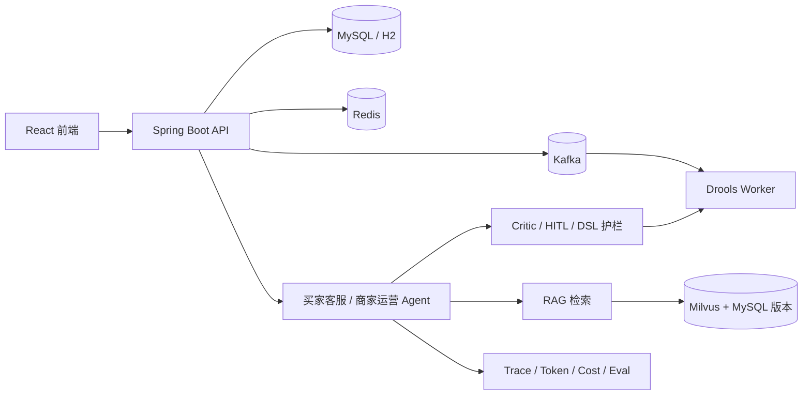

# InsightForge（智析）

面向 Agent 应用工程师 / Java 后端岗位的智能电商项目：既包含完整商城、售后与客服闭环，也包含高并发秒杀、Agent 调价、商家隔离 RAG、评测与可观测能力。

> 核心设计：LLM 只在离线控制面做规划，风险与复杂度路由器按目标动态选择最小必要 Agent；在线交易热路径由 Redis Lua、数据库约束和 Drools 确定性执行。模型可以提出策略，但不能绕过护栏直接修改价格、库存或退款状态。

## 第一次来这里，从这三份文档开始

1. [零基础搭建与验收](docs/SETUP-GUIDE.md)：从安装 Git/JDK/Node/Docker，到本地启动、登录、接口验证、完整 Docker 部署和排错。
2. [架构设计与技术选型](docs/ARCHITECTURE-DESIGN-GUIDE.md)：不讲具体代码，从业务约束出发解释为什么需要 Redis、Kafka、RAG、规则引擎，以及为什么暂不使用 GraphRAG。
3. [项目学习路线](docs/LEARNING-PATH.md)：按“先跑通、再读懂、最后能改”的顺序学习代码，每阶段都有练习和验收标准。
4. [面试题与回答](docs/INTERVIEW-QA.md)：项目介绍、Agent/RAG、高并发、工程化追问，以及不能夸大的边界。
5. [后端面试答辩手册](docs/BACKEND-INTERVIEW-DEFENSE.md)：把 Java、Spring、MySQL、Redis、Kafka、JVM 与分布式八股映射到本项目，并提供压力追问和诚实边界。
6. [可直接复制的简历项目成稿](docs/RESUME-PROJECT.md)：提供一页简历、Agent 岗、Java 后端岗和招聘平台精简版本，并标明每项数据的使用边界。
7. [风险与复杂度自适应 Agent 图](docs/ADAPTIVE-AGENT-ROUTING.md)：解释系统如何按任务动态选择角色、记录路由证据并 Fail-Safe 升级。
8. [可恢复库存预留协议](docs/RECOVERABLE-SECKILL-PROTOCOL.md)：从真实宕机窗口出发，解释原子 Reservation、ZSET 延迟补偿和数据库事务收敛。
9. [QPS 与容量设计](docs/QPS-CAPACITY-DESIGN.md)：区分入口 QPS 与落单 TPS，解释非阻塞可靠投递、消费并行和云端 A/B 方法。

已有的 40 条评测和三个完整案例在这里：

- [Agent/RAG 云端实测报告](docs/RAG-EVALUATION-REPORT.md)
- [架构图与三段核心案例](docs/AGENT-INTERVIEW-GUIDE.md)
- [历史 Phase 教程目录](specs/insightforge/tutorials/00-学习路线.md)

## 5 分钟最小启动

前置要求：JDK 21、Maven 3.9+、Node.js 20+。最小模式使用 H2 和本地 Agent 兜底，不需要 MySQL、Redis、Kafka、Milvus 或模型密钥。

```powershell
git clone https://gitee.com/paper-umbrella/insight-forge.git
cd insight-forge

cd insightforge
mvn clean package
java -jar insightforge-api/target/insightforge-api-0.1.0-SNAPSHOT.jar `
  --server.port=8090 `
  --spring.profiles.active=local
```

另开一个终端：

```powershell
cd insight-forge/insightforge-frontend
npm install
npm run dev
```

打开 `http://localhost:5173`。后端探活地址为 `http://localhost:8090/actuator/health`，预期返回 `{"status":"UP"}`。

演示账号仅用于本地种子数据：

| 角色 | 用户名 | 密码 |
| --- | --- | --- |
| 买家 | `user1` | `123456` |
| 商家 | `admin` | `admin123` |

如果命令失败，不要跳步骤，按[搭建指南的排错章节](docs/SETUP-GUIDE.md#十一常见故障)检查。

## 架构速览



## 仓库结构

```text
insight-forge/
├─ insightforge/                    Java 21 + Maven 多模块后端
│  ├─ insightforge-api/             REST、鉴权、商城、客服、可观测
│  ├─ insightforge-agent-core/      Agent 运行时、RAG、评测
│  ├─ insightforge-seckill-core/    秒杀、Lua、Kafka、幂等
│  ├─ insightforge-rule-engine/     Drools 规则执行
│  ├─ insightforge-persistence/     实体和 Mapper
│  └─ insightforge-common/          公共类型与工具
├─ insightforge-frontend/           React 18 + TypeScript + Vite
├─ deploy/                          Docker Compose、Nginx、监控、压测
├─ docs/                            当前有效的使用/评测/面试文档
└─ specs/insightforge/              详细设计和历史 Phase 教程
```

## 三条最值得讲的业务闭环

- Agent 调价：目标 → 风险/复杂度路由 → 按需角色 Agent → 独立审查 → 人工确认 → 版本化 DSL → Drools 执行 → 审计。
- 退款客服：意图识别 → 查询本人真实订单 → 生成草稿 → 用户确认 → 售后状态机 → 商家处理/申诉 → 退款。
- 可恢复秒杀：Lua 原子完成去重、扣库存、恢复载荷和超时索引 → Kafka 削峰 → DB 短事务收敛 → ZSET 到期补偿与对账。

## 评测与质量证据

- RAG 数据集：40 条，覆盖可回答、不可回答、跨商家越权和敏感请求。
- RAG 云端连续三轮：当前受控集 Recall、事实判定和拒答判定均为 `100%`，P95 为 `778/638/654ms`；这不是独立隐藏集或生产准确率。
- Agent 云端对照：50 条同集上 Single/Multi 均为 30/30 正向成功、20/20 安全拦截；P95 为 `6.887s/55.008s`，平均 token 为 `475.22/4237.02`；该历史结果用于证明简单任务不应固定执行完整多 Agent 图。
- 新增自适应角色图：Agent Core 53 项测试全通过；聚焦调价仅执行定价/风控角色，调用角色数从 4 降至 2。真实 token/延迟收益需重新跑云端 A/B 后再引用。
- 2026-08-13 最近一次云端 Maven 全量运行超过 66 分钟，未取得完整绿灯报告；只能引用已完成的专项报告，不能声称最新全套已通过。
- 2026-08-24 本地 JDK 21 全量/增量报告合计：157 tests、0 failures、0 errors、8 skipped；跳过项是需要真实 Redis 进程的条件测试，云服务器仍需在部署新版本后复跑。
- 前端质量门：`npm run typecheck` 与 `npm run build`。

## 安全与诚实边界

- `deploy/.env`、`PROJECT-HANDOVER.md` 和日志不提交 Git；仓库只保留 `.env.example`。
- 本地 `local` profile 使用 H2、本地向量或确定性模型兜底，不能宣称它等同于真实 Milvus/LLM 生产链路。
- 秒杀采用“同活动、同 SKU、同用户限一单”的业务规则；Redis 负责性能，数据库唯一约束才是最终正确性边界。
- 评测报告中的线上数字必须保留时间、数据集版本、模型和向量库信息；修改算法后重新执行，不能沿用旧数字。

## 常用质量命令

```powershell
# 后端全量测试
cd insightforge
mvn clean test

# 前端类型检查与生产构建
cd ../insightforge-frontend
npm run typecheck
npm run build

# 完整生产拓扑（先配置 deploy/.env）
cd ..
docker compose --env-file deploy/.env -f deploy/docker-compose.prod.yml up -d --build
docker compose -f deploy/docker-compose.prod.yml ps
```

部署前务必完整阅读[零基础搭建与验收](docs/SETUP-GUIDE.md)，特别是密钥、端口、资源和回滚章节。
