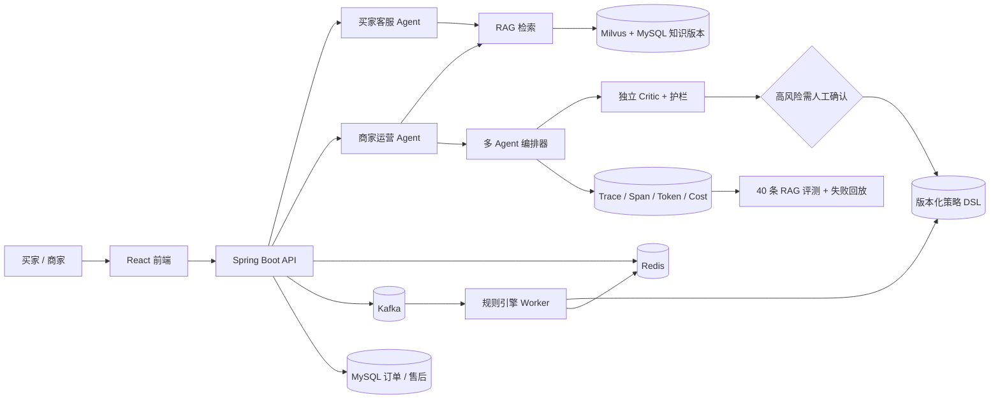

# InsightForge：Agent 应用工程师面试讲解手册

## 一句话定位

InsightForge 是一个把 LLM 放在“离线控制面”、把确定性规则留在“在线交易热路径”的智能秒杀运营系统。它不只是问答：Agent 能检索商家隔离知识、生成运营策略、经 Critic 和 HITL 审批后发布规则，并由事件驱动规则引擎执行；所有调用都有 trace、token、成本和版本证据。

## 架构图

## 案例一：Agent 调价闭环

**场景**：商家希望在库存消耗偏慢时降价冲量，但不能突破成本和毛利红线。

**链路**：经营数据和知识库进入多 Agent 规划器；角色 Agent 分析库存、价格与目标，生成策略 DSL；独立 Critic 校验成本价、毛利率、权限和工具参数。REPRICE 属于写操作，需要 HITL 确认。审批后策略版本落库，Worker 消费销售心跳并按 DSL 执行，将实时价写入 Redis；新订单读取实时价并保存成交快照，审计日志记录原因和前后值。

**面试重点**：LLM 不进入秒杀请求热路径；模型只产出受限 DSL，确定性规则负责执行；高风险动作有人审；实际成交价和审计日志证明动作不是“只生成一段文字”。

**追问准备**：若模型超时则保持旧策略；若输出非法则 Critic 拒绝并正确失败；若 Redis 失效则订单仍读取数据库基准价，系统 fail-safe。

## 案例二：退款客服闭环

**场景**：买家向专属客服说“我要退款”，Agent 不能编造订单，也不能替用户静默提交。

**链路**：系统先做意图识别，再只查询 JWT 对应用户真实的 PAY/SHIPPED/DONE 订单；已有售后单会去重。Agent 返回包含订单号、金额、原因的退款草稿，前端二次确认后调用真实售后接口。状态机按 APPLIED → APPROVED → REFUNDING → REFUNDED 流转；驳回可 APPEAL，商家复核；买家和商家页面共享同一工单真相源。

**面试重点**：这是“Agent 建议 + 用户确认 + 事务 API”的可控工具调用模式；RAG 只解释平台政策，订单金额来自结构化数据库；商家知识强隔离，没知识时转人工而不是幻觉。

**追问准备**：重复提交由业务唯一性校验拦截；越权订单按 userId 校验；Agent 不直接执行退款，符合最小权限和 Human-in-the-loop。

## 案例三：高并发秒杀幂等

**场景**：同一用户重复点击、多次网络重试以及 Kafka 重投，都不能多扣库存或创建多单。

**链路**：同一 `(activityId, activitySkuId, userId)` 确定性生成订单号；Redis SETNX 是第一道幂等闸门，Lua 原子检查并扣减库存；成功后 Kafka 异步建单，生产者开启幂等；消费者用数据库唯一键最终兜底。Redis/Kafka 异常时降级到数据库事务：先插唯一订单，再做带库存条件的原子 UPDATE，失败回滚。取消订单按状态机幂等回补。

**面试重点**：Redis 保性能、数据库唯一约束保最终正确；业务上明确为同活动同 SKU 每人限一单，前端读取订单后禁用重复购买；自动化并发测试证明库存不为负和支付令牌只能消费一次。

**追问准备**：说明为什么仅 SETNX 不够、为什么订单号不能随机、Kafka exactly-once 不能代替数据库约束，以及缓存库存与数据库最终一致的对账/补偿策略。

## 评测口径

- `Recall@4`：可回答样本的期望文档是否出现在前四个检索结果。
- `答案正确率`：命中期望文档且上下文覆盖所有关键事实；这是无 LLM 漂移的确定性离线判分。
- `拒答准确率`：不可回答/越权问题没有检索到可支撑知识。
- `P95 延迟`：40 条评测中 RAG 检索耗时的第 95 百分位。
- Prompt 版本保存完整内容和 SHA-256；知识文档每次正文变化保存不可变快照；trace 记录实际 prompt/model 版本、token 和成本。

## 简历表达（可直接精简使用）

设计并实现智能秒杀运营平台 InsightForge：自研多 Agent 编排、Critic 护栏及 HITL 审批，基于 Milvus/MySQL 构建商家隔离 RAG；将 LLM 隔离在离线控制面，通过版本化 DSL 驱动 Kafka 规则引擎。建设 40 条 Agent/RAG 评测集与失败样本回放，量化 Recall@4、答案/拒答准确率和 P95，并实现 Prompt/KB 版本、Trace/Span、token 与成本观测。秒杀链路采用 Redis Lua + Kafka + DB 唯一约束，实现防超卖和全链路幂等。
