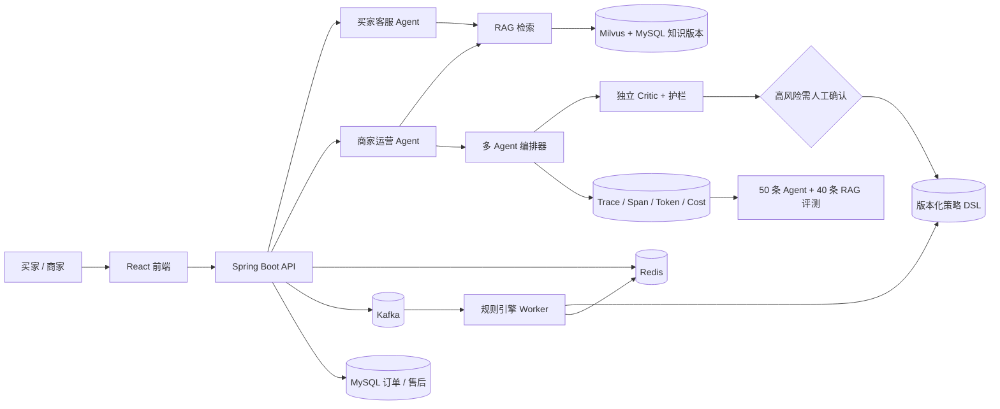

# InsightForge：Agent 应用工程师面试讲解手册

## 一句话定位

InsightForge 是一个把 LLM 放在“离线控制面”、把确定性规则留在“在线交易热路径”的智能秒杀运营系统。它不固定堆叠 Agent，而是先根据任务风险与复杂度选择最小必要角色；模糊或高风险目标自动升级完整协作图，路由原因、角色、token、成本和版本均可追踪。

## 架构图

## 案例一：Agent 调价闭环

**场景**：商家希望在库存消耗偏慢时降价冲量，但不能突破成本和毛利红线。

**链路**：路由器先判断目标涉及价格与风险，只调用定价和风控角色；活动级控盘才扩展为选品、定价、库存、风控四角色并行。角色结果汇编为策略 DSL，独立审查校验成本、权限和参数，高风险调价需人工确认。审批后 Worker 按 DSL 执行并记录成交快照与审计。

**面试重点**：LLM 不进入秒杀请求热路径；模型只产出受限 DSL，确定性规则负责执行；高风险动作有人审；实际成交价和审计日志证明动作不是“只生成一段文字”。

**追问准备**：若模型超时则保持旧策略；若输出非法则 Critic 拒绝并正确失败；若 Redis 失效则订单仍读取数据库基准价，系统 fail-safe。

## 案例二：退款客服闭环

**场景**：买家向专属客服说“我要退款”，Agent 不能编造订单，也不能替用户静默提交。

**链路**：系统先做意图识别，再只查询 JWT 对应用户真实的 PAY/SHIPPED/DONE 订单；已有售后单会去重。Agent 返回包含订单号、金额、原因的退款草稿，前端二次确认后调用真实售后接口。状态机按 APPLIED → APPROVED → REFUNDING → REFUNDED 流转；驳回可 APPEAL，商家复核；买家和商家页面共享同一工单真相源。

**面试重点**：这是“Agent 建议 + 用户确认 + 事务 API”的可控工具调用模式；RAG 只解释平台政策，订单金额来自结构化数据库；商家知识强隔离，没知识时转人工而不是幻觉。

**追问准备**：重复提交由业务唯一性校验拦截；越权订单按 userId 校验；Agent 不直接执行退款，符合最小权限和 Human-in-the-loop。

## 案例三：高并发秒杀幂等

**场景**：同一用户重复点击、多次网络重试以及 Kafka 重投，都不能多扣库存或创建多单。

**链路**：同一 `(activityId, activitySkuId, userId)` 确定性生成订单号；Redis SETNX 是第一道幂等闸门，Lua 原子检查并扣减库存；成功后 Kafka 异步建单，生产者开启幂等；消费者用数据库唯一键最终兜底。Redis/Kafka 异常时降级到数据库事务：先插唯一订单，再做带库存条件的原子 UPDATE，失败回滚。取消订单按状态机幂等回补。

**面试重点**：Redis 保性能、数据库唯一约束保最终正确；业务上明确为同活动同 SKU 每人限一单，前端读取订单后禁用重复购买；自动化并发测试证明库存不为负和支付令牌只能消费一次。

**追问准备**：说明为什么仅 SETNX 不够、为什么订单号不能随机、Kafka exactly-once 不能代替数据库约束，以及缓存库存与数据库最终一致的对账/补偿策略。

## 评测口径

- `Recall@4`：可回答样本的期望文档是否出现在前四个检索结果。
- `答案正确率`：命中期望文档且上下文覆盖所有关键事实；这是无 LLM 漂移的确定性离线判分。
- `拒答准确率`：不可回答/越权问题没有检索到可支撑知识。
- `P95 延迟`：分别统计 RAG 检索和 Agent 端到端耗时，不能用检索延迟代替完整任务延迟。
- Prompt 版本保存完整内容和 SHA-256；知识文档每次正文变化保存不可变快照；trace 记录实际 prompt/model 版本、token 和成本。

云端 50 条 Agent 集的当前证据：Single-Agent 与 Multi-Agent 均为 30/30 正向成功、20/20 安全拦截；Single P95 6.887 秒、平均 475.22 token，Multi P95 55.008 秒、平均 4237.02 token。因此当前默认应使用 Single-Agent/确定性工作流，只有复杂规划才路由 Multi-Agent。20 条对抗样本仍属于同一种非法低价 DSL 的表达变体，不能包装成覆盖 20 类安全风险。

基于该结论，项目已实现自适应角色图：聚焦调价从四角色缩减为定价+风控两个角色，模糊/跨域任务 Fail-Safe 升级完整图，安全回放强制完整图；Agent Core 53 项测试通过。角色调用减少 50% 是结构性结果，真实 token 与延迟需云端重测后再更新。

## 简历表达（可直接精简使用）

设计并实现智能秒杀运营平台 InsightForge：实现风险与复杂度自适应 Agent 图，根据目标动态选择选品、定价、库存和风控角色，模糊/高风险任务自动升级完整协作并将路由证据写入 Trace；聚焦调价的角色调用数由 4 降至 2。结合商家隔离 RAG、版本化 DSL、独立审查和人工确认，将 LLM 与交易热路径隔离；秒杀链路使用 Redis Lua、Kafka 与数据库约束保证防超卖和幂等。

Java/Spring/MySQL/Redis/Kafka/JVM 的项目化追问见 [后端面试答辩手册](BACKEND-INTERVIEW-DEFENSE.md)。
