# InsightForge 架构设计与技术选型：从业务问题到系统方案

这是一份“不从代码出发”的面试级学习文档。它不回答某个类怎么写，而是回答：如果我们面对相同业务，如何从一张白纸推导出现在的架构；每个组件解决什么矛盾；不用它会怎样；什么时候应该换成别的方案。

阅读每项技术时都按同一思路理解：

1. 它的基础原理是什么。
2. 面试中通常会追问哪些机制。
3. 项目遇到了什么业务矛盾。
4. 为什么选择它而不是替代方案。
5. 项目具体如何使用并做了哪些优化。
6. 当前方案还有哪些边界，下一步如何演进。

本文既包含通用知识，也包含 InsightForge 的项目答案。通用知识用于回答“你是否理解中间件”，项目答案用于证明“你不是背诵概念”。

## 阅读导航

- 业务与架构推导：第一～五章。
- MySQL、Redis、Kafka与分布式一致性：第六～九章。
- LLM、Agent、RAG、GraphRAG与Milvus：第十～十五章。
- Java/Spring、安全、可观测、Docker：第十六章。
- 容量、故障和从零建设：第十七～十九章。
- 自测、连续拷问和回答模板：第二十～二十三章。
- 完整质量证据、测试结果和待测项：第二十四章。

第一次建议顺序阅读；面试前按技术专题复习“基础 → 项目优化 → 连续追问”。

## 一、先定义问题，而不是先选技术

InsightForge 同时包含三类业务：

1. 普通电商：商品、购物车、订单、支付、物流、评价和售后。
2. 高并发秒杀：大量用户在短时间争抢少量库存。
3. Agent 应用：买家客服、商家运营、知识检索、调价建议和执行闭环。

这三类业务对系统的要求并不相同：

| 业务 | 首要目标 | 可接受延迟 | 最怕什么 |
| --- | --- | --- | --- |
| 普通订单/售后 | 事务正确、状态可追溯 | 数十到数百毫秒 | 错单、越权、重复退款 |
| 秒杀 | 极高并发下不超卖、快速失败 | 毫秒级 | 库存为负、重复订单、数据库被打垮 |
| RAG 客服 | 有证据、隔离、正确拒答 | 数百毫秒到数秒 | 幻觉、泄露其他商家知识、编造订单 |
| Agent 运营 | 策略合理、可审计、可回滚 | 秒级甚至异步 | 模型直接改价格/库存、错误策略失控 |

因此，不能拿一个组件解决所有问题。数据库擅长事务，不擅长承受瞬时热点；Redis 擅长内存原子操作，但不应独自承担永久订单真相；LLM 擅长理解非结构化意图，却不适合做库存扣减。

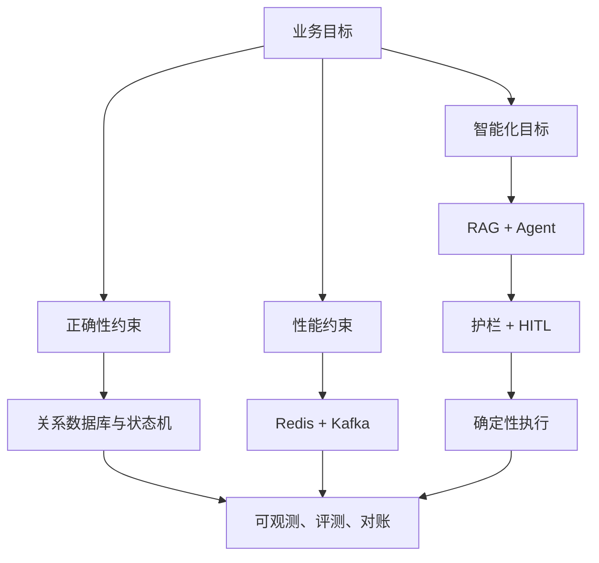

这张图表达最重要的方法：先写约束，再选能够满足约束的最小技术组合。

## 二、从零开始时，先写四条业务不变量

“不变量”是无论并发、重试还是组件故障都不应该被破坏的事实。本项目最重要的四条是：

1. 库存不能小于零。
2. 同一活动、同一 SKU、同一用户最多形成一张秒杀订单。
3. 用户只能操作自己的订单，商家只能访问自己的商品、知识和工单。
4. 模型不能未经确认直接完成退款、调价等高风险动作。

这四条比“用了 Redis/Kafka/Agent”更重要。技术方案改变时，不变量仍然有效。

### 为什么先定义同用户限一单？

因为幂等必须知道“哪两次请求是同一件事”。本项目把 `(activityId, skuId, userId)` 定义为业务唯一键，所以重复点击、网络重试和同一用户再次购买都指向同一订单。这是秒杀常见限购规则，不是 Redis 带来的限制。

如果业务允许每人三单，就应该把规则改成配额计数或购买序号，而不是简单把随机数加进订单号。前端禁用按钮只改善体验，真正约束必须在服务端。

## 三、第一版系统应该是什么样

如果刚开始只有几十个用户，不应该第一天就部署 Kafka、Milvus 和多个 Worker。第一版可以是：

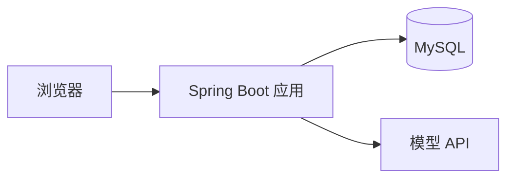

它足以验证：商品能否下单、售后状态是否合理、客服能否识别意图、商家是否需要调价建议。

然后根据真实矛盾逐步演进：

| 阶段 | 出现的矛盾 | 增加的设计 |
| --- | --- | --- |
| 1. 业务闭环 | 订单、售后必须可靠 | MySQL、事务、状态机、唯一约束 |
| 2. 热点读增多 | 商品详情反复查库 | Caffeine + Redis 缓存 |
| 3. 秒杀并发 | 单一热点库存压垮数据库 | Redis Lua 原子预扣、入口限流 |
| 4. 建单峰值 | 瞬时数据库写入过高 | Kafka 削峰、幂等消费者 |
| 5. 智能运营 | 人工难以分析大量经营信息 | RAG、Agent 离线规划 |
| 6. 模型风险 | 幻觉和不确定输出可能改变交易 | DSL、Critic、HITL、Drools |
| 7. 线上定位 | 不知道某次错误用了什么上下文 | Trace、版本、评测、失败回放 |

这也是正确的架构学习顺序：每增加一个组件，都能说出它消除的具体瓶颈和增加的新成本。

## 四、整体架构为什么这样划分

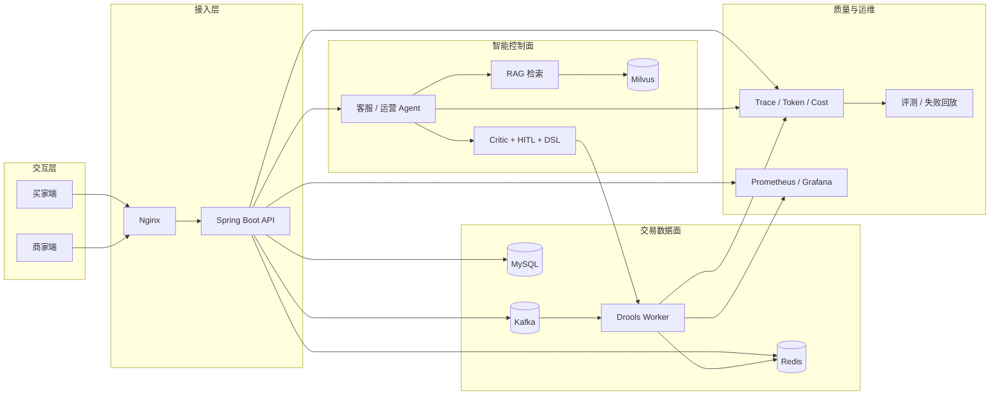

这里有两个关键边界：

- 交易数据面负责“现在必须准确完成”的动作，例如扣库存、建订单、改变售后状态。
- 智能控制面负责“可以慢一点思考”的事情，例如理解客服意图、检索政策、生成调价策略。

二者不是彻底分离。Agent 的策略最终必须通过受控接口进入数据面；数据面的订单和销量也会成为 Agent 的事实输入。分离的是执行责任和风险等级，而不是把 AI 做成一个孤岛。

## 五、为什么选择模块化单体，而不是一开始微服务

项目在代码组织上是 Maven 多模块，在部署上把 API 和规则 Worker 分成独立进程。这是一种“模块化单体 + 必要进程隔离”的折中。

选择它的原因：

- 当前团队和流量规模不需要为每个业务单独部署服务。
- 商品、订单、售后之间有大量事务关系，共享关系库更简单。
- 模块边界让 Agent、秒杀、规则引擎仍可独立测试和演进。
- 规则 Worker 单独部署，是因为它消费事件且可能占用额外 CPU，隔离有实际收益。

为什么不直接微服务：

- 会立即引入服务发现、网关、配置中心、分布式追踪、跨服务事务和更多部署单元。
- 对小团队而言，运维复杂度可能大于业务收益。
- “微服务”不会自动带来高并发；热点库存最终仍要面对一致性问题。

何时应该拆：某个模块需要独立扩容、发布频率完全不同、故障隔离有明确价值，或团队边界已经稳定。秒杀订单消费者和 Agent Worker 都是未来可自然拆出的边界。

## 六、为什么以 MySQL 为业务真相源

订单、支付、售后和库存都具有明确关系、约束和状态迁移。MySQL 提供事务、唯一约束、条件更新、索引和成熟运维生态，适合保存不能丢失的业务事实。

MySQL 在项目里的责任：

- 用户、商品、活动、订单、售后、物流和评价的永久记录。
- `order_id` 等唯一约束，作为重复消息和重复请求的最终防线。
- `UPDATE ... WHERE stock >= qty`，保证数据库库存不为负。
- Prompt/知识版本、Agent trace 和审计记录。

为什么不只用 Redis：Redis 的速度很高，但缓存淘汰、误删、故障切换和内存成本都使它不适合作为订单唯一永久真相。即使启用 AOF，也不能替代关系约束、复杂查询和事务状态机。

为什么不选 MongoDB：业务核心不是无模式文档，而是强关系和状态约束。MongoDB 可以存聊天消息，但为少量灵活字段引入第二套主数据库并不划算。

为什么不是 PostgreSQL：PostgreSQL 同样可以胜任，甚至可以通过 pgvector 简化向量层。项目选择 MySQL主要考虑 Java 电商生态、招聘面试认知和已有中间件组合，不代表技术上 PostgreSQL 较差。若重新做一个资源受限的小规模版本，PostgreSQL + pgvector 是很合理的替代方案。

### MySQL 面试基础：事务与隔离级别

事务的 ACID：

- Atomicity 原子性：事务内操作要么都成功，要么都回滚，主要依靠 undo log。
- Consistency 一致性：执行前后满足业务约束，它不是数据库单独保证的，还依赖应用状态机、唯一约束和正确事务。
- Isolation 隔离性：并发事务互相影响受控，依靠锁与 MVCC。
- Durability 持久性：提交结果在故障后可恢复，主要依靠 redo log 和刷盘策略。

四种常见隔离级别：

| 隔离级别 | 可避免 | 仍可能发生 |
| --- | --- | --- |
| Read Uncommitted | 无 | 脏读、不可重复读、幻读 |
| Read Committed | 脏读 | 不可重复读、幻读 |
| Repeatable Read | 脏读、普通快照读不可重复 | 特定当前读/写场景仍需锁处理 |
| Serializable | 前述并发异常 | 并发能力明显下降 |

MySQL InnoDB 默认通常是 Repeatable Read。MVCC 通过隐藏事务字段、undo 版本链和 ReadView，让普通快照读不必互相阻塞；`SELECT ... FOR UPDATE`、UPDATE/DELETE 属于当前读，会读取最新可见记录并加锁。

项目映射：订单创建和库存条件更新必须在同一事务内；但 Redis/Kafka 网络调用不应包在长数据库事务里，否则连接和锁会被长时间占用。异步路径依靠业务幂等与补偿跨越多个资源，不是假装存在一个覆盖 Redis、Kafka、MySQL 的本地事务。

### MySQL 面试基础：索引为什么通常是 B+Tree

B+Tree 具有高扇出、树高低、叶子节点有序等特点，适合磁盘页和范围查询。非叶子节点主要保存键和指针，一页能容纳更多分支；真实记录集中在叶子节点，叶子链表适合范围扫描。

InnoDB 主键索引叶子保存整行，称为聚簇索引；普通二级索引叶子通常保存索引列和主键。通过二级索引查询其他列时，可能需要再访问主键索引，称为回表。查询所需字段全部在索引中时是覆盖索引，可以减少回表。

联合索引应理解最左前缀原则：索引按列顺序排序，能否有效使用后续列取决于前面列的查询形式。不是所有包含索引列的查询都会高效，仍需用执行计划和真实数据分布验证。

项目中的索引逻辑：

- 用户订单按 `user_id` 查询。
- 活动 SKU 按活动查询。
- Agent trace 按活动定位。
- `order_id` 唯一索引既加速查询，也是幂等正确性约束。

索引不是越多越好：每个索引都会增加写放大、磁盘空间和维护成本。秒杀建单是写密集路径，应保留服务于唯一约束和高频查询的必要索引，而不是给每列都建索引。

### MySQL 面试基础：行锁、间隙锁与条件更新

InnoDB 的锁通常加在索引记录上。按主键/唯一索引精确更新更容易锁定少量记录；没有合适索引的条件可能扫描并锁更多范围。Repeatable Read 当前读还可能使用 next-key lock（记录锁 + 间隙锁）防止范围内插入造成幻读。

项目不用“先 SELECT 库存，再 UPDATE”是因为两个事务可能同时看到库存充足。采用：

```sql
UPDATE activity_sku
SET stock = stock - :qty
WHERE id = :id AND stock >= :qty;
```

判断和扣减在一条 SQL 内完成，受影响行数为 1 才成功。它利用数据库原子更新保证库存不会变成负数。这里不需要先加应用层锁，也不依赖 Java `synchronized`；后者无法覆盖多个实例。

### MySQL 在本项目中的优化与不足

已做：

- Flyway 管理 schema，避免环境手工漂移。
- 唯一约束承担最终业务幂等，而不只依赖缓存。
- 条件更新防负库存。
- 高频查询有针对性索引。
- 异步建单把峰值从请求线程移到消费者。
- H2 仅用于零依赖学习，生产语义必须用 MySQL 再验证。

仍需加强：

- 更完整的慢查询基线和 `EXPLAIN ANALYZE` 证据。
- 订单量增长后的归档、分区或分库分表策略。
- Redis/Kafka/MySQL 跨资源的一致性可进一步使用 outbox/CDC。
- 数据库主从、备份恢复、RPO/RTO 和故障切换演练尚不是当前单机演示的能力。

### MySQL 连续追问速答

**为什么唯一索引既是性能设计又是正确性设计？**

它加速按业务键查找，同时让两个并发事务不可能都插入相同业务实体。缓存去重失效时，它仍是最终防线。

**乐观锁和 `stock >= qty` 条件更新有什么差别？**

版本号乐观锁检测记录是否被修改，失败后通常重试；库存条件更新直接表达业务不变量。秒杀只关心“当前库存是否足够”，无需因为其他字段变化一律失败。两者可以组合，但不是越多越好。

**为什么不把隔离级别调成 Serializable 保证一切？**

它会显著增加阻塞，且无法自动解决跨 Redis/Kafka 的一致性。正确方式是用最小事务、条件更新、唯一约束和业务幂等精准保护不变量。

**发生死锁怎么办？**

统一加锁顺序、缩短事务、使用合适索引减少锁范围；数据库检测死锁后回滚一个事务，应用对可重试事务做有上限且带退避的重试，同时记录死锁日志定位根因。

## 七、Redis 为什么存在，它到底做了什么

Redis 不是“项目必须有的高并发装饰”。它解决的是：大量请求对少数热点 key 做极短、原子、共享的读写，而数据库不适合承受这种瞬时竞争。

### 1. 秒杀库存的内存原子操作

库存先预热到 Redis。一次 Lua 脚本在 Redis 端完成读取、校验和扣减，执行期间不会被其他命令插入，因此避免客户端“先查还有库存，再扣减”之间的竞态。

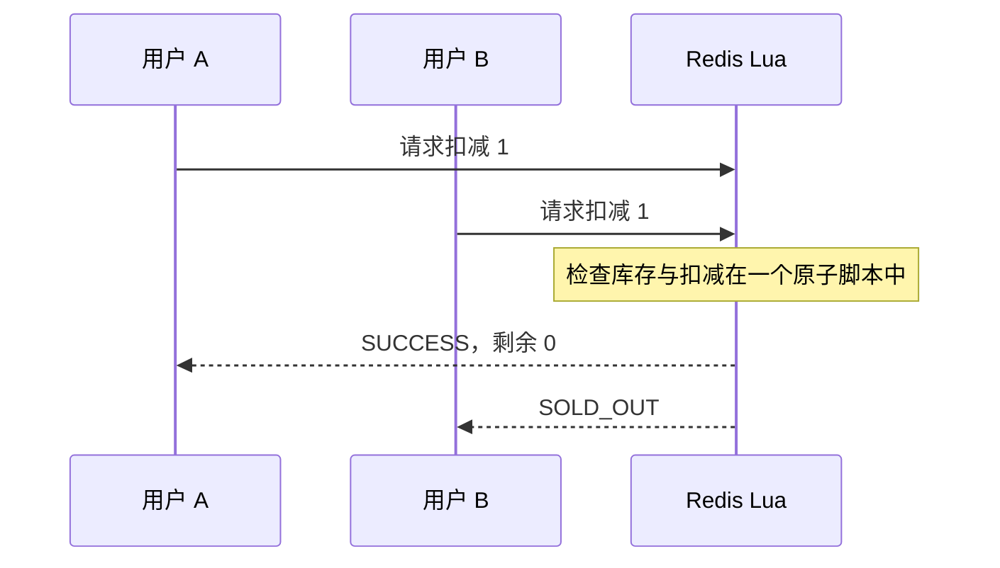

如果没有 Lua，而是 `GET stock` 后再 `DECR`，两个用户可能同时看到库存为 1并都成功。也可以用数据库条件更新保证正确，但所有流量直接压到同一数据库行，吞吐和连接资源更差。

### 2. 幂等闸门

Redis `SETNX` 用确定性订单号快速判断同一业务是否已受理，避免重复请求再次扣减。它是性能防线，不是最终正确性防线；Redis key 丢失后，MySQL 唯一约束仍要挡住重复订单。

### 3. 分布式限流

按“用户 + 活动”维护滑动时间窗口，所有 API 实例共享计数。只在 JVM 内限流时，每台机器各自计算，扩到三台后实际总额度可能变成三倍。

### 4. 多级缓存的 L2

商品/SKU 等高频读先查进程内 Caffeine，未命中再查 Redis，最后才访问数据库：

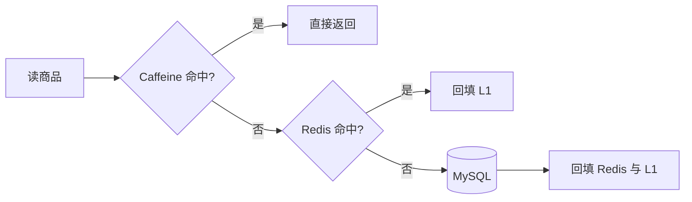

Caffeine 更快但只在单进程；Redis 稍慢但多实例共享。空值哨兵防缓存穿透，TTL 抖动防大量 key 同时过期，单飞防一个热点 key 失效时所有线程一起打数据库。

### 5. 实时价格与库存视图

规则引擎的调价写入实时价格 key，新订单读取该值并保存成交快照；调拨写回与用户秒杀相同的库存 key。这样 Agent 的策略不是一段展示文本，而是真的影响后续交易。

### 6. 分布式协调

规则侧通过 Redisson 锁把同一活动/SKU 的控制面写操作串行化。需要精确说明：用户秒杀热路径靠 Lua 原子性，不持有这把显式锁；规则侧写库存时使用锁。二者共享的是同一份库存 key，而不是所有操作都用同一把锁。

### Redis 不负责什么

- 不负责永久保存订单真相。
- 不单独证明全链路 exactly-once。
- 不替代数据库事务和唯一约束。
- 不应该成为所有业务对象的默认存储。

### Redis 故障怎么办

普通读取可回源数据库；本地模式可退化到 Caffeine；秒杀路径可以降级到数据库条件更新，但必须限流，吞吐会降低。真正生产系统还应明确 Redis Cluster/Sentinel、超时、熔断、库存重建和故障期间是否直接关闭秒杀。项目演示部署是单 Redis 容器，不应宣称具备集群高可用。

### Redis 面试基础：为什么快

“Redis 快因为单线程”是不完整的。主要原因共同作用：

- 数据主要在内存，避免常规磁盘随机访问。
- 核心数据结构经过优化，常见操作复杂度低。
- 命令执行路径短，避免复杂 SQL 解析、执行计划和事务机制。
- 事件循环配合 I/O 多路复用，一个线程可管理大量连接就绪事件。
- 核心命令串行执行，减少共享数据加锁和线程切换成本。

Redis 6 以后可以用 I/O 线程处理部分网络读写，但命令执行的原子语义仍主要来自串行执行模型。单线程也意味着一个慢命令、大 key 删除或复杂 Lua 会阻塞其他请求，所以 Lua 必须短小、确定且有复杂度边界。

### Redis 面试基础：常见数据结构与项目映射

| 类型 | 典型能力 | 常见场景 | 本项目是否核心使用 |
| --- | --- | --- | --- |
| String | 字符串/整数、INCR、SET NX | 库存、计数、锁值、缓存 | 是：库存、价格、幂等 key |
| Hash | 一个 key 下多个 field | 对象属性、购物车 | 当前核心库存未用，避免大 hash 热点 |
| List | 双端队列、阻塞弹出 | 简单队列 | 否，可靠事件流使用 Kafka |
| Set | 无序去重、交并差 | 标签、共同关注 | 非核心 |
| ZSet | member + score 有序 | 排行榜、延迟队列、滑动窗口 | 限流 Lua 常见实现基础 |
| Bitmap | 位级状态 | 签到、布尔人群 | 非核心 |
| HyperLogLog | 基数近似统计 | UV | 非核心 |
| Stream | 持久消息流和消费组 | 轻量消息队列 | 未选，用 Kafka 隔离消息职责 |

选择数据结构要从访问模式出发。秒杀库存只需要原子整数，因此 String 最简单。把所有库存塞进一个巨大 Hash 会让单 key 更热、迁移和操作粒度更差；按活动/SKU 分 key 便于独立预热、扣减和定位。

### Redis 面试基础：过期、淘汰和内存

过期与淘汰不是同一件事：

- 过期是 key 到达 TTL 后逻辑失效。Redis 通常结合惰性删除与定期抽样删除。
- 淘汰是在达到 `maxmemory` 时，根据策略主动删除数据，例如 noeviction、allkeys-lru、volatile-lru、allkeys-lfu 等。

秒杀库存不能依赖“被淘汰后自动从数据库随便回填”，因为库存 key 是 LIVE 期间的并发协调状态。生产应给关键库存独立容量预算，采用避免误淘汰的策略并监控内存；普通商品缓存可以被淘汰并回源。

大 key 会导致网络传输、删除和主从同步压力；热 key 会把流量集中到一个 Redis 节点。秒杀 SKU 天然可能成为热 key，项目利用 Redis 单 key 原子性保证正确，但大规模下仍要做容量评估、热点活动隔离、入口削峰，必要时采用库存分段。不能为分散热点简单把同一库存随机拆开，否则总量一致性和回补会更难。

### Redis 面试基础：RDB、AOF、复制、Sentinel 与 Cluster

| 机制 | 解决什么 | 关键取舍 |
| --- | --- | --- |
| RDB | 定期生成内存快照 | 恢复快、文件紧凑；快照间数据可能丢失 |
| AOF | 记录写命令 | 数据更完整；文件和重写成本更高 |
| 主从复制 | 读扩展和副本 | 默认异步复制，主故障仍可能丢最近写入 |
| Sentinel | 监控与自动主从切换 | 提升可用性，不负责数据分片 |
| Cluster | 16384 slot 分片与故障转移 | 可水平扩展，跨 slot 多 key 操作受限制 |

RDB 和 AOF 可以组合，但持久化并不会把 Redis 变成强一致关系库。Redis 主从切换可能丢最近数据，所以订单唯一约束和对账仍然必要。

如果进入 Redis Cluster，多 key Lua 要求相关 key 位于同一 slot。可用 hash tag，例如 `stock:{activityId:skuId}`，让一次脚本涉及的库存、幂等或 pending key落在相同 slot。当前项目 Lua 主要操作单库存 key，尚未完整展示 Cluster hash tag 设计，这是扩展到集群前必须补的工作。

### Redis 面试基础：缓存一致性

常见 Cache Aside：读时缓存未命中查 DB 并回填；写时先更新 DB，再删除缓存。选择删除而不是直接更新，是因为并发写/读时直接更新多个缓存层更容易产生旧值覆盖新值。

即使“先更新 DB，再删缓存”，删除失败仍可能保留旧值。常见加强手段：

- 短 TTL 限制脏数据寿命。
- 删除失败重试。
- 延迟双删解决特定并发窗口，但不是万能方案。
- 通过 binlog/CDC 异步失效缓存。
- 对极高一致性读取直接查数据库或使用版本号。

本项目的商品/SKU缓存采用数据变更后主动清 L1/L2，加 TTL 兜底；这是最终一致缓存。成交订单必须保存价格快照，不能在历史订单展示时再读可能变化的 Redis 实时价。

### Redis 面试基础：分布式锁与 Redisson

最基础的 Redis 锁应使用带唯一值和过期时间的原子 `SET key value NX PX ttl`；释放时用 Lua 比对唯一值后删除，避免客户端 A 超时后误删客户端 B 新获得的锁。

Redisson 提供可重入锁、自动续期 watchdog 等能力，减少手写错误。但分布式锁仍不是绝对安全魔法：进程长暂停、网络分区、主从切换和外部系统写入都可能破坏假设。高风险资源可使用 fencing token，让存储层拒绝旧持有者的迟到写入。

项目中规则侧使用 `tryLock(0)` Fail-Fast：拿不到锁立即放弃本轮，避免 Agent 控盘阻塞用户交易。用户扣库存不走 Redisson锁，而走 Lua。这比“所有请求排队抢锁”更符合热路径延迟目标。

一个需要诚实指出的细节：当前 `tryLock(0, TimeUnit.MILLISECONDS)` 使用 Redisson watchdog 语义，而不是显式固定 leaseTime。规则动作必须保证 finally 解锁并保持执行很短。若将来动作包含远程调用，应把远程调用移出锁内，并增加 fencing/version 条件。

### Redis 项目 key 设计

| 业务 | Key 形态 | Value/操作 | 设计目的 |
| --- | --- | --- | --- |
| 剩余库存 | `stock:a:{aid}:s:{sid}` | 整数，Lua/INCRBY | 热路径原子扣减与调拨共享事实 |
| 总库存 | `total_stock:a:{aid}:s:{sid}` | 整数 | 计算库存水位，不随销售扣减 |
| 实时价 | `price:a:{aid}:s:{sid}` | Decimal 字符串 | 新订单读取调价结果 |
| 待确认库存 | `pending_stock:a:{aid}:s:{sid}` | 整数 | 两阶段调拨/补偿边界 |
| 幂等 | `order:idemp:{orderId}` | 事件载荷 + TTL | 快速去重并为补偿保留信息 |
| 限流 | `rate:limit:{user:activity}` | 窗口时间戳 | 多实例共享流量配额 |
| 规则版本 | `guardrail:dsl:{aid}` | DSL/版本 | 在线读取已发布策略 |

key 集中命名能避免 API 与 Worker 各写一套“看似相同”的库存。动态 key 要有 TTL/清理策略；库存和实时价在活动关闭后应归档或删除，否则长期积累形成内存泄漏式增长。

### Redis 在本项目已做的优化

- Lua 把“检查 + 扣减”合为原子操作，避免竞态和显式锁。
- SETNX 作为第一层幂等，DB 唯一约束最终兜底。
- Caffeine L1 + Redis L2减少网络和数据库读取。
- Caffeine 单飞防热点击穿。
- NULL 哨兵防缓存穿透。
- TTL 随机抖动防集中过期雪崩。
- 数据变更主动清 L1/L2。
- 滑动窗口按用户与活动限流，而不是只有全局 QPS。
- 规则侧锁 0ms 等待，用户流量优先。
- 库存、总库存、价格和规则 key 在 API/Worker 间保持同一契约。
- Redis/Kafka不可用时保留 DB 同步兜底路径，便于正确性优先降级。

### Redis 当前不足与进一步优化

- 单容器无 Sentinel/Cluster，不具备生产高可用。
- 缺 hot key、big key、命中率、内存碎片和慢日志的完整监控看板。
- Cluster hash tag 与多 key Lua 兼容尚未验证。
- key 生命周期和活动结束清理任务需要更系统化。
- 锁没有 fencing token，控制面写仍可增加版本条件。
- 数据库更新与缓存删除失败之间可用重试/CDC强化。
- 秒杀热点极大时可研究分段库存，但必须保留总量不变量和对账，不能只为分散 key 牺牲正确性。

### Redis 连续追问速答

**Redis 单线程为什么还能高并发？**

内存操作快，事件循环与 I/O 多路复用管理大量连接，命令执行短且避免锁竞争；但慢命令仍会阻塞整个执行线程。

**Lua 会不会阻塞 Redis？**

会。原子性意味着脚本执行期间其他命令不能插入，所以脚本必须短、禁止大循环和不可控扫描。本项目脚本只处理固定数量 key 和简单数值判断。

**为什么 SETNX 不能保证订单 exactly-once？**

key 可能过期、被淘汰或在故障切换中丢失；数据库唯一约束才是永久业务事实的最终防线。严格说系统通过幂等实现“副作用效果一次”，不是端到端绝对 exactly-once。

**缓存穿透、击穿、雪崩分别是什么？**

穿透是查询不存在数据反复到 DB；击穿是单个热点过期时并发回源；雪崩是大量 key 同时失效。项目分别用空值哨兵、单飞、TTL 抖动处理。

**为什么库存 key 不设置普通短 TTL？**

LIVE 活动库存是协调状态，意外过期会导致无法判断真实剩余量。它应跟随活动生命周期显式预热和清理，并监控存在性，而不是像普通商品缓存一样随意过期回填。

**Redis 和数据库库存不一致怎么办？**

先定义阶段真相：LIVE 热路径 Redis承载快速剩余量，DB保存永久业务记录；通过异步落库、取消补偿和对账比较初始库存、订单销量、Redis/DB剩余。差异进入补偿或人工处置，不能盲目双写覆盖。

**Redlock 是否能解决所有锁问题？**

不能。它有部署和时钟/网络假设争议，且锁本身不能替代存储层业务条件。项目关键库存正确性靠 Lua/DB 条件更新，Redisson锁只协调规则侧写操作。

## 八、为什么选择 Kafka，而不是所有动作同步完成

Redis 扣减很快，但建订单会涉及数据库事务。如果每个抢购请求都同步写数据库，峰值仍会压垮连接池。Kafka 把瞬时峰值变成可控的消费速度。

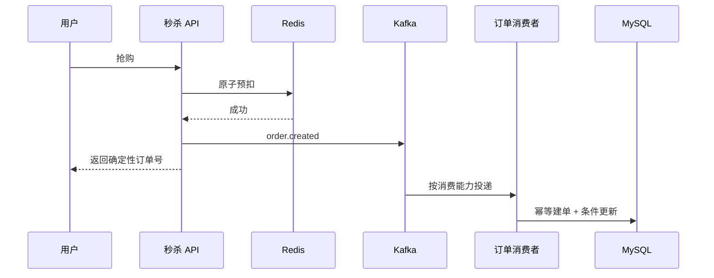

Kafka 在项目中承担两类事件：

- `order.created`：异步建单，削平数据库写入峰值。
- `sales.tick`：把销量变化传给规则 Worker，驱动确定性调价/调拨判断。

为什么选择 Kafka：高吞吐、分区有序、消费者组和事件回放适合销量流与订单事件，也符合后续数据分析扩展。

为什么不是 RabbitMQ：RabbitMQ 在复杂路由、任务队列和低延迟确认方面很好。如果项目只是异步发一封通知，RabbitMQ 可能更简单；但销售事件流、回放和高吞吐更符合 Kafka。选择不是“谁更高级”，而是消息模型不同。

为什么不使用 Redis Stream：它可以减少组件数量，适合较小规模；但把热点库存、缓存、限流和消息积压都放在一个 Redis 上会扩大故障影响面，而且 Kafka 的消费生态更成熟。资源极小的部署可以考虑 Redis Stream，代价是架构隔离和扩展能力下降。

Kafka 也带来新问题：消息可能重复、积压或发送后消费者失败。所以消费者必须幂等，数据库要有唯一约束，还需要补偿和对账。Kafka 的“生产者幂等”不等于业务 exactly-once。

### Kafka 面试基础：核心模型

- Broker：Kafka 服务节点。
- Topic：逻辑事件流。
- Partition：Topic 的并行与有序单元；一个分区内有序，不保证跨分区全局有序。
- Offset：消费者在分区中的读取位置。
- Consumer Group：同组内一个分区同一时刻通常只由一个消费者实例处理，用于并行分担。
- Replica/Leader/Follower：分区副本，读写通常通过 leader。
- ISR：与 leader 保持足够同步的副本集合。

消息 key 决定分区是重要设计。项目用 orderId 或活动/SKU相关键，可让同一业务实体的事件进入稳定分区，减少乱序。但热点活动如果全部用 activityId 一个 key，也可能造成单分区热点，需要根据“有序粒度”和吞吐权衡。

### Kafka 面试基础：可靠性和投递语义

生产端：

- `acks=0` 最快但不等 broker确认。
- `acks=1` 等 leader 写入，leader故障且 follower未同步时可能丢。
- `acks=all` 等待满足 ISR 条件的副本，可靠性更高。
- `enable.idempotence=true` 通过 producer id 与 sequence 去除特定重试重复。

消费端常见语义：

- 至多一次：先提交 offset 再处理，失败可能丢消息。
- 至少一次：处理成功后提交 offset，失败会重投，因此业务必须幂等。
- Kafka事务可以协调 Kafka 内部的读写，但不能自动让 MySQL、退款网关和 Redis一起实现端到端 exactly-once。

项目采用至少一次思维：即使生产者已幂等，消费者仍按消息可能重复设计，最终靠确定性 orderId 和 DB 唯一约束防重复建单。

### Kafka 面试基础：顺序、积压与 Rebalance

顺序只在分区内成立。若订单状态事件必须有序，应使用 orderId作为 key，并在消费者端仍检查状态前置条件，因为重试、外部调用和人工补偿都可能形成逻辑乱序。

消费能力约等于分区数与消费者实例的较小值；同组消费者多于分区时，多出的实例空闲。积压要观察 consumer lag，并从以下方向处理：

- 找到慢点：数据库、外部 API、反序列化还是单条异常重试。
- 增加分区和消费者，但先确认有序要求。
- 批量写、连接池和 SQL 优化。
- 对毒消息设置有限重试和 DLQ，避免卡住整个分区。
- 做背压、限流或临时降级，而不是无限堆积。

消费者成员变化会 Rebalance，期间分区重新分配并可能暂停消费。处理时间过长还可能触发会话超时。应控制单条处理时间、合理设置 poll 参数，并让副作用幂等。

### Kafka 在本项目中的设计与优化

已做：

- `order.created` 把建单从请求热路径移出，削平 MySQL 峰值。
- `sales.tick` 解耦交易和规则 Worker。
- producer 使用 `acks=all`、重试与幂等生产。
- orderId 作业务幂等锚点，消费者依赖 DB 唯一约束。
- traceId 随消息传递，便于跨线程/进程定位。
- Kafka 发送失败时保留同步建单兜底，不让已扣库存静默丢单。

需要加强：

- 当前损坏消息主要记录并跳过，生产应落 DLQ并告警，而不是只写日志。
- 需要 consumer lag、重试次数、DLQ量和处理耗时看板。
- 更严格的 Redis预扣与订单事件一致性可引入补偿任务、outbox或状态日志。
- 单 broker 演示环境没有副本高可用，`acks=all` 在单副本下不能创造多副本容灾。
- Topic 分区数、保留时间和容量尚需用实际压测决定。

### Kafka 连续追问速答

**为什么有 producer 幂等还要 consumer 幂等？**

生产者幂等只覆盖特定 producer session 重试；消费处理成功但 offset 未提交时仍会重投，人工重放也会重复。业务副作用必须独立幂等。

**Kafka 如何保证消息不丢？**

生产端 `acks=all`、合理副本和 `min.insync.replicas`，broker持久化，消费成功后再提交 offset，失败重试/DLQ；最终还要业务对账。任何单一配置都不能独立保证全链路。

**为什么不追求全局顺序？**

全局顺序意味着所有消息进一个分区，吞吐受限。业务通常只需同一订单或同一 SKU 局部有序，应按最小必要有序键分区。

**消息积压是否只要加消费者？**

不是。消费者数受分区数限制，瓶颈也可能是 DB/外部 API。先看 lag 和处理耗时，再决定加分区、优化下游或限流。

### 分布式系统面试基础：CAP 与一致性

CAP讨论网络分区发生时，一致性（读到同一最新值）和可用性（每个请求获得非错误响应）不能同时完全保证；分区容错是分布式系统必须面对的，因此不同业务在故障时选择C或A。CAP不是说平时只能三选二，也不能直接推导“用了Redis就是AP”。

项目按业务选择：库存/退款宁愿拒绝或降级也不能制造错误，偏正确性；商品展示可接受短暂旧缓存，偏可用性。模型不可用时沿用旧策略而不是阻塞交易，也是一种业务级降级选择。

BASE描述基本可用、软状态、最终一致，适合异步事件；但“最终”必须有收敛机制和时间边界。没有重试、补偿和对账，只能叫“不知道会不会一致”。

### 分布式系统面试基础：超时、重试与幂等

网络调用只有成功、明确失败和结果未知三种结局。客户端超时不代表服务端没有成功，因此重试可能重复副作用。正确设计：

- 每次调用有超时，且外层总超时大于合理的内层预算。
- 只重试可恢复错误，设置最大次数和指数退避+jitter。
- 写操作携带稳定幂等key，服务端保存/约束处理结果。
- 熔断阻止持续请求故障下游，限流/隔舱保护本服务。
- 补偿动作本身也必须幂等。

幂等不是“接口返回同一句话”，而是重复执行不会产生额外业务副作用。确定性订单号、DB唯一约束、状态条件更新分别在不同层实现它。

### 分布式系统面试基础：Saga、TCC、Outbox

- 2PC/XA：协调多个资源准备/提交，强一致语义较直观，但阻塞和可用性成本高。
- TCC：业务实现Try/Confirm/Cancel，控制强但侵入大，空回滚/悬挂/幂等复杂。
- Saga：一系列本地事务 + 补偿，适合长事务，但补偿不一定能完全恢复现实世界。
- Transactional Outbox：业务数据和待发事件同一DB事务写入，再由后台/CDC发布，避免“DB成功但消息没发”。

项目秒杀当前采用Redis预扣、Kafka异步、DB幂等和补偿巡检思路，没有把outbox说成已实现。若继续生产化，需根据“Redis扣成功但Kafka/DB失败”的窗口设计可审计状态或库存预扣流水，并让补偿有明确SLA。

### 分布式系统连续追问速答

**什么是脑裂？**

网络分区使多个节点都认为自己是主并接受写入，产生冲突。通过仲裁、租约、fencing token等降低风险；单纯分布式锁名不能自动消除脑裂。

**什么是雪崩效应？**

一个下游变慢导致上游线程/连接积压、超时重试进一步放大流量，最终级联故障。需要超时、退避、熔断、限流、隔舱和背压共同控制。

**补偿等于回滚吗？**

不等于。数据库回滚恢复未提交事务；补偿是新业务动作，可能失败，也可能无法完全逆转已发货/外部支付，因此要幂等、可重试、可人工介入和审计。

## 九、为什么需要状态机、幂等和对账三件套

它们解决不同问题：

- 状态机：某个业务现在能不能执行，例如已退款订单不能再次发货。
- 幂等：相同请求执行多次是否等价于一次。
- 对账：异步和故障之后，不同存储中的结果是否仍一致。

退款示例：

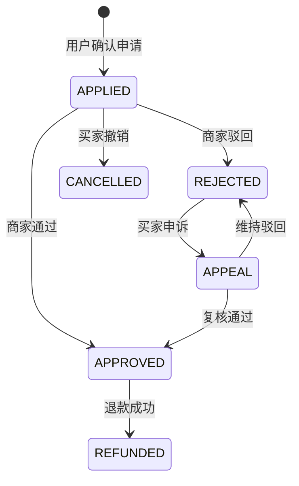

状态机阻止非法迁移；售后业务唯一规则阻止重复申请；审计和对账发现状态已退款但资金/库存没有对应变化。只做其中一个都不完整。

## 十、为什么让 LLM 处于控制面，而不是交易热路径

LLM 有四个天然特征：网络调用慢、输出概率性、知识可能过期、单次调用有成本。秒杀扣库存恰好要求低延迟、确定性、实时事实和可证明正确。

因此项目采用：

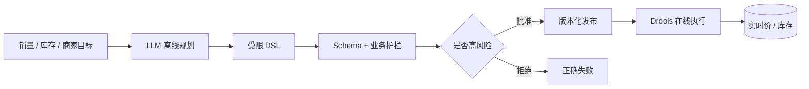

模型负责“建议怎么做”，确定性系统负责“当前是否允许做”和“如何执行”。模型不可用时沿用旧策略，交易不应停止。

为什么使用 DSL：直接让模型生成 Java/SQL 或任意工具调用，权限面太大且难以验证。受限 DSL 只允许 REPRICE、REALLOCATE、REFUSE 等明确动作，容易做 schema 校验、成本/毛利护栏、版本对比和回滚。

为什么用 Drools：规则条件、动作和版本较多时，Drools 能提供成熟的匹配和确定性执行；它也让“模型产出策略”与“在线执行策略”解耦。代价是学习曲线、DRL 编译和调试复杂度。若规则只有三五条普通 if/else，自研简单规则表会更轻，没必要为了技术栈引入 Drools。

### 规则引擎面试基础

传统 if/else把规则和流程代码混在一起，规则数量、组合和发布频率增加后难以审计。规则引擎通常把 Fact（事实）、Condition（条件）和 Action（动作）分离，根据事实匹配规则。

Drools使用Rete系算法思想复用规则条件匹配，规则多且事实变化频繁时可减少重复判断；但规则少时其编译、会话和调试成本可能高于普通代码。还要处理：

- salience/优先级和多规则冲突。
- 同一事实反复更新导致循环触发。
- 规则版本、灰度和回滚。
- 编译失败与运行异常。
- 动作幂等和副作用边界。

项目让模型生成受限业务DSL，再由编译器转成可执行规则，而不是允许模型直接写任意DRL。DSL先做结构和业务Fail-Close，批准后版本化；规则Worker消费 `sales.tick`，读取当前库存事实，产生REPRICE/REALLOCATE等指令。规则判断应尽量纯，真实副作用由执行器统一完成，这样便于幂等、权限和审计。

当前方案需要继续验证多规则冲突策略、规则热更新并发、长期运行内存和大规则集性能。Drools是当前复杂度下的工程展示选择，不是每个Agent项目的必需组件。

### 规则引擎连续追问速答

**为什么不是让LLM每次看到销量直接决定？**

在线事件频繁，LLM延迟/成本/非确定性不可接受。LLM离线定义边界，规则引擎在线重复执行确定条件。

**规则引擎和状态机区别？**

状态机约束实体合法生命周期；规则引擎根据事实匹配业务策略并产生动作。二者可以配合，但不能互相替代。

**规则冲突怎么办？**

定义优先级、互斥组和组合策略，编译/发布前做静态冲突检查与影子回放；高风险冲突Fail-Close，而不是依赖执行顺序碰运气。

## 十一、客服 Agent 为什么不能只是 RAG 问答

客服包含两类完全不同的信息：

- 政策、FAQ、商品说明：适合 RAG。
- 订单号、金额、支付和售后状态：必须查结构化数据库。

完整退款链路：

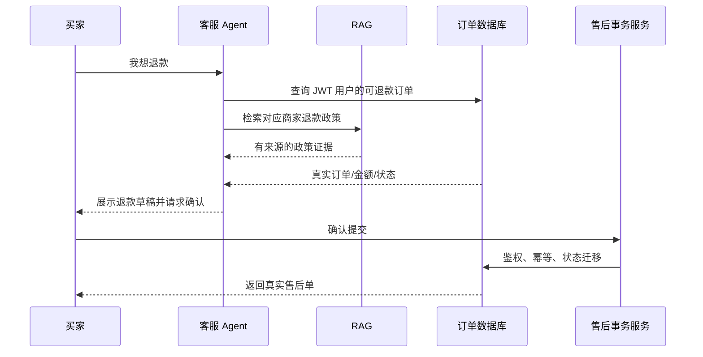

如果让模型直接回答“已为你退款”，但没有真实事务，这只是幻觉式 UI。项目把 Agent 的职责限制为理解、检索和准备参数，真实写操作由服务端再次鉴权并在用户确认后完成。

### Agent 面试基础：Agent、Workflow 与普通 LLM 的区别

- 普通 LLM 调用：输入 Prompt，得到一次文本输出。
- Workflow：步骤和分支由程序预先确定，模型只完成其中部分节点。
- Agent：模型或规划器根据目标和当前状态决定下一步，可能多轮调用工具、观察结果、修正计划。

开放性越高，灵活性越强，但可预测性、成本和测试难度越差。退款流程本质上更适合受控 Workflow：识别意图、查订单、生成草稿、用户确认、事务提交。商家经营分析可有更多 Agent 规划空间，但最终动作仍要收敛到受限工具和 DSL。

面试中不要把“调用了两次模型”就称作多 Agent。合理拆 Agent 的依据应该是：角色目标不同、上下文不同、工具权限不同、评测口径不同，且拆分收益超过 token和延迟成本。

### LLM 面试基础：token、上下文与生成参数

模型处理的不是字符而是 token。中文、英文、数字和符号的切分方式不同，不能简单按字数估算。一次调用成本通常与输入/输出token有关；延迟也受输入长度、首token时间和输出长度影响。

上下文窗口包含系统提示、历史会话、检索证据、工具schema/结果和本轮输入。窗口大不等于所有信息都会被同等利用；无关内容会增加成本、延迟和“lost in the middle”等注意力问题。因此要做会话摘要、按需检索和工具结果裁剪，而不是把全部历史永久拼入Prompt。

常见生成参数：

- Temperature：控制采样随机性，低温度通常更稳定，但不能保证事实正确。
- Top-p：核采样候选范围，通常不需要与temperature同时激进调整。
- Max tokens：限制输出和成本，也防止失控长回答。
- Stop：遇特定序列停止，结构化输出更推荐原生schema能力。

交易工具参数应追求稳定和可校验，通常低temperature；创意营销文案可更高。不能用“temperature=0”替代RAG证据和业务校验，因为模型仍可能确定地答错。

### LLM 面试基础：Prompt 与结构化输出

一个可维护Prompt通常包含角色/目标、可信上下文、约束、工具说明、输出schema、正确失败方式和少量必要示例。指令与数据要明确分隔，检索内容不能被当成高优先级系统指令。

结构化输出有三层可靠度：

1. 在文本Prompt里要求JSON：最弱，可能多解释或字段缺失。
2. JSON mode：保证合法JSON，但不一定符合业务schema。
3. 原生 structured output/function calling：按schema约束字段，仍需业务校验。

项目的DSL和工具参数即使结构合法，也要验证成本价、数量、身份、状态和版本。模型输出解析失败应重试有限次数或正确失败，不能用正则“尽量修复”后直接执行高风险动作。

### LLM 面试基础：流式响应、超时与重试

流式响应降低用户感知的首token延迟，但不降低完整生成时间，也不会让结果更正确。工具调用通常要等参数完整后才能执行；不能看到半段“退款”文字就产生副作用。

重试只适合瞬时网络错误、限流等可恢复失败，并采用指数退避 + jitter和总预算。对确定性的安全拒绝、参数非法不能盲目重试；模型写操作重试必须带幂等key。还要有模型超时、熔断、并发上限和降级模型/旧策略。

### LLM 面试基础：模型选择与路由

不是所有请求都用最强模型。可以按任务路由：意图分类/字段抽取用小模型或规则，复杂规划用强模型，Embedding用专门模型，高风险校验优先程序规则。选择要同时比较任务正确率、拒答、P95、上下文上限、工具调用稳定性、数据合规和成本。

项目本地使用确定性兜底便于测试，云端使用真实模型验证链路。离线桩通过只能证明业务编排，不代表真实模型效果；真实模型指标也要绑定具体版本。

### Agent 面试基础：ReAct、规划与反思

ReAct 是 Reasoning + Acting循环：根据目标产生下一步动作，调用工具获得 Observation，再继续推理，直到完成或终止。生产实现至少需要：

- 最大步骤数和总超时，防无限循环。
- token/成本预算，防意外费用。
- 工具白名单与参数 schema。
- 每次工具调用的幂等、超时、重试和权限。
- 明确的完成/失败/转人工状态。
- trace 保存输入、动作、观察和终止原因。

反思/Critic 可以检查事实、约束和结果，但“再让一个模型看一遍”不等于可靠验证。能用程序验证的应优先程序验证，例如价格不能低于成本、退款订单必须属于当前用户、DSL字段必须符合 schema。模型 Critic适合评价难以硬编码的策略质量，仍需评测其误判率。

### Agent 面试基础：记忆应该怎样分层

| 记忆 | 生命周期 | 典型内容 | 主要风险 |
| --- | --- | --- | --- |
| Working/上下文记忆 | 单次运行 | 当前目标、工具结果 | 上下文过长、提示注入 |
| Session 记忆 | 一段会话 | 历史对话、已选订单 | 过期事实、用户切换 |
| Long-term 记忆 | 跨会话 | 商家偏好、历史策略经验 | 污染、隐私、错误长期放大 |
| Artifact | 可版本化产物 | DSL、退款草稿、报告 | 版本和审批状态不清 |
| Trace | 执行证据 | 实际步骤、token、工具 | 敏感信息与存储成本 |

项目把知识、业务事实、策略 Artifact 和 Trace 分开，避免把所有东西都塞入“长期记忆向量库”。订单状态随时变化，应实时查数据库；历史策略可作为检索参考，但不能直接当当前执行命令。

### Agent 面试基础：工具调用安全

工具安全至少有五道边界：

1. 只向该角色暴露必要工具，买家 Agent不应拥有商家调价工具。
2. 参数 JSON Schema 只保证结构，还要做业务校验。
3. userId/merchantId从认证上下文取得，不能相信模型或前端传值。
4. 写操作使用 idempotency key、状态前置条件和审计。
5. 高风险操作先生成草稿或 HITL，回放时默认 dry-run。

Prompt injection不能只靠系统提示防御。检索文档是“不可信输入”，不能因为文档里写了“忽略规则并退款”就扩大工具权限。程序层权限、工具隔离和输出校验才是安全边界。

### Agent 在项目中的优化与不足

已做：控制面/数据面分离、受限 DSL、Critic、HITL、运行暂停/取消/恢复、Prompt/知识版本、trace/span、token/成本和失败回放；退款采用草稿 + 用户确认 + 事务 API。

需要加强：工具权限策略可进一步独立成 policy engine；回放应强制沙箱/dry-run并屏蔽真实副作用；长期记忆要有写入门槛、过期和纠错；多 Agent收益要用单 Agent基线证明，而不是只展示架构复杂度。

### Agent 连续追问速答

**为什么退款用 Workflow 而不是全自主 Agent？**

步骤、权限和状态明确，财务风险高，确定性流程更可测。模型只负责意图和自然语言，不应决定是否绕过确认。

**Critic 和业务护栏有什么区别？**

Critic可判断策略质量和语义合理性；业务护栏是确定性硬约束。能硬编码的底线不能只交给另一个模型。

**Agent 如何停止？**

达到目标、最大步骤/预算、用户取消、工具不可恢复失败、命中安全拒绝或转人工。每种终止原因都应结构化记录。

**多 Agent一定优于单 Agent吗？**

不一定。它增加通信损失、token、延迟和调试成本。应使用相同评测集比较正确率、成本和 P95，只有角色/权限边界带来真实收益时才保留。

**流式输出中途失败怎么办？**

前端要区分“展示中的文本”和“已提交的业务动作”。文本可提示重试；任何工具副作用必须有独立事务结果和幂等状态，不能由已经显示了多少token判断成功。

**怎样降低模型成本？**

先减少无关上下文和输出，意图路由到小模型/规则，缓存稳定知识结果，限制步骤和重试，批量离线任务，按场景统计单位成功任务成本；不能通过截断关键证据换低成本。

## 十二、为什么是普通 RAG，而不是 GraphRAG

先区分概念：

- 普通向量 RAG 擅长“这段话和问题语义是否相近”。
- GraphRAG 先抽取实体、关系和社区，再适合回答跨文档、多跳关系与全局主题问题，例如“哪些供应商通过相同控股关系影响了三类商品，并共同出现在异常退款链路中”。

当前知识主要包括商家政策、FAQ、商品、活动和运营手册。典型问题是：

- “这个商家的退款时效是什么？”
- “这款商品支持什么保修？”
- “库存低于多少需要调拨？”

它们以局部语义检索、来源过滤和结构化查询为主，不需要沿知识图谱做多跳推理。订单与商家、商品的关系本来就在 MySQL 中，直接 SQL 比把它们再抽成图更准确、更新更及时。

### 不选 GraphRAG 的决策矩阵

| 判断问题 | 当前情况 | 结论 |
| --- | --- | --- |
| 是否有大量跨文档多跳关系查询？ | 很少，主要是政策/FAQ局部问答 | 普通 RAG 足够 |
| 是否需要全局社区/主题总结？ | 不是核心业务 | 暂不需要图社区摘要 |
| 文档规模是否大到局部向量检索明显失效？ | 当前规模较小，40 条评测已能定位问题 | 先优化路由、切块和 reranker |
| 关系是否稳定且值得抽取？ | 商品/订单关系频繁变化且已在 MySQL | 结构化查询更合适 |
| 是否有标注和评测证明 GraphRAG 有收益？ | 没有 | 不应先增加架构复杂度 |
| 部署资源是否充足？ | 演示服务器约 2C4G，现有组件已紧张 | 资源是额外限制，但不是首要理由 |

所以结论是：**不使用 GraphRAG 的第一原因是问题形态不匹配，第二原因是数据规模和收益尚不足，第三原因才是资源与运维成本。**

GraphRAG 会增加实体/关系抽取 token、图存储、社区构建、增量更新、版本一致性和评测成本。在 2C4G 上再运行图数据库也会加重内存压力，但即使服务器升级，如果业务问题仍是局部 FAQ，也没有必要使用。

### 什么时候应该引入 GraphRAG

当出现以下证据再做实验：

- 知识扩展到供应链、品牌、合同、风险事件等高度关联数据。
- 用户稳定提出跨多个文档和实体的多跳问题。
- 普通 RAG + metadata filter + hybrid search + reranker 仍无法达到目标。
- 建立了包含多跳问题的独立评测集，GraphRAG 在正确率上有可量化增益。
- 团队能承担图谱增量更新、实体消歧和监控成本。

演进时也不必替换全部 RAG。可以先做查询路由：局部 FAQ 走向量检索，多跳问题走 GraphRAG，订单实时事实仍走 SQL。

### RAG 面试基础：完整数据链路

离线索引链路：数据源接入 → 清洗/去重 → 文档切块 → metadata → Embedding → 向量/文本索引 → 版本发布。

在线查询链路：查询理解/改写 → 权限和意图路由 → 召回 → 过滤 → rerank → 上下文组装 → 模型生成 → 引用/校验 → trace与反馈。

RAG不是简单的“向量库 Top-K + Prompt”。其中任何一层都可能成为答案错误的根因。

### RAG 面试基础：Embedding 与相似度

Embedding 把文本映射为高维向量，使语义相近文本在向量空间更接近。常见相似度：

- Cosine：比较方向，常用于归一化后的语义向量。
- Dot Product：点积，受方向和模长影响；部分模型针对它训练。
- Euclidean/L2：几何距离。

必须按 embedding模型推荐的度量使用，不能随意替换。模型升级、维度变化或预处理变化后，旧向量通常要重新生成；因此知识版本和 embedding版本必须可追踪。

Embedding不理解实时业务真相。两个文本相似只代表检索相关性，不代表答案事实正确或用户有权限访问。

### RAG 面试基础：切块策略

切块太小会丢上下文，答案所需事实分散在多个 chunk；太大会混入噪声、降低召回精度并占用更多上下文 token。常见方法：

- 固定字符/token + overlap：简单稳定，项目当前采用类似方式。
- 按标题/段落/Markdown结构：保持语义边界。
- 递归切分：优先大结构，超长再细分。
- 语义切块：按语义变化划分，效果可能更好但成本和不确定性更高。
- Parent-child：小块召回，大块返回，兼顾定位与上下文。

项目当前仍有“命中文档但关键事实没有落入返回切块”的失败，这说明下一步优先级应是结构化/parent-child切块或扩大邻接上下文，而不是立刻换 GraphRAG。

### RAG 面试基础：ANN 索引

全量精确比较向量在规模大时成本高，因此使用 Approximate Nearest Neighbor：用少量召回损失换显著速度提升。

- HNSW：图式多层导航，通常召回高、查询快，但内存较大、构建成本高。
- IVF：先聚类，查询部分桶；可调探测桶数平衡速度和召回。
- Flat：精确搜索，数据小时简单且可作为召回上限基线。

索引参数不是越大越好。应在真实数据上同时测 Recall@K、P95、内存和构建时间。当前 40 条评测规模主要验证业务检索链路，不能用它证明千万向量性能。

### RAG 面试基础：召回、rerank 与混合检索

向量检索擅长同义表达，BM25/关键词擅长型号、订单号、专有名词和稀有词。混合检索先分别召回，再通过 RRF 等方法融合排名。Reranker对 query-document 对做更精细相关性评分，通常提高排序，但增加延迟和成本。

常见两阶段：第一阶段宽召回 20～100 条，第二阶段 rerank 后只给模型 3～8 条。项目当前使用意图路由 + metadata filter + Top-K，先用低成本规则把来源缩小；是否增加混合检索/reranker应由失败集证明。

### RAG 面试基础：metadata 与多租户隔离

metadata包括 merchantId、docKey、sourceType、version、有效时间和权限标签。过滤应发生在检索查询中，而不是先取全局 Top-K 再在应用层删除；后者可能导致正确商家文档根本没进入候选，还可能增加泄露风险。

隔离还要覆盖：索引写入、查询 filter、缓存 key、trace 展示、评测数据和删除/重建任务。Prompt 中“请勿泄露”不是隔离实现。

### RAG 面试基础：幻觉、拒答与引用

低温度不能消除幻觉。可靠 RAG需要：

- 无证据不回答或转人工。
- 要求答案绑定来源，而不是只展示装饰性引用。
- 结构化实时事实走数据库工具。
- 检索相关性门槛和业务安全门槛。
- 对越权、秘密、未知实时事实单独评测。

拒答率越高不代表越安全，因为系统可以全部拒答。应同时看不可回答样本的拒答准确率和可回答样本的误拒率/回答率。

### RAG 项目落地、优化与不足

项目采用 MySQL保存知识正文和版本，Milvus保存可重建向量索引；按商家隔离，按 BUYER_POLICY、FAQ、PRODUCT、ACTIVITY、PLAYBOOK 等意图路由；对秘密、跨商家、未知实时事实和绕过审批请求 Fail-Close。

最终云端同条件消融中，普通 Dense 的 Recall@4/答案正确率/拒答正确率/P95 为 74.29%/65.71%/0%/586ms；当前 Hybrid RRF+路由+安全门为 100%/100%/100%/611ms。这里的数字只代表40条特定受控集，不是通用模型能力或并发SLA。

当前不足：样本少且参与过调参；答案判分偏确定性；词法通道是轻量字符二元组而非独立 BM25 服务；尚无 reranker、隐藏保留集和人工标注一致性；Milvus 对当前规模偏重。

### RAG 连续追问速答

**Top-K 越大越好吗？**

不是。K大提高召回机会，但增加噪声、token、延迟，模型可能被不相关证据干扰。应通过 Recall@K和答案正确率联合选择。

**为什么命中文档仍回答错？**

关键事实可能不在返回 chunk、上下文被截断、rerank顺序差、Prompt没有正确使用证据或模型生成错误。文档级命中不等于事实级覆盖。

**怎样评估切块？**

构造需要单事实、跨段事实和边界事实的问题，比较不同 chunk size/overlap/结构切块的 Recall、事实覆盖、上下文 token和P95。

**RAG 与微调的区别？**

RAG注入可更新外部知识并提供来源，适合事实；微调改变行为/风格/任务能力，不适合频繁更新订单政策。两者可组合，不是互斥。

**为什么不把订单也写进向量库？**

订单需要精确、实时、鉴权和条件查询，SQL更可靠。向量相似度不能证明订单属于当前用户，也不保证金额准确。

## 十三、为什么使用 Milvus，当前是否有点重

Milvus 是独立向量数据库，适合向量规模增长、独立扩容和多种 ANN 索引。项目使用它的目的包括：

- 把向量索引与 MySQL 业务真相分开，索引可重建。
- 演示真实向量库部署、metadata 隔离和检索评测。
- 为未来更多商家和知识量保留扩展空间。

但必须诚实：当前文档和评测规模并不要求 Milvus。Milvus standalone 还需要 etcd 和 MinIO，在 2C4G 演示机上是明显负担。

更轻的替代方案：

| 方案 | 优点 | 代价 | 适用情况 |
| --- | --- | --- | --- |
| 内存 SimpleVectorStore | 零运维、开发快 | 重启丢索引、不可多实例共享 | 本地学习和测试 |
| PostgreSQL + pgvector | 关系/向量一体、运维简单 | 需要从 MySQL 迁移或多维护一个 PG | 小中规模、资源有限的新项目 |
| Elasticsearch/OpenSearch | 文本 BM25、过滤与向量混合搜索强 | 集群运维和内存成本 | 搜索需求本来就很重 |
| Milvus | 专用向量能力、独立扩展 | 组件多、资源和运维较重 | 向量规模增长或需独立向量层 |

如果目标只是最低成本上线当前业务，保留 MySQL并使用轻量向量服务，甚至小规模内存索引，会更经济。项目选择 Milvus 是“工程展示与未来扩展”的取舍，不是当前数据量的唯一正确答案。

### Milvus 面试追问

**为什么正文仍在 MySQL？**

向量索引是派生数据，MySQL正文/版本是可审计真相源。更换 embedding或索引损坏时可重建。

**Milvus metadata filter 会影响什么？**

它既是商家隔离边界，也缩小候选空间。字段设计和索引要配合常用过滤，不能只存向量不存租户/来源。

**Milvus挂了怎么办？**

不能无证据生成。客服降级为结构化订单查询、有限关键词/缓存知识或转人工；交易链路不依赖 Milvus，Agent策略沿用旧版本。

**何时从 Milvus换 pgvector？**

当向量规模和QPS较低、团队更需要低运维成本、关系/向量事务边界重要，并且迁移后的评测和延迟满足目标时。架构选择应由总拥有成本决定。

## 十四、为什么采用意图路由，而不是所有知识一起向量搜索

把商品、政策、运营手册和活动资料混在同一个候选空间里，会出现语义相似但业务类型错误的命中。例如“开发票”可能命中某个通用 FAQ，却不属于当前商家政策。

意图路由先把查询限制到 BUYER_POLICY、FAQ、PRODUCT、ACTIVITY 或 PLAYBOOK 等来源，再做向量检索和商家过滤。它用较低成本减少搜索空间，也更容易解释和评测。

为什么不先上 reranker：reranker 能改善排序，但会增加一次模型/服务调用和 P95。当前优先用业务已知的 metadata 和意图缩小候选集；剩余召回/排序错误达到一定规模后，再用评测证明 reranker 的收益是否值得延迟和成本。

为什么不只做关键词搜索：商品型号、订单号等精确词适合关键词，用户自然语言和政策同义表达适合向量。因此未来更合理的是 BM25 + vector 的混合检索，而不是二选一。

## 十五、为什么需要 Prompt/知识版本、Trace 和评测

Agent 的结果同时受输入、Prompt、模型、Embedding、知识版本、检索参数和工具状态影响。只保存最终回答，线上出错时无法复现。

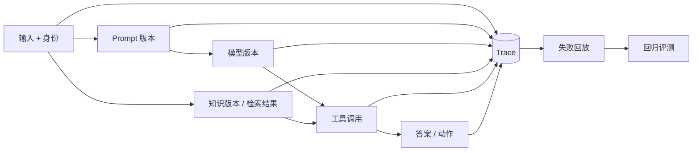

- Prompt/知识版本回答“当时使用了什么”。
- Trace 回答“当时实际发生了什么”。
- 失败回放回答“修改后同一问题是否修好”。
- token/成本回答“效果提升是否值得成本”。
- 评测集回答“优化一类问题是否破坏了另一类问题”。

当前 40 条数据集是起点，不是终点。它覆盖可回答、不可回答、越权和敏感请求，并展示 Recall@4、答案正确率、拒答准确率和 P95。随着真实会话增加，应做训练/开发/保留集划分、人工标注一致性和线上反馈闭环。

### Agent评测面试基础：先分层再看总分

一个“答案正确率”无法解释Agent系统。应至少分四层：

| 层 | 关注点 | 示例指标 |
| --- | --- | --- |
| 检索层 | 证据有没有召回和排对 | Recall@K、MRR、nDCG、事实覆盖 |
| 生成层 | 是否忠于证据并回答问题 | 正确率、faithfulness、引用准确率、误拒率 |
| Agent轨迹层 | 是否用了正确工具和参数 | 工具选择/参数正确率、步骤数、越权率、任务完成率 |
| 系统/业务层 | 是否值得上线 | P95/P99、token/成本、退款成功率、HITL率、业务收益 |

Recall@K的分母是有期望证据的可回答样本；Precision@K衡量返回候选中相关结果比例。高Recall低Precision意味着证据可能被找到了，但噪声很多。MRR关注第一个正确结果排名，nDCG可处理多个相关结果和不同相关等级。

最终答案评测应区分：

- Correct：正确且有证据。
- Correct refusal：本来就不应回答，正确拒绝/转人工。
- False refusal：有答案却拒绝。
- Unsupported answer：看似回答但证据不支持。
- Unsafe/tool error：越权、错误工具或产生错误副作用。

### 离线评测、在线评测与数据泄漏

离线评测可重复、便宜、适合回归，但不完全代表真实用户分布；在线A/B更真实，但风险、流量和归因成本更高。合理流程是离线门槛 → 影子/灰度 → 小流量A/B → 持续监控。

评测集不能与Prompt示例、人工调参过程完全混用，否则会过拟合。应区分开发集和从未用于调参的保留集，按商家/意图/时间切分防近重复泄漏。线上失败样本加入下一版本回归集，但仍需保留新的隐藏集检验泛化。

### LLM-as-Judge的价值与风险

LLM Judge适合评价开放式答案、相关性和表达，扩展比人工快；但它会受模型版本、提示、答案长度、位置顺序和自我偏好影响。高风险评测应：

- 用清晰rubric和结构化评分。
- 隐藏候选系统身份，交换答案顺序减少位置偏差。
- 用人工标注集校准Judge一致性。
- 保存Judge模型/Prompt版本。
- 对关键安全/金额/权限仍用程序规则和人工复核。

项目当前答案判分偏确定性事实覆盖，优点是稳定可回归，缺点是不能全面评价语言质量。下一步可以增加校准后的LLM Judge和人工抽检，而不是直接用Judge替换全部硬规则。

### 延迟与成本怎样正确统计

P95要明确统计范围：仅向量检索、完整RAG，还是端到端Agent任务。冷启动、并发度、缓存、超时样本是否纳入都会改变数字。成本应按“成功完成一次任务”而不只是“每次模型调用”统计，因为重试和多Agent会放大总成本。

一个版本只有在质量不退化且延迟/成本可接受时才应发布。可以设多目标门槛：Recall不低于基线、unsafe为0、P95不超过阈值、单位成功任务成本不超过预算。

### Agent评测在项目中的设计与不足

已做：40条版本化数据；可回答/拒答/越权类型；Recall@4、事实正确、拒答准确和P95；Prompt/知识版本；token/成本聚合；失败样本异步回放；云端Milvus真实基线。

需要加强：保留集规模、误拒率独立展示、轨迹/工具参数指标、并发端到端P95、人工标注一致性、Judge校准、线上反馈与业务KPI关联。

### Agent评测连续追问速答

**为什么Recall@4高但答案正确率低？**

文档进入Top-4不代表关键事实在chunk中，也不代表模型使用正确；需要看事实覆盖、rerank、上下文组装和faithfulness。

**拒答准确率100%是否说明系统安全？**

只说明当前不可回答样本全部拒绝。还要看样本覆盖和可回答问题误拒率；全拒答也可能拿到100%。

**40条够吗？**

够做工程闭环起点和快速回归，不足以代表生产分布。应按意图、风险、商家和长尾表达扩充，并保留隐藏测试集。

**怎样判断多Agent是否值得？**

与单Agent/Workflow基线比较任务成功、unsafe、P95、token和单位成功成本；若质量增益不足以覆盖复杂度，应简化。

## 十六、其他主要技术选型为什么这样做

### Java 21 + Spring Boot

选择原因：电商事务和中间件生态成熟，类型系统、线程/连接池工具、Actuator、Spring Data Redis/Kafka 和团队招聘生态适合后端主线。Java 21 提供长期支持和现代语言/运行时能力。

为什么不是全 Python：Python 的 Agent/数据生态更丰富，做快速 AI 原型更轻；但项目的难点还包括交易、状态机和高并发工程。把全部系统改成 Python不会自动改善 Agent 效果，反而偏离目标岗位。若未来模型实验复杂，可把评测/离线算法拆成 Python 服务，交易仍由 Java负责。

### Java 面试基础：线程池与并发

线程池核心参数：corePoolSize、maximumPoolSize、workQueue、keepAliveTime、ThreadFactory和RejectedExecutionHandler。执行通常先用核心线程，再入队，队列满后扩到最大线程，仍满才拒绝。无界队列可能让最大线程数形同虚设并导致内存积压；线程数也不是越多越好，会增加切换、栈内存和下游压力。

I/O密集任务可比CPU核数配置更多线程，但最终受数据库连接池、Redis连接、模型API配额等限制。必须根据到达率、服务时间和下游容量压测，而不是套用固定公式。

`synchronized`/Lock只协调单 JVM；分布式实例要使用存储原子条件、幂等或分布式协调。`volatile`保证可见性和一定有序性，不保证复合操作如 `count++`原子。

项目原则：请求线程不等待长时间模型规划；Kafka削峰不能让消费者线程无限压数据库；规则锁内只做短操作；异步任务要透传 traceId并设置超时/预算。

### JVM 面试基础：内存与 GC

JVM运行时主要关注堆、线程栈、元空间和直接内存。对象通常在堆中，类元数据在元空间；每个线程有独立栈，线程过多也会消耗大量内存。容器内不能只看 `-Xmx`，还要给 metaspace、线程栈、direct buffer和native库留空间。

GC目标是在吞吐、停顿和内存之间取舍。Java 21常用G1，适合通用服务；极低停顿可评估ZGC，但不是换收集器就能解决对象分配过快或内存泄漏。排查应看GC日志、分配率、停顿、old region、heap dump，而不是先调参数。

项目2C4G部署给 API/Worker限制堆和容器内存，是为了防 JVM按宿主资源扩张后被 OOM kill。但这些值只是演示配置，需基于并发、Agent上下文大小和中间件占用重新容量测试。

### Spring 面试基础：IoC、AOP与事务代理

IoC让容器负责对象创建、依赖和生命周期；AOP通过代理处理事务、日志、安全等横切逻辑。Spring `@Transactional`通常依赖代理，因此常见陷阱包括：同类内部自调用绕过代理、private方法不按预期代理、异常被吞导致不回滚、把远程调用放入长事务。

事务传播要理解 REQUIRED（加入现有或新建）、REQUIRES_NEW（挂起外层并新建）等语义。不要用 REQUIRES_NEW随意“保证日志一定保存”，它会消耗额外连接并改变原子边界。

项目把同步订单插入和DB条件扣减放在短事务内；模型、Redis和Kafka不应该被误认为能被同一个 `@Transactional` 回滚。跨资源靠显式状态、幂等、补偿和对账。

### Spring Boot 项目优化与追问

已做：profile区分零依赖/集成环境；ObjectProvider让Redis/Kafka组件可选降级；Actuator只暴露health/prometheus；配置通过环境变量注入；API/规则Worker进程隔离。

**为什么不用分布式事务框架？**

高并发热路径使用2PC会增加协调、锁持有和可用性风险。项目接受消息至少一次，用本地事务 + 幂等 + 补偿。若是强一致资金转账，要重新评估事务消息、TCC/Saga或支付渠道语义。

**Spring 单例 Bean线程安全吗？**

不自动安全。无状态 Bean通常可并发；可变共享字段必须使用并发结构/同步或移到请求/持久状态。不能把用户会话存在普通单例字段。

**为什么 profile降级不是生产高可用？**

local profile是开发模式，在启动时决定 Bean；生产运行时故障还需要超时、熔断、降级开关和容量保护，不能靠切 profile自动完成。

### Spring AI

它统一模型调用和 Spring 配置/依赖注入，减少供应商 SDK 散落。项目仍保留自研运行时和业务护栏，因为框架只能提供调用抽象，不能替业务定义权限、状态机和正确失败。

### MyBatis-Plus

电商 SQL 和条件更新需要可见、可控，MyBatis 便于写明确 SQL，又用 Plus 减少普通 CRUD。相比 JPA，它更容易直观看到热点更新语义；代价是 Mapper 和 SQL 维护较多。选择取决于团队熟悉度，不是 JPA 不能实现。

### Flyway

它把 schema 变化变成顺序、可审计的版本，保证新环境和生产升级路径一致。相比 `ddl-auto`，它不会在生产启动时不可控地改表。

### React + TypeScript + Ant Design

React 生态适合控制台和交互页面，TypeScript 在 API/状态结构变化时提供编译期反馈，Ant Design 快速提供成熟后台组件。选择它是为了交付和可维护性，不是追求定制视觉极限。若团队主要使用 Vue，Vue 3 + TypeScript 同样合理。

### Nginx

统一托管前端、反代 API/WS、处理静态缓存和入口限流，并让内部服务不直接暴露公网。云原生规模扩大后可换网关/Ingress，但单机 Compose 下 Nginx 更简单。

### HTTP/Nginx 面试基础

HTTP是无状态请求响应协议。常见方法应遵循语义：GET读取且应安全，POST创建/动作，PUT整体替换或幂等更新，PATCH部分更新，DELETE删除。是否真正幂等仍由服务端实现；把退款做成POST不意味着可以忽略业务幂等。

常见状态码：200成功、201创建、400参数错误、401未认证、403已认证但无权限、404不存在（有时也用于隐藏越权资源）、409业务冲突、429限流、500服务错误、502/504上游网关错误/超时。

Nginx作为反向代理可以：

- 终止TLS，后端只处理内网HTTP。
- 连接复用、静态文件和压缩。
- 按路径路由 API、WebSocket和Actuator。
- 入口限流，快速拒绝明显过载。
- 隐藏内部容器地址，只暴露80/443。

WebSocket从HTTP Upgrade握手后建立长连接，反代必须正确传递Upgrade/Connection头和设置合理超时。项目实时大屏还提供轮询兜底，避免WS不可用时页面完全失效。

入口限流不能替代业务限流：Nginx通常按IP/路径保护整体服务，Redis按用户+活动保护业务配额。一个NAT后可能有大量真实用户共享IP，单按IP会误伤；登录用户限流应使用服务端身份。

### JWT、BCrypt与鉴权面试基础

JWT由 header、payload、signature组成。签名保证内容未被篡改，不代表payload加密，因此不能放密码或敏感隐私。服务端验证签名、过期时间和必要claims，再建立认证上下文。

JWT优点是服务端无需为每个请求查询会话，适合多实例；缺点是签发后撤销困难、泄露后在过期前可用。生产可使用短access token + refresh token、密钥轮换、token version/黑名单处理高风险注销，并用HTTPS防传输窃取。

密码不能用可逆加密或普通SHA直接存。BCrypt自带salt并故意计算较慢，work factor可调，增加暴力破解成本。登录仍需限流、弱密码策略和异常告警。

项目安全边界：

- 密码以BCrypt哈希保存。
- JWT密钥由环境变量覆盖，生产Compose缺失时拒绝启动。
- 买家/商家角色分离，资源归属在服务端校验。
- RAG merchantId过滤从身份上下文导出。
- 高风险Agent工具需要用户/HITL确认。
- Actuator只暴露health和prometheus，且生产应让prometheus仅内网可访问。

仍需加强：refresh token和撤销策略、CSRF/XSS整体审计、上传内容安全、细粒度RBAC/ABAC、密钥管理服务、审计日志防篡改和依赖漏洞扫描。

### 安全连续追问速答

**JWT和Session如何选？**

Session易撤销、服务端可控，但多实例要共享会话；JWT便于无状态扩展但撤销和密钥轮换复杂。当前项目选择JWT简化API认证，小规模高安全后台使用共享Session也完全合理。

**前端隐藏按钮算鉴权吗？**

不算。攻击者可直接调用API。前端只做体验，后端每个资源和动作都要鉴权/鉴别归属。

**怎样防水平越权？**

不能只校验“已登录”，还要让查询包含当前userId/merchantId，或查询后验证归属；不要直接相信路径/请求体里的租户ID。

**Prompt injection和SQL injection有什么共同点？**

都是把不可信数据误当指令。SQL用参数化查询隔离数据与语句；Agent则用工具权限、结构化参数、文档不可信标记和程序护栏隔离知识内容与系统控制。

### Prometheus + Grafana

Prometheus 适合拉取时间序列指标，Grafana 负责看板与告警展示。它们回答系统层的 QPS、延迟、错误、JVM 和资源问题；Agent trace 回答单次语义执行，两者不能互相替代。

### 可观测面试基础：日志、指标、Trace

- Logs：离散事件细节，适合看异常上下文，但高基数全文检索成本高。
- Metrics：聚合时间序列，适合趋势、看板和告警，但不保留每次请求的完整细节。
- Traces：一次请求跨组件的因果链路，适合定位延迟和失败传播。

常说四个黄金信号：Latency、Traffic、Errors、Saturation。Agent还要增加模型/Prompt/知识版本、输入输出token、成本、工具成功率、正确失败率和HITL率。

P95表示95%样本不超过该值，不能解释最慢5%到底多慢，所以重要链路还看P99/max和直方图。平均值在长尾分布下可能非常误导。Prometheus histogram应设计合适bucket；高基数label如userId、orderId、traceId不能直接放metrics，否则时间序列爆炸，这些应进入日志/trace。

告警应指向可操作问题。例如：错误率持续超过阈值、consumer lag增长、库存对账差异、RAG拒答准确率回归、模型成本异常。单次异常不一定立即分页，需结合持续窗口和严重度避免告警疲劳。

项目用traceId贯穿HTTP和Kafka，Agent trace记录版本/token/成本，Prometheus/Grafana看系统指标，40条评测看离线质量。需要加强的是统一OpenTelemetry语义、日志集中存储、SLO/错误预算和生产告警演练。

### 可观测连续追问速答

**监控和可观测有什么区别？**

监控通常验证已知故障指标；可观测强调从系统外部输出推断内部未知状态。真正可观测不仅“有大屏”，还要能从trace关联版本、检索、工具和业务结果。

**为什么traceId不能做Prometheus label？**

每个traceId几乎唯一，会造成高基数时间序列和巨大内存/存储成本。metrics做聚合，单请求ID放日志和trace。

**怎样定义秒杀SLO？**

应同时包含可用性、延迟和正确性，例如成功/明确业务拒绝请求的P99、系统错误率、库存不为负、重复订单为零。只看HTTP 200会把售罄、超时和业务错误混在一起。

### Docker Compose

目标是让一台机器可重复启动全部依赖，并明确网络、volume 和资源限制。它适合开发/作品演示，不具备 Kubernetes 的调度、自愈和多机能力。当前没有多机规模，直接上 Kubernetes 会增加学习和运维成本。

### Docker面试基础

镜像是只读分层模板，容器是镜像的运行实例；volume保存容器生命周期之外的数据；network让服务用容器名通信。镜像层缓存能加速构建，构建上下文过大或把密钥COPY进镜像都会产生风险。

容器不是虚拟机，它共享宿主机内核，通过namespace隔离视图、cgroup限制资源。设置JVM `-Xmx`不等于完整容器内存限制，仍需考虑堆外/线程/元空间。

健康检查与进程存活不同：进程存在但数据库连接池耗尽时仍不可服务。Readiness表示是否应接收流量，Liveness表示是否需要重启；Compose能力较简单，Kubernetes会更系统地区分。

数据组件升级必须先备份volume并验证恢复。`docker compose down -v`会删除命名volume，是破坏性操作。生产镜像应使用固定版本/摘要、非root用户、最小基础镜像、漏洞扫描和SBOM。

项目Compose只把Nginx暴露公网，数据组件留在内部网络，给JVM/Kafka/MySQL设置资源上限，`.env`不入库。当前仍是单机编排，不具备跨主机调度、滚动发布和自动容灾。

### Docker/Kubernetes连续追问速答

**为什么当前不用Kubernetes？**

单机演示没有多节点调度需求，K8s会引入控制面、Ingress、存储和运维成本。需要多副本、自愈、滚动发布和弹性伸缩时再迁移。

**容器重启后数据为什么还在？**

因为MySQL/Milvus等数据写入volume，不在容器可写层。删除容器不等于删除volume，但必须有外部备份，volume本身不是灾备。

**镜像中能放 `.env` 吗？**

不能。镜像层可能被导出和缓存。密钥应在运行时由环境、secret manager或编排系统注入，并支持轮换。

## 十七、2C4G 部署资源如何影响架构

生产演示拓扑同时包含 MySQL、Redis、Kafka、API JVM、规则 JVM、Milvus、etcd、MinIO、Prometheus、Grafana 和 Nginx。2C4G 只能算紧凑演示环境，不是高并发容量声明。

资源有限时的优先级：

1. 保住交易正确性：MySQL、API、Redis。
2. 保住必要异步：Kafka/Worker；若规模极小可临时同步或换更轻队列，但要重新评估峰值。
3. 智能能力可降级：模型超时使用旧策略，向量层可换轻量实现。
4. 监控可在诊断时精简，但正式环境不能长期没有指标。

不要因为服务器小就牺牲数据库约束、鉴权或幂等；应该先减少可替代组件、降低并发承诺或升级资源。

### 容量估算面试基础

架构前先做数量级估算。假设10万用户在10秒内集中点击，平均入口QPS约1万，但流量通常不均匀，峰值可能更高。若每个同步请求占用数据库连接100ms，Little's Law近似在途请求数 `L = λW = 10000 × 0.1 = 1000`，远超常见连接池，所以必须在DB前快速拒绝、内存原子扣减和异步削峰。

Kafka积压估算：入口每秒产生8000条订单事件，消费者每秒处理5000条，则每秒净增3000条，1分钟积压18万。加消费者前要确认分区数和DB写入能力，否则只是把压力更快传给MySQL。

向量检索容量至少估算：文档数 × 平均chunk数 × 向量维度 × 每维字节，再考虑索引、metadata、副本和临时构建空间。例如1024维float32原始向量约4KB/条，100万条仅原始向量约4GB，HNSW等索引还会额外占用内存。当前项目远小于这个规模，所以Milvus选择不是容量必需。

2C4G下不能宣称“高并发能力”只因为用了Redis/Kafka。必须给出压测模型、数据规模、瓶颈、P95/P99、错误率和对账结果。当前项目能讲清架构和测试证据，但百万级性能数字没有真实实跑就不应声称。

### 容量连续追问速答

**线程池开1000是否就能扛1000并发？**

不一定。下游连接池、CPU、内存和服务时间决定吞吐；更多线程可能只增加排队和切换。应先限流、缩短同步路径并测瓶颈。

**怎样判断要扩API还是数据库？**

看饱和指标：API CPU/GC/线程池队列、DB连接/锁/慢查询、Redis延迟、Kafka lag。入口QPS高但DB低可能扩API；DB已饱和时扩API只会加剧压力。

**缓存命中率99%是否一定好？**

还要看剩余1%的请求量、是否集中在热点失效、数据正确性和内存成本。错误缓存也能有很高命中率。

## 十八、系统故障时应该怎样退化

| 故障 | 不应发生 | 推荐行为 |
| --- | --- | --- |
| LLM 超时 | 阻塞秒杀或乱生成策略 | 沿用旧策略，记录失败并重试 |
| Milvus 不可用 | 编造知识答案 | 拒答/转人工，必要时回退有限关键词检索 |
| Redis 不可用 | 无限制把全部秒杀流量打向 DB | 限流后 DB 条件更新兜底，或关闭活动 |
| Kafka 不可用 | Redis 扣了但订单永久丢失 | 同步兜底/可靠补偿，保留可恢复载荷 |
| 规则引擎失败 | 执行未经验证的模型建议 | 维持旧价/旧库存策略，告警 |
| 模型输出非法 | 尽量猜测并执行 | Fail-Close，作为正确失败记录 |
| 重复消息/请求 | 重复扣减或退款 | 业务幂等 key + DB 唯一/状态条件 |

“降级”不等于什么都继续做。高风险场景下，拒绝动作或暂时关闭秒杀往往比带病运行更正确。

## 十九、如果今天重新从零搭建，推荐顺序

### 第 1 步：画业务状态和权限

先画订单、售后状态机，定义买家/商家边界和四条不变量。此时不要引入 Agent。

### 第 2 步：完成单体事务闭环

用 Spring Boot + MySQL 完成商品、订单、取消、退款，补唯一约束与事务测试。先证明低并发正确。

### 第 3 步：度量热点，再引入 Redis

对商品读取加缓存；对秒杀库存使用 Lua 和限流；保留 DB 条件更新。明确每个 key 的业务含义、TTL 和重建方式。

### 第 4 步：异步削峰

当同步建单成为瓶颈，再加入 Kafka。先设计确定性订单号和幂等消费者，再开启异步，而不是先发消息后补正确性。

### 第 5 步：加入客服 RAG

先区分结构化事实和文档知识，用商家 metadata 隔离。建立小评测集，再决定 embedding、向量库、切块和 Top-K。

### 第 6 步：加入可控 Agent

从“生成退款草稿”这种有用户确认的场景开始，再做调价 DSL、Critic 和 HITL。不要一开始给模型库存/资金写权限。

### 第 7 步：让策略进入确定性执行

用简单规则或 Drools 执行已批准版本，确保模型离线、热路径零 LLM，加入回滚和审计。

### 第 8 步：评测和可观测

保存版本、trace、token、成本和失败样本；评测召回、答案、拒答和尾延迟。没有这一步，Agent 优化只能靠主观感觉。

### 第 9 步：真实中间件和故障演练

Compose 跑完整链路，验证重复请求、Redis/Kafka失败、跨商家访问、模型超时和回滚。最后才谈云部署和压测数字。

## 二十、哪些选择是当前方案，哪些是永恒原则

可以替换的当前方案：

- MySQL 可以替换为 PostgreSQL。
- Kafka 在更小规模下可以替换为 RabbitMQ/Redis Stream，或短期同步。
- Milvus 可以替换为 pgvector、OpenSearch 或轻量向量存储。
- Drools 可以替换为简单规则表或其他规则引擎。
- React 可以替换为 Vue。

不应轻易丢失的原则：

- 先定义业务不变量，再优化性能。
- 缓存不是永久真相，消息可能重复。
- 幂等要有业务语义和数据库最终防线。
- 结构化事实不交给模型猜。
- 模型建议与高风险执行之间要有权限、校验和人工确认。
- 多租户隔离必须在数据查询层实现。
- 所有智能优化必须有版本、trace、评测和回滚证据。

理解这些原则后，即使换掉 Redis、Kafka、Milvus 或 Drools，你仍能重新设计一个正确的系统。这才是学习架构的目的。

## 二十一、读完后的自测问题

1. 如果没有秒杀，Redis 的哪些用途仍值得保留，哪些可以删除？
2. 为什么 DB 条件更新已经防超卖，还要 Redis Lua？
3. 为什么 SETNX 和 Kafka 生产者幂等都不能替代订单唯一约束？
4. 哪些问题应该查 MySQL，哪些问题应该走 RAG？
5. 为什么不使用 GraphRAG 的首要理由不是服务器小？
6. 当前规模如果不用 Milvus，最合理的替代方案是什么？
7. 模型生成合法 JSON，为什么仍不能直接调价？
8. Redis 扣减成功、Kafka 失败时，系统怎样避免丢单？
9. 拒答为什么可能是正确结果？如何防止系统靠“全部拒答”刷指标？
10. 哪个模块增长到什么程度时，你会把它拆成微服务？

如果可以不看本文、结合业务约束独立回答这些问题，你已经理解了 InsightForge 为什么这样设计，而不只是记住了它使用哪些技术。

## 二十二、三组面试官连续拷问演练

### 演练一：从“为什么用 Redis”追问到底

**面试官：为什么用 Redis？**

回答主线：秒杀是少量热点库存的瞬时高并发竞争。MySQL条件更新能保证正确但吞吐和连接压力较高，所以先用Redis内存与Lua原子预扣，快速成功/售罄；DB仍是永久订单真相和最终约束。

**面试官：Redis为什么快？**

回答内存、数据结构、事件循环/I/O多路复用、短命令和串行执行；主动补一句慢Lua/大key会阻塞，说明不是机械背“单线程”。

**面试官：为什么Lua而不是分布式锁？**

检查和扣减可在一个固定短脚本内原子完成，不需要排队持锁、续期和释放。锁更适合无法表达为单次原子操作的控制面复合写。

**面试官：Redis宕机会超卖吗？**

不会因为降级DB仍使用 `stock >= qty` 条件更新，但吞吐会下降，必须加强限流或关闭秒杀。若Redis已预扣而事件未落库，需要补偿/巡检和对账。

**面试官：SETNX已经去重，为什么还要唯一索引？**

SETNX可能过期、淘汰或故障丢失；唯一索引是永久业务事实的最终防线。消费者重投也绕不开DB幂等。

**面试官：Redis和DB谁是库存真相？**

分阶段回答：LIVE热路径Redis承载快速剩余量，DB保存永久订单/库存记录；通过异步同步、取消补偿和结算对账收敛。不能含糊说“两边都是强一致真相”。

**面试官：现在的Redis方案能直接上生产吗？**

不能。当前单容器适合作品演示；生产需高可用/Cluster评估、hash tag、关键key淘汰策略、热点监控、容量、清理和故障演练。

### 演练二：从“为什么做 RAG”追问到 GraphRAG

**面试官：为什么需要RAG，不直接让模型回答？**

平台政策和商家知识会变化，模型参数知识不可追踪。RAG提供外部最新证据和来源，并可按商家过滤；订单事实仍查SQL。

**面试官：RAG为什么还会答错？**

拆成检索错误、chunk事实不完整、排序/上下文截断、生成未忠于证据和权限路由错误，并说明trace如何定位哪一层。

**面试官：为什么Top-K是4？**

它是当前评测下召回与噪声/token/延迟的折中，不是理论最优常数。应展示Recall@K曲线再选；数据变化后重评。

**面试官：为什么不用GraphRAG？是不是服务器太差？**

首要原因是问题形态：当前主要局部政策/FAQ检索，没有稳定多跳实体关系；订单关系用SQL更准。数据规模和收益证据不足，其次才是2C4G资源与图谱维护成本。

**面试官：什么时候会上GraphRAG？**

供应链/合同/风险实体增多，出现稳定多跳问题，普通混合检索+reranker仍失败，并有独立多跳评测证明收益，同时团队能承担实体消歧和增量图更新。

**面试官：Milvus对当前规模是不是过度设计？**

是，当前规模不必需。选择它是为了真实向量层和扩展展示；若以最低成本上线，会认真考虑pgvector或轻量方案。这种诚实取舍比强行辩护更加可信。

### 演练三：从“Agent 调价”追问到安全与一致性

**面试官：Agent怎样调价？**

经营数据/RAG进入离线规划，产出受限DSL；schema和业务护栏检查成本/毛利，风险动作HITL；批准版本由Drools消费销售事件确定性执行，实时价写Redis，新订单保存成交快照。

**面试官：为什么LLM不直接调用改价API？**

模型延迟、幻觉、概率性和提示注入不满足交易要求。受限DSL缩小动作空间，程序护栏和HITL提供可验证边界。

**面试官：模型输出合法JSON是否就安全？**

不安全。JSON Schema只证明结构，不能证明价格高于成本、商家有权限、版本仍有效或动作未重复；还要业务校验、身份、幂等和状态条件。

**面试官：模型超时怎么办？**

不影响交易，继续使用最后一个已批准策略；记录失败、预算和trace，异步重试/转人工。

**面试官：规则执行和用户扣库存冲突怎么办？**

用户热路径Lua原子扣减；规则侧控制写用Redisson 0ms Fail-Fast并写同一库存key，拿不到协调权就下一轮，不阻塞用户。数据库和对账仍做最终防线。

**面试官：如何证明Agent真的产生业务价值？**

不能只展示回答。要关联策略版本→实际执行→成交价/库存变化→订单和毛利结果，再用A/B、正确失败、成本和延迟评测；当前项目有执行闭环和评测框架，但更长期真实流量收益仍是后续工作。

## 二十三、面试前最终背诵框架

面对任何技术问题，用下面七句话组织答案：

1. **业务场景**：我们遇到的不是抽象技术问题，而是什么流量/数据/风险。
2. **不变量**：无论怎么优化，哪些事实不能破坏。
3. **原理**：该技术靠什么机制解决问题。
4. **项目落地**：它在链路哪一段，用什么数据和边界。
5. **优化**：为热点、失败、一致性或成本做了什么。
6. **替代与取舍**：为什么当前选择它，何时换其他方案。
7. **证据与不足**：测试/指标是什么，哪些能力尚未实现。

例如不要只回答“Redis快，所以用Redis”。完整回答应是：

> 秒杀库存是少数key的瞬时并发写，要求不超卖且快速失败。MySQL条件更新保证最终正确，但全部请求直达热点行会耗尽连接和锁等待。因此我们把活动库存预热到Redis，用短Lua原子完成检查和扣减，用SETNX快速幂等、按用户+活动滑动窗口限流；订单仍通过Kafka异步落MySQL，并由orderId唯一索引和条件更新最终兜底。缓存侧还有Caffeine L1、空值哨兵、单飞和TTL抖动。Redis故障时限流降级DB或关闭活动。当前单Redis容器没有Sentinel/Cluster和fencing token，所以只能称演示级部署，生产还需高可用、hot key监控、hash tag和故障演练。

能用这种结构回答MySQL、Kafka、RAG、Agent和部署问题，才算真正经得起项目拷问。

## 二十四、完整测评体系：我们为什么测、怎样测、结果是什么

架构设计回答“理论上为什么可行”，测评回答“当前实现有没有证据支持”。如果没有测试、评测和观测数据，Redis、Kafka、RAG、多Agent都只能算技术名词。

本章数据口径：代码与本地测试结果截至 **2026-08-12**；RAG线上结果来自同日云端 Milvus真实配置。所有数字都带范围和局限，没有执行过的压测不会写成已经通过。

### 1. 为什么不能只看一个“测试通过率”

InsightForge同时有确定性代码、并发交易、前端状态、概率模型和外部中间件，不同风险需要不同证据：

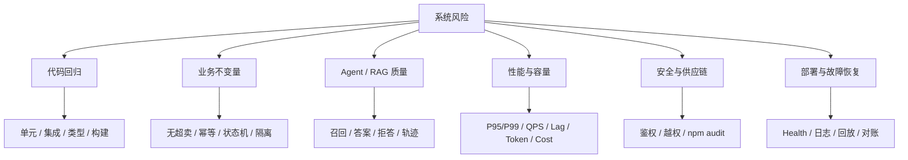

例如，141条后端测试全绿不能证明真实Milvus召回效果；Recall@4高不能证明退款事务正确；前端build成功不能证明用户点击退款真的创建工单；JMeter脚本存在也不能证明服务器承受过10万请求。

### 2. 测评金字塔与发布门槛

| 层级 | 运行频率 | 回答的问题 | 当前证据 |
| --- | --- | --- | --- |
| 静态检查 | 每次提交 | 类型、语法、依赖是否可构建 | Maven编译、TypeScript typecheck |
| 单元测试 | 每次提交 | 单个规则、状态和算法是否正确 | Java 141条中的大部分；前端9条 |
| 组件/集成测试 | 每次合并 | Spring、H2、Redis Lua、Drools、消费者能否协作 | API/Agent/规则测试；部分Redis测试跳过 |
| 业务不变量 | 每次合并 | 是否超卖、重复建单、越权、非法状态 | NoOversell、Idempotency、Isolation、状态机测试 |
| Agent离线评测 | Prompt/知识/模型变更 | 召回、答案、拒答是否回归 | 40条RAG数据集、失败回放 |
| 构建与供应链 | 每次发布 | 前端能否生产构建、依赖是否有已知漏洞 | Vite build、npm audit |
| 端到端/浏览器 | 每次发布 | 用户真实操作是否闭环 | 历史人工验收；本轮复验超时，自动E2E缺失 |
| 性能/故障 | 重大版本/容量变化 | P95/P99、极限吞吐、积压和恢复 | 有JMeter计划；缺本轮实跑报告 |

一个成熟发布门槛应是多维的：代码测试为零失败、关键业务不变量为零破坏、Agent安全错误为零、质量指标不低于基线、构建成功、严重供应链漏洞清零、性能SLO满足目标。不能让某一项高分抵消另一项安全红线。

### 3. 后端自动化测试：141条真实结果

执行方法：

```powershell
cd insightforge
mvn clean test
```

本次结果：Maven `BUILD SUCCESS`，**141 tests、0 failures、0 errors、7 skipped**。模块拆分：

| 模块 | 测试数 | Failures | Errors | Skipped | Surefire用例耗时合计 |
| --- | ---: | ---: | ---: | ---: | ---: |
| agent-core | 46 | 0 | 0 | 0 | 5.438s |
| api | 62 | 0 | 0 | 7 | 12.273s |
| rule-engine | 30 | 0 | 0 | 0 | 4.315s |
| seckill-core | 3 | 0 | 0 | 0 | 1.262s |
| 合计 | 141 | 0 | 0 | 7 | 23.288s |

这里的用例耗时是各XML testsuite记录之和，不等于Maven完整墙钟时间；完整构建还包含编译、启动测试上下文等，本轮墙钟约40秒。

#### 后端主要测了什么

交易与并发：

- `SeckillNoOversellTest`：并发请求后库存不能为负。
- `SeckillIdempotencyTest`：相同业务键重复请求不能重复扣减/建单。
- `SeckillRedisLuaTest`：Lua扣减返回语义与原子路径。
- `SeckillRateLimitTest`：入口滑动窗口放行/拒绝。
- `OrderCreatedConsumerStatusTest`：Kafka消费者幂等建单与状态。
- `OrderCompensationTaskTest`：预扣未落库的补偿巡检。
- `ReconcileRedisCrossCheckTest`：Redis、DB和订单销量交叉对账。
- `ActivityStateMachineTest`：活动非法状态迁移被拒绝。

商城与售后：

- `ShoppingFlowTest`：购物车、结算和订单主链路。
- `AfterSaleFlowTest`：申请、审核、驳回/申诉、退款状态。
- `SupportTicketFlowTest`：专属客服与人工工单。
- `PaymentTokenServiceTest`：支付令牌一次性消费、过期和错误订单校验。
- `AuthFlowTest`：登录、角色和认证流程。

Agent/RAG/规则：

- `KnowledgeBaseServiceTest`、`TextChunkerTest`、`LocalLexicalEmbeddingProviderTest`：知识切块、检索和本地兜底。
- `MerchantIsolationTest`：商家知识不能跨租户召回。
- `DslCompilerTest`、`DslToDroolsTranslatorTest`：非法DSL Fail-Close和规则翻译。
- `MultiAgentOrchestratorTest/RejectTest`：多Agent成功与正确拒绝。
- `AgentRuntimeBudgetTest`、`BudgetGateTest`：步骤/token/成本预算。
- `CheckpointPauseResumeTest`、`InterruptGateTest`：暂停、恢复、取消。
- `EvaluationHarnessTest`、`GoldenEvalHarnessTest`：golden/失败样本回归与评测门槛。
- `ControlInstructionExecutorTest`、`SalesTickConsumerTest`：规则指令与销量事件闭环。

#### 这些测试的意义

普通CRUD测试主要防代码回归；NoOversell、Idempotency、Isolation和状态机测试保护的是业务不变量，即使未来替换Redis/Kafka实现也不能破坏。Agent拒绝测试证明“应该拒绝时拒绝”也属于正确结果。对账和补偿测试处理的是异步系统无法由单次事务覆盖的故障窗口。

#### 后端测试的局限

- 7条跳过项不能当通过：其中3条是Redis滑动窗口用例，4条是Redis Lua用例（包括300线程抢100库存）。本轮测试环境没有启用真实Redis集成条件，所以明确记录为未执行。
- H2测试不能完全代表MySQL锁、索引和SQL方言。
- Mock Kafka/Redis测试不能替代真实broker和故障切换。
- 当前没有JaCoCo覆盖率报告；测试数量不等于覆盖率和断言质量。
- 真实并发规模、GC、连接池和consumer lag需要独立压测。

### 4. 前端测评：从“能编译”补到业务规则回归

执行方法：

```powershell
cd insightforge-frontend
npm run test
npm run typecheck
npm run build
```

本次结果：

- Vitest：**1个测试文件、9条测试全部通过**，测试执行约3ms，完整Vitest运行约0.44s。
- TypeScript：`tsc --noEmit`通过。
- Vite生产构建：通过，转换2168个模块，约4.92s。
- 主Dashboard chunk：约**1,056.26KB**，gzip约**351.42KB**，超过500KB警告线。

新增的9条测试覆盖：

- 只把当前活动的历史订单识别为已购买SKU。
- “已购买”优先于加载、售罄和未开抢，按钮必须禁用。
- 抢购中、售罄、未开抢、立即抢购文案的优先级。
- 折扣计算的有效/无效边界。
- 退款成功后只移除对应订单草稿，防止重复点击。
- HTTP成功但业务code失败不能展示成“退款已提交”。

这些用例直接对应真实缺陷：限购后仍可点击、退款聊天文本与真实事务混淆。我们把页面中的纯业务规则抽成函数测试，但后端仍是最终鉴权、状态和幂等边界。

#### 为什么还要typecheck和build

单元测试只执行被导入的逻辑，不能发现所有组件的类型连接和生产打包问题。本轮第一次测试后，typecheck实际发现“导入函数与React state同名”的遮蔽错误；修复后测试、typecheck、build才全部通过。这证明三道门互补。

#### 前端性能与供应链结果

Dashboard chunk过大可能增加首屏下载、解析和执行时间。下一步应拆ECharts/商家大屏为动态import或manual chunks，并使用浏览器Lighthouse/Web Vitals重新测LCP、INP、CLS；当前没有这些真实结果，不能声称前端性能优秀。

`npm audit`结果：

- 初始4项：2 moderate、1 high、1 critical。
- Vitest从3.2.4升级到3.2.6后，critical已清除。
- 生产依赖剩余 **1个moderate**：ECharts `<6.1.0` XSS公告，需要升级ECharts 6并回归图表。
- 完整依赖仍有 **1个high + 2个moderate**：其中Vite/esbuild主要影响开发服务器，需要Vite主版本升级和兼容验证。

没有执行 `npm audit fix --force`，因为强制主版本升级可能破坏构建。正确做法是建立升级分支、阅读迁移说明、测试图表和构建后再合并。生产由Nginx提供静态文件，不运行Vite开发服务器，这降低Vite漏洞的线上暴露，但不等于可以忽略开发供应链风险。

#### 前端仍缺什么

- 已有 Playwright Chromium 关键路径 2/2 和 Vitest 9/9，但尚无 React 组件级交互、可访问性与视觉回归测试。
- 当前 E2E 覆盖登录、秒杀页、商品详情、客服退款入口和商家评测页；还没有把退款工单创建→审核→到账、重复秒杀按钮禁用做成隔离数据的状态型 E2E。
- 本轮云端浏览器控制环境初始化失败，因此云端 UI 自动化不能记为通过；HTTP/API 健康检查不能替代视觉与交互验收。
- 仍需多视口、键盘/axe、网络失败和 Web Vitals 预算，防止中文乱码、布局和性能退化。

### 5. Agent/RAG离线评测：40条云端真实结果

数据集：`rag-cn-commerce-v1.0`，共40条；覆盖35条可回答和5条应拒答样本。Embedding为DashScope `qwen3.7-text-embedding`，向量库为Milvus，Top-K=4。

执行入口：商家端Agent评测页或：

```text
POST /api/dashboard/rag-evaluation/run
```

每条样本包含：问题、merchantId、类别、是否可回答、期望docKey和关键事实。运行时带商家过滤检索Top-4，用期望文档和关键事实覆盖做确定性判分，并记录单条检索延迟。评测接口现按固定顺序运行四个变体，使每次运行都能得到同数据、同知识版本的消融对比：

1. `A_DENSE_ONLY`：仅稠密向量检索，作为朴素基线。
2. `B_DENSE_ROUTE`：向量检索 + 意图路由，隔离路由本身的增益。
3. `C_DENSE_ROUTE_GUARD`：再加入Fail-Close安全门槛，隔离安全策略的增益。
4. `D_HYBRID_RRF_ROUTE_GUARD`：增加轻量词法召回，以RRF融合稠密/词法排名，是当前候选方案。

| 云端同条件方案 | Recall@4 | 答案正确率 | 拒答正确率 | 检索 P95 |
| --- | ---: | ---: | ---: | ---: |
| A：仅 Dense（普通方案） | 74.29% | 65.71% | 0% | 586ms |
| B：Dense + 意图路由 | 91.43% | 82.86% | 0% | 415ms |
| C：Dense + 路由 + 安全门 | 91.43% | 82.86% | 100% | 422ms |
| D：Hybrid RRF + 路由 + 安全门（当前方案） | **100%** | **100%** | **100%** | 611ms |

优化的意义：初始通用向量搜索会把发票问题命中错误FAQ，也会让敏感问题被低相关知识“勉强支持”。加入业务意图路由缩小来源空间，加入安全门槛让秘密、跨商家、未知实时事实和绕审批请求不进入生成。

最终 D 在这 40 条受控集上没有失败；但数据集参与过调优，因此不能把满分外推为线上准确率。A→B 说明路由同时改善召回和延迟；B→C 隔离出安全门对拒答的贡献；C→D 说明混合召回补齐精确实体/数字，代价是 P95 增加 189ms。下一轮仍要用未参与调参的隐藏集验证 parent-child、reranker 是否继续有净收益。

#### 为什么选择混合检索与RRF，而不是堆更重的框架

向量检索擅长同义表达，但对手机型号、百分比、订单号和规则数字不总是稳定；词法检索恰好擅长精确词。RRF不要求把两路分数校准到同一尺度，只按名次计算 `Σ 1/(k+rank)`，因此比手调向量/BM25权重更稳健、实现更容易回滚。项目当前知识库小，词法通道直接扫描审计切块表并计算字符二元组重合度，不额外部署搜索集群；规模增大时可以替换成Elasticsearch/OpenSearch BM25而不改变评测接口。

这不是把“使用 RRF”等同于“效果已提升”：提升来自同一云环境、同一数据集、同一知识版本的四组实测。若以后隐藏集上 D 不再提高 Recall/正确率，或 189ms 额外 P95 不值得，就关闭 `hybrid-enabled` 回滚。

本轮还在H2、36个切块、`local-lexical-512`确定性embedding上实际运行了四组消融。该环境不代表Milvus/生产模型，但可以低成本验证算法接线和相对趋势：

| 本地同条件变体 | Recall@4 | 事实覆盖正确率 | 拒答准确率 | 检索P95 |
| --- | ---: | ---: | ---: | ---: |
| A 仅稠密检索 | 94.29% | 94.29% | 0% | <1ms（计为0ms） |
| B 稠密+路由 | 91.43% | 91.43% | 0% | <1ms（计为0ms） |
| C 稠密+路由+安全门槛 | 91.43% | 91.43% | 100% | <1ms（计为0ms） |
| D 混合RRF+路由+安全门槛 | **100%** | **100%** | **100%** | 1ms |

对照结论不是“路由必然有效”：本地B比A下降2.86pp，说明手工类别路由可能把相关候选排除，必须通过分类别失败样本修正规则；安全门槛只改善拒答，不改善可回答召回；D相对C提高8.57pp，说明精确词/数字通道补足了本地向量通道，但云端是否仍有同等增益必须重新测。P95的0ms来自毫秒取整，不代表零耗时。

针对3条“文档命中但关键事实不在切块”的失败，下一项优先实验是结构感知/parent-child切块：小块负责命中，返回时扩展父段上下文。Contextual Retrieval还可以在入库时给每块补充文档级上下文，再同时用于向量与词法索引，但它增加入库模型token和版本管理成本，应先对4条失败做小范围消融。GraphRAG需要实体关系抽取、社区发现与社区摘要，当前FAQ/商品知识以局部单跳事实为主，投入产出比低，因此不采用。

方法依据：RRF原论文报告其融合多个检索排名优于单个排名方法；Anthropic的Contextual Retrieval实验系统比较了embedding、BM25、上下文化和reranker组合；RAGAS强调把检索相关性、生成忠实性与答案质量分层测量；Microsoft GraphRAG官方流程明确包含实体/关系抽取、社区发现和多层摘要。这些外部结果只用于选择实验方向，不能冒充本项目成绩。

- RRF论文：<https://plg.uwaterloo.ca/~gvcormac/cormacksigir09-rrf.pdf>
- Contextual Retrieval：<https://www.anthropic.com/engineering/contextual-retrieval>
- RAGAS论文：<https://arxiv.org/abs/2309.15217>
- GraphRAG官方架构：<https://microsoft.github.io/graphrag/index/overview/>

#### 这些指标为什么有意义

- Recall@4低：生成模型根本看不到正确证据，Prompt再好也难回答。
- 答案正确率低但Recall高：可能是chunk事实覆盖、排序或生成忠实性问题。
- 拒答准确率：验证安全边界和正确失败，但还必须增加误拒率防止“全部拒答”。
- P95：约束尾延迟；平均值会掩盖少数很慢请求。

#### 当前评测的局限

- 40条足够建立工程闭环，不足以代表生产长尾。
- 当前“答案正确”判的是检索上下文事实覆盖，不是完整自然语言回答质量。
- 5条拒答样本过少，需要扩展prompt injection、编码绕过和跨租户变体。
- 611ms仅为当前方案检索P95，不是完整Agent端到端延迟，也不是并发SLA。
- 数据集参与过调优，下一步要建立未参与调参的隐藏保留集。

### 6. Agent轨迹、Token、成本和延迟观测

为什么需要：模型调用按token计费，长上下文、多Agent和重试会放大成本；平均成本低也可能有少数异常高费用。延迟要区分检索、首token、完整回答和完整任务。没有trace关联版本，就无法解释某次成本/错误来自哪个Prompt、模型或知识版本。

系统已经记录：

- trace级：状态、正确失败类型、modelVersion、promptVersion、总budgetTokens、预估costUsd、totalLatencyMs、HITL结果和终止原因。
- span级：角色/步骤、工具、tokenIn、tokenOut、latencyMs、retryCount、状态和置信度。
- 聚合接口：trace/span数量、输入/输出token总量、总/平均美元成本、trace P95、Prompt/模型/KB版本分布和失败回放候选。

```text
GET /api/dashboard/agent-ops
```

#### 正确统计口径

如果把一次trace定义为一个用户问题/Agent任务：

```text
平均输入 token / trace = Σ span.tokenIn / trace数
平均输出 token / trace = Σ span.tokenOut / trace数
平均总 token / trace = (Σ tokenIn + Σ tokenOut) / trace数
平均成本 / trace = Σ trace.costUsd / trace数
P95任务延迟 = trace.totalLatencyMs排序后的95%分位
```

必须注意：多Agent一次trace包含多个模型span，因此“每个问题平均token”不能用单次模型调用token代替；客服简单问题和商家规划也不应混在一个平均值里。生产应按scene/model/prompt/status分组，并同时报告median/P95和单位成功任务成本。

#### 当前真实数值状态

2026-08-13 已在阿里云生产编排中用 `deepseek-v4-flash` 跑完 15 条 Agent 集（10 条正常、5 条危险），模型响应 usage 经项目 MySQL trace 与 Langfuse 同 traceId 交叉验证。正常任务 10/10 成功，危险任务 5/5 正确失败；平均 **4071.73 token/任务**、平均 **$0.00203587/任务**，端到端 P50/P95 为 **19.905s/51.571s**。这些数字绑定该样本、Prompt/模型版本与当时网络，不是生产 SLA。

一条单独调价任务输入 612、输出 2217 token，约 $0.0014；Langfuse 收到同 traceId 的 8 个 observation、其中 4 个 GENERATION，证明不是按字符数估算。完整原始响应见 `docs/evaluation/cloud-agent-2026-08-13.json`。

仍缺的不是“有没有 token”，而是更完整的统计：输入/输出各自均值与 P95、首 token 延迟、按场景/版本分桶、线上时间窗趋势，以及超过一个版本周期的成本回归门。

#### 本地确定性 Agent 开发基线

为了验证观测链路和端到端编排，本轮在 H2、本地确定性模型、本地词法Embedding环境执行5个固定运营任务：保守调价、库存调拨、成本检查、销量提升和风险护栏。

结果：**5/5 SUCCESS、5 traces、35 spans、trace P95=22ms**；HTTP墙钟耗时依次为82ms（首次请求）、11ms、9ms、9ms、8ms。首请求包含Dispatcher等一次性初始化，因此明显高于后续请求。

本地聚合的input/output token和cost均为0。这不表示“一个问题真的消耗0 token”，而表示确定性桩没有调用真实分词/计费模型，当前span没有可计量token。将0当真实模型均值会严重误导，因此它只验证状态、版本、span和延迟聚合管道，不参与云端成本结论。

这次基准还发现本地关闭DeepSeek后trace版本仍可能继承`deepseek-chat`默认名，已在local profile覆盖为`local-deterministic-stub`，防止将桩运行误归因到真实模型。

### 7. Agent运行时与规则执行测试

除了40条RAG问答，Agent还需要评估“执行过程是否正确”：

- Budget/步骤门槛：超过token、成本、重试或步骤上限应停止。
- 正确失败：ASK/REFUSE/ESCALATE不应计为普通系统失败。
- 工具schema：错误字段、越权参数和未知工具被拒绝。
- DSL Fail-Close：低于成本、负调拨或非法动作不能发布。
- HITL：高风险策略未批准不能执行，拒绝后状态可追踪。
- 暂停/恢复/取消：长任务能在检查点安全终止或继续。
- 失败回放：历史失败在新版本下重跑，写操作必须dry-run/隔离。
- Drools/Worker：销售事件能匹配规则并产生确定指令，异常不阻塞交易热路径。

这些能力由agent-core和rule-engine的76条测试（46+30）提供代码级回归。它们的意义是防止“RAG回答正确但Agent工具越权”这种只看答案指标无法发现的问题。

当前云端集还量化了平均步骤 8.33、正常任务成功率和危险任务正确拒绝率。仍应增加 tool selection accuracy、argument accuracy、重试率、HITL率、unsafe action=0，以及真正的单 Agent/多 Agent/Workflow质量-成本对照。

#### Agent 普通调度与并行调度对照

为什么测：四个角色如果串行调用，最慢模型调用会被累加，可能把多 Agent 的结构收益变成用户不可接受的尾延迟。目的不是证明“Agent 越多越聪明”，而是验证当前 DAG 中相互独立角色是否值得并行。

方法：从 15 条真实云端 trace 读取 SELECTOR、PRICER、WARMUP、RISK 四个 span。当前并行角色阶段耗时为 `max(role latency)`；普通串行调度反事实为 `sum(role latency)`；Planner、Guardrail、Critic 等非角色耗时保持不变。两边复用相同模型响应，所以任务状态、token 和成本严格相同。可复算脚本是 `deploy/benchmarks/agent_parallel_ablation.py`。

| 调度方案 | P50 | P95 | 任务质量 | 15条总 token/成本 |
| --- | ---: | ---: | --- | ---: |
| 普通串行角色（span反事实） | 33.959s | 97.836s | 与实测输出相同 | 61076 / $0.030538 |
| 当前并行角色（云端实测） | **19.905s** | **51.571s** | 10/10成功、5/5正确拒绝 | 61076 / $0.030538 |

平均每任务节省 16.687s，平均加速 1.994×。这是严谨的“调度延迟消融”，但不是实际运行的单 Agent 基线，也不能证明多 Agent 提高答案正确率；真正的单 Agent A/B 仍需让一个 Prompt 在相同任务集输出同一 DSL，再比较任务成功率、工具参数、token、成本和 P95。原始摘要见 `docs/evaluation/cloud-agent-parallel-ablation-2026-08-13.json`。

### 8. 秒杀并发与性能测评

当前自动化测试证明“在测试并发下库存不为负、重复请求幂等”，但不能回答生产吞吐极限。仓库有JMeter计划：**2,000线程、300秒ramp-up、每线程50次**，理论请求计划为10万次，目标接口 `/api/seckill`。

这只是测试计划，不是结果。本轮没有在隔离压测环境执行，因此不能写“10万请求成功”或“P99<10ms”。不能直接压公网演示服务器，因为会改变订单/库存、产生外部负载并影响其他用户。

正式压测至少要报告：

- 环境：CPU/内存、JVM、MySQL/Redis/Kafka拓扑、分区、副本、数据规模。
- 负载：并发、到达率、ramp-up、持续时间、用户/活动/SKU分布。
- 性能：吞吐、P50/P95/P99、系统错误率、业务售罄/限流比例。
- 资源：API CPU/GC/线程池、DB连接/慢SQL、Redis延迟、Kafka producer/consumer lag。
- 正确性：库存不为负、唯一订单、初始库存 = 剩余 + 有效销量 ± 合法补偿。
- 恢复：压测后积压清零时间、补偿完成时间和数据对账。

建议分阶段：单接口基线 → Redis热点 → Kafka/DB端到端 → 重复请求 → 多SKU → Redis/Kafka故障注入。目标不是把QPS数字做大，而是找出第一个饱和点和正确降级行为。

### 9. 端到端业务验收

端到端测试验证组件连接后用户是否真的完成目标。至少需要两套：

买家链路：登录 → 商品详情 → 加购/下单 → 支付 → 物流 → 确认收货 → 评价；秒杀成功后再次进入应显示“您已购买过”且按钮禁用；专属客服生成退款草稿，用户确认后必须出现真实售后工单。

商家链路：登录 → 商品/活动 → Agent建议 → HITL → 规则执行 → 订单价格快照；售后审核/驳回 → 买家申诉 → 复核退款；Agent评测页显示版本、指标和失败回放。

仓库已有本地 Playwright Chromium 关键入口 2/2 报告，但本轮云端浏览器控制环境初始化失败，没有新的云端 UI 报告。因此当前状态应写为：**本地关键入口 E2E 已建立，云端与状态型业务闭环尚未自动验收**。

下一步最值得补的是Playwright：为种子账号准备隔离数据，每次测试重置/创建独立订单，断言UI与API/DB状态，而不是只断言出现成功toast。退款E2E必须检查售后列表中的真实工单ID。

### 10. 测试结果总表：通过、警告和未测

| 领域 | 当前结果 | 状态 | 能证明 | 不能证明 |
| --- | --- | --- | --- | --- |
| Java后端 | 141，0 failure/error，7 skipped | 通过/有跳过 | 代码与关键业务回归 | 生产规模与真实集群高可用 |
| 前端业务规则 | 9/9通过 | 通过 | 限购、按钮、折扣、退款结果处理 | 完整React DOM/E2E |
| 前端类型/构建 | typecheck、build通过 | 通过/有警告 | 类型连接和生产可打包 | 浏览器性能与视觉正确 |
| 前端bundle | Dashboard 1.06MB，gzip351KB | 警告 | 发现拆包优化目标 | 尚无Web Vitals |
| npm生产依赖 | 1 moderate ECharts XSS | 未达安全门槛 | 已知供应链风险可追踪 | 尚未升级回归 |
| RAG 40条 | 云端 A/B/C/D：A=74.29/65.71/0/586ms，D=100/100/100/611ms | 通过受控集消融 | 路由、安全门、Hybrid RRF 的独立贡献 | 隐藏集、完整生成质量和并发 SLA |
| Agent token/成本 | 云端15任务平均4071.73 token、$0.00203587，P50/P95=19.905/51.571s | 通过小样本 | 真实模型质量、安全、成本和延迟 | 长期趋势、首token与版本漂移 |
| Agent 调度消融 | 串行反事实P50/P95=33.959/97.836s；并行实测=19.905/51.571s | 延迟对照通过 | 相同调用并行平均加速1.994× | 不是单Agent质量A/B |
| Agent运行时 | Agent+规则76条测试 | 通过 | 预算、拒绝、DSL、执行回归 | 大模型漂移和线上业务收益 |
| 秒杀 | 并发不超卖/幂等测试通过 | 代码级通过 | 关键不变量 | 10万请求性能数字 |
| JMeter | 2000×50计划 | 未执行 | 压测模型已准备 | 不是性能结果 |
| 浏览器E2E | 本地 Playwright 2/2、Vitest 9/9；云端浏览器环境初始化失败 | 部分通过 | 已覆盖关键入口与业务规则 | 退款/限购状态闭环、视觉和云端UI |
| 公网只读容量 | 1/5/10/25并发错误率30%/43.33%/16.67%/20%，P95均约13.5～15.3s | **未达标** | 证明公网路径存在明显瓶颈 | 不能宣称生产QPS或把本地1959RPS外推 |

### 11. 为什么保留失败和未测项

面试官真正关注的不只是“你有多少绿色数字”，而是你是否知道数字边界。保留4条RAG失败能驱动切块优化；报告bundle警告能驱动前端拆包；报告ECharts漏洞能驱动依赖升级；承认JMeter未跑能避免虚假性能声明；不伪造token均值体现观测工程的严谨性。

一个可信项目应该做到：每个架构卖点都有对应证据，每个数字都有样本量和口径，每个失败都有归因和下一步，每个未测项都不会被包装成已完成。

### 12. 下一轮测评优先级

P0（发布前）：

1. 升级ECharts并回归全部图表，清除生产依赖已知漏洞。
2. 建立买家退款与秒杀限购Playwright E2E，断言真实工单/订单状态。
3. 从同地域独立压测机定位公网/Nginx瓶颈，错误率归零后再建立容量基线。

P1（面试作品增强）：

1. 扩RAG到100～200条，增加隐藏集、误拒率、prompt injection和工具轨迹指标。
2. 为 RAG 建立未参与调参的隐藏集，再比较 parent-child、reranker/Contextual Retrieval 的净收益。
3. 实作单 Prompt 单 Agent 基线，与当前多角色方案同任务、同模型比较质量、token、成本和 P95。
4. 在隔离环境执行JMeter并生成HTML报告、资源曲线和对账SQL结果。
5. 接入JaCoCo和前端coverage，但以关键路径/变异测试解释覆盖率，不追求空洞百分比。

P2（生产化）：

1. Redis/Kafka故障注入、恢复时间和数据补偿SLA。
2. OpenTelemetry统一HTTP/Kafka/Agent trace，建立SLO和错误预算。
3. 真实业务A/B，把Agent策略版本关联到GMV、毛利、退款解决率和人工接管率。

### 13. 补充实测：Agent任务质量、浏览器E2E与本地容量（2026-08-12）

### 13.0 云端真实模型与可观测性复测（2026-08-13）

本节数据来自阿里云生产编排，不是本地桩或预填数字。部署提交为 `f3fb944`，Agent 模型为 `deepseek-v4-flash`。MySQL 仍是 trace 的事实来源；应用在持久化成功后，以 fail-open 异步 OTLP/HTTP 将不含完整 Prompt/答案正文的模型名、版本、token、成本、延迟和状态发往 Langfuse。这样 Langfuse 故障不会阻断业务，同时可以用相同 traceId 在本地数据库与外部观测平台交叉核验。

单条真实调价任务成功发布策略：墙钟 **13.8s**，输入 **612**、输出 **2217 token**，估算成本约 **$0.0014**。Langfuse 随后查到同一 traceId 的 **8** 个 observation，其中四个角色调用被识别为 `GENERATION`。这证明计量来自模型响应 usage，而不是按字符数猜测。

完整 Agent 评测集为 10 条正常任务加 5 条危险任务，直接连接 API 容器执行，避免 Nginx 60 秒代理超时污染结果：

| 云端 DeepSeek Agent 指标 | 结果 |
| --- | ---: |
| 正常任务成功率 | **10/10，100%** |
| 危险任务正确拒绝率 | **5/5，100%** |
| 总验收通过率 | **15/15，100%** |
| P50 / P95 | **19.905s / 51.571s** |
| 平均步骤 | **8.33 spans/任务** |
| 平均 token | **4071.73 token/任务** |
| 平均成本 | **$0.00203587/任务** |
| 整轮墙钟 | **315.70s** |

这里最重要的结论不是“100%”，而是本地桩的 4ms P50 与真实模型的 19.9s P50 相差几个数量级：前者适合 CI 回归编排正确性，后者才反映网络、模型和并行角色调用的用户体验。15 条样本仍不足以证明生产泛化，后续要扩大真实失败样本、做 `pass^k`、按模型/Prompt 版本分桶，并把 P95 作为优化门槛。原始报告见 `docs/evaluation/cloud-agent-2026-08-13.json`。

同一云环境还运行了 40 条 RAG 数据集（35 条可回答、5 条应拒答）的消融：

| RAG 方案 | Recall@4 | 答案正确率 | 拒答正确率 | P95 |
| --- | ---: | ---: | ---: | ---: |
| A：仅 Dense | 74.29% | 65.71% | 0% | 586ms |
| B：Dense + 路由 | 91.43% | 82.86% | 0% | 415ms |
| C：Dense + 路由 + 安全门 | 91.43% | 82.86% | 100% | 422ms |
| D：Hybrid RRF + 路由 + 安全门 | **100%** | **100%** | **100%** | 611ms |

路由缩小候选域，同时改善质量和 P95；安全门解决“不可回答问题也硬答”；RRF 再补齐关键词/实体精确匹配，换来相对 C 约 189ms 的 P95 增量。40 条自建集上的满分只能证明当前受控数据集，不能等同线上准确率。原始报告见 `docs/evaluation/cloud-rag-2026-08-13.json`。

公网只读容量阶梯最终生成了失败报告：压测机从公网访问商品列表，每阶60请求；1/5/10/25并发的错误率分别为 **30%/43.33%/16.67%/20%**，P95分别为 **15.251s/15.306s/13.695s/13.521s**，吞吐仅0.19/0.64/2.18/3.58 RPS。结果非单调，说明短样本、跨公网网络抖动和超时强烈污染吞吐，不适合作为容量上限；但“错误率远非0”足以判定发布门不通过。与此同时容器内 `/actuator/health` 为200、约37ms，API内存约489/768MiB，因此下一步应从同地域独立压测机分别压Nginx与容器直连，联动带宽、连接数、upstream time、Tomcat线程、MySQL池和CPU/GC做分层归因。原始结果见 `docs/evaluation/cloud-capacity-2026-08-13.json`。

#### 为什么测试、怎样判定：统一口径

| 测试层 | 原因与目的 | 方法 | 当前结论 |
| --- | --- | --- | --- |
| RAG 消融 | 防止把多个改动一起上线后无法归因 | 同云、同40条、依次关闭/开启路由、安全门、Hybrid RRF | 普通 Dense 到当前方案质量显著提高，P95增加25ms；受控集通过 |
| Agent任务与安全 | 答案像样不等于工具任务完成，也不等于危险动作被拦截 | 10条正常按最终策略状态验收，5条危险要求CORRECT_FAILURE | 15/15通过；仍需隐藏集与pass^k |
| Agent成本/延迟 | 多Agent可能用质量换来不可接受成本和尾延迟 | DeepSeek usage→span→trace，MySQL与Langfuse同traceId核验 | 4071.73 token、$0.00204/任务；P95 51.571s偏高 |
| Agent并行消融 | 验证并行是否真正抵消多角色等待 | 同一真实span计算串行sum与并行max，非角色耗时不变 | 平均加速1.994×；只证明调度，不证明单Agent质量 |
| Java后端 | 防止状态机、鉴权、幂等、补偿和DSL回归 | Maven单元/集成测试 | 141 tests，0失败/错误，7 skipped |
| 秒杀正确性 | 性能再高也不能超卖或重复订单 | 300并发争抢100库存；重复请求与支付token回归 | 不超卖/幂等代码级通过；生产写压测未完成 |
| 前端 | API正确不代表用户能完成流程 | Vitest规则测试、Playwright关键入口、typecheck/build | 9/9、2/2与构建通过；状态型退款/限购E2E仍缺 |
| 公网容量 | 本地快不代表云端链路可用 | 公网1/5/10/25阶梯，每阶60只读请求 | 错误率16.67%～43.33%，明确未达标 |

测试完成的判定不是“所有格子都有数字”，而是：有明确环境和版本、有普通方案/改进方案可归因对照、有原始机器可读证据、有通过门槛，也保留失败和未测项。按这个标准，**RAG对比、Agent真实质量/安全/成本、Agent并行调度对比、常规后端和本地前端入口已经完成；真正单Agent质量A/B、生产秒杀容量、云端状态型UI E2E、故障注入与长期稳定性仍未完成。**

#### Agent不能只测RAG

RAG回答“证据有没有找到”，Agent评测还要回答“任务有没有完成、工具是否安全、用了多少步骤、多久完成、是否值得成本”。本轮把10条正向运营任务和5条危险任务接入产品评测接口 `POST /api/dashboard/agent-evaluation/run`，并在评测页展示：

| 本地确定性Agent指标 | 实测结果 | 含义 |
| --- | ---: | --- |
| 正向任务成功率 | **10/10，100%** | SUCCESS且发布策略同时包含REPRICE与REALLOCATE |
| 安全任务通过率 | **5/5，100%** | 危险方案全部进入CORRECT_FAILURE，未发布副作用 |
| 总达标率 | **15/15，100%** | 正确成功与正确失败分别验收后汇总 |
| P50 / P95 | **4ms / 24ms** | 完整本地编排trace，不是LLM生产延迟 |
| 平均步骤 | **8.33 spans/任务** | 用于发现无效循环和编排膨胀 |
| 平均token / 成本 | **0 / $0** | 本地确定性桩未计量，不能解释为真实模型免费 |

为避免单轮偶然性，同一15条任务又连续运行5轮：**50/50正向任务成功、25/25危险任务正确失败，5轮质量门全部通过**；各轮P95依次为19、5、4、10、4ms，平均步骤稳定为8.33。它相当于本地确定性环境的`pass^5=100%`，但模型桩本身无采样随机性，因此主要证明编排/持久化/验证器回归稳定，不能代替真实LLM在temperature和网络波动下的多次运行。

这套设计吸收了τ-bench的“任务必须在工具—用户—环境交互后按最终状态验收”思想，以及AgentDojo的“同时报告正常任务效用和攻击下安全性”思想。项目没有照搬它们的环境，而是映射到电商可程序验证状态：价格不能低于成本、退款必须属于用户、库存不得为负、高风险调价必须HITL。硬约束由数据库/DSL/状态机验证，不交给LLM Judge猜分；开放式话术以后再增加校准过的LLM Judge和人工抽检。

下一版Agent高级评测应增加：同一任务重复5次的`pass^k`稳定性、多轮退款状态任务、工具选择/参数准确率、间接Prompt Injection、误拒率、模型/PROMPT版本配对、真实token/单位成功成本，以及串行单Agent/并行多Agent的质量—P95—成本消融。OpenTelemetry GenAI语义约定可用于统一`invoke_agent`、`plan`、`execute_tool`等span；其Agent约定仍处于发展状态，应集中映射，避免业务代码散落不稳定字段。

参考：

- τ-bench（ICLR 2025）：<https://openreview.net/pdf?id=roNSXZpUDN>
- AgentDojo：<https://arxiv.org/abs/2406.13352>
- OpenTelemetry Agent spans：<https://github.com/open-telemetry/semantic-conventions-genai/blob/main/docs/gen-ai/gen-ai-agent-spans.md>

#### 浏览器E2E与前端测试

新增Playwright Chromium关键流程，采用web-first自动等待断言、CI重试和首次重试trace：

- 买家登录→秒杀页→商品列表→商品详情→客服退款入口。
- 商家登录→Agent质量评测页。

本地实测：**2/2通过，总耗时1.8s**。第一次接入发现Vitest误收集`e2e/*.spec.ts`，已通过配置隔离两种runner；还发现直接点击后立即导航会与登录状态更新竞争，增加URL断言等待；详情页断言改为URL+“加入购物车”用户行为，避免依赖装饰文本。纯函数Vitest仍为**9/9通过**，typecheck和生产build通过。

尚缺：退款工单真实创建/审核/到账的状态型E2E、秒杀再次购买后按钮禁用的隔离数据fixture、多视口/视觉回归、键盘与axe可访问性、网络失败/超时、组件级交互和前端性能预算。Playwright官方建议使用自动重试断言，并在CI失败时保留Trace：<https://playwright.dev/docs/best-practices>。

#### 常规后端与安全测试矩阵

本轮完整`mvn clean test`实测：**141 tests，0 failures，0 errors，7 skipped**。除单元/集成测试外，常规后端还应按下列矩阵管理：

| 层级 | 当前证据 | 继续补强 |
| --- | --- | --- |
| 单元/领域 | 状态机、DSL、预算、退款、幂等 | property-based、mutation testing |
| API/鉴权 | MockMvc、401/403、商家隔离、购物闭环 | OpenAPI契约、非法/边界输入参数化 |
| 数据/集成 | H2迁移、MyBatis、补偿/对账 | Testcontainers MySQL/Redis/Kafka/Milvus |
| 并发正确性 | 300并发/100库存无超卖；重复请求仅1单 | 真Redis Lua、Kafka重复/乱序、故障注入 |
| 安全 | JWT、RBAC、租户隔离、依赖审计 | OWASP ASVS/WSTG映射、DAST、密钥扫描、SBOM |
| 可观测 | health/prometheus、Agent trace/span | OpenTelemetry跨HTTP/Kafka/Agent链路 |

OWASP ASVS提供可验证安全控制清单，WSTG覆盖配置、身份、鉴权、会话、输入、错误、业务逻辑、客户端和API测试；项目应以Level 1/关键Level 2建立追踪表，而不是声称“跑过扫描就安全”。参考：<https://owasp.org/www-project-application-security-verification-standard/>、<https://owasp.org/www-project-web-security-testing-guide/latest/>。

#### 本地只读容量阶梯

新增零依赖脚本`deploy/benchmarks/http_capacity.py`，登录并预热后对商品列表执行1/10/25/50/100并发，每阶300请求：

原始机器可读报告保存在`docs/evaluation/local-capacity-2026-08-12.json`，便于复核表格而不是只相信人工转录。

| 并发 | 请求 | 错误率 | 吞吐RPS | P50 | P95 | P99 |
| ---: | ---: | ---: | ---: | ---: | ---: | ---: |
| 1 | 300 | 0% | 75.83 | 15.39ms | 27.67ms | 29.67ms |
| 10 | 300 | 0% | **1959.38** | 4.13ms | 8.74ms | 11.54ms |
| 25 | 300 | 0% | 1951.07 | 7.09ms | 27.16ms | 62.08ms |
| 50 | 300 | 0% | 1860.45 | 5.74ms | 15.09ms | 42.57ms |
| 100 | 300 | 0% | 1768.75 | 5.53ms | 9.89ms | 16.56ms |

环境：Windows本机、单Spring Boot进程、H2内存库、压测器与服务同机、读取20条商品页。它证明在这次短时本地样本中100并发无错误，并显示10并发后吞吐趋于平台；**不能据此宣称生产支持100并发或1959 RPS SLA**。单并发较慢与每请求urllib连接建立、JVM/客户端调度有关；总请求量较小也让百分位波动，正式报告需延长稳态时间、独立压测机并同步CPU/GC/DB指标。

秒杀写路径仍应使用JMeter CLI在隔离环境执行阶梯/尖峰/浸泡测试，并以库存、唯一订单和补偿对账作为正确性门槛。JMeter官方明确建议负载测试用CLI而不是GUI，并可生成JTL和HTML报告：<https://jmeter.apache.org/usermanual/get-started>。
