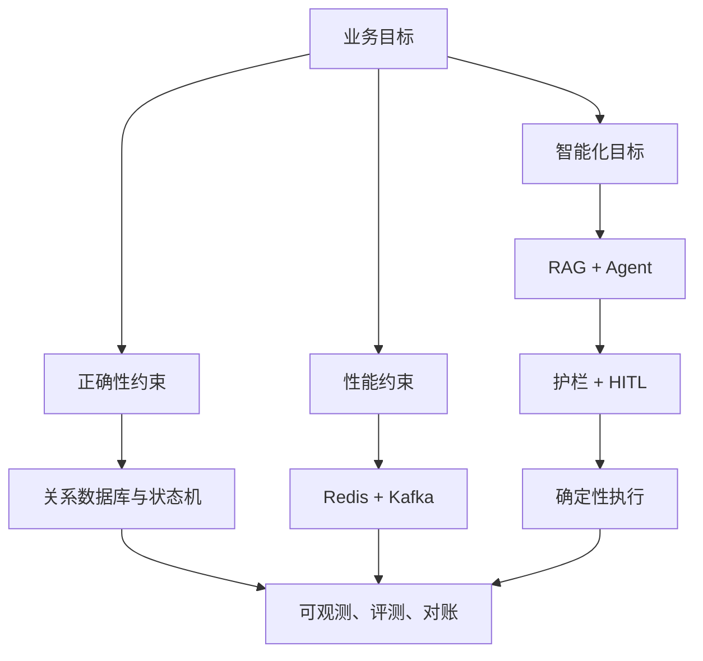
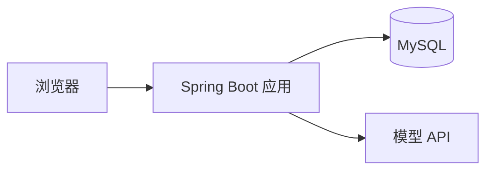
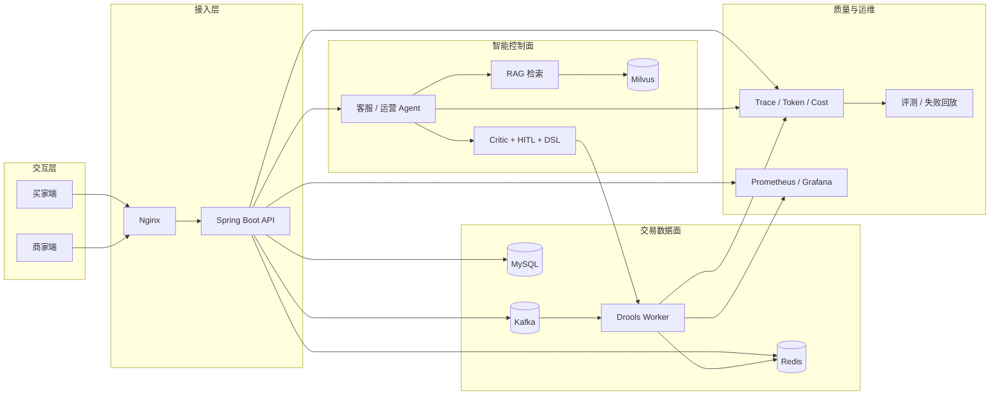
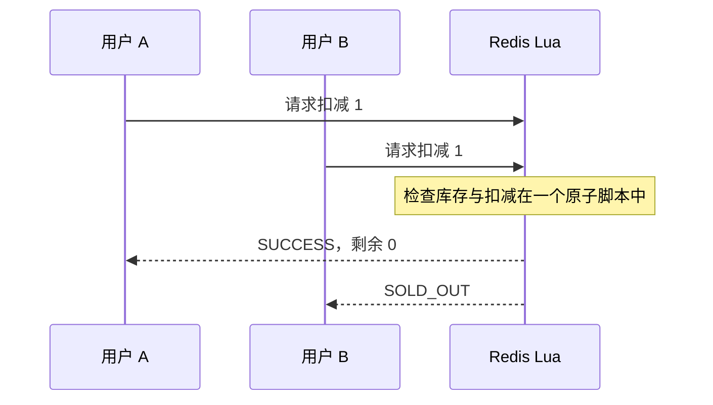
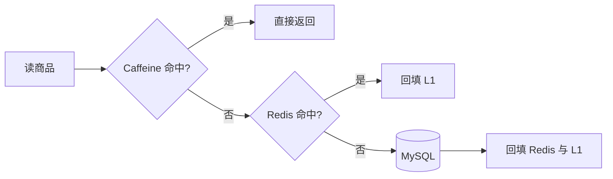
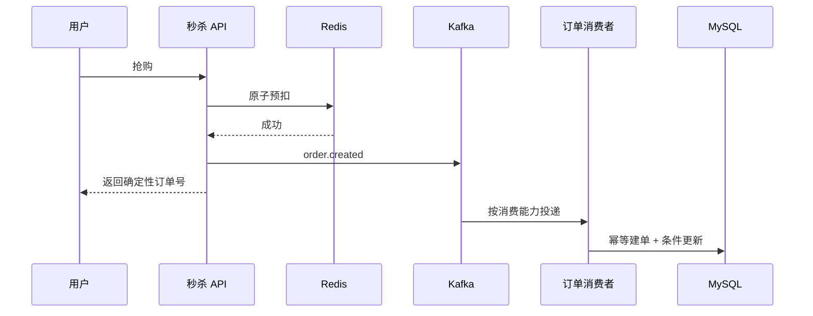
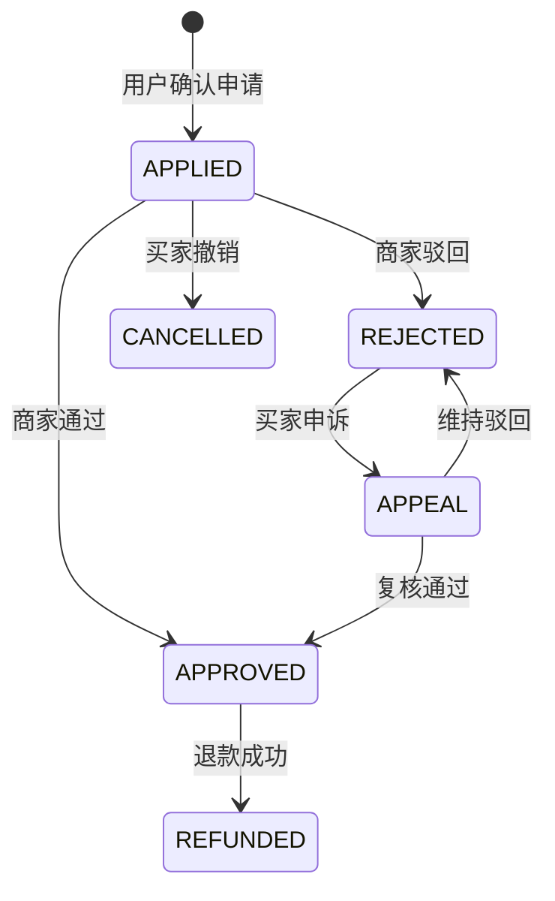
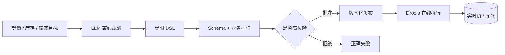
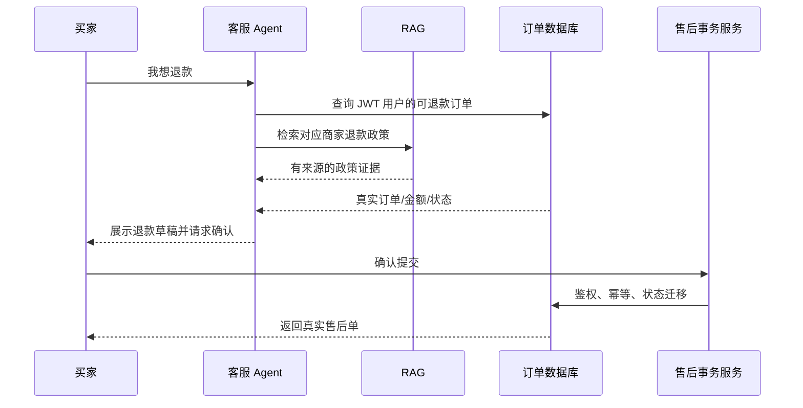
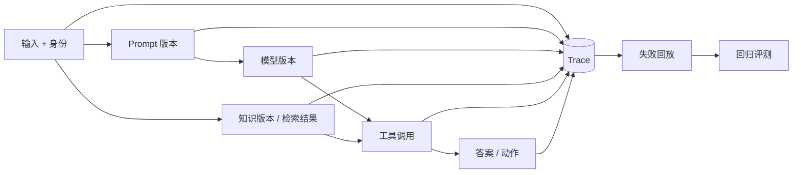

# InsightForge 架构设计与技术选型：从业务问题到系统方案

这是一份“不从代码出发”的学习文档。它不回答某个类怎么写，而是回答：如果我们面对相同业务，如何从一张白纸推导出现在的架构；每个组件解决什么矛盾；不用它会怎样；什么时候应该换成别的方案。

## 一、先定义问题，而不是先选技术

InsightForge 同时包含三类业务：

1. 普通电商：商品、购物车、订单、支付、物流、评价和售后。
2. 高并发秒杀：大量用户在短时间争抢少量库存。
3. Agent 应用：买家客服、商家运营、知识检索、调价建议和执行闭环。

这三类业务对系统的要求并不相同：

| 业务 | 首要目标 | 可接受延迟 | 最怕什么 |
| --- | --- | --- | --- |
| 普通订单/售后 | 事务正确、状态可追溯 | 数十到数百毫秒 | 错单、越权、重复退款 |
| 秒杀 | 极高并发下不超卖、快速失败 | 毫秒级 | 库存为负、重复订单、数据库被打垮 |
| RAG 客服 | 有证据、隔离、正确拒答 | 数百毫秒到数秒 | 幻觉、泄露其他商家知识、编造订单 |
| Agent 运营 | 策略合理、可审计、可回滚 | 秒级甚至异步 | 模型直接改价格/库存、错误策略失控 |

因此，不能拿一个组件解决所有问题。数据库擅长事务，不擅长承受瞬时热点；Redis 擅长内存原子操作，但不应独自承担永久订单真相；LLM 擅长理解非结构化意图，却不适合做库存扣减。

这张图表达最重要的方法：先写约束，再选能够满足约束的最小技术组合。

## 二、从零开始时，先写四条业务不变量

“不变量”是无论并发、重试还是组件故障都不应该被破坏的事实。本项目最重要的四条是：

1. 库存不能小于零。
2. 同一活动、同一 SKU、同一用户最多形成一张秒杀订单。
3. 用户只能操作自己的订单，商家只能访问自己的商品、知识和工单。
4. 模型不能未经确认直接完成退款、调价等高风险动作。

这四条比“用了 Redis/Kafka/Agent”更重要。技术方案改变时，不变量仍然有效。

### 为什么先定义同用户限一单？

因为幂等必须知道“哪两次请求是同一件事”。本项目把 `(activityId, skuId, userId)` 定义为业务唯一键，所以重复点击、网络重试和同一用户再次购买都指向同一订单。这是秒杀常见限购规则，不是 Redis 带来的限制。

如果业务允许每人三单，就应该把规则改成配额计数或购买序号，而不是简单把随机数加进订单号。前端禁用按钮只改善体验，真正约束必须在服务端。

## 三、第一版系统应该是什么样

如果刚开始只有几十个用户，不应该第一天就部署 Kafka、Milvus 和多个 Worker。第一版可以是：

它足以验证：商品能否下单、售后状态是否合理、客服能否识别意图、商家是否需要调价建议。

然后根据真实矛盾逐步演进：

| 阶段 | 出现的矛盾 | 增加的设计 |
| --- | --- | --- |
| 1. 业务闭环 | 订单、售后必须可靠 | MySQL、事务、状态机、唯一约束 |
| 2. 热点读增多 | 商品详情反复查库 | Caffeine + Redis 缓存 |
| 3. 秒杀并发 | 单一热点库存压垮数据库 | Redis Lua 原子预扣、入口限流 |
| 4. 建单峰值 | 瞬时数据库写入过高 | Kafka 削峰、幂等消费者 |
| 5. 智能运营 | 人工难以分析大量经营信息 | RAG、Agent 离线规划 |
| 6. 模型风险 | 幻觉和不确定输出可能改变交易 | DSL、Critic、HITL、Drools |
| 7. 线上定位 | 不知道某次错误用了什么上下文 | Trace、版本、评测、失败回放 |

这也是正确的架构学习顺序：每增加一个组件，都能说出它消除的具体瓶颈和增加的新成本。

## 四、整体架构为什么这样划分

这里有两个关键边界：

- 交易数据面负责“现在必须准确完成”的动作，例如扣库存、建订单、改变售后状态。
- 智能控制面负责“可以慢一点思考”的事情，例如理解客服意图、检索政策、生成调价策略。

二者不是彻底分离。Agent 的策略最终必须通过受控接口进入数据面；数据面的订单和销量也会成为 Agent 的事实输入。分离的是执行责任和风险等级，而不是把 AI 做成一个孤岛。

## 五、为什么选择模块化单体，而不是一开始微服务

项目在代码组织上是 Maven 多模块，在部署上把 API 和规则 Worker 分成独立进程。这是一种“模块化单体 + 必要进程隔离”的折中。

选择它的原因：

- 当前团队和流量规模不需要为每个业务单独部署服务。
- 商品、订单、售后之间有大量事务关系，共享关系库更简单。
- 模块边界让 Agent、秒杀、规则引擎仍可独立测试和演进。
- 规则 Worker 单独部署，是因为它消费事件且可能占用额外 CPU，隔离有实际收益。

为什么不直接微服务：

- 会立即引入服务发现、网关、配置中心、分布式追踪、跨服务事务和更多部署单元。
- 对小团队而言，运维复杂度可能大于业务收益。
- “微服务”不会自动带来高并发；热点库存最终仍要面对一致性问题。

何时应该拆：某个模块需要独立扩容、发布频率完全不同、故障隔离有明确价值，或团队边界已经稳定。秒杀订单消费者和 Agent Worker 都是未来可自然拆出的边界。

## 六、为什么以 MySQL 为业务真相源

订单、支付、售后和库存都具有明确关系、约束和状态迁移。MySQL 提供事务、唯一约束、条件更新、索引和成熟运维生态，适合保存不能丢失的业务事实。

MySQL 在项目里的责任：

- 用户、商品、活动、订单、售后、物流和评价的永久记录。
- `order_id` 等唯一约束，作为重复消息和重复请求的最终防线。
- `UPDATE ... WHERE stock >= qty`，保证数据库库存不为负。
- Prompt/知识版本、Agent trace 和审计记录。

为什么不只用 Redis：Redis 的速度很高，但缓存淘汰、误删、故障切换和内存成本都使它不适合作为订单唯一永久真相。即使启用 AOF，也不能替代关系约束、复杂查询和事务状态机。

为什么不选 MongoDB：业务核心不是无模式文档，而是强关系和状态约束。MongoDB 可以存聊天消息，但为少量灵活字段引入第二套主数据库并不划算。

为什么不是 PostgreSQL：PostgreSQL 同样可以胜任，甚至可以通过 pgvector 简化向量层。项目选择 MySQL主要考虑 Java 电商生态、招聘面试认知和已有中间件组合，不代表技术上 PostgreSQL 较差。若重新做一个资源受限的小规模版本，PostgreSQL + pgvector 是很合理的替代方案。

## 七、Redis 为什么存在，它到底做了什么

Redis 不是“项目必须有的高并发装饰”。它解决的是：大量请求对少数热点 key 做极短、原子、共享的读写，而数据库不适合承受这种瞬时竞争。

### 1. 秒杀库存的内存原子操作

库存先预热到 Redis。一次 Lua 脚本在 Redis 端完成读取、校验和扣减，执行期间不会被其他命令插入，因此避免客户端“先查还有库存，再扣减”之间的竞态。

如果没有 Lua，而是 `GET stock` 后再 `DECR`，两个用户可能同时看到库存为 1并都成功。也可以用数据库条件更新保证正确，但所有流量直接压到同一数据库行，吞吐和连接资源更差。

### 2. 幂等闸门

Redis `SETNX` 用确定性订单号快速判断同一业务是否已受理，避免重复请求再次扣减。它是性能防线，不是最终正确性防线；Redis key 丢失后，MySQL 唯一约束仍要挡住重复订单。

### 3. 分布式限流

按“用户 + 活动”维护滑动时间窗口，所有 API 实例共享计数。只在 JVM 内限流时，每台机器各自计算，扩到三台后实际总额度可能变成三倍。

### 4. 多级缓存的 L2

商品/SKU 等高频读先查进程内 Caffeine，未命中再查 Redis，最后才访问数据库：

Caffeine 更快但只在单进程；Redis 稍慢但多实例共享。空值哨兵防缓存穿透，TTL 抖动防大量 key 同时过期，单飞防一个热点 key 失效时所有线程一起打数据库。

### 5. 实时价格与库存视图

规则引擎的调价写入实时价格 key，新订单读取该值并保存成交快照；调拨写回与用户秒杀相同的库存 key。这样 Agent 的策略不是一段展示文本，而是真的影响后续交易。

### 6. 分布式协调

规则侧通过 Redisson 锁把同一活动/SKU 的控制面写操作串行化。需要精确说明：用户秒杀热路径靠 Lua 原子性，不持有这把显式锁；规则侧写库存时使用锁。二者共享的是同一份库存 key，而不是所有操作都用同一把锁。

### Redis 不负责什么

- 不负责永久保存订单真相。
- 不单独证明全链路 exactly-once。
- 不替代数据库事务和唯一约束。
- 不应该成为所有业务对象的默认存储。

### Redis 故障怎么办

普通读取可回源数据库；本地模式可退化到 Caffeine；秒杀路径可以降级到数据库条件更新，但必须限流，吞吐会降低。真正生产系统还应明确 Redis Cluster/Sentinel、超时、熔断、库存重建和故障期间是否直接关闭秒杀。项目演示部署是单 Redis 容器，不应宣称具备集群高可用。

## 八、为什么选择 Kafka，而不是所有动作同步完成

Redis 扣减很快，但建订单会涉及数据库事务。如果每个抢购请求都同步写数据库，峰值仍会压垮连接池。Kafka 把瞬时峰值变成可控的消费速度。

Kafka 在项目中承担两类事件：

- `order.created`：异步建单，削平数据库写入峰值。
- `sales.tick`：把销量变化传给规则 Worker，驱动确定性调价/调拨判断。

为什么选择 Kafka：高吞吐、分区有序、消费者组和事件回放适合销量流与订单事件，也符合后续数据分析扩展。

为什么不是 RabbitMQ：RabbitMQ 在复杂路由、任务队列和低延迟确认方面很好。如果项目只是异步发一封通知，RabbitMQ 可能更简单；但销售事件流、回放和高吞吐更符合 Kafka。选择不是“谁更高级”，而是消息模型不同。

为什么不使用 Redis Stream：它可以减少组件数量，适合较小规模；但把热点库存、缓存、限流和消息积压都放在一个 Redis 上会扩大故障影响面，而且 Kafka 的消费生态更成熟。资源极小的部署可以考虑 Redis Stream，代价是架构隔离和扩展能力下降。

Kafka 也带来新问题：消息可能重复、积压或发送后消费者失败。所以消费者必须幂等，数据库要有唯一约束，还需要补偿和对账。Kafka 的“生产者幂等”不等于业务 exactly-once。

## 九、为什么需要状态机、幂等和对账三件套

它们解决不同问题：

- 状态机：某个业务现在能不能执行，例如已退款订单不能再次发货。
- 幂等：相同请求执行多次是否等价于一次。
- 对账：异步和故障之后，不同存储中的结果是否仍一致。

退款示例：

状态机阻止非法迁移；售后业务唯一规则阻止重复申请；审计和对账发现状态已退款但资金/库存没有对应变化。只做其中一个都不完整。

## 十、为什么让 LLM 处于控制面，而不是交易热路径

LLM 有四个天然特征：网络调用慢、输出概率性、知识可能过期、单次调用有成本。秒杀扣库存恰好要求低延迟、确定性、实时事实和可证明正确。

因此项目采用：

模型负责“建议怎么做”，确定性系统负责“当前是否允许做”和“如何执行”。模型不可用时沿用旧策略，交易不应停止。

为什么使用 DSL：直接让模型生成 Java/SQL 或任意工具调用，权限面太大且难以验证。受限 DSL 只允许 REPRICE、REALLOCATE、REFUSE 等明确动作，容易做 schema 校验、成本/毛利护栏、版本对比和回滚。

为什么用 Drools：规则条件、动作和版本较多时，Drools 能提供成熟的匹配和确定性执行；它也让“模型产出策略”与“在线执行策略”解耦。代价是学习曲线、DRL 编译和调试复杂度。若规则只有三五条普通 if/else，自研简单规则表会更轻，没必要为了技术栈引入 Drools。

## 十一、客服 Agent 为什么不能只是 RAG 问答

客服包含两类完全不同的信息：

- 政策、FAQ、商品说明：适合 RAG。
- 订单号、金额、支付和售后状态：必须查结构化数据库。

完整退款链路：

如果让模型直接回答“已为你退款”，但没有真实事务，这只是幻觉式 UI。项目把 Agent 的职责限制为理解、检索和准备参数，真实写操作由服务端再次鉴权并在用户确认后完成。

## 十二、为什么是普通 RAG，而不是 GraphRAG

先区分概念：

- 普通向量 RAG 擅长“这段话和问题语义是否相近”。
- GraphRAG 先抽取实体、关系和社区，再适合回答跨文档、多跳关系与全局主题问题，例如“哪些供应商通过相同控股关系影响了三类商品，并共同出现在异常退款链路中”。

当前知识主要包括商家政策、FAQ、商品、活动和运营手册。典型问题是：

- “这个商家的退款时效是什么？”
- “这款商品支持什么保修？”
- “库存低于多少需要调拨？”

它们以局部语义检索、来源过滤和结构化查询为主，不需要沿知识图谱做多跳推理。订单与商家、商品的关系本来就在 MySQL 中，直接 SQL 比把它们再抽成图更准确、更新更及时。

### 不选 GraphRAG 的决策矩阵

| 判断问题 | 当前情况 | 结论 |
| --- | --- | --- |
| 是否有大量跨文档多跳关系查询？ | 很少，主要是政策/FAQ局部问答 | 普通 RAG 足够 |
| 是否需要全局社区/主题总结？ | 不是核心业务 | 暂不需要图社区摘要 |
| 文档规模是否大到局部向量检索明显失效？ | 当前规模较小，40 条评测已能定位问题 | 先优化路由、切块和 reranker |
| 关系是否稳定且值得抽取？ | 商品/订单关系频繁变化且已在 MySQL | 结构化查询更合适 |
| 是否有标注和评测证明 GraphRAG 有收益？ | 没有 | 不应先增加架构复杂度 |
| 部署资源是否充足？ | 演示服务器约 2C4G，现有组件已紧张 | 资源是额外限制，但不是首要理由 |

所以结论是：**不使用 GraphRAG 的第一原因是问题形态不匹配，第二原因是数据规模和收益尚不足，第三原因才是资源与运维成本。**

GraphRAG 会增加实体/关系抽取 token、图存储、社区构建、增量更新、版本一致性和评测成本。在 2C4G 上再运行图数据库也会加重内存压力，但即使服务器升级，如果业务问题仍是局部 FAQ，也没有必要使用。

### 什么时候应该引入 GraphRAG

当出现以下证据再做实验：

- 知识扩展到供应链、品牌、合同、风险事件等高度关联数据。
- 用户稳定提出跨多个文档和实体的多跳问题。
- 普通 RAG + metadata filter + hybrid search + reranker 仍无法达到目标。
- 建立了包含多跳问题的独立评测集，GraphRAG 在正确率上有可量化增益。
- 团队能承担图谱增量更新、实体消歧和监控成本。

演进时也不必替换全部 RAG。可以先做查询路由：局部 FAQ 走向量检索，多跳问题走 GraphRAG，订单实时事实仍走 SQL。

## 十三、为什么使用 Milvus，当前是否有点重

Milvus 是独立向量数据库，适合向量规模增长、独立扩容和多种 ANN 索引。项目使用它的目的包括：

- 把向量索引与 MySQL 业务真相分开，索引可重建。
- 演示真实向量库部署、metadata 隔离和检索评测。
- 为未来更多商家和知识量保留扩展空间。

但必须诚实：当前文档和评测规模并不要求 Milvus。Milvus standalone 还需要 etcd 和 MinIO，在 2C4G 演示机上是明显负担。

更轻的替代方案：

| 方案 | 优点 | 代价 | 适用情况 |
| --- | --- | --- | --- |
| 内存 SimpleVectorStore | 零运维、开发快 | 重启丢索引、不可多实例共享 | 本地学习和测试 |
| PostgreSQL + pgvector | 关系/向量一体、运维简单 | 需要从 MySQL 迁移或多维护一个 PG | 小中规模、资源有限的新项目 |
| Elasticsearch/OpenSearch | 文本 BM25、过滤与向量混合搜索强 | 集群运维和内存成本 | 搜索需求本来就很重 |
| Milvus | 专用向量能力、独立扩展 | 组件多、资源和运维较重 | 向量规模增长或需独立向量层 |

如果目标只是最低成本上线当前业务，保留 MySQL并使用轻量向量服务，甚至小规模内存索引，会更经济。项目选择 Milvus 是“工程展示与未来扩展”的取舍，不是当前数据量的唯一正确答案。

## 十四、为什么采用意图路由，而不是所有知识一起向量搜索

把商品、政策、运营手册和活动资料混在同一个候选空间里，会出现语义相似但业务类型错误的命中。例如“开发票”可能命中某个通用 FAQ，却不属于当前商家政策。

意图路由先把查询限制到 BUYER_POLICY、FAQ、PRODUCT、ACTIVITY 或 PLAYBOOK 等来源，再做向量检索和商家过滤。它用较低成本减少搜索空间，也更容易解释和评测。

为什么不先上 reranker：reranker 能改善排序，但会增加一次模型/服务调用和 P95。当前优先用业务已知的 metadata 和意图缩小候选集；剩余召回/排序错误达到一定规模后，再用评测证明 reranker 的收益是否值得延迟和成本。

为什么不只做关键词搜索：商品型号、订单号等精确词适合关键词，用户自然语言和政策同义表达适合向量。因此未来更合理的是 BM25 + vector 的混合检索，而不是二选一。

## 十五、为什么需要 Prompt/知识版本、Trace 和评测

Agent 的结果同时受输入、Prompt、模型、Embedding、知识版本、检索参数和工具状态影响。只保存最终回答，线上出错时无法复现。

- Prompt/知识版本回答“当时使用了什么”。
- Trace 回答“当时实际发生了什么”。
- 失败回放回答“修改后同一问题是否修好”。
- token/成本回答“效果提升是否值得成本”。
- 评测集回答“优化一类问题是否破坏了另一类问题”。

当前 40 条数据集是起点，不是终点。它覆盖可回答、不可回答、越权和敏感请求，并展示 Recall@4、答案正确率、拒答准确率和 P95。随着真实会话增加，应做训练/开发/保留集划分、人工标注一致性和线上反馈闭环。

## 十六、其他主要技术选型为什么这样做

### Java 21 + Spring Boot

选择原因：电商事务和中间件生态成熟，类型系统、线程/连接池工具、Actuator、Spring Data Redis/Kafka 和团队招聘生态适合后端主线。Java 21 提供长期支持和现代语言/运行时能力。

为什么不是全 Python：Python 的 Agent/数据生态更丰富，做快速 AI 原型更轻；但项目的难点还包括交易、状态机和高并发工程。把全部系统改成 Python不会自动改善 Agent 效果，反而偏离目标岗位。若未来模型实验复杂，可把评测/离线算法拆成 Python 服务，交易仍由 Java负责。

### Spring AI

它统一模型调用和 Spring 配置/依赖注入，减少供应商 SDK 散落。项目仍保留自研运行时和业务护栏，因为框架只能提供调用抽象，不能替业务定义权限、状态机和正确失败。

### MyBatis-Plus

电商 SQL 和条件更新需要可见、可控，MyBatis 便于写明确 SQL，又用 Plus 减少普通 CRUD。相比 JPA，它更容易直观看到热点更新语义；代价是 Mapper 和 SQL 维护较多。选择取决于团队熟悉度，不是 JPA 不能实现。

### Flyway

它把 schema 变化变成顺序、可审计的版本，保证新环境和生产升级路径一致。相比 `ddl-auto`，它不会在生产启动时不可控地改表。

### React + TypeScript + Ant Design

React 生态适合控制台和交互页面，TypeScript 在 API/状态结构变化时提供编译期反馈，Ant Design 快速提供成熟后台组件。选择它是为了交付和可维护性，不是追求定制视觉极限。若团队主要使用 Vue，Vue 3 + TypeScript 同样合理。

### Nginx

统一托管前端、反代 API/WS、处理静态缓存和入口限流，并让内部服务不直接暴露公网。云原生规模扩大后可换网关/Ingress，但单机 Compose 下 Nginx 更简单。

### Prometheus + Grafana

Prometheus 适合拉取时间序列指标，Grafana 负责看板与告警展示。它们回答系统层的 QPS、延迟、错误、JVM 和资源问题；Agent trace 回答单次语义执行，两者不能互相替代。

### Docker Compose

目标是让一台机器可重复启动全部依赖，并明确网络、volume 和资源限制。它适合开发/作品演示，不具备 Kubernetes 的调度、自愈和多机能力。当前没有多机规模，直接上 Kubernetes 会增加学习和运维成本。

## 十七、2C4G 部署资源如何影响架构

生产演示拓扑同时包含 MySQL、Redis、Kafka、API JVM、规则 JVM、Milvus、etcd、MinIO、Prometheus、Grafana 和 Nginx。2C4G 只能算紧凑演示环境，不是高并发容量声明。

资源有限时的优先级：

1. 保住交易正确性：MySQL、API、Redis。
2. 保住必要异步：Kafka/Worker；若规模极小可临时同步或换更轻队列，但要重新评估峰值。
3. 智能能力可降级：模型超时使用旧策略，向量层可换轻量实现。
4. 监控可在诊断时精简，但正式环境不能长期没有指标。

不要因为服务器小就牺牲数据库约束、鉴权或幂等；应该先减少可替代组件、降低并发承诺或升级资源。

## 十八、系统故障时应该怎样退化

| 故障 | 不应发生 | 推荐行为 |
| --- | --- | --- |
| LLM 超时 | 阻塞秒杀或乱生成策略 | 沿用旧策略，记录失败并重试 |
| Milvus 不可用 | 编造知识答案 | 拒答/转人工，必要时回退有限关键词检索 |
| Redis 不可用 | 无限制把全部秒杀流量打向 DB | 限流后 DB 条件更新兜底，或关闭活动 |
| Kafka 不可用 | Redis 扣了但订单永久丢失 | 同步兜底/可靠补偿，保留可恢复载荷 |
| 规则引擎失败 | 执行未经验证的模型建议 | 维持旧价/旧库存策略，告警 |
| 模型输出非法 | 尽量猜测并执行 | Fail-Close，作为正确失败记录 |
| 重复消息/请求 | 重复扣减或退款 | 业务幂等 key + DB 唯一/状态条件 |

“降级”不等于什么都继续做。高风险场景下，拒绝动作或暂时关闭秒杀往往比带病运行更正确。

## 十九、如果今天重新从零搭建，推荐顺序

### 第 1 步：画业务状态和权限

先画订单、售后状态机，定义买家/商家边界和四条不变量。此时不要引入 Agent。

### 第 2 步：完成单体事务闭环

用 Spring Boot + MySQL 完成商品、订单、取消、退款，补唯一约束与事务测试。先证明低并发正确。

### 第 3 步：度量热点，再引入 Redis

对商品读取加缓存；对秒杀库存使用 Lua 和限流；保留 DB 条件更新。明确每个 key 的业务含义、TTL 和重建方式。

### 第 4 步：异步削峰

当同步建单成为瓶颈，再加入 Kafka。先设计确定性订单号和幂等消费者，再开启异步，而不是先发消息后补正确性。

### 第 5 步：加入客服 RAG

先区分结构化事实和文档知识，用商家 metadata 隔离。建立小评测集，再决定 embedding、向量库、切块和 Top-K。

### 第 6 步：加入可控 Agent

从“生成退款草稿”这种有用户确认的场景开始，再做调价 DSL、Critic 和 HITL。不要一开始给模型库存/资金写权限。

### 第 7 步：让策略进入确定性执行

用简单规则或 Drools 执行已批准版本，确保模型离线、热路径零 LLM，加入回滚和审计。

### 第 8 步：评测和可观测

保存版本、trace、token、成本和失败样本；评测召回、答案、拒答和尾延迟。没有这一步，Agent 优化只能靠主观感觉。

### 第 9 步：真实中间件和故障演练

Compose 跑完整链路，验证重复请求、Redis/Kafka失败、跨商家访问、模型超时和回滚。最后才谈云部署和压测数字。

## 二十、哪些选择是当前方案，哪些是永恒原则

可以替换的当前方案：

- MySQL 可以替换为 PostgreSQL。
- Kafka 在更小规模下可以替换为 RabbitMQ/Redis Stream，或短期同步。
- Milvus 可以替换为 pgvector、OpenSearch 或轻量向量存储。
- Drools 可以替换为简单规则表或其他规则引擎。
- React 可以替换为 Vue。

不应轻易丢失的原则：

- 先定义业务不变量，再优化性能。
- 缓存不是永久真相，消息可能重复。
- 幂等要有业务语义和数据库最终防线。
- 结构化事实不交给模型猜。
- 模型建议与高风险执行之间要有权限、校验和人工确认。
- 多租户隔离必须在数据查询层实现。
- 所有智能优化必须有版本、trace、评测和回滚证据。

理解这些原则后，即使换掉 Redis、Kafka、Milvus 或 Drools，你仍能重新设计一个正确的系统。这才是学习架构的目的。

## 二十一、读完后的自测问题

1. 如果没有秒杀，Redis 的哪些用途仍值得保留，哪些可以删除？
2. 为什么 DB 条件更新已经防超卖，还要 Redis Lua？
3. 为什么 SETNX 和 Kafka 生产者幂等都不能替代订单唯一约束？
4. 哪些问题应该查 MySQL，哪些问题应该走 RAG？
5. 为什么不使用 GraphRAG 的首要理由不是服务器小？
6. 当前规模如果不用 Milvus，最合理的替代方案是什么？
7. 模型生成合法 JSON，为什么仍不能直接调价？
8. Redis 扣减成功、Kafka 失败时，系统怎样避免丢单？
9. 拒答为什么可能是正确结果？如何防止系统靠“全部拒答”刷指标？
10. 哪个模块增长到什么程度时，你会把它拆成微服务？

如果可以不看本文、结合业务约束独立回答这些问题，你已经理解了 InsightForge 为什么这样设计，而不只是记住了它使用哪些技术。
