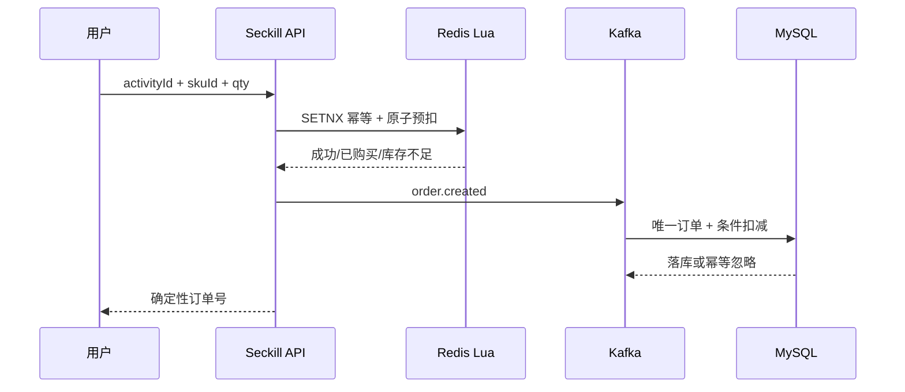
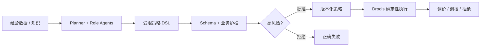

# InsightForge 项目学习路线

目标是从“能启动”进阶到“能解释、能定位、能修改”。不要一开始逐行读完整仓库；先沿真实业务请求建立地图，再深入中间件和 Agent。

## 使用方法

每个阶段都包含四件事：理解目标、代码入口、动手练习、通过标准。只有能脱离文档完成练习，才算学会。

建议节奏：

- 第 1 周：阶段 0～2，跑通并理解普通电商闭环。
- 第 2 周：阶段 3～4，掌握秒杀和一致性。
- 第 3 周：阶段 5～6，掌握 Agent/RAG 和安全护栏。
- 第 4 周：阶段 7～9，完成评测、部署和面试演练。

## 阶段 0：建立全局地图

先完成 [SETUP-GUIDE.md](SETUP-GUIDE.md) 的模式 A，并记住分层：

```text
浏览器 → React 页面 → /api → Controller → Service → Mapper/中间件
                                      └→ Agent → RAG/工具/护栏
```

代码入口：

- `insightforge-frontend/src/App.tsx`：页面路由。
- `insightforge-frontend/src/api/`：前端请求封装。
- `insightforge-api/.../controller/`：REST 接口入口。
- `insightforge-api/src/main/resources/application*.yml`：运行环境配置。
- `insightforge-api/src/main/resources/db/migration/`：数据库真实结构。

练习：浏览器点击一次商品详情，同时在 Network 找到请求，再定位 CatalogController、Service/Mapper 和返回 DTO。

通过标准：能画出该请求的调用链，并解释为什么前端开发请求 5173，后端实际监听 8090。

## 阶段 1：普通电商交易闭环

按以下顺序体验：商品 → 购物车 → 结算 → 支付 → 发货 → 确认收货 → 评价。重点不是页面，而是状态和真相源。

阅读入口：

- `CatalogController`：商品目录。
- `UserCenterController` 与 `CheckoutService`：购物车和结算。
- `OrderController`：订单支付/取消。
- `BuyerController`、`MerchantController`：履约、评价和售后。
- V6、V14～V20 Flyway 迁移：业务表和状态演进。

练习：在订单状态变化前后查询 API 返回，列出每一步允许的前置状态，以及重复点击时的结果。

通过标准：能说明“状态机”不是一个枚举就够了，还要在服务端验证合法迁移、鉴权和幂等。

## 阶段 2：鉴权与多商家隔离

项目使用 BCrypt 保存密码、JWT 表达登录身份，并按买家/商家角色限制资源。客户端传来的 userId/merchantId 不能直接相信，应从认证上下文推导或校验归属。

阅读入口：

- `insightforge-api/.../auth/AuthService.java` 及同目录安全配置。
- `LoginController`：登录/注册。
- `MerchantController` 与 `BuyerController`：资源归属校验。
- `KnowledgeBaseService`：RAG 的 merchantId metadata/filter。

练习：买家 A 尝试访问买家 B 的订单；商家 A 的知识问题尝试命中商家 B 文档。把预期拒绝写成测试。

通过标准：能解释“Prompt 中说不要越权”为何不是安全边界，真正隔离必须在查询、缓存 key、向量 metadata 和工具参数层实现。

## 阶段 3：秒杀热路径与防超卖

先记住目标：高吞吐是优化目标，`stock >= 0` 和“一次业务请求只产生一单”是正确性约束。

链路：



阅读入口：

- `SeckillService`：路径选择与业务订单号。
- `RedisStockService` 和 `seckill_reserve.lua`：原子完成快速幂等、扣减、恢复凭证和补偿索引。
- `ActivitySkuMapper.decrementStockIfEnough`：`WHERE stock >= qty`。
- V1 的订单唯一约束、`SeckillNoOversellTest`。

关键问题：

- 只有 Redis SETNX 不够：缓存可能丢，最终仍需 DB 唯一约束。
- 只有分布式锁不够：锁有租约/故障，且吞吐差；数据库条件更新提供最终原子语义。
- Kafka “恰好一次”不能代替业务幂等：消息系统无法替数据库定义“什么是同一订单”。
- 本项目规则为同活动、同 SKU、同用户限一单，所以已购买后前端禁用，但后端仍必须拦截绕过前端的请求。

练习：并发发送多次相同请求，再发送多个不同用户请求；验证订单唯一、库存不为负、初始库存 = 剩余 + 成交 + 合法补偿差异。

通过标准：能从入口到数据库说出每一道幂等/防超卖防线，以及每层失效后下一层如何兜底。

## 阶段 4：缓存、消息与一致性

学习 Redis 与 Kafka 时不要背 API，要回答“失败会怎样”。

阅读主题：

- Caffeine + Redis 多级缓存、空值哨兵、TTL 抖动和单飞。
- Kafka producer `acks=all`、幂等生产、consumer group。
- 订单异步落库、取消回补、对账与补偿。
- Redis 库存是高性能视图，数据库是最终业务真相。

练习：分别模拟 Redis 不可用、Kafka 重投、消费者处理一半失败。为每种情况写下：用户看到什么、数据是否可能重复/丢失、靠什么恢复。

通过标准：不使用“最终一致所以没问题”这种空话，能给出明确的不变量、重试 key、唯一约束、补偿任务和告警。

## 阶段 5：Agent 控制面与确定性数据面

核心架构决策：模型擅长非结构化分析和策略建议，但延迟、概率性与幻觉不适合秒杀热路径。



阅读入口：

- `insightforge-agent-core` 下 runtime/planning/evaluation。
- `DslCompiler`：结构与业务约束 Fail-Close。
- `ControlInstructionExecutor`：确定性动作。
- `AgentController`：运行、暂停、取消、恢复、回放。
- `PromptVersionService`：Prompt 内容、版本和 SHA-256。

练习：构造一个低于成本价的 REPRICE DSL，追踪它在哪里被拒绝；再构造合法策略，追踪到 HITL/发布/执行。

通过标准：能回答模型超时、非法输出、重复动作、人工拒绝、旧策略回滚分别怎么处理。

## 阶段 6：退款客服与 RAG

客服不是“给模型一个聊天框”。可靠链路应把知识问答和事务动作拆开：

```text
用户意图 → 查本人真实订单 → RAG 解释政策 → 生成退款草稿
→ 用户二次确认 → 事务 API → 售后状态机 → 商家处理/申诉
```

阅读入口：

- `BuyerAssistantService`：意图、订单事实、草稿和工具边界。
- `KnowledgeBaseService`：切块、向量化、检索路由和安全门槛。
- `BuyerController` 的 after-sale 接口。
- V14、V18、V20：聊天、商家会话隔离和申诉。

必须分清：

- RAG 可回答政策，但退款金额/订单状态必须查结构化数据库。
- Agent 可准备参数，但不能绕过用户确认直接退款。
- 缺知识、越权或高风险请求应拒答/转人工，这叫正确失败，不是系统失败。
- 重复点击需要售后业务唯一性和状态机共同拦截。

练习：覆盖无订单、订单不属于本人、已有售后、可退款订单、跨商家政策、未知问题六种输入。

通过标准：每一种输入都能说明预期答案、是否调用工具、是否要人工确认、数据库是否变化。

## 阶段 7：评测、版本与失败回放

数据集 `rag-eval-dataset.json` 有 40 条。四个核心指标：

- Recall@4：期望知识是否进入前四条检索结果。
- 答案正确率：检索上下文是否覆盖所有关键事实。
- 拒答准确率：不可回答或越权问题是否没有被错误支持。
- P95：95% 请求在该延迟以内，比平均值更能暴露尾延迟。

阅读入口：

- `RagEvalDataset`、`RagEvaluationService`。
- `PromptVersionService`、V21 迁移。
- `FailureReplayService`、Agent 评测前端页。
- [RAG-EVALUATION-REPORT.md](RAG-EVALUATION-REPORT.md)。

练习：新增一条真实失败样本，先证明失败，再修改检索/切块/阈值，重新评测并记录新旧指标和副作用。不要为了涨分删除困难样本。

通过标准：能解释每个指标的分母、数据版本、判分方法，以及为什么拒答率不是越高越好。

## 阶段 8：可观测与成本

Agent 调用至少要能用 traceId 回答：谁发起、用了哪个 Prompt/模型/知识版本、检索了什么、调用哪些工具、多少 token/成本/延迟、为何失败、能否回放。

阅读入口：

- `ObservabilityService` 与 dashboard DTO。
- trace/span 表及 Agent 评测页面。
- Prometheus、Grafana 配置。

练习：选择一次成功退款建议和一次拒答，沿 trace 对比 token、检索结果、工具调用和终止原因。

通过标准：发生线上“Agent 答错”时，能在十分钟内定位是检索、Prompt、模型、工具、权限还是前端确认链路的问题。

## 阶段 9：测试、部署与演示

执行质量门：

```powershell
cd insightforge
mvn clean test
cd ../insightforge-frontend
npm run typecheck
npm run build
```

然后完成 Docker 模式，故意改错一个密钥/端口，练习从 `compose ps`、日志、health、浏览器 Network 定位并恢复。

通过标准：你能在一台新机器上不看交接密码，从克隆开始完成启动；也能解释配置、密钥、volume、探活、日志、备份和回滚。

## 毕业项目：自己做一次小改动

任选一项：

1. 给售后增加平台管理员复核角色，并补越权测试。
2. 给 RAG 增加 reranker，对比 Recall、正确率和 P95。
3. 给秒杀补失败注入测试，证明 Kafka 重投不重复建单。
4. 给 Prompt 版本增加回滚 API，并记录审计人和原因。

完整交付必须包含：需求说明、架构取舍、代码、单元/集成测试、指标前后对比、文档和回滚方案。

做到这里，你才是“搭过并理解这个项目”，而不只是运行过别人写的仓库。
