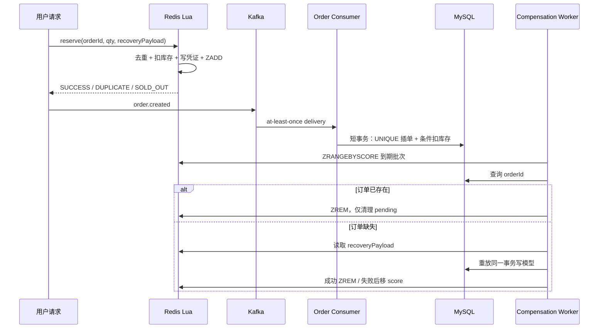

# 可恢复库存预留协议

## 1. 为什么需要自己的后端设计

常见秒杀示例只展示 Redis `GET/DECR` 或 Lua 防超卖，但真正困难的是 Redis 扣减以后，
Kafka、应用和 MySQL 任意一个节点失败时如何恢复。旧实现依次执行：

1. `SETNX order:idemp:*`；
2. Lua 扣 Redis 库存；
3. 发送 Kafka；
4. 消费者插入订单并扣 MySQL 库存。

这四步之间存在三个故障窗口：

- SETNX 成功、Lua 前宕机：用户被判定已经购买，但库存从未预留；
- Lua 成功、Kafka 前宕机：库存减少但没有建单消息；
- 订单插入成功、DB 库存更新失败：出现订单与库存不一致。

旧补偿任务使用 `KEYS order:idemp:*` 扫描。KEYS 是 O(N) 全量遍历，数据量大时会阻塞
Redis，而且它无法区分“只有幂等占位”和“库存真的已经扣减”。

## 2. 设计目标与不变量

项目实现轻量的 Recoverable Reservation Protocol（可恢复预留协议），核心不变量是：

> 只有创建了包含完整恢复载荷的 Reservation，Redis 库存才允许减少；每个 Reservation
> 最终必须收敛为一个数据库订单，或进入可观察、可重试的异常状态。

它不追求 Redis、Kafka、MySQL 的跨资源强事务，而是缩小原子边界，再通过幂等、恢复凭证
和对账实现最终一致性。

## 3. 数据结构

- `stock:a:{activityId}:s:{activitySkuId}`：秒杀剩余库存；
- `order:idemp:{orderId}`：值为完整订单事件 JSON，同时承担幂等凭证和恢复载荷；
- `order:reservation:pending`：ZSET，member 为 orderId，score 为首次补偿截止时间；
- `orders.order_id UNIQUE`：数据库最终幂等边界；
- `activity_sku stock/sold`：用条件更新维护最终库存事实。

确定性订单号由 `(activityId, activitySkuId, userId)` 推导。同一业务请求在 HTTP 重试、
Kafka 重投和补偿重放中都得到同一个身份。

## 4. 原子预留

`seckill_reserve.lua` 在 Redis 的一个原子执行单元内完成：

1. 检查 Reservation 是否存在，存在则返回 DUPLICATE；
2. 检查库存键和值是否合法；
3. 判断库存是否足够；
4. 扣减库存；
5. 写入带 TTL 的恢复载荷；
6. 把 orderId 加入 ZSET 超时索引。

脚本还在写入前检查三个托管 Key 的 Redis 类型，降低错误类型造成 Lua 中途失败的风险。
因为幂等和扣减在同一脚本里，系统不再存在“占位成功但没有扣库存”的中间状态。

## 5. Kafka 的职责变化

Kafka 仍负责削峰和异步投递，但不再承担“订单能否恢复”的唯一责任：

- Kafka 正常：消费者快速落库；
- Kafka ack 失败：请求线程复用同一个 `OrderCreationService` 同步收敛；
- Kafka 消息丢失或消费者长期失败：ZSET 到期后补偿器从 Reservation 重放；
- Kafka 重投：orderId 唯一约束阻止重复订单，只有首次插入才扣 DB 库存。

因此语义是 at-least-once delivery + effectively-once business effect，不宣称分布式 exactly-once。

## 6. 数据库事务边界

`OrderCreationService.createOrderIdempotent` 是消费者、同步兜底和补偿器共用的唯一写模型，
并用 `@Transactional` 包住：

1. 插入确定性 orderId 的订单；
2. `UPDATE activity_sku SET stock=stock-qty ... WHERE stock>=qty`；
3. 更新影响行数不是 1 时抛出 `InventoryConsistencyException`，订单插入随事务回滚。

事件同时显式携带 productId 和 activitySkuId，修复异步链路中两个 SKU 标识混用的问题。
网络调用、Redis 和 Kafka 不放进数据库事务，避免长事务占用连接，也不假装 Spring 事务能回滚外部资源。

## 7. 为什么用 ZSET 而不是 KEYS 或固定队列

`ZRANGEBYSCORE 0..now LIMIT batchSize` 的复杂度约为 O(logN+M)，只读取已经超时的固定批次。
失败项通过更新 score 延后重试，不会形成无间隔热循环；成功项只从 pending ZSET 删除，
Reservation 本身保留到 TTL，继续支持“同用户同活动同 SKU 限一单”的快速判断。

普通 List 无法高效查询“现在到期”的任务；全库 KEYS/SCAN 虽能遍历，却没有超时顺序语义。
ZSET 同时提供超时队列和可观测积压量，适合当前单 Redis、小规模部署。

## 8. 故障矩阵

- Lua 前失败：没有库存变化，也没有 Reservation，允许回退 DB 或重试；
- Lua 成功后应用宕机：Reservation 和 pending 索引都在，补偿器可恢复；
- Kafka 不可用：同步收敛；同步失败则仍保留 Reservation；
- 消费者重复执行：数据库唯一键使第二次插入成为无副作用重复；
- DB 库存漂移：条件更新返回 0，事务回滚，pending 不确认，等待对账处理；
- 补偿器宕机：ZSET 是持久状态，恢复后继续按 score 扫描；
- Reservation 载荷损坏：本轮失败并后移，日志和 pending 指标暴露问题，不静默删证据。

## 9. 为什么没有直接使用 Seata/TCC

项目是单体多模块加独立 Worker，部署资源有限。引入分布式事务协调器会增加运行节点、状态表、
超时和运维复杂度，而且秒杀热路径不适合等待跨 Redis、Kafka、MySQL 的同步协调。

TCC 也要求 Redis 库存具备 Try/Confirm/Cancel 完整语义，并处理悬挂、空回滚和幂等，复杂度并不会消失。
当前协议选择：Redis 内缩小原子边界、MySQL 内使用本地事务、资源之间用恢复凭证和对账收敛。
如果未来涉及真实支付资金，应优先采用支付网关幂等号、事务 Outbox/Inbox 和账务流水，而不是复用秒杀库存协议。

## 10. 测试证据

- `RedisStockReservationTest`：脚本结果映射、Redis 异常降级、有界 ZSET 拉取和确认；
- `SeckillRedisLuaTest`：真实 Redis 下首次预留成功、重复预留不二次扣库存、载荷可恢复；
- `OrderCreatedConsumerStatusTest`：重复订单不扣库存，DB 库存冲突抛异常以触发事务回滚；
- `OrderCompensationTaskTest`：到期 Reservation 能重建订单并把 DB 库存从 10 收敛到 9；
- 既有无超卖测试：300 请求竞争 100 库存，成功数不超过 100，最终库存不为负。

## 11. 当前边界

- 当前部署是单 Redis。Redis Cluster 下多 Key Lua 必须使用相同 hash tag；全局 pending ZSET
  需要改为按活动分片的 ZSET 或独立延迟队列，不能直接照搬。
- Reservation TTL 为 24 小时，生产应根据最长故障恢复时间和活动周期配置，并对即将过期但未收敛项告警。
- 当前重试是固定间隔，生产可增加指数退避、最大次数、死信状态和人工处置台。
- Redis AOF 和单节点重启只能证明耐久性，不能等价于 Sentinel/Cluster 高可用。

## 12. 面试表达

> 我没有把 Redis Lua、Kafka 和唯一索引简单串起来，而是分析了每两步之间的宕机窗口。
> 原实现的 SETNX 与扣库存分离，会出现占位成功但库存未扣，KEYS 补偿也无法识别这个状态。
> 我把幂等、扣库存、恢复载荷和超时索引合并到一段 Lua，形成可恢复 Reservation；Kafka
> 只做削峰，消息丢失时 ZSET 补偿器按到期批次重放同一个数据库事务写模型。数据库库存
> 冲突会回滚订单并保留凭证。因此系统实现的是可解释的最终一致性和 effectively-once 副作用，
> 而不是依赖一个“严格 exactly-once”的口号。
