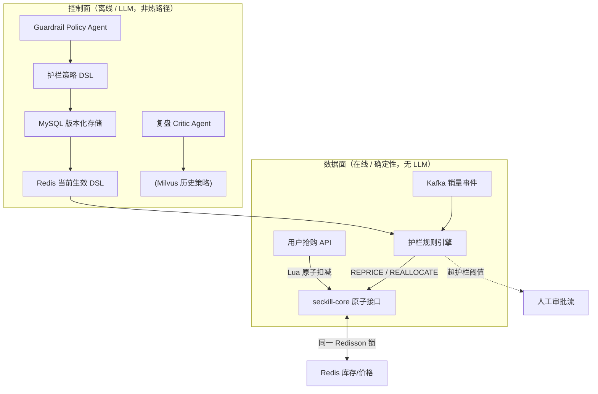
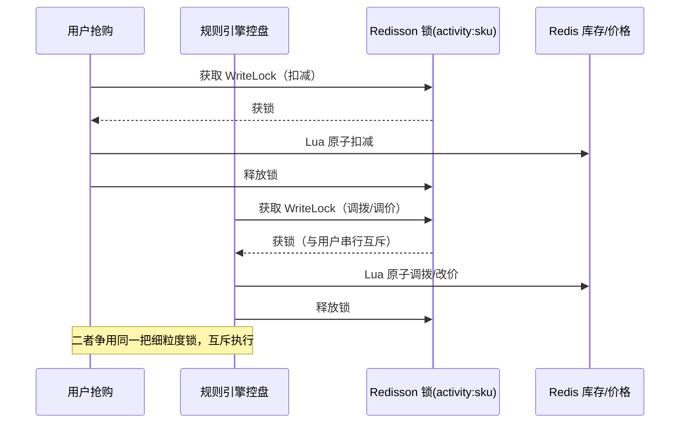
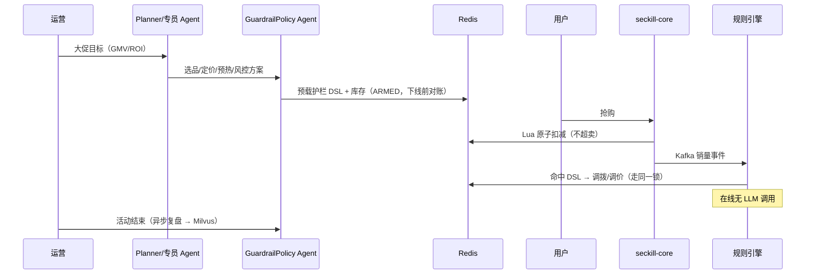

# InsightForge（智析）智能秒杀 / 大促平台（Agent 辅助）— 设计文档（v0.9 评审稿）

> 流程说明：本文档由 brainstorming 阶段产出，遵循 **GitHub spec-kit** 流程——先定 spec（本文件），经评审调整后再出 `plan.md` 与 `tasks.md`，最后进入实现。
> 状态：评审稿 v0.9。
> 修订记录：[2026-08-05] v0.1 初始；v0.2 后端与 Agent 深度融合；v0.3 锚定商家经营分析场景；v0.4 尝试从"共享资源争用"挖并发/互斥（被否，因读多写少、并发读不构成挑战）；v0.5 pivot 到「智能秒杀/大促平台（agent 辅助）」，Agent 实时控盘走同一套锁；v0.6 据"大模型延迟红线"改为控制面/数据面分离（Guardrail Policy Agent 离线生成 DSL → 规则引擎在线走锁，LLM 不进热路径）；v0.7 据整体评价加固（独立规则引擎/资源隔离/锁粒度/DSL规范/权限分级/缓存防护/库存一致性/Kafka可靠性/双轨评估/图与故障预案）；**v0.8 据"隐患/硬伤"补强（落地前必堵）**：① 锁超时分级 Fail-Fast（用户 10ms 优先、规则引擎 0ms 失败重入队）；② 分段调拨只建新段 O(1)、绝不追加热段；③ DSL 静态编译器 Fail-Close（Antlr/纯 Java 校验，编译不过阻断上线）；④ 预测性调拨（滑动窗口线性回归算 TTL，提前调度，无 LLM）；⑤ 两阶段预留（pending_stock）杜绝补偿超卖；⑥ 大屏策略可解释性（后端模板，非 LLM）。详见 `analysis.md`；**[2026-08-06] v0.9 新增「监测与评估」设计**：依据生产级 Agent 评估四层框架（组件/轨迹/结果/系统）+ 正确失败率 + 独立验证器 + Trace 回归闭环 + 硬编码护栏，把 Agent 控制面的可观测与可评估内建进 Phase 7–11（详见 `agent-observability-evaluation.md`）。

---

## 1. 项目定位与目标

### 1.1 一句话定位
一个**智能秒杀 / 大促平台（Agent 辅助）**：商家配置大促目标，多智能体自动产出**选品 / 定价 / 库存预热 / 风控**策略并预热上线；活动期间高并发抢购由经典秒杀引擎（Redis+Lua+分布式锁）保证**不超卖**。**大模型延迟红线**：LLM 永不进入秒杀热路径（扣减/调价/再分配/下单）——**Guardrail Policy Agent 在离线规划期把活动目标编译成「护栏策略 DSL」**，**确定性规则引擎**在 LIVE 期消费实时销量流、触发动态调价/库存再分配，**走与用户抢购相同的 Redisson 锁 + Lua 原子**。Agent 通过它生成的策略间接驱动热路径（差异化保留），但 LLM 推理零热路径调用（红线遵守）。

### 1.2 业务背景与典型场景（User Stories）
**业务背景**：秒杀 / 大促是电商最典型的高并发场景，核心工程难题是"高并发下库存扣减不超卖、流量削峰、限流"。传统做法靠人工配活动、靠规则拦流量。我们的差异点：用 **AI Agent** 把"选品 / 定价 / 库存预热 / 风控阈值"自动化，并在活动中**实时控盘**（某 SKU 售罄过快 → 自动再分配库存或调价），且控盘的写动作走与用户抢购**相同的分布式锁**——Agent 与高并发/互斥真正纠缠。

**典型场景（User Stories）**
- **US-1 活动规划**：运营给目标"双11 美妆场，目标 GMV 500万、ROI≥3" → Planner 拆子任务 → 选品/定价/预热/风控 专员 Agent 产出方案 → 运营确认 → 库存预热到 Redis → 活动上线。
- **US-2 高并发抢购（互斥心脏）**：活动开始，百万用户抢购 → Redis+Lua 原子扣减 + Redisson 分布式锁防超卖 + Kafka 异步下单削峰 + Nginx+Lua 限流。
- **US-3 实时控盘（规则引擎走锁，Agent 离线出策略）**：护栏规则引擎发现"SKU-A 售罄速度超预期 2 倍" → 在护栏内**自动再分配**库存（从池 B 调拨）或**动态调价**（走同一 Redisson 锁+Lua 原子）；超阈值的重大动作转人工确认。该护栏策略由 **Guardrail Policy Agent 离线生成 DSL**，LLM 本身不在 LIVE 热路径。
- **US-4 异常检测 / 客服**：Agent 检测刷单 / 异常流量并告警；智能客服答活动规则。
- **US-5 质量保障**：平台用评测集跑 eval，双维度量化——秒杀无超卖 + Agent 策略/控盘质量。

### 1.3 目标（成功标准）
- **面试项目，但真实完整**：能 Docker 一键起、能部署上线、能跑量化评估。
- **两条主线都硬**：① 后端高并发工程（Redis+Lua 原子 / 分布式锁 / Kafka 削峰 / 限流 / 状态机 / 压测）；② Agent 知识（规划 / 工具调用 / 记忆 / 反思 / 多 Agent 协作 / 实时控盘）。
- **有评估闭环**：硬指标证明系统靠谱（无超卖 / exactly-once / 锁等待 / Agent 策略质量 / 控盘有效性）。

### 1.4 非目标 / YAGNI（范围红线）
- 不做完整多租户 SaaS 基础设施（租户后台 / 计费中心），先做简单多用户 + 数据隔离 + 限流。
- 不追求覆盖所有商品模型，先标准 SKU + 库存扣减。
- 不内置训练 / 微调，专注推理与编排。
- Agent 控盘默认"护栏内自动 + 重大人工"，不做完全无人值守自治。
- **范围红线（防膨胀）**：每个里程碑限定新增功能，**非核心需求（优惠券、积分、多渠道分销、支付网关对接等）一律延后至 M7+（可选扩展）**，不在 M1–M6 范围内；任何新增跨域功能须先回此红线确认，避免范围蔓延。

### 1.5 监测与评估设计（Agent 控制面，详见 `agent-observability-evaluation.md`）
- **为什么单独设计**：Agent 的"聪明"必须可观测、可评估、可追责，否则只是"看起来有用"。本项目 Agent 是控制面（离线规划 + 在线规则引擎），LLM 不进热路径，因此监测聚焦"离线规划运行质量 + 在线规则引擎业务结果"。
- **四层评估**：组件（工具/参数 Schema/记忆召回/模型成功率）→ 轨迹（Critic 拦截/重复调用/越权/恢复）→ 结果（DSL Fail-Close 编译/影子模式/回测 oversell=0/SLA）→ 系统（运行成功率 /**正确失败率**/延迟/成本/人工接管率）。
- **三条铁律**：① Trace 不为漂亮大屏，只服务"定位层级 / 重放失败 / 沉淀回归评估集"；② 独立验证器（Critic）而非原 Agent 自评，可验证结果优先确定性程序校验；③ 正确失败（ASK/REFUSE/ESCALATE）计入正确失败率，绝不编造成功。
- **内建而非补**：Phase 7 落 Trace + 状态机 + 预算闸门 + Critic verdict；Phase 8 独立验证器 + 正确失败行为 + golden 评估集；Phase 9 Fail-Close 门禁 + 影子/回测 + 护栏埋点；Phase 10 Trace 查看器 + 四层看板 + HITL；Phase 11 eval harness 闭环 + 灰度/A/B + CI。

---

## 2. 技术栈总览（企业级，按「秒杀 / 大促」场景痛点驱动）

| 类别 | 选型 | 作用 |
|---|---|---|
| 语言/框架 | Java 21 + Spring Boot 3.3 + Maven | 后端主体 |
| 持久层 | MyBatis-Plus | ORM |
| 关系库 | **MySQL 8** | 商品 / 活动 / 订单 / 用户 |
| 缓存/锁/限流 | **Redis 7 + Redisson** | 库存缓存、分布式锁（防超卖/控盘）、限流、订单去重、价格缓存 |
| 消息队列 | **Kafka** | 异步下单削峰 + 实时销量事件流（供 Agent 控盘） |
| 多级缓存 | **Caffeine + Redis** | 商品/活动配置热点 |
| 向量库 | **Milvus** | Agent 长期记忆（历史活动策略与结果向量化，供规划参考/相似复用） |
| Agent 接入 | **Spring AI + DeepSeek** | 模型调用 / Embedding |
| 安全 | JWT + Redis 会话 + Spring Security | 鉴权 |
| 限流 | Nginx+Lua 令牌桶 / Redis+Lua 滑动窗口 / Sentinel | 接入层与模型双限流 |
| 压测 | JMeter | 百万抢购 + 并发 Agent 控盘 |
| 前端 | React 18 + TS + Vite + Ant Design + ECharts | 商户后台 + 实时大屏 |
| 部署 | Nginx + Docker Compose + GitHub Actions | 负载均衡 / 一键起 / CI |
| 可观测 | Actuator + Prometheus + Grafana | 扣减耗时 / 锁等待 / 超卖告警 |

**后端能力 ↔ 「秒杀 / 大促」场景 的驱动关系（杜绝"为用而用"）**

> 设计原则：每个后端组件都由本场景的**真实痛点**驱动。高并发与互斥在这里是**系统命脉**（库存扣减是共享可变状态的真互斥），不是附加功能。Agent 的控盘写动作与用户抢购共用同一套锁，因此"Agent + 高并发"是纠缠的，不是贴上去的。

| 本系统的真实痛点（来自「秒杀 / 大促」场景） | 后端解法（企业级组件） |
|---|---|
| 百万用户同时抢购，库存**不能超卖**（共享可变状态真互斥） | **Redis+Lua 原子扣减 + Redisson 分布式锁**（防超卖，互斥心脏） |
| 下单峰值远超 DB 能力 | **Kafka** 异步削峰 + 订单状态机 |
| 突发流量打爆系统 | **Nginx+Lua 令牌桶 / Redis+Lua 滑动窗口 / Sentinel** 限流 |
| **护栏规则引擎执行 Agent 离线生成的策略（调价/再分配）与用户抢购争用同一库存/价格** | **同一套 Redisson 锁 + Lua 原子**（Agent 策略间接驱动热路径，混合执行：护栏内自动、重大人工；LLM 不进热路径） |
| 商品/活动配置高频读、热点 key 失效 | **Caffeine+Redis 多级缓存** + 逻辑过期 + 随机 TTL（缓存击穿真身）+ 布隆过滤器 |
| 请求重试 / Kafka 重投导致重复下单 | **Redis SETNX 去重**（orderId=hash(user,product,activity)）→ exactly-once |
| Agent 规划需历史销量 / 竞品价 | **历史数据接入 + `web_search`**；Agent 长期记忆入 **Milvus** |
| 多活动 / 多商家并发，需隔离可追溯 | **JWT** + `traceId` + Prometheus/Grafana |
| 上线前证明"高并发下锁 / 限流 / 防超卖都生效" | **JMeter** 压测（百万抢购 + 并发 Agent 控盘） |

> 参考实现洞察：MagTrade 等已有"秒杀+Agent"，但其 Agent 仅做外围客服/异常检测、**不碰锁**；运营多智能体产品会改共享状态但中低并发。本项目的差异点正是**让 Agent 离线生成的护栏策略，其在线执行（规则引擎）走与用户抢购相同的锁**——LLM 不进热路径，但智能仍以确定性方式落地到核心场景（控制面/数据面分离）。

---

## 3. 高并发与部署架构

### 3.1 并发模型（高并发与互斥是命脉）
- **为什么天然高并发**：秒杀的本质就是海量用户并发抢购同一份库存——**库存扣减是共享可变状态的真互斥**，必须原子。目标支撑 ~百万级并发抢购、峰值数千 TPS 扣减。
- **库存扣减（互斥心脏）**：单 key 用 **Redis+Lua 原子脚本**（`DECR`+库存≥0 校验）保证不超卖；跨资源（库存+订单+预算）用 **Redisson 分布式锁**。
- **大模型延迟红线（控制面 / 数据面分离）**：LLM 推理延迟秒级、非确定、知识截止、会幻觉，与秒杀"毫秒级+强一致+exactly-once"直接冲突 → **LLM 永不进入秒杀热路径（扣减/调价/再分配/下单）**。采用控制面/数据面分离：**控制面（LLM 离线）** = Guardrail Policy Agent 把活动目标编译成护栏策略 DSL + 复盘 Critic 写 Milvus；**数据面（确定性）** = 护栏规则引擎读取 DSL，在 LIVE 期消费 Kafka 销量流执行 `REPRICE`/`REALLOCATE`。在线零 LLM 调用，策略与特征规划期预计算入 Redis（空间换时间），超时降级到硬编码兜底（fail-open）。
- **Agent 策略共用锁（关键差异，但 LLM 不进热路径）**：护栏规则引擎执行的 `REPRICE` / `REALLOCATE` 改的是与用户抢购**同一个**库存/价格资源 → 走**同一 Redisson 锁 + Lua 原子**。Agent 通过它离线生成的策略 DSL 间接驱动这一写动作（差异化保留），但 LLM 推理本身不在热路径。**混合执行**：小幅调价/再分配在护栏内（单次幅度上限 + 熔断）自动执行；超阈值或涉及大额预算的重大动作转人工确认（human-in-the-loop，非 LLM 现场决策）。
- **分布式锁粒度设计（防止锁竞争与性能隐患）**：
  - **细粒度锁 Key**：锁以 `lock:activity:{activityId}:sku:{skuId}` 为粒度，单 SKU 独立加锁，避免全局锁导致并发吞吐量暴跌。
  - **读写分离锁**：库存/价格**查询**用 Redisson `ReadLock`（读多写少不互斥）；**扣减 / 调价 / 调拨**用 `WriteLock`（排他）。
  - **分段锁 + 调拨只建新段（O(1)，避免阻塞热段）**：热点 SKU 库存拆分为 N 段（`segment1..N`），用户扣减时 Lua 脚本**遍历所有段汇总扣减**；**调拨（Reallocate）永远只 `SET` 一个新段 `segment_{N+1}`（O(1)），绝不向正在热卖的旧段追加写**——新段只锁自身 Key，完全不影响旧段的锁竞争。
  - **锁超时分级 Fail-Fast（用户流量绝对优先）**：用户抢购 `tryLock(timeout=10ms)`，抢不到立即返回「拥挤，请重试」，绝不长时间排队；规则引擎调拨 `tryLock(timeout=0ms)`（尝试一次，拿不到立即放弃本次调拨），将事件重新放回 Kafka **延迟 5s 重试**。Agent 策略流量永远让位于用户流量。
  - **可靠性**：Redisson 看门狗自动续期（默认 30s，每 10s 续约）防死锁；锁等待 / 持有耗时埋点进 Prometheus，超阈值告警。
- **削峰与限流**：Kafka 异步下单；Nginx+Lua 令牌桶 + Redis+Lua 滑动窗口 + Sentinel 多层限流；模型调用单独限流（DeepSeek 配额，仅在离线/异步路径）。
- **幂等（exactly-once）**：订单 `orderId = hash(userId, productId, activityId)`，Redis SETNX 去重，Kafka 重投不重复下单。
- **进程内并发**：单请求内 Agent DAG 无依赖节点线程池 + `CompletableFuture` 并行；Worker 多实例横向扩展。

### 3.2 部署架构
- `docker-compose` 编排服务：`MySQL / Redis / Kafka / Milvus / API / Seckill-Worker / Rule-Engine-Worker / Agent-Worker / 前端(Nginx)`。
- Nginx：API 负载均衡 + 前端静态托管 + WebSocket 反代 + Lua 令牌桶限流；Worker 多实例、Kafka 分区并行 → 水平扩展。
- **资源隔离（核心流量 vs Agent 异步任务）**：防止大促峰值时 Agent 规划/复盘/向量检索抢占 CPU 内存，导致锁等待变长、下单时延毛刺，或沙箱异常拖垮核心服务。
  - **容器级**：`Seckill-Worker`（核心流量，高优先级、独立 CPU/内存配额、反亲和部署）与 `Agent-Worker`（离线/异步任务，低优先级、`cgroup` 限额）拆分为两类容器；新增独立的 `Rule-Engine-Worker` 承载在线护栏执行（与 Seckill-Worker 同高优先级域，但不跑 LLM）。
  - **线程池级**：API 接入、库存扣减、Kafka 消费、Agent 任务使用**独立线程池**；核心业务线程池设最高优先级，Agent 任务线程池限并发、可排队丢弃。
  - **沙箱隔离**：Agent 规划计算（SQL/Python）跑在**独立进程/容器**，禁与核心服务同进程；沙箱崩溃不影响 Seckill-Worker。
- 可观测：Actuator + Prometheus + Grafana 看板（扣减耗时 / 锁等待 / 超卖告警 / 限流触发 / **Agent 与规则引擎维度指标见 §7.2**）。

### 3.3 一次请求的全链路（看 Agent 与高并发如何纠缠）
以 **US-3「SKU-A 售罄速度超预期 2 倍，护栏规则引擎自动再分配库存」** 为例：
1. **规划期（含 LLM 控制面）**：Planner 收"双11 美妆场"目标 → 选品/定价/预热/风控 Agent 出方案 → 运营确认 → **Guardrail Policy Agent 把"控盘预案"编译成护栏策略 DSL**（如"售罄速率>1.8×预期且余量<阈值→从池B自动调拨≤X件；调价幅度≤Y%；超出→人工"）预加载 Redis → 预热 Agent 把库存 Lua 预载 Redis（`ARMED`）。
2. **LIVE 开始**：用户抢购 → API 限流 → Lua 原子扣库存（不超卖）→ 发 Kafka 异步建单 → WS 推结果。
3. **实时流**：每次成交发 Kafka 销量事件 → **护栏规则引擎（确定性，非 LLM）**消费，发现 SKU-A 售罄过快。
4. **规则引擎控盘（走锁，无 LLM）**：规则引擎按 DSL 决策从池 B 调拨库存 → 调 `reallocator` 工具 → **Redisson 锁 + Lua 原子**在池 A/B 间移动库存（与并发用户抢购争用同一锁）→ 护栏内自动生效；若超阈值则转人工确认（human-in-the-loop）。**整段在线零 LLM 调用。**
5. **Critic 校验**：动作前校验（库存>0？幅度在护栏内？）→ 不通过则走兜底规则或转人工。
6. **全程**：状态变更发 Kafka + 更新 Redis + WS 推大屏；`traceId` 贯穿；Grafana 监控锁等待。
7. **闭环（异步 LLM 复盘）**：活动结束 `SETTLING` 对账（库存=初始-成功单数，验证无超卖）→ `CLOSED`；**复盘 Critic Agent（异步、离线）**分析策略/控盘效果，写入 Milvus 供下次规划参考。

> 这条链路里：Redis+Lua 防超卖是用户抢购与规则引擎控盘**共用**的原子基座；Redisson 锁同时保护"用户扣库存"和"规则引擎再分配"——Agent 通过它离线生成的策略 DSL 间接驱动热路径（差异化保留），但 LLM 推理始终在控制面，绝不在数据面热路径。

### 3.4 状态机
- **活动生命周期**：`DRAFT`(Agent 规划) → `ARMED`(库存预热 Redis) → `LIVE`(用户抢 + Agent 控) → `SETTLING`(对账) → `CLOSED`。
- **单请求（订单）**：`PRE_CHECK → LOCK_STOCK`(Lua 原子) `→ CREATE_ORDER`(Kafka 异步) `→ PAY → DONE` / 超时 `CANCEL`(释放库存)。
- **护栏规则引擎控盘动作**作为 `LIVE` 态内事件：`REPRICE` / `REALLOCATE`（由 Agent 离线生成的策略 DSL 驱动），自身受锁保护并触发子状态迁转；订单幂等用 `orderId`+SETNX 去重。

---

### 3.5 缓存防护体系（击穿 / 雪崩 / 穿透 实战兜底）
- **缓存击穿（热点 Key）**：活动配置、商品详情等热点 Key 采用「**互斥锁重建 + 逻辑过期**」——值内嵌逻辑过期时间，后台异步刷新，高并发下仅一个线程回源 DB；辅以随机 TTL 打散初始过期。避免「先查缓存 miss → 并发回源」击穿 DB。
- **缓存雪崩**：Redis 集群分片；Key TTL 加随机抖动避免同时失效；Redis 不可用时降级读本地 **Caffeine**（stale-while-revalidate，返回旧值并异步刷新），保护核心读路径。
- **缓存穿透**：布隆过滤器拦截不存在的 `productId`/`activityId`；空值缓存短 TTL，防止恶意遍历打穿到 DB。

### 3.6 库存预热一致性（MySQL ↔ Redis 双写）
- **上线对账**：预热 Agent 把库存 Lua 预载 Redis 后，进入 `ARMED` 前做一次 **MySQL-Redis 库存对账**，不一致直接阻断活动上线。
- **增量同步**：活动中库存变更（后台手动改库存、退款回补）走 **Canal 监听 Binlog → 增量同步 Redis**，保证双写一致，避免超卖/少卖。
- **巡检修复**：定时后台任务比对 MySQL 与 Redis 库存，修复偏差（修复动作本身走同一套锁）。

### 3.7 消息可靠性与降级
- **下单 Topic**：生产者 `acks=all` + 重试；消费者手动提交 offset；失败订单进**死信队列（DLQ）**后台补偿；订单幂等（`orderId`+SETNX）保证 exactly-once。
- **销量事件 Topic**：至少一次投递；次要消息可丢弃，但**库存调拨/调价失败事件**进 DLQ 并触发人工告警。
- **规则引擎消费失败回滚**：控盘动作（调价/调拨）执行异常 → **删除 `pending_stock` 预留标记（绝不反向改硬库存）+ 记审计 + 告警**；**不影响用户抢购主流程（fail-open）**。

### 3.8 库存调拨与补偿事务（两阶段预留 + 预测性调拨）
- **两阶段预留（pending_stock，杜绝补偿超卖）**：调拨（Reallocate）**不是直接加硬库存**，而是先加 `pending_stock`（预留缓冲池）。用户扣减只消耗硬库存；**反向补偿时仅删除 `pending` 标记，绝不触碰已售硬库存**——彻底规避「恢复时库存已被他人抢光 → 恢复成负数」的超卖风险。
- **预测性调拨（Predictive Reallocation，从被动救火到主动调度）**：在规则引擎内引入**滑动窗口线性回归（确定性算法，无 LLM）**，实时计算 `TTL = 剩余库存 / 当前流速`（预计售罄时间）。当 `TTL < 5min` 即**提前触发预调拨**，而非等「售罄速率超预期 2 倍」才事后响应。AI 控盘的「智能感」拉满，且全程不进大模型热路径。

---

## 4. 多智能体编排设计

复用我们设计的 **Planner + 专员 Agent + 反思** 架构，角色重映射到秒杀域：

- **Planner（规划）**：把活动目标拆成带依赖的**子任务 DAG**（选品 / 定价 / 预热 / 风控）。
- **选品 Agent**：历史销量 + 竞品（`web_search`）→ 选 SKU、分引流/利润/清仓款。
- **定价 Agent**：成本 + 竞品 + 满减规则 → 秒杀价 + 券面额 + 活动规则。
- **预热 Agent**：决定 Redis 预加载库存量 + 分片（按 productId hash 取模）。
- **风控 Agent**：限流参数 / 限购 / 黑名单阈值。
- **Guardrail Policy Agent（离线生成护栏 DSL）**：规划期把活动目标/选品/定价/风控结论编译成**护栏策略 DSL**（调价/再分配触发条件、幅度上限、熔断、人工确认阈值），预加载 Redis。LLM 仅在离线控制面，**不进热路径**。
- **Monitor / Alert Agent（异步监测 + 人工升级）**：异步消费 Kafka 销量流做统计与异常检测（售罄过快 / 转化异常 / 刷单），超护栏阈值的重大情况推送人工确认，**不在线做写决策**。
- **Critic（自检）**：校验策略/动作（价>成本？库存>0？风控不过激？动作前再校验）+ 反思重试。
- **Orchestrator（总控）**：排程 + 写策略配置（活动级锁防并发改策略）+ 实时控盘调度 + `traceId`。

「Agent 知识」覆盖：规划、工具调用、记忆、反思/自检、多 Agent 协作、**控制面/数据面分离（LLM 离线、规则引擎在线）**、人在环（重大动作人工确认）。Viz Agent → 实时大屏；Writer Agent → 运营方案文档。在线热路径由**确定性护栏规则引擎**执行，LLM Agent 只出现在离线规划与异步复盘。

---

## 5. Agent Core 自研运行时

### 5.1 工具系统（Tool Registry，秒杀域工具）
- 每个工具用 JSON Schema 声明：`{name, description, parameters(JSON Schema), executor}`；启动时注册 `ToolRegistry`。模型输出 `tool_call` → 运行时校验参数 schema → 执行（沙箱/锁内）→ `observation` 回灌。
- 内置工具：
  - `historical_sales_analyzer`：对历史销量做 SQL/Python 分析（沙箱）。
  - `competitor_pricer`：调 `web_search` 拉竞品价，供定价。
  - `stock_preloader`：Lua 预加载库存到 Redis。
  - `repricer`：**Lua 原子改价（受 Redisson 锁）**——由**护栏规则引擎**在线调用（非 LLM 直接调用）；LLM 仅离线产出该工具的策略参数（幅度/条件）。
  - `reallocator`：**Redis 库存跨池移动（Redisson 锁 + Lua 原子）**——由**护栏规则引擎**在线调用（非 LLM 直接调用）；LLM 仅离线产出该工具的策略参数。
  - `anomaly_detector`：消费 Kafka 实时销量流，识别异常。
  - `coupon_budget`（可选）：Lua 原子扣预算。
  - `web_search`：拉竞品/市场实时数据（驱动定价与风控，自身受同一套限流+缓存）。
  - `memory_lookup`：查 Milvus 历史活动策略。

### 5.2 记忆机制（三层）
- **短期**：当前任务消息窗口；超长触发摘要压缩。
- **长期**：用户级偏好存 Redis；历史活动策略与结果向量化入 **Milvus**，供规划参考与相似活动复用。
- **跨 Agent 共享**：经 Orchestrator 消息总线传递结构化 `Artifact`（选品清单/定价方案/库存计划），不把一切塞进 prompt。
- **Milvus 分层检索优化（活动量大后控延迟）**：
  - **分区**：按时间/热度分区（近一年热活动 / 历史冷活动），检索时按需路由，减少计算量。
  - **召回权重**：同品类、同 GMV 目标的活动优先召回（metadata 过滤 + 加权）。
  - **热向量缓存**：高频复用的相似策略向量缓存至 Redis，避免每次规划都查 Milvus。

### 5.3 规划与执行（Plan-and-Execute）
- 规划期：Planner 产出子任务 DAG，Orchestrator 按拓扑序调度，无依赖节点 `CompletableFuture` 并行。
- 实时控盘期：护栏规则引擎是**事件驱动持续循环**（消费 Kafka 流、执行 DSL），非一次性 DAG；LLM Agent 不参与此循环（控制面/数据面分离）。

### 5.4 反思/自检循环
- Critic 输出结构化 JSON：`{passed, issues:[{type, severity, detail, fix_suggestion}]}`。
- 策略/动作不通过 → 携带 issues 回到对应 Agent 修订，最多 `maxRetry=3`；超限降级交付或转人工。

### 5.5 护栏策略 DSL 规范（Guardrail DSL）
> 解决"DSL 是纸上设计"问题：统一语法、存储、版本、热更新，支撑灰度/回滚。
- **格式**：结构化 **JSON（可序列化为 YAML）**，由 Guardrail Policy Agent 离线产出，Schema 含四段：
  - `trigger`：触发条件（指标 + 运算符 + 阈值，如 `sellout_rate > 1.8×expected AND remaining_ratio < 0.1`）。
  - `action`：动作类型（`REPRICE` / `REALLOCATE`），指向 `insightforge-tools` 原子接口。
  - `bounds`：参数上限（单次调价 ±5%、单次调拨 ≤ 池总量 10%）、熔断阈值（连续触发次数 / 时间窗）。
  - `human_gate`：人工判定边界（超 `bounds` 的重大动作转人工审批）。
- **版本化存储**：DSL 以版本号存入 **MySQL**（如 `guardrail_policy` 表，`activity_id + version` 唯一），支持单活动多版本策略、**灰度切换、一键回滚**。
- **热更新**：当前生效 DSL 缓存至 **Redis**；规则引擎监听配置变更事件（或定时拉取）实现**规则热更新，无需重启服务**。DSL 样例见 §13 附录。
- **DSL 静态编译器（Fail-Close，防 LLM 幻觉/冷启动裸奔）**：`insightforge-rule-engine` **启动前（及每个 DSL 新版本发布时）**必须先过一道**静态编译器**。因 DSL 为结构化 **JSON**，第一步用**纯 Java（Jackson 反序列化 + Schema 校验）**完成语法/类型检查：引用的 `metric` 是否在预定义枚举内、运算符/阈值合法、`AND/OR` 嵌套合法、`action` 类型与 `bounds` 匹配；**校验通过后，由 `DroolsRuleCompiler` 将每条策略翻译为 Drools `when/then` 规则**（Drools 7.x `Kie` API）。**任一校验或翻译失败 → Fail-Close 直接 `System.exit(1)` 阻断上线（绝不把解析异常留到运行时）**；同时 Guardrail Policy Agent 产出 DSL 后先自编译一次，失败则携带错误回 Critic 修订，最多 `maxRetry=3`。> 选型说明：在线执行采用 **Drools**（v0.8 初稿为自研轻量引擎）；JSON DSL 形态、控制面/数据面分离与 Fail-Close 语义完全不变，仅"静态编译"由"纯 Java 校验"扩展为"JSON 校验 + JSON→Drools 翻译"。翻译层 `DroolsRuleCompiler` 隔离，未来可换回自研 matcher 而不动 DSL 与上游。

### 5.6 工具权限分级管控（三层校验，防幻觉/误复用）
`reallocator` / `repricer` 直接操作库存与价格，仅靠 Critic 前置校验不足，建立三层防护：
1. **离线规划期（静态）**：Critic Agent 校验策略参数合理性（价 > 成本？调拨量 ≤ 池总量？）。
2. **规则引擎执行前（动态护栏）**：硬编码兜底阈值拦截——单次调价 ±5% 上限、单次调拨 ≤ 池总量 10%、熔断（单位时间触发上限）；越界直接拒绝执行。
3. **权限分级 + 审计**：自动动作仅允许小幅调整；大额调拨、大幅降价**必须走人工审批流**；所有控盘动作写**操作审计日志**（谁/何时/何参数/结果），供复盘与追溯。

---

## 6. 数据接入 + 代码沙箱 + 异步/状态机

### 6.1 数据接入
- **规划期**：历史销量 CSV/DB → DuckDB/SQL 分析；自动推断特征供选品/定价。
- **实时流**：每次成交发 Kafka 销量事件 → **护栏规则引擎（确定性，非 LLM）消费并执行控盘**；Monitor/Alert Agent 异步消费做统计与异常检测、超阈升级人工。LLM 不进热路径。
- **可选 JDBC**：接商家订单库做历史分析。

### 6.2 代码沙箱（安全关键）
- Agent 规划计算（SQL/Python）跑在**隔离进程/容器**，`seccomp`+capability 限制，CPU/内存/墙钟配额，禁网外写。
- **库存/价格写动作不在沙箱**，而在 **Redis+Lua + Redisson 锁** 内执行（这是高并发心脏的原子基座）。

### 6.3 异步任务 / 状态机
- 订单状态机与活动状态机见 §3.4。
- 每次状态变更：发 Kafka 事件 + 更新 Redis + WS 推前端；Worker 崩溃可事件重放恢复（至少一次语义）。
- 幂等：Redis SETNX 去重（orderId）+ Redisson 锁，保证 exactly-once。

---

## 7. 评估闭环（双维度）

### 7.1 目标
量化"秒杀不出错 + Agent 真有用"，给面试/上线硬指标。

### 7.2 评测集
- **秒杀正确性集**：构造百万级并发抢购脚本（JMeter），初始库存 N，验证最终库存 = N - 成功单数、且无重复订单。
- **Agent 质量集**：构造带黄金策略/黄金控盘动作的活动样例（黄金选品/定价由确定性脚本+专家标注）；覆盖趋势/对比/占比/异常。

### 7.3 双轨评估指标（客观硬指标优先，LLM 仅补充定性）
- **客观硬指标（纯数值、无主观、权重优先）**：毛利率、库存周转、售罄时长、限流触发次数、无超卖（库存≥0 且 = 初始-成功单数）、exactly-once（无重复订单）、锁等待 P99、缓存击穿/雪崩次数。
- **LLM 定性（补充，权重低于客观）**：选品/定价合理性、控盘动作解释质量（LLM-as-judge 按 rubric），仅做辅助分析，不单独决定通过。
- **效率/成本**：端到端时延（P50/P95）、token 消耗、￥成本。

### 7.4 评估 harness
- `eval` 模块：跑评测集 → 调系统 → 收集产出 → 对照黄金算指标 → 输出 JSON+Markdown。
- **LLM-as-judge 作为补充定性**，权重低于客观指标；评测集持续迭代，将线上运营点赞/踩样本自动加入黄金数据集。
- **CI 集成**：GitHub Actions 跑 `./mvnw eval:run`，客观关键指标低于阈值则失败。

### 7.5 在线评估 + A/B 实验
- 运营对 Agent 方案/控盘动作点赞/点踩 → 反馈表 → 复盘进 Milvus 与评测集（数据飞轮）。
- **A/B 实验**：活动按组分配，一部分商家用 **AI 自动控盘**、一部分用**传统人工规则**；评估模块自动对比 GMV、售罄率、毛利，量化"AI 策略是否真提升经营指标"，形成数据飞轮。

### 7.6 可观测指标（补充 AI / 规则引擎维度）
- **Agent 维度**：LLM 调用耗时、token 消耗、策略校验失败次数、人工介入次数。
- **规则引擎维度**：DSL 匹配命中次数、自动调价/调拨次数、熔断拦截次数。
- **资源指标**：Milvus 检索时延、沙箱 CPU/内存占用。
- 看板：Actuator + Prometheus + Grafana（含上述新增维度 + 扣减耗时 / 锁等待 / 超卖告警 / 限流触发）。

---

## 8. 项目结构与模块划分

Maven 多模块（parent：`insightforge`）：

```
insightforge
├── insightforge-api            # REST + WebSocket 接入层（限流/Nginx 配合）
├── insightforge-seckill-core   # 高并发引擎：Lua 脚本、Redisson 锁、Kafka 消费者、状态机、防超卖  ★核心
├── insightforge-rule-engine    # 独立护栏规则引擎：DSL 加载/解析、Kafka 销量事件消费、条件匹配、熔断/幅度校验、输出标准化控盘指令，调用 seckill-core 原子接口  ★核心（AI 策略与并发原语解耦）
├── insightforge-agent-core     # 自研 Agent 运行时（循环/工具/记忆/反思）
├── insightforge-agents        # Planner/选品/定价/预热/风控/GuardrailPolicy/Monitor-Alert/Critic
├── insightforge-tools         # 秒杀域工具（repricer/reallocator/preloader…）+ web_search
├── insightforge-datasource     # 历史销量 + 实时流接入
├── insightforge-sandbox       # Agent 规划计算沙箱
├── insightforge-persistence   # 商品/活动/订单/用户实体与仓储
├── insightforge-eval          # 评估 harness（双维度）
├── insightforge-common        # 安全/日志/配置/限流/异常
└── insightforge-gateway       # （可选）网关/聚合
web/                            # React + Vite 前端（商户后台 + 实时大屏）
docker/                         # docker-compose / Dockerfile
specs/insightforge/             # spec.md / plan.md / tasks.md
```

---

## 9. 里程碑与路线图

- **M1 脚手架**：Maven 多模块 + Spring Boot 跑通 + MySQL/Redis/Kafka/Milvus docker-compose + CI 骨架。
- **M2 秒杀核心（高并发心脏）**：Redis 预扣 + Lua 原子 + Redisson 防超卖 + Kafka 异步 + 订单/活动状态机 + Nginx+Lua 限流 + 幂等。
- **M3 Agent Core**：工具注册、ReAct/Plan-Execute、记忆、反思重试、秒杀域工具 + 沙箱（Guardrail Policy Agent 离线生成 DSL、复盘 Critic）。
- **M4 多智能体编排 + 护栏规则引擎**：Planner + 专员 + GuardrailPolicy + Monitor/Alert + Critic + Orchestrator + **确定性护栏规则引擎（在线走锁）** + WS + 多级缓存。
- **M5 前端与部署**：商户后台（建活动/看策略）+ 实时大屏 + Docker + Nginx + 监控看板；**大屏增加「策略可解释性」**：规则引擎每次调价/调拨用**后端模板**生成自然语言说明（非 LLM 实时生成），如「因 SKU-A 流速超预期 210%，触发 DSL Rule#r1，自动从池B调入 50 件」——直观展示 Agent 后台在干活，面试演示冲击力强。
- **M6 评估闭环**：评测集（无超卖 + Agent 质量）+ harness + LLM-as-judge + CI 回归 + JMeter 压测（百万抢购 + 规则引擎并发控盘，**热路径无 LLM**）。

每个 M 都有可演示产出。

---

## 10. 风险与缓解
- **超卖**：Redis+Lua 原子 + Redisson 锁 + 幂等去重 + 对账；压测验证。
- **Agent 误控**：护栏（单次幅度上限 + 熔断）+ 重大动作人工确认 + Critic 前置校验。
- **模型成本/不稳定**：语义/策略缓存（Milvus）+ 限流 + 重试 + 降级。
- **评估主观**：黄金数字用确定性脚本、judge 用结构化 rubric。
- **范围过大**：每个 M 可演示，非目标列 YAGNI（§1.4）。

---

## 11. 开放问题（含倾向性选型建议）
1. 向量库：**Milvus**（**推荐**，企业级独立扩展、千万~百亿级、多索引；本项目已选）。仅在长期 < 百万向量且想省运维时降级 **pgvector**。
2. 消息队列：**Kafka**（**推荐**，异步削峰 + 原生事件流驱动规则引擎；已选）。RabbitMQ 仅当团队更熟且无需事件流回放时考虑。
3. 前端：**React**（**默认推荐**，生态/类型成熟度）。Vue 亦可。
4. 报告导出：是否要 **PDF / Word**（运营方案文档导出，M5/M6 后期可选）。
5. 多用户：先做 **JWT 单用户**（**推荐**，最快验证主线），后期再上简单多用户。
6. 护栏规则引擎：**Drools**（成熟 RETE/PHREAK 推理引擎，已选）vs 自研轻量 Java 规则引擎（可控、轻量）。选型结论：采用 Drools；JSON DSL 与 Fail-Close 语义不变，仅以 `DroolsRuleCompiler`（JSON→Drools 翻译 + 校验）替换原自研静态编译，翻译层隔离可回退（详见 §5.5）。

---

## 12. 架构图与核心流程

### 12.1 控制面 / 数据面分层架构（LLM 不进热路径）


### 12.2 分布式锁共用逻辑（用户抢购 vs 规则引擎调拨争用同一锁）


### 12.3 端到端时序（规划 → 抢购 → 控盘 → 复盘）


## 13. 关键数据结构

### 13.1 Redis Key 设计
| Key | 含义 | 类型 |
|---|---|---|
| `stock:a:{aid}:s:{sid}` | SKU 剩余库存 | int |
| `stock:a:{aid}:s:{sid}:seg:{n}` | 分段库存（分段锁，调拨只新建 `seg_{N+1}`） | int |
| `pending_stock:a:{aid}:s:{sid}` | 调拨预留缓冲池（两阶段预留，补偿仅删此标记） | int |
| `price:a:{aid}:s:{sid}` | 当前秒杀价 | decimal |
| `lock:a:{aid}:s:{sid}` | Redisson 锁 Key（细粒度） | lock |
| `order:idemp:{hash(uid,pid,aid)}` | 订单幂等去重（SETNX） | string |
| `guardrail:dsl:{aid}` | 当前生效护栏 DSL | JSON |
| `seckill:quota:{aid}:{uid}` | 用户限购计数 | int |

### 13.2 护栏 DSL 样例（JSON）
```json
{
  "activity_id": "A1001",
  "version": 3,
  "rules": [
    {
      "id": "r1",
      "trigger": { "metric": "sellout_rate", "op": ">", "threshold": "1.8×expected" },
      "condition": { "remaining_ratio_lt": 0.1 },
      "action": { "type": "REALLOCATE", "from_pool": "B", "to_pool": "A", "max_units_pct": 0.1 },
      "bounds": { "max_units_pct": 0.1, "circuit_breaker": { "window": "60s", "max_triggers": 5 } },
      "human_gate": { "when": "units_pct > 0.1", "approve_flow": true }
    },
    {
      "id": "r2",
      "trigger": { "metric": "remaining_ratio", "op": "<", "threshold": 0.05 },
      "action": { "type": "REPRICE", "delta_pct": -0.03 },
      "bounds": { "delta_abs_pct": 0.05, "floor": "cost_price" },
      "human_gate": { "when": "delta_abs_pct > 0.05", "approve_flow": true }
    }
  ]
}
```

### 13.3 Kafka 事件体定义
- `order.created`（下单 Topic，至少一次 + DLQ）：`{orderId, userId, activityId, skuId, qty, status, ts}`
- `sales.tick`（销量事件 Topic）：`{activityId, skuId, soldQtyDelta, remainingStock, ts}`
- `guardrail.action`（控盘动作）：`{activityId, skuId, actionType, params, result, byRule, ts}`
- `guardrail.action.failed`（控盘失败 → DLQ）：`{..., error, rollbackDone, ts}`

## 14. 故障演练预案
- **Redis 宕机**：本地 Caffeine 兜底读；写路径降级为「仅 DB 行锁最终兜底」并限流；恢复后 Canal 重建缓存 + 对账。
- **Milvus 不可用**：规划期降级为「近期 MySQL 历史表 + 规则默认策略」，Agent 仍能出基础方案；复盘延至恢复后。
- **LLM 服务熔断**：控制面（DSL 生成/复盘）降级为「复用上次成功 DSL + 规则引擎兜底」；数据面完全不依赖 LLM，不受影响。
- **规则引擎异常**：控盘动作失败 → 反向 Lua 回滚 + 告警 + 转人工；用户抢购主流程 fail-open。
- **Kafka 积压**：消费者扩容（分区并行）+ 优先级（下单 Topic 优先于销量事件 Topic）。

---

> 下一步：用户审阅本文档（v0.8）+ `plan.md`/`tasks.md`/`tutorial.md` → 确认 `tutorial.md` 附录 A 的决策（或保留默认）→ 从 Phase 0 按 `tasks.md` 逐任务推进，配合 `tutorial.md` 一步步实现（spec-kit 工作流）。
