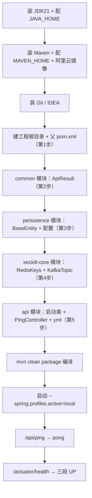
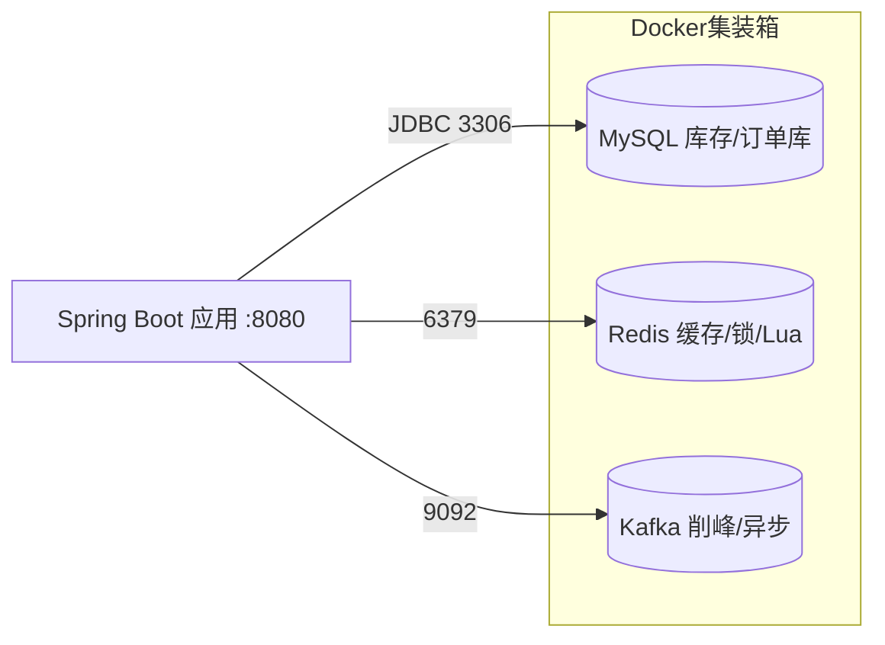

# Phase 0 — 从零搭环境 + Maven 多模块骨架（手把手版）

> 这是**食谱式（recipe）教程**：每一步都给你「敲什么命令 → 建什么文件 → 贴完整代码（带注释）→ 做完会看到什么」。
> 你照着从第一步敲到最后一步，就能把整个后端骨架跑起来、看到第一个接口返回 `pong`、健康页 `UP`。
> 数据库/缓存/消息队列这一关，**本机装不了 Docker 也能过**——用项目内置的 `local` 零依赖 profile（用 H2 内存库代替 MySQL，不连 Redis/Kafka）即可；Docker 方案原样保留，等你迁移到能装 Docker 的机器时再用。

---

## 先搞懂：我们要搭什么、为什么这样搭

整个项目是一个 **Java 后端**，未来要做「智能秒杀 + AI Agent 辅助」。但在写任何秒杀逻辑之前，得先把三样东西准备好：

1. **工具链**（JDK / Maven / Git / IDEA）：没有它们，Java 代码没法编译运行。
2. **工程骨架**（Maven 多模块）：把代码按职责拆成 `common / persistence / seckill-core / api` 四个模块。
3. **运行验证**：让骨架能编译、能启动、第一个接口能返回 `pong`，证明"地基 + 水电网"接通了。

> 💡 **为什么用"多模块"？**
> 一个项目如果全塞在一个文件夹，后期会乱成一锅粥。拆模块是**职责分离**：数据库相关放 `persistence`，纯业务逻辑放 `seckill-core`，对外接口放 `api`，公共工具放 `common`。模块间通过 `pom.xml` 的 `<dependency>` 互相引用，互不污染。你后面会看到 `api` 要调用 `seckill-core` 的 Service，就必须在 `api` 的 `pom.xml` 里声明依赖——这正是模块化的代价与好处。

### 术语大白话（看不懂先读这里，后面不再解释）

- **JDK**：Java 的"发动机 + 编译器"，没有它所有 Java 代码都跑不起来。
- **Maven**："打包管理员"。按 `pom.xml` 去仓库下载依赖、编译、打包成 `jar`。
- **Git**："代码传送带"，把项目从 Gitee 拉到本地 / 把改动推上去。
- **模块（module）**：一个独立的代码包，有自己的 `pom.xml` 和源码目录；多个模块组成一个大工程。
- **依赖（dependency）**：A 模块要用 B 模块的代码，就在 A 的 `pom.xml` 里声明"我依赖 B"。
- **Profile（Spring 的）**：同一份代码在不同环境用不同配置。本项目 `local` = 用 H2 内存库、不连 Redis/Kafka（零依赖）；默认 = 连真实的 MySQL/Redis/Kafka。
- **Actuator / 健康检查**：Spring 提供的"体检端点"，访问 `/actuator/health` 看 `UP/DOWN`。
- **H2**：一个纯 Java 的内存数据库，不用安装，启动即建库，关掉即消失——非常适合本地零依赖跑通。

---

## 第 0 步：准备工具（装一次，永久受益）

> 📖 **为什么先装工具？** 这些是地基。装好并配好环境变量后，后面所有命令（`java / mvn / git`）才能在任意目录直接敲。
> 安装约定：所有工具统一装到 `D:\devtools` 下，路径**不要有中文、不要有空格**（新手最常见坑）。

### 0.1 装 JDK 21

1. 打开清华大学开源镜像（国内直连）：`https://mirrors.tuna.tsinghua.edu.cn/Adoptium/21/jdk/x64/windows/`
2. 下载文件名以 `OpenJDK21U-jdk_x64_windows_hotspot_` 开头、后缀 `.msi` 的那个（最新版本即可）。
3. 双击安装，**安装路径改成 `D:\devtools\jdk21`**（纯英文、无空格），一路 Next 到 Finish。
4. 配环境变量：桌面右键"此电脑" → 属性 → 高级系统设置 → 环境变量 → 系统变量里**新建** `JAVA_HOME = D:\devtools\jdk21`；再在 `Path` 里**新建** `%JAVA_HOME%\bin`。
5. **关掉所有命令行窗口重开**，敲 `java -version`，看到 `21.x` 即成功。

> 🧠 **理解一下**：环境变量就是告诉 Windows"JDK 装在哪"。`%JAVA_HOME%\bin` 加进 `Path` 后，你在任何目录敲 `java`，系统都知道去 `D:\devtools\jdk21\bin` 找它。没配或没重开终端，就会报"java 不是内部命令"。

### 0.2 装 Maven 3.9.x

1. 打开 `https://mirrors.tuna.tsinghua.edu.cn/apache/maven/maven-3/`，进 `3.9.x` 最新目录的 `binaries/`，下载 `apache-maven-3.9.x-bin.zip`。
2. 解压到 `D:\devtools\`，得到 `D:\devtools\apache-maven-3.9.x`。
3. 配环境变量：新建 `MAVEN_HOME = D:\devtools\apache-maven-3.9.x`，`Path` 里加 `%MAVEN_HOME%\bin`。重开终端。
4. **必做**：配置阿里云镜像，否则依赖下不动。打开 `C:\Users\你的用户名\.m2\`，新建 `settings.xml`：

```xml
<?xml version="1.0" encoding="UTF-8"?>
<settings xmlns="http://maven.apache.org/SETTINGS/1.0.0">
  <mirrors>
    <mirror>
      <id>aliyun</id>
      <mirrorOf>central</mirrorOf>
      <name>aliyun maven</name>
      <url>https://maven.aliyun.com/repository/public</url>
    </mirror>
  </mirrors>
</settings>
```

5. 重开终端敲 `mvn -version`，看到 `3.9.x` 且 `Java version: 21` 即成功。

> 🧠 **理解一下**：Maven 编译时要从网上下几百 MB 依赖包。默认走国外服务器国内极慢，阿里云镜像是"国内加速中转站"。这一步只做一次，以后所有 Maven 项目都受益。

### 0.3 装 Git

1. `https://registry.npmmirror.com/-/binary/git-for-windows/` 进最新版本目录，下载 `Git-2.XX.X-64-bit.exe`。
2. 双击一路 Next（默认选项对新手最友好）。
3. 验证：重开终端敲 `git --version`，有版本号即成功。

### 0.4 装 IntelliJ IDEA（写代码的"写字台"，强烈建议）

1. `https://www.jetbrains.com/idea/download/` 选 **Community（社区版，免费）** 下载。
2. 安装后首次启动，点 **Open**，选中工程根目录 `D:\Java\insightforge`（里面有 `pom.xml`）。IDEA 会自动识别 Maven 工程并下载依赖（首次稍慢）。
3. 配置 SDK：`File → Project Structure → Project`，SDK 设为 JDK 21（没有就 `Add SDK → JDK` 指向 `D:\devtools\jdk21`）。

### 0.5 Docker（可选 / 预留，本机装不了就跳过）

> ⚠️ **你的开发机装不了 Docker？先跳过这一节，照常往下做。** Phase 0 脚手架现在就能用「本地零依赖启动」（见第 7 步路径 B）验证跑通；`docker-compose.yml` 原样保留，等你迁移到**能装 Docker 的机器**时再启用。
> 下载：`https://www.docker.com/products/docker-desktop/`。装完启动 Desktop，命令行敲 `docker run --rm hello-world` 看到欢迎文字即成功。

---

## 第 1 步：建工程根目录 + 父 POM（统一版本的中枢）

> 📖 **概念：父 POM 是"版本目录"。**
> 一个多模块工程必须有个"总管"——父 `pom.xml`。它干两件关键事：① 用 `<modules>` 声明有哪些子模块；② 用 `<dependencyManagement>` 把所有依赖的**版本集中声明一次**。子模块要用依赖时只写 `groupId:artifactId`、**不写版本号**。好处：绝不会出现"A 模块用 Redisson 3.30、B 模块用 3.28 导致冲突"。

### 1.1 建工程根目录

```bash
# 你的工作目录（按自己情况改，本教程约定根在 D:\Java）
mkdir -p D:\Java\insightforge
cd D:\Java\insightforge
```

### 1.2 父 pom.xml（完整代码 + 注释）

> 文件： `D:\Java\insightforge\pom.xml`

```xml
<?xml version="1.0" encoding="UTF-8"?>
<project xmlns="http://maven.apache.org/POM/4.0.0"
         xmlns:xsi="http://www.w3.org/2001/XMLSchema-instance"
         xsi:schemaLocation="http://maven.apache.org/POM/4.0.0 https://maven.apache.org/xsd/maven-4.0.0.xsd">
    <modelVersion>4.0.0</modelVersion>

    <!-- 父工程的坐标：groupId 公司/组织反写，artifactId 工程名，version 版本 -->
    <groupId>com.insightforge</groupId>
    <artifactId>insightforge</artifactId>
    <version>0.1.0-SNAPSHOT</version>
    <packaging>pom</packaging>   <!-- 父工程必须 packaging=pom，它本身不打 jar -->
    <name>InsightForge</name>
    <description>智析 · 智能秒杀/大促平台（Agent 辅助）— 多模块后端</description>

    <!-- ① 声明四个子模块：Maven 编译时会按依赖顺序依次构建它们 -->
    <modules>
        <module>insightforge-common</module>
        <module>insightforge-persistence</module>
        <module>insightforge-seckill-core</module>
        <module>insightforge-api</module>
    </modules>

    <!-- ② 统一属性：版本号集中在这里，子模块引用 ${...} 即可 -->
    <properties>
        <maven.compiler.release>21</maven.compiler.release>   <!-- 用 Java 21 编译 -->
        <project.build.sourceEncoding>UTF-8</project.build.sourceEncoding>
        <java.version>21</java.version>

        <!-- 统一依赖版本（详见 plan.md） -->
        <spring-boot.version>3.3.5</spring-boot.version>
        <mybatis-plus.version>3.5.11</mybatis-plus.version>
        <redisson.version>3.34.1</redisson.version>
        <spring-ai.version>1.0.0</spring-ai.version>
        <drools.version>9.44.0.Final</drools.version>
        <lombok.version>1.18.36</lombok.version>
    </properties>

    <!-- ③ 版本目录：子模块写依赖时不写版本，版本以这里为准 -->
    <dependencyManagement>
        <dependencies>
            <!-- Spring Boot BOM：一次性管理 web/actuator/data-redis/kafka/mysql 等 -->
            <dependency>
                <groupId>org.springframework.boot</groupId>
                <artifactId>spring-boot-dependencies</artifactId>
                <version>${spring-boot.version}</version>
                <type>pom</type>
                <scope>import</scope>
            </dependency>

            <!-- MyBatis-Plus：ORM 框架（实体 ↔ 数据库表） -->
            <dependency>
                <groupId>com.baomidou</groupId>
                <artifactId>mybatis-plus-boot-starter</artifactId>
                <version>${mybatis-plus.version}</version>
            </dependency>

            <!-- mybatis-spring 3.0.4：修复与 Spring 6.1 的 factoryBeanObjectType 类型不兼容
                 （mybatis-plus 3.5.x 默认带 3.0.3，会在注册 Mapper 时抛异常，详见附录排查） -->
            <dependency>
                <groupId>org.mybatis</groupId>
                <artifactId>mybatis-spring</artifactId>
                <version>3.0.4</version>
            </dependency>

            <!-- Redisson：分布式锁 + 限流（防超卖心脏，Phase 3 起大量使用） -->
            <dependency>
                <groupId>org.redisson</groupId>
                <artifactId>redisson-spring-boot-starter</artifactId>
                <version>${redisson.version}</version>
            </dependency>

            <!-- Spring AI BOM：Phase 7+ Agent 接入（DeepSeek / Embedding） -->
            <dependency>
                <groupId>org.springframework.ai</groupId>
                <artifactId>spring-ai-bom</artifactId>
                <version>${spring-ai.version}</version>
                <type>pom</type>
                <scope>import</scope>
            </dependency>

            <!-- Drools BOM：Phase 9 护栏规则引擎（已选定 Drools，见 spec §5.5） -->
            <dependency>
                <groupId>org.drools</groupId>
                <artifactId>drools-bom</artifactId>
                <version>${drools.version}</version>
                <type>pom</type>
                <scope>import</scope>
            </dependency>

            <!-- Lombok：编译期自动生成 getter/setter，省掉样板代码 -->
            <dependency>
                <groupId>org.projectlombok</groupId>
                <artifactId>lombok</artifactId>
                <version>${lombok.version}</version>
                <scope>provided</scope>
            </dependency>
        </dependencies>
    </dependencyManagement>

    <!-- 直接依赖：这里声明的，会传递给所有子模块 -->
    <dependencies>
        <dependency>
            <groupId>org.projectlombok</groupId>
            <artifactId>lombok</artifactId>
            <scope>provided</scope>
        </dependency>
    </dependencies>

    <build>
        <pluginManagement>
            <plugins>
                <!-- Spring Boot 打包插件：把应用打成可执行 fat jar（api 模块用） -->
                <plugin>
                    <groupId>org.springframework.boot</groupId>
                    <artifactId>spring-boot-maven-plugin</artifactId>
                    <version>${spring-boot.version}</version>
                </plugin>
                <!-- 启用 -parameters：保留方法参数名，避免 @PathVariable 因反射拿不到参数名而 500 -->
                <plugin>
                    <groupId>org.apache.maven.plugins</groupId>
                    <artifactId>maven-compiler-plugin</artifactId>
                    <version>3.13.0</version>
                    <configuration>
                        <parameters>true</parameters>
                    </configuration>
                </plugin>
            </plugins>
        </pluginManagement>
    </build>
</project>
```

> 🧠 **理解一下**：这份父 POM 自己不打包（`packaging=pom`），它只是"总管"。`<modules>` 告诉 Maven："我有四个小弟，按依赖顺序构建。" `<dependencyManagement>` 是"版本目录"——子模块写 `spring-boot-starter-web` 时不写版本，Maven 自动来这里查。这样全工程版本统一，杜绝冲突。

**这一步做完**：工程有了"总管"，但四个子模块还没建。接下来逐个建。

---

## 第 2 步：建 common 模块（统一返回体）

> 📖 **概念：统一返回体让前端好处理。**
> 所有接口都返回同一格式 `{code, message, data}`：`code=0` 成功，非 0 出错，`data` 是真正的数据。前端不用每个接口猜返回长啥样。这个放 `common` 模块，因为所有模块都可能要返回数据。

### 2.1 建目录 + 建 pom.xml

```bash
mkdir -p insightforge-common/src/main/java/com/insightforge/common/result
```

> 文件： `insightforge-common/pom.xml`

```xml
<?xml version="1.0" encoding="UTF-8"?>
<project xmlns="http://maven.apache.org/POM/4.0.0"
         xmlns:xsi="http://www.w3.org/2001/XMLSchema-instance"
         xsi:schemaLocation="http://maven.apache.org/POM/4.0.0 https://maven.apache.org/xsd/maven-4.0.0.xsd">
    <modelVersion>4.0.0</modelVersion>
    <!-- 子模块必须声明 parent，指回父工程的坐标（版本要一致） -->
    <parent>
        <groupId>com.insightforge</groupId>
        <artifactId>insightforge</artifactId>
        <version>0.1.0-SNAPSHOT</version>
    </parent>
    <artifactId>insightforge-common</artifactId>
    <name>InsightForge Common</name>
    <description>公共模块：统一返回体、工具、异常等</description>

    <dependencies>
        <!-- 用 Lombok 生成 getter/setter；版本由父 POM 管理，这里不写 -->
        <dependency>
            <groupId>org.projectlombok</groupId>
            <artifactId>lombok</artifactId>
        </dependency>
    </dependencies>
</project>
```

### 2.2 ApiResult.java（统一返回体）

> 文件： `insightforge-common/src/main/java/com/insightforge/common/result/ApiResult.java`

```java
package com.insightforge.common.result;

import lombok.Data;
import java.io.Serializable;

/**
 * 统一 API 返回体（教学骨架，Phase 0）。
 * code=0 表示成功；非 0 表示业务/错误码。
 */
@Data                                    // Lombok：自动生成 getter/setter/toString
public class ApiResult<T> implements Serializable {

    private int code;                    // 0=成功，非0=失败（如 404/409）
    private String message;              // 提示信息
    private T data;                      // 真正的业务数据（泛型，什么类型都装）

    /** 成功时调用：code=0, message="ok" */
    public static <T> ApiResult<T> ok(T data) {
        ApiResult<T> r = new ApiResult<>();
        r.setCode(0);
        r.setMessage("ok");
        r.setData(data);
        return r;
    }

    /** 失败时调用：只给 code 和 message，data 为 null */
    public static <T> ApiResult<T> fail(int code, String message) {
        ApiResult<T> r = new ApiResult<>();
        r.setCode(code);
        r.setMessage(message);
        return r;
    }
}
```

> 🧠 **理解一下**：`@Data` 是 Lombok 注解，编译时自动帮你生成 `getCode()/setCode()` 等样板代码，你不用手写。`<T>` 是泛型——`ApiResult<String>` 装字符串，`ApiResult<StockInfo>` 装库存对象。两个静态工厂方法 `ok()/fail()` 让调用处写起来很干净：`return ApiResult.ok("pong")`。

---

## 第 3 步：建 persistence 模块（ORM 底座）

> 📖 **概念：持久层管"数据库"。**
> 这个模块负责把 Java 对象和数据库表互相转换（ORM）。它提供：实体基类（自带主键）、MyBatis-Plus 配置。后续 Phase 的表实体和 Mapper 都放这里。

### 3.1 建目录 + 建 pom.xml

```bash
mkdir -p insightforge-persistence/src/main/java/com/insightforge/persistence/entity
mkdir -p insightforge-persistence/src/main/java/com/insightforge/persistence/config
```

> 文件： `insightforge-persistence/pom.xml`

```xml
<?xml version="1.0" encoding="UTF-8"?>
<project xmlns="http://maven.apache.org/POM/4.0.0"
         xmlns:xsi="http://www.w3.org/2001/XMLSchema-instance"
         xsi:schemaLocation="http://maven.apache.org/POM/4.0.0 https://maven.apache.org/xsd/maven-4.0.0.xsd">
    <modelVersion>4.0.0</modelVersion>
    <parent>
        <groupId>com.insightforge</groupId>
        <artifactId>insightforge</artifactId>
        <version>0.1.0-SNAPSHOT</version>
    </parent>
    <artifactId>insightforge-persistence</artifactId>
    <name>InsightForge Persistence</name>
    <description>持久层：MyBatis-Plus + MySQL（实体、仓储、配置）</description>

    <dependencies>
        <!-- 依赖 common：用它的 ApiResult（虽然 persistence 现在还用不到，先连上） -->
        <dependency>
            <groupId>com.insightforge</groupId>
            <artifactId>insightforge-common</artifactId>
            <version>${project.version}</version>
        </dependency>
        <!-- MyBatis-Plus 起步依赖（含自动配置） -->
        <dependency>
            <groupId>com.baomidou</groupId>
            <artifactId>mybatis-plus-boot-starter</artifactId>
        </dependency>
        <!-- 显式锁定 mybatis-spring 3.0.4（修复 Spring 6.1 的 factoryBeanObjectType 不兼容） -->
        <dependency>
            <groupId>org.mybatis</groupId>
            <artifactId>mybatis-spring</artifactId>
        </dependency>
        <!-- MySQL 驱动：运行时才需要，编译不依赖 -->
        <dependency>
            <groupId>com.mysql</groupId>
            <artifactId>mysql-connector-j</artifactId>
            <scope>runtime</scope>
        </dependency>
    </dependencies>
</project>
```

### 3.2 BaseEntity.java（实体基类，自带主键 id）

> 文件： `insightforge-persistence/src/main/java/com/insightforge/persistence/entity/BaseEntity.java`

```java
package com.insightforge.persistence.entity;

import com.baomidou.mybatisplus.annotation.IdType;
import com.baomidou.mybatisplus.annotation.TableId;
import lombok.Data;

import java.io.Serializable;

/**
 * 实体基类（Phase 0 已建）。
 * 所有业务表实体都继承它，白嫖一个自增主键 id。
 */
@Data                                   // Lombok：自动生成 getter/setter/toString 等
public abstract class BaseEntity implements Serializable {

    @TableId(type = IdType.AUTO)        // 告诉 MyBatis-Plus：id 由数据库自增
    private Long id;
}
```

> 🧠 **理解一下**：`abstract` 表示它自己不被实例化，只作为父类被继承。`@TableId(type = AUTO)` 表示主键由数据库自增——你插入时不设 id，数据库自己填。所有实体继承它，每张表都有 `id` 字段，不用重复写。

### 3.3 MybatisPlusConfig.java（MP 配置）

> 文件： `insightforge-persistence/src/main/java/com/insightforge/persistence/config/MybatisPlusConfig.java`

```java
package com.insightforge.persistence.config;

import com.baomidou.mybatisplus.extension.plugins.MybatisPlusInterceptor;
import org.springframework.context.annotation.Bean;
import org.springframework.context.annotation.Configuration;

/**
 * MyBatis-Plus 配置（Phase 0 基础配置）。
 * 本 Phase 还没有分页查询，故先注册 MybatisPlusInterceptor 占位；
 * 后续 Phase 做分页列表时，再 addInnerInterceptor 一个分页拦截器。
 */
@Configuration                            // 标记为 Spring 配置类，容器启动会加载它
public class MybatisPlusConfig {

    @Bean                                // 把拦截器交给 Spring 容器管理
    public MybatisPlusInterceptor mybatisPlusInterceptor() {
        return new MybatisPlusInterceptor();
    }
}
```

> 🧠 **理解一下**：`@Configuration` + `@Bean` 是 Spring 里"把一个对象交给容器管理"的标准写法。后面所有模块启动时，`MybatisPlusInterceptor` 就存在于容器里，MP 才能正常工作。现在它还是空的"占位"，等以后加分页功能再填内容。

---

## 第 4 步：建 seckill-core 模块（Redis / Kafka 规范）

> 📖 **概念：这是"高并发引擎"的栖息处。**
> 秒杀的命根子是并发与互斥。本项目用 Redis（缓存 + 分布式锁 + Lua 原子扣减）和 Kafka（削峰异步）。这些 Key 怎么命名、Topic 叫什么，如果散落各处容易拼错。所以现在先建两个"规范类"集中管理——**提前把命名约定定死，后面省大麻烦**。

### 4.1 建目录 + 建 pom.xml

```bash
mkdir -p insightforge-seckill-core/src/main/java/com/insightforge/seckill/core/redis
mkdir -p insightforge-seckill-core/src/main/java/com/insightforge/seckill/core/kafka
```

> 文件： `insightforge-seckill-core/pom.xml`

```xml
<?xml version="1.0" encoding="UTF-8"?>
<project xmlns="http://maven.apache.org/POM/4.0.0"
         xmlns:xsi="http://www.w3.org/2001/XMLSchema-instance"
         xsi:schemaLocation="http://maven.apache.org/POM/4.0.0 https://maven.apache.org/xsd/maven-4.0.0.xsd">
    <modelVersion>4.0.0</modelVersion>
    <parent>
        <groupId>com.insightforge</groupId>
        <artifactId>insightforge</artifactId>
        <version>0.1.0-SNAPSHOT</version>
    </parent>
    <artifactId>insightforge-seckill-core</artifactId>
    <name>InsightForge Seckill Core</name>
    <description>★高并发引擎：Redis Key 规范、Redisson 锁、Kafka 主题</description>

    <dependencies>
        <dependency>
            <groupId>com.insightforge</groupId>
            <artifactId>insightforge-common</artifactId>
            <version>${project.version}</version>
        </dependency>
        <!-- Phase 1 起：秒杀服务需要访问持久层实体与 Mapper -->
        <dependency>
            <groupId>com.insightforge</groupId>
            <artifactId>insightforge-persistence</artifactId>
            <version>${project.version}</version>
        </dependency>
        <!-- Redisson：分布式锁 + 限流（Phase 3 起大量使用） -->
        <dependency>
            <groupId>org.redisson</groupId>
            <artifactId>redisson-spring-boot-starter</artifactId>
        </dependency>
        <!-- Kafka：削峰异步（Phase 4 起大量使用） -->
        <dependency>
            <groupId>org.springframework.kafka</groupId>
            <artifactId>spring-kafka</artifactId>
        </dependency>
    </dependencies>
</project>
```

### 4.2 RedisKeys.java（Redis Key 命名规范）

> 文件： `insightforge-seckill-core/src/main/java/com/insightforge/seckill/core/redis/RedisKeys.java`

```java
package com.insightforge.seckill.core.redis;

/**
 * Redis Key 命名规范（与 spec §13.1 对齐）。
 * 集中管理 key 拼装，避免散落各处拼错；后续 Phase 的 Lua 扣减 / 分段 / pending 均复用此处。
 */
public final class RedisKeys {           // final + 私有构造：纯工具类，不允许实例化

    private RedisKeys() {
    }

    /** 主库存：stock:a:{aid}:s:{sid} */
    public static String stock(long activityId, long skuId) {
        return "stock:a:" + activityId + ":s:" + skuId;
    }

    /** 分段库存：stock:a:{aid}:s:{sid}:seg:{n}（调拨只建新段 seg_{N+1}） */
    public static String stockSegment(long activityId, long skuId, int seg) {
        return stock(activityId, skuId) + ":seg:" + seg;
    }

    /** 两阶段预留：pending_stock:a:{aid}:s:{sid} */
    public static String pendingStock(long activityId, long skuId) {
        return "pending_stock:a:" + activityId + ":s:" + skuId;
    }

    /** 细粒度锁：lock:a:{aid}:s:{sid}（用户 10ms / 规则引擎 0ms，见 spec §3.1） */
    public static String lock(long activityId, long skuId) {
        return "lock:a:" + activityId + ":s:" + skuId;
    }

    /** 订单幂等：order:idemp:{hash}（SETNX 去重，exactly-once） */
    public static String orderIdempotent(String hash) {
        return "order:idemp:" + hash;
    }

    /** 当前生效 DSL：guardrail:dsl:{aid}（Redis 热更新） */
    public static String guardrailDsl(long activityId) {
        return "guardrail:dsl:" + activityId;
    }
}
```

> 🧠 **理解一下**：这是"命名约定字典"。比如主库存的 Redis key 统一叫 `stock:a:1:s:1`。以后任何地方要操作库存，都调 `RedisKeys.stock(1,1)`，绝不会有人手滑拼成 `stock_1_1` 导致读不到。这种"集中规范"在大型项目里很重要。

### 4.3 KafkaTopicConfig.java（Kafka 主题声明）

> 文件： `insightforge-seckill-core/src/main/java/com/insightforge/seckill/core/kafka/KafkaTopicConfig.java`

```java
package com.insightforge.seckill.core.kafka;

import org.springframework.context.annotation.Bean;
import org.springframework.context.annotation.Configuration;
import org.springframework.kafka.config.TopicBuilder;

/**
 * Kafka 主题声明（Phase 0 建 Topic；Broker 可达时由 Spring 自动创建）。
 * 命名与 plan.md §4.3 / spec §13 对齐；guardrail.action.failed 为 DLQ（死信队列）。
 */
@Configuration
public class KafkaTopicConfig {

    public static final String ORDER_CREATED = "order.created";            // 订单创建事件
    public static final String SALES_TICK = "sales.tick";                  // 销量心跳（流计算）
    public static final String GUARDRAIL_ACTION = "guardrail.action";      // 护栏动作下发
    public static final String GUARDRAIL_ACTION_FAILED = "guardrail.action.failed"; // 失败动作进 DLQ

    @Bean   // 每个 @Bean 声明一个主题；3 个分区、1 副本
    public org.apache.kafka.clients.admin.NewTopic orderCreated() {
        return TopicBuilder.name(ORDER_CREATED).partitions(3).replicas(1).build();
    }

    @Bean
    public org.apache.kafka.clients.admin.NewTopic salesTick() {
        return TopicBuilder.name(SALES_TICK).partitions(3).replicas(1).build();
    }

    @Bean
    public org.apache.kafka.clients.admin.NewTopic guardrailAction() {
        return TopicBuilder.name(GUARDRAIL_ACTION).partitions(3).replicas(1).build();
    }

    @Bean
    public org.apache.kafka.clients.admin.NewTopic guardrailActionFailed() {
        return TopicBuilder.name(GUARDRAIL_ACTION_FAILED).partitions(3).replicas(1).build();
    }
}
```

> 🧠 **理解一下**：Kafka 是"消息队列"——一个模块生产消息，另一个模块消费，解耦削峰。`@Bean` 声明主题后，Spring 启动时若 Kafka 可达就自动建好，不用手动敲命令。`guardrail.action.failed` 是 **DLQ（死信队列）**：处理失败的动作丢这里，便于事后排查——这是生产级系统的标配。

---

## 第 5 步：建 api 模块（启动类 + 第一个接口 + 配置）

> 📖 **概念：api 是"门面 / 启动入口"。**
> 它是唯一一个能直接 `java -jar` 跑起来的模块。里面放：启动类（程序入口）、Controller（对外 HTTP 接口）、以及 `application.yml`（连接 MySQL/Redis/Kafka 的地址）。其他三个模块都是被它依赖、在它内部运行的"零件"。

### 5.1 建目录 + 建 pom.xml

```bash
mkdir -p insightforge-api/src/main/java/com/insightforge/api/controller
mkdir -p insightforge-api/src/main/resources
mkdir -p insightforge-api/src/test/java/com/insightforge/api
```

> 文件： `insightforge-api/pom.xml`

```xml
<?xml version="1.0" encoding="UTF-8"?>
<project xmlns="http://maven.apache.org/POM/4.0.0"
         xmlns:xsi="http://www.w3.org/2001/XMLSchema-instance"
         xsi:schemaLocation="http://maven.apache.org/POM/4.0.0 https://maven.apache.org/xsd/maven-4.0.0.xsd">
    <modelVersion>4.0.0</modelVersion>
    <parent>
        <groupId>com.insightforge</groupId>
        <artifactId>insightforge</artifactId>
        <version>0.1.0-SNAPSHOT</version>
    </parent>
    <artifactId>insightforge-api</artifactId>
    <name>InsightForge API</name>
    <description>REST + WebSocket 接入层（可启动的 Spring Boot 应用）</description>

    <dependencies>
        <!-- 依赖三个兄弟模块（注意：这里把前面三个模块全部连上了） -->
        <dependency>
            <groupId>com.insightforge</groupId>
            <artifactId>insightforge-common</artifactId>
            <version>${project.version}</version>
        </dependency>
        <dependency>
            <groupId>com.insightforge</groupId>
            <artifactId>insightforge-persistence</artifactId>
            <version>${project.version}</version>
        </dependency>
        <dependency>
            <groupId>com.insightforge</groupId>
            <artifactId>insightforge-seckill-core</artifactId>
            <version>${project.version}</version>
        </dependency>
        <!-- Web 起步依赖：提供 @RestController / @GetMapping 等 -->
        <dependency>
            <groupId>org.springframework.boot</groupId>
            <artifactId>spring-boot-starter-web</artifactId>
        </dependency>
        <!-- Actuator：健康检查端点 /actuator/health -->
        <dependency>
            <groupId>org.springframework.boot</groupId>
            <artifactId>spring-boot-starter-actuator</artifactId>
        </dependency>
        <!-- 测试：@SpringBootTest / JUnit（Phase 1 起用于并发超卖演示） -->
        <dependency>
            <groupId>org.springframework.boot</groupId>
            <artifactId>spring-boot-starter-test</artifactId>
            <scope>test</scope>
        </dependency>
        <!-- 本地零依赖冒烟测试用（local profile）：H2 内存库代替 MySQL -->
        <dependency>
            <groupId>com.h2database</groupId>
            <artifactId>h2</artifactId>
            <scope>runtime</scope>
        </dependency>
    </dependencies>

    <build>
        <plugins>
            <!-- Spring Boot 打包插件：把应用打成可执行 fat jar -->
            <plugin>
                <groupId>org.springframework.boot</groupId>
                <artifactId>spring-boot-maven-plugin</artifactId>
                <executions>
                    <execution>
                        <id>repackage</id>
                        <goals>
                            <goal>repackage</goal>
                        </goals>
                    </execution>
                </executions>
            </plugin>
        </plugins>
    </build>
</project>
```

### 5.2 InsightForgeApplication.java（启动类）

> 文件： `insightforge-api/src/main/java/com/insightforge/api/InsightForgeApplication.java`

```java
package com.insightforge.api;

import org.mybatis.spring.annotation.MapperScan;
import org.springframework.boot.SpringApplication;
import org.springframework.boot.autoconfigure.SpringBootApplication;

/**
 * InsightForge 启动类（Phase 0）。
 * 扫描整个 com.insightforge 基包，装载各模块 Bean；
 * @MapperScan 让 MyBatis-Plus 扫描持久层 Mapper 接口。
 */
@SpringBootApplication(scanBasePackages = "com.insightforge")
@MapperScan("com.insightforge.persistence.mapper")
public class InsightForgeApplication {

    public static void main(String[] args) {
        SpringApplication.run(InsightForgeApplication.class, args);   // 程序入口：启动 Spring 容器
    }
}
```

> 🧠 **理解一下**：`main` 方法是 Java 程序的入口。`@SpringBootApplication` 启动整个 Spring 世界；`scanBasePackages="com.insightforge"` 让 Spring 去这个包下找所有 `@Service/@RestController/@Configuration` 并实例化；`@MapperScan` 专门告诉 MyBatis-Plus"去 `persistence.mapper` 包给 Mapper 接口生成实现"。不加这行，运行时会报"找不到 Mapper 的 Bean"。

### 5.3 PingController.java（第一个接口）

> 文件： `insightforge-api/src/main/java/com/insightforge/api/controller/PingController.java`

```java
package com.insightforge.api.controller;

import com.insightforge.common.result.ApiResult;
import org.springframework.web.bind.annotation.GetMapping;
import org.springframework.web.bind.annotation.RestController;

/**
 * 健康检查 / 连通性探测（Phase 0）。
 * 真正的业务接口（/api/seckill 等）在后续 Phase 逐步加入。
 */
@RestController                              // 这是一个 HTTP 接口类
public class PingController {

    @GetMapping("/api/ping")                // 浏览器 GET 这个地址就触发下面方法
    public ApiResult<String> ping() {
        return ApiResult.ok("pong");        // 返回 {code:0, message:"ok", data:"pong"}
    }
}
```

> 🧠 **理解一下**：`@RestController` 表示"这个类专门处理 HTTP 请求"。`@GetMapping("/api/ping")` 把 `GET /api/ping` 这个地址绑定到 `ping()` 方法。浏览器一访问，就返回我们 `common` 模块定义的 `ApiResult.ok("pong")`。这个接口不碰数据库，纯粹用来证明"应用起来了 + 模块间打通了"。

### 5.4 application.yml（默认配置：连真实 MySQL/Redis/Kafka）

> 文件： `insightforge-api/src/main/resources/application.yml`

```yaml
server:
  port: 8080                                # 应用监听 8080 端口

spring:
  application:
    name: insightforge
  # 每次启动自动执行 schema.sql（建表）+ data.sql（种子数据），与 local profile 共用
  sql:
    init:
      mode: always
  datasource:                               # ① MySQL 连接信息
    url: jdbc:mysql://localhost:3306/insightforge?useUnicode=true&characterEncoding=utf8&serverTimezone=Asia/Shanghai&allowPublicKeyRetrieval=true
    username: insightforge
    password: insightforge
    driver-class-name: com.mysql.cj.jdbc.Driver
  data:
    redis:                                  # ② Redis 连接信息
      host: localhost
      port: 6379
      database: 0
  kafka:                                    # ③ Kafka 连接信息
    bootstrap-servers: localhost:9092
    producer:
      acks: all                             # 生产端：等所有副本确认，保证不丢消息
      retries: 3
    consumer:
      group-id: insightforge-default
      auto-offset-reset: earliest

management:                                 # ④ 健康检查端点
  endpoints:
    web:
      exposure:
        include: health,info,metrics
  endpoint:
    health:
      show-details: always

logging:
  level:
    com.insightforge: INFO
```

> 🧠 **理解一下**：这份是"默认 profile"的配置——假设你的机器上已经跑着真实的 MySQL(3306)/Redis(6379)/Kafka(9092)。`localhost` 是因为中间件都在本机。`management` 那段把 `/actuator/health` 打开，等会验证时用。如果你本机没装这些、又装不了 Docker，就用下面这份 `application-local.yml` 零依赖跑。

### 5.5 application-local.yml（零依赖 profile：H2 代替 MySQL，关掉 Redis/Kafka）

> 文件： `insightforge-api/src/main/resources/application-local.yml`

```yaml
# Phase 0 本地零依赖冒烟测试 profile（激活方式：启动时加 --spring.profiles.active=local）
# 用途：本机装不了 Docker 时，用 H2 内存库代替 MySQL，不连 Redis/Kafka，直接把脚手架跑起来。
spring:
  datasource:
    url: jdbc:h2:mem:insightforge;DB_CLOSE_DELAY=-1;DB_CLOSE_ON_EXIT=FALSE   # H2 内存库
    driver-class-name: org.h2.Driver
    username: sa
    password: ""
  h2:
    console:
      enabled: true                        # 打开 H2 控制台，浏览器可看库内容
  sql:
    init:
      mode: always                         # 同样启动建表 + 灌种子
  autoconfigure:
    exclude:
      - org.springframework.boot.autoconfigure.data.redis.RedisAutoConfiguration
      - org.springframework.boot.autoconfigure.data.redis.RedisRepositoriesAutoConfiguration
      - org.springframework.boot.autoconfigure.kafka.KafkaAutoConfiguration
      - org.redisson.spring.starter.RedissonAutoConfigurationV2   # Redisson 也会连 Redis，一起关

management:
  endpoints:
    web:
      exposure:
        include: health,info,metrics
  endpoint:
    health:
      show-details: always

logging:
  level:
    com.insightforge: INFO
```

> 🧠 **理解一下**：`local` profile 是"懒人救星"。它做两件事：① 把数据源换成 **H2 内存库**（不用装 MySQL，启动即建库）；② 用 `autoconfigure.exclude` **关掉 Redis / Kafka / Redisson 的自动配置**（因为本机没起这些服务，不关的话启动会报错连不上）。这样你**零中间件**就能把脚手架跑起来验证。等将来接了真实中间件，不加参数用默认 `application.yml` 即可。

**这一步做完**：四个模块全部建好，骨架已能编译运行。接下来（可选）加 Docker 一键起依赖。

---

## 第 6 步（可选）：docker-compose 一键起依赖

> 📖 **概念：Docker Compose 把"装三个中间件"变成"一条命令"。**
> 如果你迁移到能装 Docker 的机器，可以用这份 `docker-compose.yml` 一次拉起 MySQL/Redis/Kafka。它和 `application.yml` 里的 `localhost` 端口一一对应。本机装不了 Docker 就跳过，用上面的 `local` profile 验证即可。

> 文件： `D:\Java\docker\docker-compose.yml`

```yaml
version: "3.8"

# InsightForge 本地依赖（Phase 0）
# 启动顺序：先 docker compose up -d，再启动 Spring Boot 应用。
# Kafka 采用 KRaft 单节点；Spring 会自动按 seckill-core 的 NewTopic 建主题。

services:
  mysql:
    image: mysql:8.0
    container_name: insightforge-mysql
    environment:
      MYSQL_ROOT_PASSWORD: root
      MYSQL_DATABASE: insightforge
      MYSQL_USER: insightforge
      MYSQL_PASSWORD: insightforge
    ports:
      - "3306:3306"
    volumes:
      - mysql-data:/var/lib/mysql
    healthcheck:
      test: ["CMD", "mysqladmin", "ping", "-h", "localhost", "-u", "root", "-proot"]
      interval: 10s
      timeout: 5s
      retries: 5

  redis:
    image: redis:7.2
    container_name: insightforge-redis
    ports:
      - "6379:6379"
    healthcheck:
      test: ["CMD", "redis-cli", "ping"]
      interval: 10s
      timeout: 5s
      retries: 5

  kafka:
    image: bitnami/kafka:3.7
    container_name: insightforge-kafka
    environment:
      KAFKA_CFG_NODE_ID: "1"
      KAFKA_CFG_PROCESS_ROLES: "broker,controller"
      KAFKA_CFG_CONTROLLER_QUORUM_VOTERS: "1@kafka:9093"
      KAFKA_CFG_LISTENERS: "PLAINTEXT://:9092,CONTROLLER://:9093"
      KAFKA_CFG_ADVERTISED_LISTENERS: "PLAINTEXT://localhost:9092"
      KAFKA_CFG_LISTENER_SECURITY_PROTOCOL_MAP: "CONTROLLER:PLAINTEXT,PLAINTEXT:PLAINTEXT"
      KAFKA_CFG_CONTROLLER_LISTENER_NAMES: "CONTROLLER"
      KAFKA_CFG_AUTO_CREATE_TOPICS_ENABLE: "true"
      ALLOW_PLAINTEXT_LISTENER: "yes"
    ports:
      - "9092:9092"
    healthcheck:
      test: ["CMD", "kafka-topics.sh", "--bootstrap-server", "localhost:9092", "--list"]
      interval: 15s
      timeout: 10s
      retries: 5

volumes:
  mysql-data:
```

> 🧠 **理解一下**：`image` 是现成的官方镜像；`ports` 把容器端口映射到本机（3306/6379/9092），正好对应 `application.yml`；`healthcheck` 让 Docker 知道"服务真起来了没"。Kafka 用 **KRaft** 新架构（去掉了 ZooKeeper），单节点够本地开发。启用方式：`cd D:\Java\docker && docker compose up -d`，等三个都 `healthy` 再启动应用。

---

## 第 7 步：编译 + 启动 + 验证（看到 pong 即通关）

> 📖 **为什么这是"通关标志"？** 编译通过 = 四个模块代码/依赖无误；启动成功 = Spring 容器、各模块 Bean、数据源都装配好了；`/api/ping` 返回 `pong` = HTTP 链路 + 模块间调用打通。这三件事齐了，地基就牢了。

### 7.1 编译（mvn clean package）

```bash
cd D:\Java\insightforge

# 你自己的机器（已装好 Maven）：
mvn clean package -DskipTests

# 沙箱 / Windows+GitBash 下 mvn 启动报错时，用这条「直调 Java 启动 Maven」绕过：
# MVN_HOME="D:/devtools/maven/apache-maven-3.9.9"
# java -classpath "$MVN_HOME/boot/plexus-classworlds-2.8.0.jar" \
#   -Dclassworlds.conf="$MVN_HOME/bin/m2.conf" -Dmaven.home="$MVN_HOME" \
#   -Dmaven.multiModuleProjectDirectory="D:/Java/insightforge" \
#   -Dlibrary.jansi.path="$MVN_HOME/lib/jansi-native" \
#   org.codehaus.plexus.classworlds.launcher.Launcher clean package -DskipTests
```

看到结尾 `[INFO] BUILD SUCCESS` 即编译通过。每个模块会生成 `target/*.jar`，其中 `insightforge-api/target/insightforge-api-0.1.0-SNAPSHOT.jar` 是可执行的。

### 7.2 启动（零依赖 local profile，最稳）

```bash
# 用 local profile：H2 内存库 + 不连 Redis/Kafka，无需任何中间件
java -jar insightforge-api/target/insightforge-api-0.1.0-SNAPSHOT.jar \
     --spring.profiles.active=local --server.port=8080
```

看到 `Started InsightForgeApplication` 且无报错即成功。
> 💡 不要用 `mvn spring-boot:run`：本项目多模块结构下它可能报"找不到主类"，`java -jar` 跑打好的 fat jar 最稳。若报 `Port 8080 was already in use`，任务管理器结束 `java.exe` 再跑。

### 7.3 验证 1：健康检查

浏览器打开（或命令行 `curl http://localhost:8080/actuator/health`）：

```
http://localhost:8080/actuator/health
```

走 `local` profile 应看到（没有 redis/kafka 项，因为故意没加载，这是正常的）：
```json
{
  "status": "UP",
  "components": {
    "db":   { "status": "UP", "details": { "database": "H2" } },
    "diskSpace": { "status": "UP" },
    "ping": { "status": "UP" }
  }
}
```

### 7.4 验证 2：第一个接口

浏览器打开（或 `curl http://localhost:8080/api/ping`）：
```
http://localhost:8080/api/ping
```
应看到：
```json
{"code":0,"message":"ok","data":"pong"}
```

✅ **`pong` + 健康页 `status: UP` 出现 = Phase 0 通关！**

---

## 第 8 步：流程图 + 排错 + 收尾

### 8.1 从零到跑通的流程图





> 大白话：应用是"店铺"，三个中间件是"仓库（MySQL）/ 前台缓存（Redis）/ 后台传话筒（Kafka）"。Docker 把它们装进集装箱一起运来，应用按 `application.yml` 里的地址去敲门。现在你用 `local` profile 时，MySQL 被 H2 替代、Redis/Kafka 暂时没接——店铺先空跑验证灯亮。

### 8.2 排错（按现象查）

| 现象 | 原因 | 解决 |
|---|---|---|
| `java / mvn / git` 不是内部命令 | Path 没配 or 没重开终端 | 检查环境变量；**关掉所有终端重开** |
| `invalid target release: 21` | JDK 不是 21 | `java -version` 确认；`JAVA_HOME` 指向 21 |
| `mvn` 编译卡在 Download | 没配阿里云镜像 | 按第 0.2 节配 `settings.xml` 后重试 |
| `mvn` 报 `ClassNotFoundException: org.codehaus.plexus.classworlds.launcher.Launcher` | Windows+GitBash 下 Maven 把 `MAVEN_HOME` 解析成 `/d/...`，但 `java.exe` 要 `D:/...` | 在 **cmd.exe** 里跑 `mvn`；或沙箱里用第 7.1 节"直调 Java 启动 Maven"命令 |
| 启动报 `Invalid value type for attribute 'factoryBeanObjectType': java.lang.String` | MyBatis-Plus 3.5.9 + Spring 6.1 不兼容旧 mybatis-spring | 父 POM 升 `mybatis-plus 3.5.11` + 锁 `mybatis-spring 3.0.4`（本 Phase 已做） |
| `mvn spring-boot:run` 报找不到主类 | 多模块下插件检测问题 | 改用 `mvn -pl insightforge-api -am package` 后 `java -jar target/...jar` |
| `Port 8080 was already in use` | 上次 java 进程没退 | 任务管理器结束 `java.exe` 再跑 |
| 走 local 启动报 `could not be excluded ... RedissonAutoConfiguration` | 用了旧 jar / profile 没生效 | 重新 `mvn clean package` 确保新 `application-local.yml` 进了 jar |

### 8.3 本阶段"故意留白"的地方（Phase 1 预告）

Phase 0 只保证"地基 + 水电 + 灯亮"，下面这些**刻意没做**，是后面 Phase 的核心：
- ❌ 没有秒杀下单接口（Phase 1 才加 `POST /api/seckill`，且**故意不做并发保护，先暴露超卖**）。
- ❌ 没有 Redis+Lua 原子扣减 / 分布式锁（Phase 2–3 的防超卖心脏）。
- ❌ 没有 Agent / 护栏 DSL / 规则引擎（Phase 7–9）。
- ❌ 没有前端大屏（Phase 10）。

> 教学逻辑：先有能跑的骨架，再一步步"加功能 + 加保护"，让你清楚每加一样东西**解决什么痛点**。Phase 1 我们会先写出"会超卖"的朴素下单，再用 Phase 2/3 把它改对——这样你才真正理解防超卖为什么难。

---

## 下一步（进入 Phase 1）

打开 `tutorials/phase1.md`（最小秒杀主流程，**故意不安全**）：从建实体类开始，一步步写出"点抢购 → 库存-1 → 出订单"的接口，并亲手用 300 并发测试把"超卖"演给你看。
