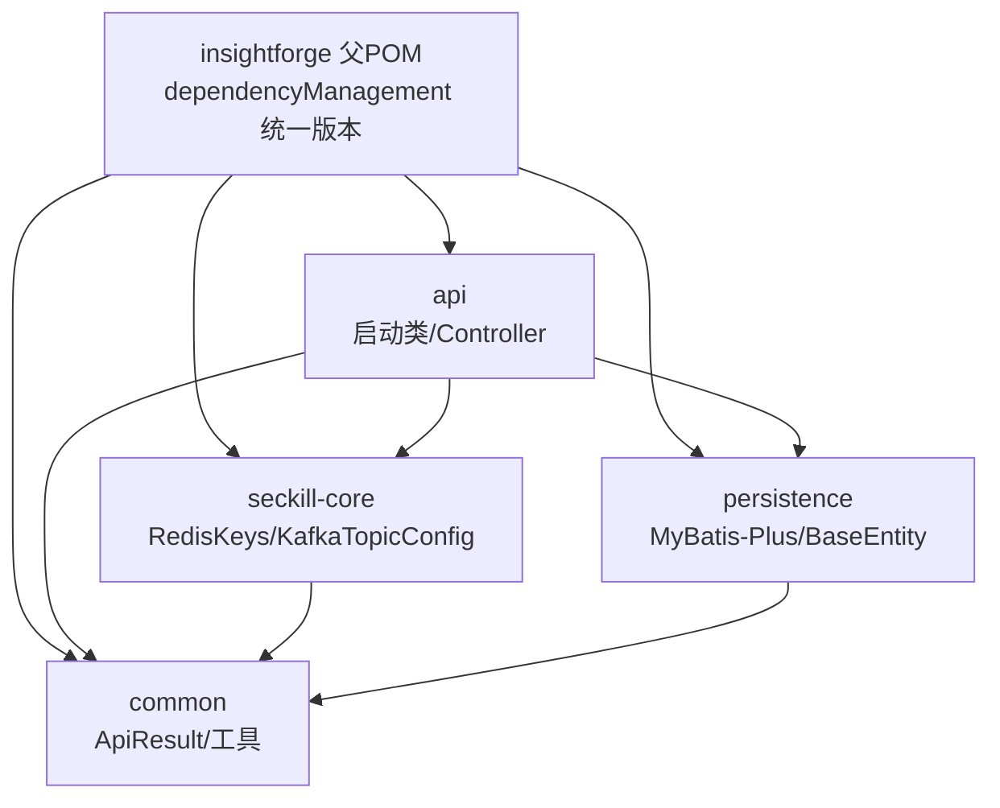
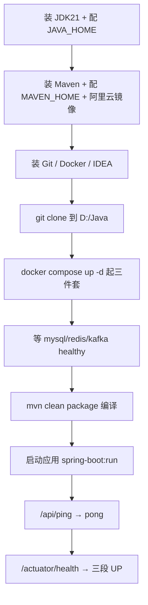
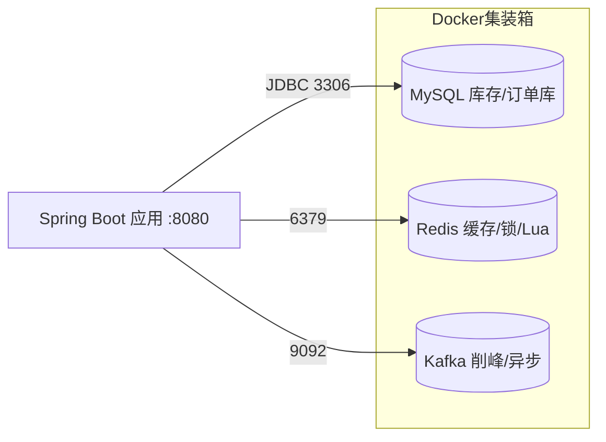

# Phase 0 教学文档：从零搭好环境与骨架（新手照做版）

> 这是 `tutorial.md` 里 **Phase 0** 的**保姆级详解**。即使你以前没装过 Java、没碰过命令行，只要**严格按本文顺序一步步做**，就能把整个工程跑起来、看到第一个接口返回 `pong`。
> 配套文档：`plan.md`（方案）、`spec.md`（v0.8 设计）、`tasks.md`（勾选清单）、`glossary.md`（大白话词典，看不懂词先查这里）、`tutorial.md`（总纲）。

---

## 0.0 先看终点：你做完这一关会得到什么

一句话：**装好 4 个工具（JDK / Maven / Git / Docker）+ 1 个编辑器（IDEA），把仓库代码拉下来，一键拉起数据库/缓存/消息队列，编译并启动项目，最后用浏览器/命令行敲一下，看到 `pong` 和三个 `UP`。**

完成标志（必须全部满足才算通关）：

```
✅ java -version   显示 21.x
✅ mvn -version    显示 3.9.x 且底下写 Java 21
✅ git --version   有版本号
✅ docker run hello-world  出欢迎文字
✅ docker compose ps   mysql/redis/kafka 三个都是 healthy
✅ mvn clean package   BUILD SUCCESS
✅ 浏览器开 http://localhost:8080/api/ping  看到 {"code":0,"data":"pong"}
✅ 浏览器开 http://localhost:8080/actuator/health  看到 db/redis/kafka 都是 UP
```

> **大白话**：Phase 0 不写任何业务代码（代码我已经帮你写进仓库了）。你这一关只干一件事——**把"房子地基 + 水电网（数据库/缓存/消息队列）"接好，确认灯能亮**。真正的秒杀逻辑从 Phase 1 才往下加。

---

## 0.1 你要装的 5 个东西（先认个脸）

| 工具 | 干啥用的（人话） | 必须？ |
|---|---|---|
| **JDK 21** | Java 程序的"发动机+编译器"，没有它所有 Java 代码都跑不起来 | 必须 |
| **Maven 3.9.x** | "打包管理员"：按 `pom.xml` 去仓库下载依赖、编译、打包成 jar | 必须 |
| **Git** | "代码传送带"：把你从 Gitee 上把项目拉到本地 | 必须 |
| **Docker Desktop** | "集装箱"：一条命令拉起 MySQL/Redis/Kafka，省得你挨个装 | 必须 |
| **IntelliJ IDEA Community** | 写 Java 的"写字台"（编辑器），以后改代码全靠它 | 强烈建议（免费） |

> 安装约定：所有工具统一装到 `D:\devtools` 下，路径**不要有中文、不要有空格**（这是新手最常见的坑，能避开就避开）。

---

## 0.2 第 1 步：装 JDK 21（Java 开发工具包）

### 0.2.1 去哪下载（国内直连，不用翻墙）

打开这个网址（清华大学开源镜像，国内很快）：

```
https://mirrors.tuna.tsinghua.edu.cn/Adoptium/21/jdk/x64/windows/
```

页面里会列出一堆文件。**找文件名以 `OpenJDK21U-jdk_x64_windows_hotspot_` 开头、后缀是 `.msi` 的那一个**（`.msi` 是安装版，最省事；选日期最新/版本号最大的那个，比如 `OpenJDK21U-jdk_x64_windows_hotspot_21.0.6_7.msi`）。点它下载。

> 备用（若上面打不开）：华为云 `https://mirrors.huaweicloud.com/openjdk/` ；或官网 `https://adoptium.net/temurin/releases/?version=21`（官网国内可能慢）。

### 0.2.2 安装

1. 双击下载好的 `.msi`。
2. 一路点 **Next**（下一步）。
3. **安装路径这一步改一下**：默认是 `C:\Program Files\...`，建议改成 `D:\devtools\jdk21`（**纯英文、无空格**）。记住这个路径，下一步配环境变量要用。
4. 点 **Install** 等它装完，最后 **Finish**。

### 0.2.3 配环境变量（重点，新手必看）

环境变量就是告诉 Windows"JDK 装在哪"，否则命令行找不到它。

**图形界面操作（推荐）：**
1. 桌面右键 **"此电脑"** → **显示更多选项** → **属性**（或直接按 `Win + Pause`）。
2. 点左侧 **"高级系统设置"**。
3. 弹窗右下角点 **"环境变量(N)..."**。
4. 下半部分 **"系统变量"** 区域，点 **"新建(W)..."**：
   - 变量名：`JAVA_HOME`
   - 变量值：`D:\devtools\jdk21`（填你 0.2.2 实际装的路径）
   - 确定。
5. 在"系统变量"里找到已经存在的 **Path**，双击它 → 点 **"新建"** → 输入 `%JAVA_HOME%\bin` → 一路确定。
6. **关键**：关掉所有已打开的命令行窗口，重新开一个，让新变量生效。

> 命令行备选（如果你习惯敲命令）：以管理员身份开 PowerShell，执行
> `setx JAVA_HOME "D:\devtools\jdk21" /M` 然后 `setx PATH "%PATH%;%JAVA_HOME%\bin" /M`
> 同样要重开终端。

### 0.2.4 ✅ 验证

重新打开一个 **命令提示符（CMD）** 或 **PowerShell**，敲：

```bash
java -version
```

看到类似下面就算成功（版本号 21 开头即可）：

```
openjdk version "21.0.6" 2025-01-21
OpenJDK Runtime Environment Temurin-21.0.6+7 (build 21.0.6+7)
OpenJDK 64-Bit Server VM Temurin-21.0.6+7 (build 21.0.6+7, mixed mode)
```

❌ 如果提示 **"java 不是内部或外部命令"**：说明 Path 没配好，或没重开终端。回去检查 0.2.3。

---

## 0.3 第 2 步：装 Maven 3.9.x（构建工具）

### 0.3.1 去哪下载（国内直连）

打开清华大学 Apache 镜像目录：

```
https://mirrors.tuna.tsinghua.edu.cn/apache/maven/maven-3/
```

点进去找一个 `3.9.x` 文件夹（比如 `3.9.9/` 或更新的 `3.9.16/`），再进里面的 `binaries/`，下载 **`apache-maven-3.9.x-bin.zip`**（`x` 取最新那个）。

> Maven 不用安装，是个压缩包，解压即用。

### 0.3.2 解压 + 配环境变量

1. 把 `apache-maven-3.9.x-bin.zip` 解压到 `D:\devtools\`，会得到 `D:\devtools\apache-maven-3.9.x`。
2. 和 JDK 一样配环境变量：
   - 新建系统变量 `MAVEN_HOME` = `D:\devtools\apache-maven-3.9.x`
   - 在 `Path` 里新建 `%MAVEN_HOME%\bin`
3. 重开终端。

### 0.3.3 ⚠️ 必做：配置阿里云镜像（否则依赖下不动）

Maven 编译时要从网上下几百 MB 的依赖包。默认走国外服务器，国内会非常慢甚至失败。**必须**先配国内镜像：

1. 打开文件夹 `C:\Users\你的用户名\.m2\`（没有就新建）。
2. 在里面新建文件 `settings.xml`，内容如下（直接整段复制）：

```xml
<?xml version="1.0" encoding="UTF-8"?>
<settings xmlns="http://maven.apache.org/SETTINGS/1.0.0">
  <mirrors>
    <mirror>
      <id>aliyun</id>
      <mirrorOf>central</mirrorOf>
      <name>aliyun maven</name>
      <url>https://maven.aliyun.com/repository/public</url>
    </mirror>
  </mirrors>
</settings>
```

> 这一步做过一次，以后所有 Maven 项目都受益。

### 0.3.4 ✅ 验证

重开终端敲：

```bash
mvn -version
```

看到类似下面（注意最后一行 Runtime 是 21）即成功：

```
Apache Maven 3.9.9 (...)
Maven home: D:\devtools\apache-maven-3.9.9
Java version: 21.0.6, vendor: Eclipse Adoptium, runtime: D:\devtools\jdk21
```

❌ 若显示 `Java version: 17` 或更低：说明 `JAVA_HOME` 指向了旧 JDK，回去改 0.2.3。
❌ 若 `mvn` 不是内部命令：Path 没配好或没重开终端。

---

## 0.4 第 3 步：装 Git（拉代码用）

### 0.4.1 去哪下载（国内直连）

打开 npmmirror 的 git-for-windows 目录：

```
https://registry.npmmirror.com/-/binary/git-for-windows/
```

点进最新的版本文件夹（如 `v2.47.0.windows.1/`），下载 **`Git-2.XX.X-64-bit.exe`**（64 位安装包）。

> 备用：官网 `https://git-scm.com/download/win`。

### 0.4.2 安装

双击 `.exe`，**一路 Next** 即可（默认选项对新手最友好，包括"添加到右键菜单""用 Vim 作默认编辑器"都无妨）。

### 0.4.3 ✅ 验证

重开终端敲：

```bash
git --version
```

看到 `git version 2.XX.X.windows.1` 即成功。

---

## 0.5 第 4 步：装 Docker Desktop（一键起依赖）

### 0.5.1 去哪下载

主选（官方，国内一般能下，只是稍慢）：

```
https://www.docker.com/products/docker-desktop/
```

点 **"Download for Windows"**。

> 若官方下不动，可用 DaoCloud 镜像入口：`https://get.daocloud.io/`（页面里找 Docker Desktop 下载）。

### 0.5.2 安装

1. 双击安装包，勾选 **"Use WSL 2 instead of Hyper-V"**（用 WSL 2 后端，推荐）和 **"Add shortcut to desktop"**，然后 **OK → Install**。
2. 装完启动 Docker Desktop。第一次启动会初始化 WSL 2，可能要等一两分钟。
3. 看到窗口右上角鲸鱼图标变绿、状态显示 **"Docker Desktop is running"** 就ok了。
4. **重启一次电脑**（WSL 2 有时要重启才完全就绪，能避开很多玄学报错）。

> 系统要求：Windows 10/11 专业版或家庭版均可（家庭版会自动装 WSL 2）。若提示"WSL 2 未安装"，按 Docker 弹窗里的链接装一下 WSL 即可。

### 0.5.3 ✅ 验证

重开终端敲：

```bash
docker --version
docker compose version
docker run --rm hello-world
```

最后一条如果看到一段欢迎文字（"Hello from Docker!"），说明 Docker 真正能跑容器了。

❌ 若 `docker run` 报错说"守护进程未启动"：Docker Desktop 没运行，去任务栏把它打开。

---

## 0.6 第 5 步：装 IntelliJ IDEA（写代码的"写字台"，强烈建议）

以后 Phase 1 起你要亲手改 Java 代码，没有编辑器会很痛苦。IDEA 社区版**免费**且够用。

### 0.6.1 去哪下载

```
https://www.jetbrains.com/idea/download/?section=windows
```

选 **"Community"（社区版，免费）** 的 Download。

### 0.6.2 安装 + 导入项目

1. 双击安装，一路 Next（可勾选"创建桌面快捷方式""关联 .java 文件"）。
2. 首次启动选 **"New Project" 先跳过**，进入主界面后点 **"Open"**，选中文件夹 `D:\Java\insightforge`（就是你后面 clone 下来的工程根目录，里面有 `pom.xml`）。
3. IDEA 会自动识别 Maven 工程。等右下角"正在导入 Maven 项目"转完（首次会下载依赖，稍慢）。
4. 配置 SDK：菜单 **File → Project Structure → Project**，把 **SDK** 设为你的 JDK 21（若列表没有，点"Add SDK → JDK"指向 `D:\devtools\jdk21`）。
5. 配置 Maven：菜单 **File → Settings → Build → Build Tools → Maven**，确认 **Maven home path** 指向 `D:\devtools\apache-maven-3.9.x`，**User settings file** 指向你 0.3.3 配的 `C:\Users\你的用户名\.m2\settings.xml`。

> 不必现在就跑项目，只是先把"写字台"准备好。真正启动项目在 0.10。

---

## 0.7 第 6 步：把代码拉到本地

1. 打开终端，**先建好工作目录**（如果还没有）：

```bash
mkdir D:\Java
cd D:\Java
```

2. 克隆仓库（代码都在 Gitee 上）：

```bash
git clone https://gitee.com/paper-umbrella/insight-forge.git .
```

> 注意末尾的 `.` 表示"克隆到当前目录 D:\Java"。如果 D:\Java 里已经有文件会报错，那就先 `cd D:\Java` 后 `git clone https://gitee.com/paper-umbrella/insight-forge.git insightforge` 拉到子文件夹也行——但本教程约定代码在 `D:\Java` 根下，建议用第一种。

3. 克隆完，目录应长这样（节选）：

```
D:\Java\
├── insightforge\          ← 后端工程（多模块）
│   ├── pom.xml
│   ├── insightforge-common\
│   ├── insightforge-persistence\
│   ├── insightforge-seckill-core\
│   └── insightforge-api\
├── docker\
│   └── docker-compose.yml
└── specs\insightforge\    ← 文档（含本文件 tutorials/）
```

✅ 看到 `insightforge` 和 `docker` 两个文件夹即成功。

---

## 0.8 第 7 步：一键拉起三个中间件（MySQL / Redis / Kafka）

这几个就是项目的"数据库 / 缓存 / 消息队列"。用 Docker 一条命令起，不用你手动装。

1. 开终端：

```bash
cd D:\Java\docker
docker compose up -d
```

2. 首次会**下载镜像**（MySQL/Redis/Kafka 几个镜像加起来约 1GB，耐心等几分钟，取决于网速）。
3. 下载完会自动启动。看状态：

```bash
docker compose ps
```

等到三个服务的 `STATUS` 都变成 **`healthy`**（可能要等 20~40 秒，Kafka 最慢）。像这样：

```
NAME                    STATUS                    PORTS
insightforge-mysql      Up 40 seconds (healthy)   3306/tcp
insightforge-redis      Up 40 seconds (healthy)   6379/tcp
insightforge-kafka      Up 35 seconds (healthy)   9092/tcp
```

❌ 若某个一直 `starting` 或 `unhealthy`：`docker compose logs 服务名`（如 `docker compose logs kafka`）看报错。多数是首次初始化慢，等久一点再 `docker compose ps`。

> 这三个容器里的账号密码、端口都已经在 `D:\Java\docker\docker-compose.yml` 写好了（MySQL 用户/库都是 `insightforge`，Redis/Kafka 默认），后面项目直接用，不用你改。

---

## 0.9 第 8 步：编译项目（mvn clean package）

1. 开终端：

```bash
cd D:\Java\insightforge
mvn clean package -DskipTests
```

2. **首次编译会下载大量依赖**（Spring Boot、MyBatis-Plus、Redisson、Drools 等，几百 MB），配合 0.3.3 的阿里云镜像，一般 3~8 分钟。后面再编就快了（有本地缓存）。
3. 看到结尾出现：

```
[INFO] BUILD SUCCESS
```

✅ 即编译通过。每个模块会生成 `target/*.jar`。

❌ 若报 `invalid target release: 21`：JDK 不是 21，回去查 0.2。
❌ 若卡在下载不动：检查 0.3.3 的 `settings.xml` 是否配对路径、内容是否正确。
❌ 若报某个依赖找不到：通常是网络瞬间抖，重试一次 `mvn clean package -DskipTests` 即可。

---

## 0.10 第 9 步：启动应用 + 验证通不通

### 0.10.1 启动（任选一种）

**方式 A：命令行**
```bash
cd D:\Java\insightforge
mvn -pl insightforge-api spring-boot:run
```

**方式 B：用 IDEA**
在 IDEA 左侧找到 `insightforge-api` 模块下的 `InsightForgeApplication.java`，右键 → **Run 'InsightForgeApplication'**。

> 首次启动要连 MySQL/Redis/Kafka，控制台会刷一堆日志，看到 `Started InsightForgeApplication` 且无报错即成功。

### 0.10.2 验证 1：健康检查（看三个中间件是否都 UP）

浏览器打开：

```
http://localhost:8080/actuator/health
```

应看到（节选）：

```json
{
  "status": "UP",
  "components": {
    "db":     { "status": "UP" },
    "redis":  { "status": "UP" },
    "kafka":  { "status": "UP" }
  }
}
```

> 三个 `UP` = 应用成功连上了数据库、缓存、消息队列。

### 0.10.3 验证 2：第一个接口

浏览器打开（或用命令行 `curl http://localhost:8080/api/ping`）：

```
http://localhost:8080/api/ping
```

应看到：

```json
{"code":0,"message":"ok","data":"pong"}
```

✅ **`pong` + 三个 `UP` 同时出现 = Phase 0 通关！**

❌ 若 `db DOWN`：MySQL 容器没起或账号错 → `docker compose ps` 看 mysql 是否 healthy。
❌ 若 `redis DOWN`：`docker compose restart redis`。
❌ 若 `kafka DOWN`：等久一点，`docker logs insightforge-kafka` 看是否 `started`。
❌ 若页面打不开（连不上 8080）：应用没起来，看启动日志有没有 `Exception`。

---

## 0.11 ✅ 检查点汇总表（照着打钩）

| # | 检查项 | 命令 / 操作 | 期望结果 |
|---|---|---|---|
| 1 | JDK | `java -version` | 21.x |
| 2 | Maven | `mvn -version` | 3.9.x + Java 21 |
| 3 | Maven 镜像 | 看 `C:\Users\你\.m2\settings.xml` | 含 aliyun mirror |
| 4 | Git | `git --version` | 有版本号 |
| 5 | Docker | `docker run --rm hello-world` | 欢迎文字 |
| 6 | 代码 | 看 `D:\Java\insightforge\pom.xml` | 文件存在 |
| 7 | 中间件 | `docker compose ps` | 三个 healthy |
| 8 | 编译 | `mvn clean package -DskipTests` | BUILD SUCCESS |
| 9 | 接口 | 浏览器开 `/api/ping` | `{"code":0,"data":"pong"}` |
| 10 | 健康 | 浏览器开 `/actuator/health` | db/redis/kafka 全 UP |

全部打钩 → 在 `tasks.md` 的 **Phase 0** 把"验收"行勾成 `[x]`，然后进入 Phase 1。

---

## 0.12 常见坑（按现象查）

| 现象 | 原因 | 解决 |
|---|---|---|
| `java / mvn / git` 不是内部命令 | Path 没配 or 没重开终端 | 检查环境变量；**关掉所有终端重开** |
| `invalid target release: 21` | JDK 不是 21 | `java -version` 确认；`JAVA_HOME` 指向 21 |
| `mvn` 编译卡在 Download | 没配阿里云镜像 | 按 0.3.3 配 `settings.xml` 后重试 |
| Docker 装完跑不了容器 | WSL 2 没就绪 | 重启电脑；或按 Docker 提示装 WSL |
| `docker compose` 命令不存在 | Docker 太旧 | 升级 Docker Desktop（新版自带 compose v2） |
| 端口被占用 8080/3306/6379/9092 | 本机已跑着同款服务 | 关掉占用进程，或改 `application.yml`/`compose` 端口 |
| `/actuator/health` 里某个 DOWN | 对应容器没起/账号错 | `docker compose ps` + 核对 `application.yml` |
| 依赖偶尔下载失败 | 网络抖动 | 重试 `mvn clean package -DskipTests` |

---

## 0.13 代码讲解（看懂骨架用，不要求手写）

> Phase 0 的代码**我已经写好放在仓库里了**，你 clone 下来就有。下面帮你"看懂每个文件是干嘛的"，方便以后改。

### 0.13.1 目录与模块依赖

```
D:/Java/insightforge/
├── pom.xml                  ← 父 POM：统一版本 + 模块声明
├── insightforge-common/     ← 工具类、统一返回体 ApiResult
├── insightforge-persistence/← MyBatis-Plus 配置 + 实体基类
├── insightforge-seckill-core/← Redis Key 规范 + Kafka 主题声明
└── insightforge-api/        ← 启动类 + PingController + application.yml
```



> 含义：`api` 是门面/启动入口，依赖其余三个；`common` 被大家依赖（放共享东西）。这种拆分就是"职责分离"——以后高并发引擎、规则引擎、Agent 各占一个模块，互不污染。

### 0.13.2 父 `pom.xml`（为什么"只写一次版本"很重要）

父 POM 用 `<dependencyManagement>` 把所有依赖版本**集中声明一次**。子模块要用时只写 `groupId:artifactId`，**不写版本号**。好处：绝不会出现"A 模块用 Redisson 3.30、B 模块用 3.28 导致冲突"这种坑。

```xml
<properties>
    <maven.compiler.release>21</maven.compiler.release>
    <spring-boot.version>3.3.5</spring-boot.version>
    <mybatis-plus.version>3.5.9</mybatis-plus.version>
    <redisson.version>3.34.1</redisson.version>
    <spring-ai.version>1.0.0</spring-ai.version>
    <drools.version>9.44.0.Final</drools.version>   <!-- 你选的规则引擎 Drools -->
</properties>
<dependencyManagement>
    <dependencies>
        <dependency>
            <groupId>org.springframework.boot</groupId>
            <artifactId>spring-boot-dependencies</artifactId>
            <version>${spring-boot.version}</version>
            <type>pom</type><scope>import</scope>
        </dependency>
        <!-- MyBatis-Plus / Redisson / Spring-AI / Drools BOM / Lombok 同理 -->
    </dependencies>
</dependencyManagement>
```

### 0.13.3 `application.yml`（应用怎么连三个中间件）

```yaml
server:
  port: 8080
spring:
  datasource:                              # ① MySQL
    url: jdbc:mysql://localhost:3306/insightforge?...&serverTimezone=Asia/Shanghai
    username: insightforge
    password: insightforge
  data:
    redis:                                 # ② Redis
      host: localhost
      port: 6379
  kafka:                                   # ③ Kafka
    bootstrap-servers: localhost:9092
    producer: { acks: all, retries: 3 }
    consumer: { group-id: insightforge-default, auto-offset-reset: earliest }
management:                                # ④ 健康检查端点
  endpoints.web.exposure.include: health,info,metrics
  endpoint.health.show-details: always
```

> `localhost` 是因为中间件都跑在 Docker 里、映射到了本机端口。

### 0.13.4 `docker-compose.yml`（一键拉起三件套）

```yaml
version: "3.8"
services:
  mysql:
    image: mysql:8.0
    environment:
      MYSQL_ROOT_PASSWORD: root
      MYSQL_DATABASE: insightforge
      MYSQL_USER: insightforge
      MYSQL_PASSWORD: insightforge
    ports: ["3306:3306"]
    volumes: ["mysql-data:/var/lib/mysql"]
    healthcheck:
      test: ["CMD","mysqladmin","ping","-h","localhost","-uroot","-proot"]
      interval: 10s; timeout: 5s; retries: 5
  redis:
    image: redis:7.2
    ports: ["6379:6379"]
    healthcheck: { test: ["CMD","redis-cli","ping"], interval: 10s; timeout: 5s; retries: 5 }
  kafka:
    image: bitnami/kafka:3.7
    environment:
      KAFKA_CFG_NODE_ID: "1"
      KAFKA_CFG_PROCESS_ROLES: "broker,controller"
      KAFKA_CFG_CONTROLLER_QUORUM_VOTERS: "1@kafka:9093"
      KAFKA_CFG_LISTENERS: "PLAINTEXT://:9092,CONTROLLER://:9093"
      KAFKA_CFG_ADVERTISED_LISTENERS: "PLAINTEXT://localhost:9092"
      KAFKA_CFG_AUTO_CREATE_TOPICS_ENABLE: "true"
    ports: ["9092:9092"]
    healthcheck: { test: ["CMD","kafka-topics.sh","--bootstrap-server","localhost:9092","--list"], interval: 15s; timeout: 10s; retries: 5 }
volumes: { mysql-data: }
```

> Kafka 用 **KRaft**（新版，去掉了 ZooKeeper），单节点够本地开发。Spring 启动时会按 `seckill-core` 自动建好主题，不用手动建。

### 0.13.5 骨架代码（每个文件讲一句"为什么存在"）

- **`common/ApiResult.java`**：统一返回体，所有接口都返回 `{code, message, data}`，前端好处理。
- **`persistence/MybatisPlusConfig.java`**：注册 MP 分页插件（以后列表查询要分页）。
- **`persistence/BaseEntity.java`**：实体基类，业务表实体继承它就有自增主键 `id`。
- **`seckill-core/RedisKeys.java`**：**Redis Key 命名规范**，和 spec §13.1 对齐；以后 Lua 扣减/分段/pending 都复用它，避免到处拼错。
- **`seckill-core/KafkaTopicConfig.java`**：声明 4 个主题，其中 `guardrail.action.failed` 是 **DLQ（死信队列）**，处理失败的动作进这里排查。
- **`api/InsightForgeApplication.java`**：启动类，`scanBasePackages="com.insightforge"` 让 Spring 扫描所有模块。
- **`api/PingController.java`**：第一个接口，验证"应用起来了 + common 模块打通"。

```java
@RestController
public class PingController {
    @GetMapping("/api/ping")
    public ApiResult<String> ping() {
        return ApiResult.ok("pong");
    }
}
```

---

## 0.14 流程图：从零到跑通





> 大白话：应用是"店铺"，三个中间件是"仓库（MySQL）/ 前台缓存（Redis）/ 后台传话筒（Kafka）"。Docker 把它们装进集装箱一起运来，应用按 `application.yml` 里的地址去敲门。

---

## 0.15 本阶段"故意留白"的地方（Phase 1 预告）

Phase 0 只保证"地基 + 水电 + 灯亮"，下面这些**刻意没做**，是后面 Phase 的核心：
- ❌ 没有秒杀下单接口（Phase 1 才加 `POST /api/seckill`，且**故意不做并发保护，先暴露超卖**）。
- ❌ 没有 Redis+Lua 原子扣减 / 分布式锁（Phase 2–3 的防超卖心脏）。
- ❌ 没有 Agent / 护栏 DSL / 规则引擎（Phase 7–9）。
- ❌ 没有前端大屏（Phase 10）。

> 教学逻辑：先有能跑的骨架，再一步步"加功能 + 加保护"，让你清楚每加一样东西**解决什么痛点**。Phase 1 我们会先写出"会超卖"的朴素下单，再用 Phase 2/3 把它改对——这样你才真正理解防超卖为什么难。

---

## 0.16 术语速查（本阶段出现）

- **JDK / Maven / Git / Docker**：见 `glossary.md` → "基础设施"。
- **环境变量（JAVA_HOME 等）**：操作系统里存的"路径便签"，让命令行能找到工具。
- **Actuator / 健康检查**：Spring 提供的"体检端点"，暴露 `UP/DOWN`。
- **DLQ（死信队列）**：处理失败的消息被丢进的独立队列，便于事后排查。
- **KRaft**：Kafka 新架构，去掉 ZooKeeper，单节点也能跑。
- **BOM（Bill of Materials）**：Maven 的"版本目录"，`import` 后子模块不用写版本号。

> 看不懂的词，先去 `glossary.md` 查；那是本项目的大白话词典。

---

## 0.17 完成后请做

1. 在 `tasks.md` 的 **Phase 0** 把"验收"那行勾选 `[x]`。
2. 进入下一阶段：打开 `tutorials/phase1.md`（最小秒杀主流程，故意不安全），或先看 `tutorial.md` 的 Phase 1 概要。
