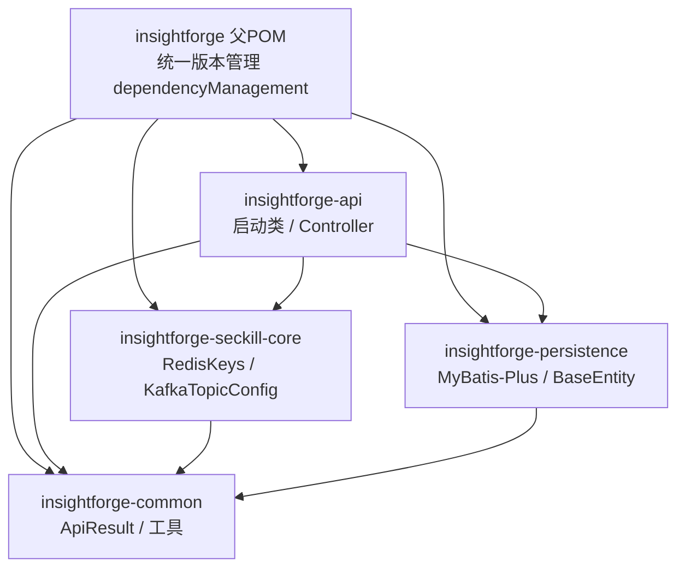
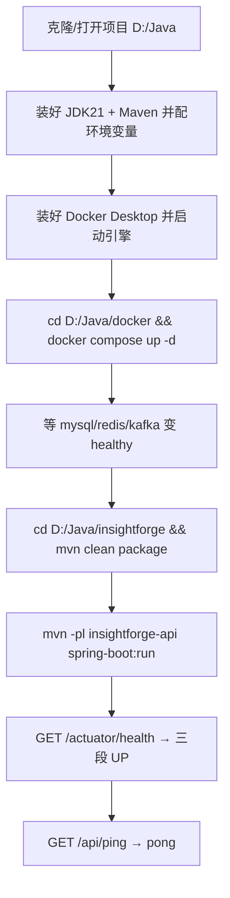
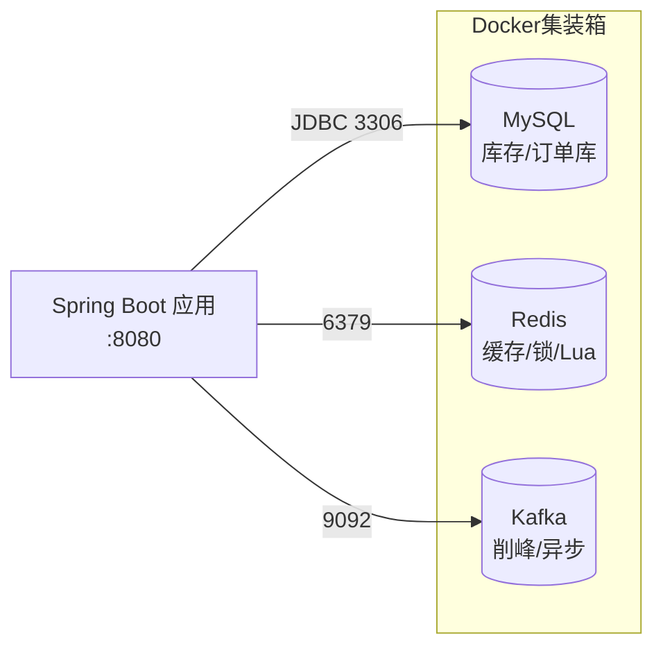

# Phase 0 详细教学：环境与骨架（从零到"能跑通的第一个接口"）

> 这是 `tutorial.md` 里 **Phase 0** 的**逐行详解版**。你跟着本文件做，就能独立把整个工程骨架 + 依赖 + 第一个接口跑起来。
> 配套：`plan.md` §2/§4.1/§10、`spec.md` §5.5/§13、`glossary.md`（看不懂术语先查这里）、`tasks.md`（勾选清单）。
> 本阶段所有选型已在 tutorial 附录 A 确认：JDK 21 / Maven / React / 单用户 JWT / Drools / 预测调拨+A-B 纳入 / 报告延后 / 范围红线。

---

## 0.1 本阶段目标（先看终点）

一句话：**搭好一个能编译的 Maven 多模块工程 + 一键拉起依赖的 Docker，并跑通第一个健康检查接口 `/api/ping` 和 `/actuator/health`。**

做完你应当能：
1. `mvn clean package` 编译通过（多模块）。
2. `docker compose up -d` 一键起 MySQL / Redis / Kafka。
3. 启动应用后，`/actuator/health` 显示三个中间件 `UP`，`/api/ping` 返回 `{"code":0,"data":"pong"}`。

> 大白话：Phase 0 不写任何业务，只把"房子地基 + 水电煤气（数据库/缓存/消息队列）"接好，并确认灯能亮。真正的秒杀在下个 Phase 才开始。

---

## 0.2 你需要准备的"资源"（环境）

> 这一节就是"配置资源"。这三项装完并验证，后面每个 Phase 都不用再折腾环境。

### 0.2.1 JDK 21（Java 开发工具包）

- **为什么选 21（对比 17）**：21 的**虚拟线程（Project Loom）**能让高并发 I/O（连 Redis、发 Kafka）用"几乎免费"的轻量线程写，不用养巨大线程池；Spring Boot 3.3 本就要求 17+。17 也"够用且更稳"，但放弃虚拟线程红利。我们选 21。
- **大白话**：JDK 就是"Java 程序的发动机+编译器"，没有它后面所有代码都跑不起来。
- **安装（Windows）**：
  1. 去 [Adoptium Temurin 21](https://adoptium.net/temurin/releases/?version=21) 下载 **Windows x64 JDK (.msi)**。
  2. 双击安装，记住安装路径（如 `C:\Program Files\Eclipse Adoptium\jdk-21...`）。
  3. 配置环境变量：`JAVA_HOME` = 该路径；把 `%JAVA_HOME%\bin` 加到 `Path`。
- **验证**：
  ```bash
  java -version
  # 应显示：openjdk version "21.x.x" ...
  ```

### 0.2.2 Maven 3.9.x（构建工具）

- **为什么选 Maven（对比 Gradle）**：`pom.xml` 在 Java 企业/面试里最主流，父 POM 多模块是标准范式，资料最多、排错最易。Gradle 更快但要多学一门 DSL。
- **大白话**：Maven 是"项目的打包管理员"——它按 `pom.xml` 去仓库下载所有依赖、编译、打包成可运行 jar。
- **安装（Windows）**：
  1. 下载 [apache-maven-3.9.x-bin.zip](https://maven.apache.org/download.cgi)。
  2. 解压到 `D:\devtools\apache-maven-3.9.x`。
  3. 配置：`MAVEN_HOME` = 解压路径；把 `%MAVEN_HOME%\bin` 加到 `Path`。
- **验证**：
  ```bash
  mvn -version
  # 应显示：Apache Maven 3.9.x + Java version 21
  ```

### 0.2.3 Docker Desktop + Docker Compose（依赖集装箱）

- **为什么用 Docker**：一条命令拉起 MySQL/Redis/Kafka，**环境完全可复现**——你换电脑、面试现场都能一键起，告别"在我机器能跑"。
- **大白话**：Docker 把每个中间件装进"集装箱"，不用你在本机挨个装数据库、装消息队列，且版本固定不会乱。
- **安装（Windows）**：
  1. 下载安装 [Docker Desktop](https://www.docker.com/products/docker-desktop/)，安装时勾选 **WSL 2 后端**。
  2. 启动 Docker Desktop，等右下角鲸鱼图标变绿（引擎运行中）。
- **验证**：
  ```bash
  docker --version
  docker compose version
  docker run --rm hello-world   # 能出欢迎信息即正常
  ```

### 0.2.4 Git（拉代码）

```bash
git --version
# 已装则跳过；仓库地址：https://gitee.com/paper-umbrella/insight-forge
```

---

## 0.3 项目长什么样（目录结构 + 模块依赖）

### 0.3.1 目录树

```
D:/Java/
├── insightforge/                     ← 后端工程（Maven 多模块，parent）
│   ├── pom.xml                       ← 父 POM：统一版本 + 模块声明
│   ├── insightforge-common/          ← 工具类、统一返回体 ApiResult
│   ├── insightforge-persistence/     ← MyBatis-Plus 配置 + 实体基类
│   ├── insightforge-seckill-core/    ← Redis Key 规范 + Kafka 主题声明
│   └── insightforge-api/             ← 启动类 + PingController + application.yml
├── docker/
│   └── docker-compose.yml            ← MySQL / Redis / Kafka 一键起
└── specs/insightforge/               ← 文档（plan/spec/tasks/tutorial/glossary + tutorials/）
```

### 0.3.2 模块依赖图



> 含义：`api` 是"门面/启动入口"，它依赖其余三个；`common` 被大家依赖（放共享的东西）。这种拆分就是 plan §2 说的"职责分离"——高并发引擎、规则引擎、Agent 将来各占一个模块，互不污染。

---

## 0.4 关键文件逐行讲（照搬真实代码）

### 0.4.1 父 `pom.xml` —— 为什么"只写一次版本"很重要

```xml
<project ...>
    <groupId>com.insightforge</groupId>
    <artifactId>insightforge</artifactId>
    <version>0.1.0-SNAPSHOT</version>
    <packaging>pom</packaging>          <!-- 父工程必须是 pom 打包 -->

    <modules>                            <!-- 声明四个子模块 -->
        <module>insightforge-common</module>
        <module>insightforge-persistence</module>
        <module>insightforge-seckill-core</module>
        <module>insightforge-api</module>
    </modules>

    <properties>
        <maven.compiler.release>21</maven.compiler.release>   <!-- 统一用 Java 21 编译 -->
        <spring-boot.version>3.3.5</spring-boot.version>
        <mybatis-plus.version>3.5.9</mybatis-plus.version>
        <redisson.version>3.34.1</redisson.version>
        <spring-ai.version>1.0.0</spring-ai.version>
        <drools.version>9.44.0.Final</drools.version>
        <lombok.version>1.18.36</lombok.version>
    </properties>

    <dependencyManagement>               <!-- 关键：版本集中声明 -->
        <dependencies>
            <!-- Spring Boot BOM：一次性管住 web/actuator/data-redis/kafka/mysql -->
            <dependency>
                <groupId>org.springframework.boot</groupId>
                <artifactId>spring-boot-dependencies</artifactId>
                <version>${spring-boot.version}</version>
                <type>pom</type>
                <scope>import</scope>
            </dependency>
            <!-- MyBatis-Plus / Redisson / Spring-AI BOM / Drools BOM / Lombok 同理 -->
            ...
        </dependencies>
    </dependencyManagement>
</project>
```

**大白话解释 `dependencyManagement`**：它像"公司采购目录"——父 POM 只规定"我们用 Redisson 3.34.1、Spring Boot 3.3.5"，子模块想用某个依赖时**不用再写版本号**，直接引 `groupId:artifactId` 即可。好处：**绝不会出现 seckill-core 用 Redisson 3.30、rule-engine 用 3.28 导致的冲突**——这正是我们把引擎/规则引擎/Agent 拆开时最怕的坑。

> ⚠️ Drools 已在父 POM 入 BOM（`<drools.version>9.44.0.Final</drools.version>`）。这是你确认的第 5 项决策（规则引擎用 Drools）在构建层的落地；Phase 9 才会真正写 `when/then` 规则。

### 0.4.2 子模块 `pom.xml`（以 `insightforge-api` 为例）

每个子模块只需声明自己"额外"的依赖，版本全部继承父 POM：

```xml
<project ...>
    <parent>
        <groupId>com.insightforge</groupId>
        <artifactId>insightforge</artifactId>
        <version>0.1.0-SNAPSHOT</version>
    </parent>
    <artifactId>insightforge-api</artifactId>

    <dependencies>
        <dependency>
            <groupId>org.springframework.boot</groupId>
            <artifactId>spring-boot-starter-web</artifactId>      <!-- 版本来自父 BOM -->
        </dependency>
        <dependency>
            <groupId>org.springframework.boot</groupId>
            <artifactId>spring-boot-starter-actuator</artifactId>  <!-- 健康检查 -->
        </dependency>
        <dependency>
            <groupId>com.insightforge</groupId>
            <artifactId>insightforge-common</artifactId>           <!-- 依赖兄弟模块 -->
        </dependency>
        <dependency>
            <groupId>com.insightforge</groupId>
            <artifactId>insightforge-persistence</artifactId>
        </dependency>
        <dependency>
            <groupId>com.insightforge</groupId>
            <artifactId>insightforge-seckill-core</artifactId>
        </dependency>
    </dependencies>

    <build>
        <plugins>
            <plugin>
                <groupId>org.springframework.boot</groupId>
                <artifactId>spring-boot-maven-plugin</artifactId>  <!-- 打可执行 jar -->
            </plugin>
        </plugins>
    </build>
</project>
```

> `common / persistence / seckill-core` 三个模块的 pom 结构类似，只是依赖更少（例如 `common` 只依赖 Lombok）。核心思想：**版本不重复写，依赖谁就引谁**。

### 0.4.3 `application.yml` —— 应用怎么连三个中间件

```yaml
server:
  port: 8080

spring:
  application:
    name: insightforge
  datasource:                                    # ① MySQL
    url: jdbc:mysql://localhost:3306/insightforge?...&serverTimezone=Asia/Shanghai
    username: insightforge
    password: insightforge
    driver-class-name: com.mysql.cj.jdbc.Driver
  data:
    redis:                                       # ② Redis
      host: localhost
      port: 6379
      database: 0
  kafka:                                         # ③ Kafka
    bootstrap-servers: localhost:9092
    producer:
      acks: all                                  # 生产者：leader+follower 都落盘才算成功（不丢消息）
      retries: 3
    consumer:
      group-id: insightforge-default
      auto-offset-reset: earliest                # 从头消费，不漏消息

management:                                      # ④ 健康检查端点
  endpoints:
    web:
      exposure:
        include: health,info,metrics
  endpoint:
    health:
      show-details: always                       # 把每个中间件的 UP/DOWN 都显示出来
```

> 大白话：这份文件就是"应用的环境说明书"——告诉 Spring 去哪连数据库、缓存、消息队列，以及把"健康体检报告"（`/actuator/health`）对外开放。`localhost` 是因为中间件都跑在 Docker 里并映射到了本机端口。

### 0.4.4 `docker-compose.yml` —— 一键拉起三个中间件

```yaml
version: "3.8"
services:
  mysql:
    image: mysql:8.0
    container_name: insightforge-mysql
    environment:
      MYSQL_ROOT_PASSWORD: root
      MYSQL_DATABASE: insightforge          # 自动建库
      MYSQL_USER: insightforge
      MYSQL_PASSWORD: insightforge
    ports: ["3306:3306"]
    volumes: ["mysql-data:/var/lib/mysql"]  # 数据持久化，重启不丢
    healthcheck:                            # ① 健康探针：能 ping 通才算 healthy
      test: ["CMD", "mysqladmin", "ping", "-h", "localhost", "-uroot", "-proot"]
      interval: 10s; timeout: 5s; retries: 5

  redis:
    image: redis:7.2
    container_name: insightforge-redis
    ports: ["6379:6379"]
    healthcheck:
      test: ["CMD", "redis-cli", "ping"]
      interval: 10s; timeout: 5s; retries: 5

  kafka:
    image: bitnami/kafka:3.7
    container_name: insightforge-kafka
    environment:                            # KRaft 单节点（不依赖 ZooKeeper）
      KAFKA_CFG_NODE_ID: "1"
      KAFKA_CFG_PROCESS_ROLES: "broker,controller"
      KAFKA_CFG_CONTROLLER_QUORUM_VOTERS: "1@kafka:9093"
      KAFKA_CFG_LISTENERS: "PLAINTEXT://:9092,CONTROLLER://:9093"
      KAFKA_CFG_ADVERTISED_LISTENERS: "PLAINTEXT://localhost:9092"
      KAFKA_CFG_AUTO_CREATE_TOPICS_ENABLE: "true"
    ports: ["9092:9092"]
    healthcheck:
      test: ["CMD", "kafka-topics.sh", "--bootstrap-server", "localhost:9092", "--list"]
      interval: 15s; timeout: 10s; retries: 5
volumes:
  mysql-data:
```

> ① **healthcheck 的意义**：Docker 会定期检查容器是否真的"活着的"（而不是进程起了但服务挂了）。后面 Phase 用 `depends_on: condition: service_healthy` 才能让应用"等依赖真正就绪再连"，避免启动时数据库还没起来。
> Kafka 用 **KRaft**（新版，去掉了 ZooKeeper），单节点足够本地开发与演示。Spring 启动时会按 `seckill-core` 里的 `NewTopic` 自动建好主题，所以 compose 里不用手动建 topic。

### 0.4.5 骨架代码（每个文件讲一句"为什么存在"）

**`common/ApiResult.java`** —— 统一返回体，所有接口都返回 `{code, message, data}`，前端好处理。
```java
@Data
public class ApiResult<T> implements Serializable {
    private int code;      // 0=成功，非0=错误码
    private String message;
    private T data;
    public static <T> ApiResult<T> ok(T data) { ... }   // 成功
    public static <T> ApiResult<T> fail(int code, String message) { ... } // 失败
}
```

**`persistence/MybatisPlusConfig.java`** —— 注册 MP 分页插件（以后列表查询要分页）。
```java
@Configuration
public class MybatisPlusConfig {
    @Bean
    public MybatisPlusInterceptor mybatisPlusInterceptor() {
        MybatisPlusInterceptor i = new MybatisPlusInterceptor();
        i.addInnerInterceptor(new PaginationInnerInterceptor(DbType.MYSQL));
        return i;
    }
}
```

**`persistence/BaseEntity.java`** —— 实体基类，业务表实体继承它就有自增主键 `id`。
```java
@Data
public abstract class BaseEntity implements Serializable {
    @TableId(type = IdType.AUTO)
    private Long id;
}
```

**`seckill-core/RedisKeys.java`** —— **Redis Key 命名规范，和 spec §13.1 对齐**。集中拼 key，避免到处手写拼错；以后 Lua 扣减/分段/pending 都复用它。
```java
public final class RedisKeys {
    public static String stock(long aid, long sid)            { return "stock:a:"+aid+":s:"+sid; }
    public static String stockSegment(long aid, long sid, int n){ return stock(aid,sid)+":seg:"+n; }
    public static String pendingStock(long aid, long sid)     { return "pending_stock:a:"+aid+":s:"+sid; }
    public static String lock(long aid, long sid)             { return "lock:a:"+aid+":s:"+sid; }   // spec §3.1 细粒度锁
    public static String orderIdempotent(String hash)         { return "order:idemp:"+hash; }
    public static String guardrailDsl(long aid)               { return "guardrail:dsl:"+aid; }       // 护栏 DSL 热更新
}
```
> 这套 key 规范是后面防超卖（Lua 扣减）、两阶段预留（pending）、细粒度锁的**统一地基**，现在先定义好，后面直接调用。

**`seckill-core/KafkaTopicConfig.java`** —— 声明 4 个主题，其中 `guardrail.action.failed` 是 **DLQ（死信队列）**，处理失败的动作进这里便于排查。
```java
public class KafkaTopicConfig {
    public static final String ORDER_CREATED = "order.created";
    public static final String SALES_TICK = "sales.tick";          // 实时销量心跳（供规则引擎算流速）
    public static final String GUARDRAIL_ACTION = "guardrail.action";
    public static final String GUARDRAIL_ACTION_FAILED = "guardrail.action.failed"; // DLQ
    // 每个都 @Bean NewTopic(name).partitions(3).replicas(1)
}
```
> `sales.tick` 是后面"预测性调拨"的数据源（算库存流速）；DLQ 是 spec 里 Kafka 可靠性（失败重试/死信）的落点。

**`api/InsightForgeApplication.java`** —— 启动类，`scanBasePackages="com.insightforge"` 让 Spring 扫描所有模块。
```java
@SpringBootApplication(scanBasePackages = "com.insightforge")
public class InsightForgeApplication {
    public static void main(String[] args) {
        SpringApplication.run(InsightForgeApplication.class, args);
    }
}
```

**`api/PingController.java`** —— 第一个接口，验证"应用起来了 + common 模块打通"。
```java
@RestController
public class PingController {
    @GetMapping("/api/ping")
    public ApiResult<String> ping() {
        return ApiResult.ok("pong");
    }
}
```

---

## 0.5 流程图：从零到跑通

### 0.5.1 构建与运行总流程



### 0.5.2 应用与中间件连接关系



> 大白话：应用是"店铺"，三个中间件是"仓库（MySQL）/ 前台缓存（Redis）/ 后台传话筒（Kafka）"。Docker 把它们装进集装箱一起运来，应用按 `application.yml` 里的地址去敲门。

---

## 0.6 动手步骤（直接照敲）

```bash
# 1) 拉代码（若还没拉）
git clone https://gitee.com/paper-umbrella/insight-forge.git D:/Java
cd D:/Java

# 2) 起依赖（首次会下载镜像，稍慢，耐心等）
cd D:/Java/docker
docker compose up -d
docker compose ps          # 看 STATUS 是否 healthy（可能要等 20~40s）

# 3) 编译（首次会下载大量依赖到本地仓库 ~/.m2，可能 3~8 分钟）
cd D:/Java/insightforge
mvn clean package -DskipTests

# 4) 启动应用
mvn -pl insightforge-api spring-boot:run
# 或打好的 jar：
# java -jar insightforge-api/target/insightforge-api-0.1.0-SNAPSHOT.jar
```

> 伪代码版（看逻辑，不必敲）：
> ```
> IF 没装JDK/Maven/Docker: 先装(见0.2)
> docker.compose.up(-d)
> WHILE 任一中间件 != healthy: sleep(5s)
> mvn.clean.package()
> spring.boot.run()
> ASSERT health.endpoint == UP
> ASSERT ping == "pong"
> ```

---

## 0.7 验证（你应当看到什么）

**健康检查**（重点看 `db`/`redis`/`kafka` 三个组件都是 `UP`）：
```bash
curl http://localhost:8080/actuator/health
```
预期（节选）：
```json
{
  "status": "UP",
  "components": {
    "db":     { "status": "UP" },
    "redis":  { "status": "UP" },
    "kafka":  { "status": "UP" }
  }
}
```

**连通性探测**：
```bash
curl http://localhost:8080/api/ping
# 返回：{"code":0,"message":"ok","data":"pong"}
```

> 三个 `UP` + `pong` 同时出现 = **Phase 0 通关**。任何一个 `DOWN` 都说明对应的 Docker 容器没起来或账号密码不对（看 0.8 排错）。

---

## 0.8 常见坑（排错）

| 现象 | 原因 | 解决 |
|---|---|---|
| `mvn` 不是内部命令 | 没配 `Path` | 确认 `%MAVEN_HOME%\bin` 在 `Path`；重开终端 |
| 编译报 `invalid target release: 21` | JDK 不是 21 | `java -version` 确认；检查 `JAVA_HOME` 指向 21 |
| `docker compose` 报错 | Docker 没启动 / 版本旧 | 启动 Docker Desktop；旧版用 `docker-compose`（有横杠） |
| `/actuator/health` 里 `db DOWN` | MySQL 没起或账号错 | `docker compose ps` 看 mysql 是否 healthy；核对 `application.yml` 用户名/密码 |
| `redis DOWN` | redis 容器没起 | `docker compose restart redis` |
| `kafka DOWN` / 连不上 9092 | KRaft 还没就绪 | 等久一点；`docker logs insightforge-kafka` 看是否 `started` |
| 端口被占用（8080/3306/6379/9092） | 本机已跑着同款服务 | 关掉占用进程，或改 `application.yml`/`compose` 端口 |
| 依赖下载极慢/失败 | Maven 中央仓库访问慢 | 在 `~/.m2/settings.xml` 配阿里云镜像（搜"maven 阿里云镜像"） |

> 阿里云镜像 `settings.xml` 关键片段（放在 `C:\Users\你的用户名\.m2\settings.xml`）：
> ```xml
> <mirrors>
>   <mirror>
>     <id>aliyun</id>
>     <mirrorOf>central</mirrorOf>
>     <name>aliyun maven</name>
>     <url>https://maven.aliyun.com/repository/public</url>
>   </mirror>
> </mirrors>
> ```

---

## 0.9 本阶段"故意留白"的地方（Phase 1 预告）

Phase 0 只保证"地基 + 水电 + 灯亮"，下面这些**刻意没做**，是后面 Phase 的核心：
- ❌ 没有秒杀下单接口（Phase 1 才加 `POST /api/seckill`，且**故意不做并发保护，先暴露超卖**）。
- ❌ 没有 Redis+Lua 原子扣减 / 分布式锁（Phase 2–3 的防超卖心脏）。
- ❌ 没有 Agent / 护栏 DSL / 规则引擎（Phase 7–9）。
- ❌ 没有前端大屏（Phase 10）。

> 教学逻辑：先有能跑的骨架，再一步步"加功能 + 加保护"，让你清楚每加一样东西**解决什么痛点**。Phase 1 我们会先写出"会超卖"的朴素下单，再用 Phase 2/3 把它改对——这样你才真正理解防超卖为什么难。

---

## 0.10 术语速查（本阶段出现）

- **Maven 多模块 / 父 POM**：见 `glossary.md` → "构建工具"。
- **Docker / Docker Compose**：见 `glossary.md` → "基础设施"。
- **Actuator / 健康检查**：Spring 提供的"体检端点"，暴露 `UP/DOWN`。
- **DLQ（死信队列）**：处理失败的消息被丢进的独立队列，便于事后排查——见 `glossary.md` → "削峰/异步"。
- **KRaft**：Kafka 新架构，去掉 ZooKeeper，单节点也能跑。
- **BOM（Bill of Materials）**：Maven 的"版本目录"，`import` 后子模块不用写版本号。

> 看不懂的词，先去 `glossary.md` 查；那是本项目的大白话词典。

---

## 0.11 完成后请做

1. 在 `tasks.md` 的 **Phase 0** 把"验收"那行勾选 `[x]`（构建通过 + 三个中间件 UP + ping 通）。
2. 进入下一阶段：打开 `tutorials/phase1.md`（最小秒杀主流程，故意不安全），或先看 `tutorial.md` 的 Phase 1 概要。
