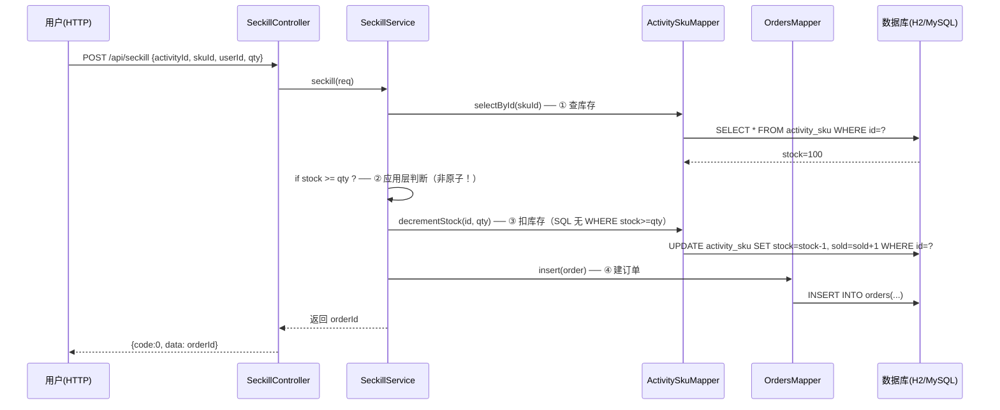

# Phase 1 — 最小秒杀主流程（故意不安全，M1）

> 配套：`plan.md` §4/§5（数据模型/API 契约）、`tasks.md`（Phase 1 清单）、`tutorial.md`（Phase 1 概述）、`glossary.md`（术语大白话）。
> 本文件是 **Phase 1 的逐行详解**：流程图 + 伪代码 + 核心代码 + 验证结果 + 排错。跟着做即可完整实现并跑通。

---

## 0. 本 Phase 一句话目标

先把「**用户点抢购 → 库存 -1 → 生成订单**」这条业务链路跑通，且**故意不做任何并发保护**，把「**并发会超卖**」这个缺陷当场暴露出来。下一阶段（Phase 2/3）再一步步把它治好。

> 💡 教学哲学：**先懂业务，再懂并发。** 一开始就上锁，你永远不知道「锁到底在防什么」。先让它超卖，你就真正理解了为什么需要 DB 乐观锁、Redis+Lua、分布式锁。

### 术语大白话（看不懂先读这里）
- **超卖**：明明只有 100 件商品，却卖出去 120 单。最典型的秒杀事故，也是本项目从头到尾要消灭的头号敌人。
- **库存扣减**：用户抢到后，把「剩余库存」减 1。这是秒杀系统里**最关键的写操作**（共享可变状态）。
- **原子性（本 Phase 的反面教材）**：「查库存 + 减库存」应该是一步完成、别人插不进来的；本 Phase 故意把它拆成两步，于是别人能插进来 → 超卖。
- **竞态（race condition）**：两个请求「同时」读到同一份库存，都以为有货，于是都卖了 → 库存被打穿。

---

## 1. 总体流程图（主流程）



> 重点看 **①②③**：查库存和扣库存是**两步独立 SQL**，中间没有任何锁/原子约束。这正是超卖的根源（见 §5）。

---

## 2. 数据模型（4 张表）

建表脚本：`insightforge-api/src/main/resources/schema.sql`（同时兼容 H2 MySQL 模式与 MySQL 8，标准 SQL，无专有子句）。

| 表 | 作用 | 关键字段 |
|---|---|---|
| `product` | 商品主数据 | `id, name, sku, cost_price` |
| `activity` | 大促活动 | `id, name, status, target_gmv, target_roi, start_at, end_at`（`status` Phase 6 升级为状态机） |
| `activity_sku` | **★秒杀核心表**：某活动下某 SKU 的库存真相 | `activity_id, sku_id, seckill_price, total_stock, stock, sold, version` |
| `orders` | 订单 | `order_id, user_id, activity_id, sku_id, qty, status, created_at` |

`activity_sku` 三个库存字段的分工（也是后续 Phase 的伏笔）：
- `total_stock`：初始库存（对账用，之后不变）。
- `stock`：**剩余库存**，热路径每次扣减改它。
- `sold`：已售数量，扣减时同步 +1（对账 / 后续销量流）。
- `version`：乐观锁版本号，**Phase 2 才启用**（本 Phase 留着但不参与逻辑）。

种子数据 `data.sql`：每次启动（dev 用 `local` profile）清空并插入 1 商品 + 1 活动 + 1 个 SKU（库存 100），方便反复看效果。

---

## 3. 代码逐文件讲解

### 3.1 实体（persistence 模块）
路径：`insightforge-persistence/src/main/java/com/insightforge/persistence/entity/`

四个实体均继承 `BaseEntity`（自带 `id` 自增主键），用 Lombok `@Data` 省 getter/setter。以核心的 `ActivitySku` 为例：

```java
@Data
@EqualsAndHashCode(callSuper = true)
@TableName("activity_sku")
public class ActivitySku extends BaseEntity {
    private Long activityId;
    private Long skuId;
    private BigDecimal seckillPrice;
    private Integer totalStock;  // 初始库存（对账用）
    private Integer stock;       // 剩余库存（热路径扣减字段）
    private Integer sold;        // 已售（对账 / 销量流）
    private Integer version;     // 乐观锁版本号（Phase 2 启用）
}
```
> `Product / Activity / Orders` 结构类似，见仓库对应文件。MyBatis-Plus 默认把驼峰字段（`seckillPrice`）映射到蛇形列（`seckill_price`），无需额外注解。

### 3.2 Mapper（persistence 模块）
路径：`.../persistence/mapper/`，四个接口均 `extends BaseMapper<T>`，白嫖增删改查。

`ActivitySkuMapper` 多一个**故意不安全**的自定义方法（超卖的根源就在这条 SQL）：

```java
public interface ActivitySkuMapper extends BaseMapper<ActivitySku> {
    /**
     * ⚠️ 故意不安全：没有 WHERE stock >= #{qty} 条件！
     * 业务里先 SELECT 查库存、再调本方法扣减，两步不原子；
     * 并发时多个线程都通过“有货”判断，一起扣 → 库存扣成负数（超卖）。
     * Phase 2 加条件变 DB 兜底；Phase 3 改 Redis+Lua 原子扣减。
     */
    @Update("UPDATE activity_sku SET stock = stock - #{qty}, sold = sold + #{qty} WHERE id = #{id}")
    int decrementStock(@Param("id") Long id, @Param("qty") int qty);
}
```

### 3.3 DTO（seckill-core 模块）
路径：`insightforge-seckill-core/src/main/java/com/insightforge/seckill/core/dto/`
- `SeckillRequest`：抢购请求体 `{activityId, skuId, userId, qty}`（也是 seckill-core 对外契约，Controller 直接复用）。
- `StockInfo`：库存查询返回 `{skuId, totalStock, stock, sold}`（便于看超卖）。

### 3.4 核心服务 SeckillService（seckill-core 模块）
路径：`.../seckill/core/service/SeckillService.java`

```java
@Service
public class SeckillService {
    private final ActivitySkuMapper activitySkuMapper;
    private final OrdersMapper ordersMapper;
    // 构造注入省略...

    public ApiResult<String> seckill(SeckillRequest req) {
        // ① 查库存（一次独立 SELECT）
        ActivitySku sku = activitySkuMapper.selectById(req.getSkuId());
        if (sku == null) return ApiResult.fail(404, "商品不存在");

        // ② 应用层判断“有货” —— ⚠️ 只是 Java 里判断，不是数据库原子约束
        if (sku.getStock() < req.getQty()) return ApiResult.fail(409, "已售罄");

        // ③ 扣库存 —— ⚠️ SQL 没有 WHERE stock>=qty，并发会扣成负数（超卖）
        activitySkuMapper.decrementStock(sku.getId(), req.getQty());

        // ④ 建订单
        Orders order = new Orders();
        order.setOrderId(UUID.randomUUID().toString().replace("-", "")); // Phase 4 改幂等 hash
        order.setUserId(req.getUserId());
        order.setActivityId(req.getActivityId());
        order.setSkuId(req.getSkuId());
        order.setQty(req.getQty());
        order.setStatus("CREATED");                       // Phase 6 升级订单状态机
        order.setCreatedAt(LocalDateTime.now());
        ordersMapper.insert(order);

        return ApiResult.ok(order.getOrderId());
    }

    /** 查库存，便于验证与演示超卖 */
    public ApiResult<StockInfo> stockInfo(Long skuId) { /* 查 activity_sku 返回 StockInfo */ }
}
```

### 3.5 控制器（api 模块）
路径：`insightforge-api/src/main/java/com/insightforge/api/controller/SeckillController.java`

```java
@RestController
@RequestMapping("/api/seckill")
public class SeckillController {
    private final SeckillService seckillService;
    // 构造注入省略...

    @PostMapping
    public ApiResult<String> seckill(@RequestBody SeckillRequest req) {
        return seckillService.seckill(req);
    }

    @GetMapping("/stock/{skuId}")
    public ApiResult<StockInfo> stock(@PathVariable("skuId") Long skuId) {
        return seckillService.stockInfo(skuId);
    }
}
```
> 注意 `@PathVariable("skuId")` 写了名字——因为编译没加 `-parameters` 时反射拿不到参数名会 500（见 §7 排错）。本项目已在父 POM 开启 `<parameters>true</parameters>` 根治。

### 3.6 启动类加 @MapperScan（api 模块）
`InsightForgeApplication.java` 加一行，让 MyBatis-Plus 扫描持久层 Mapper：
```java
@SpringBootApplication(scanBasePackages = "com.insightforge")
@MapperScan("com.insightforge.persistence.mapper")
public class InsightForgeApplication { ... }
```

### 3.7 建表 + 种子（api 模块 resources）
- `schema.sql`：4 张表 DDL（H2 MySQL 模式 / MySQL 通用）。
- `data.sql`：每次启动清空并插入 1 商品 + 1 活动 + 库存 100 的 SKU。
- `application-local.yml` 与 `application.yml` 均开启 `spring.sql.init.mode: always`，启动即建表 + 灌种子。

---

## 4. 伪代码（核心流程，便于理解）

```
函数 seckill(请求):
    sku = 查数据库(activity_sku 表, 按 skuId)        # ① SELECT
    如果 sku 不存在: 返回 "商品不存在"
    如果 sku.剩余库存 < 请求数量: 返回 "已售罄"        # ② 应用层判断
    执行 SQL: UPDATE activity_sku
              SET 剩余库存 = 剩余库存 - 数量,
                  已售 = 已售 + 数量
              WHERE id = skuId                         # ③ 扣库存（无 stock>=数量 条件！）
    插入订单表(订单号, 用户, 活动, SKU, 数量, 状态)    # ④ 建订单
    返回 订单号
```

> 伪代码里 **② 和 ③ 之间没有任何“锁”或“原子”保证**——这就是超卖的种子。

---

## 5. 超卖是怎么发生的（竞态图解）


更极端：本 Phase 的 `decrementStock` **完全没有 `WHERE stock >= qty`**，所以哪怕库存已经是 0，只要请求通过 ② 的判断（因为 ② 用的是「旧值」），就会继续扣成负数。并发越高，超卖越狠。

---

## 6. 构建与运行（本机）

### 标准方式（你自己的机器，已按 phase0.md 装好 JDK21+Maven）
```bash
# 1) 构建（会跑 SeckillOversellDemoTest 复现超卖）
mvn clean package

# 2) 零依赖本地启动（H2 内存库，无需 MySQL/Redis/Kafka）
java -jar insightforge-api/target/insightforge-api-0.1.0-SNAPSHOT.jar \
     --spring.profiles.active=local --server.port=8080
```

### 验证接口
```bash
# 抢购前
curl http://localhost:8080/api/seckill/stock/1
# → {"code":0,"data":{"skuId":1,"totalStock":100,"stock":100,"sold":0}}

# 单线程抢 1 件
curl -X POST http://localhost:8080/api/seckill \
  -H 'Content-Type: application/json' \
  -d '{"activityId":1,"skuId":1,"userId":1,"qty":1}'
# → {"code":0,"data":"<orderId>"}

# 抢购后
curl http://localhost:8080/api/seckill/stock/1
# → {"code":0,"data":{"skuId":1,"totalStock":100,"stock":99,"sold":1}}  ✅ 单线程正确
```

---

## 7. 排错笔记（真实踩过的坑）

1. **`mvn` 报 `ClassNotFoundException: org.codehaus.plexus.classworlds.launcher.Launcher`**
   - 现象：Windows + Git Bash 里直接 `mvn` 启动失败。
   - 原因：Maven 启动脚本在 MinGW 下把 `MAVEN_HOME` 解析成 Unix 路径 `/d/...`，但 Windows 的 `java.exe` 需要 `D:/...`，于是找不到启动 jar。
   - 解决：在 **cmd.exe** 里跑 `mvn`（或确保 `MAVEN_HOME` 是 Windows 路径 `D:\...`）。本沙箱用「直接调 Java 启动 Maven 的 classworlds 启动器」绕过，你本机用 cmd 即可。

2. **MyBatis-Plus 3.5.9 + Spring Boot 3.3 启动报 `Invalid value type for attribute 'factoryBeanObjectType': java.lang.String`**
   - 原因：Spring 6.1 改了 `factoryBeanObjectType` 的类型，旧 `mybatis-spring 3.0.3` 不兼容；Phase 0 没 `@MapperScan` 所以没触发，Phase 1 一加 Mapper 就炸。
   - 解决：父 POM 把 `mybatis-plus` 升到 **3.5.11**，并显式锁定 **`mybatis-spring 3.0.4`**（已写入 `pom.xml` 的 `dependencyManagement` 与 persistence 模块）。

3. **`GET /api/seckill/stock/1` 返回 500：`Name for argument of type [java.lang.Long] not specified`**
   - 原因：`@PathVariable Long skuId` 没写名字，且编译没带 `-parameters`。
   - 解决：注解写成 `@PathVariable("skuId")`；并在父 POM 开 `<parameters>true</parameters>` 根治（后续加 `@RequestParam` 等也不会再踩）。

---

## 8. 超卖复现结果（已实跑）

项目内置一个**演示测试** `insightforge-api/src/test/java/com/insightforge/api/SeckillOversellDemoTest.java`：用 300 个并发线程同时抢库存仅 100 的 SKU。实跑结果：

```
>>> 初始库存 = 100
>>> 剩余库存 stock = -200      ← 被打穿成 -200！
>>> 订单总数       = 300       ← 100 库存卖了 300 单！
>>> 是否超卖 = true
```

> ⚠️ 这条测试在 Phase 1 是「**预期通过**」的——它要证明缺陷确实存在。
> 一旦 **Phase 2（DB 条件更新兜底）/ Phase 3（Redis+Lua 原子扣减）** 修好超卖，它会开始失败，
> 届时请把它删掉或改成断言「不再超卖」，作为修复的回归看护。

---

## 9. 本 Phase 验收清单

- [x] 4 张表建好（`product / activity / activity_sku / orders`）
- [x] `POST /api/seckill` 查库存 → 扣库存 → 建订单 链路跑通（同步、无并发保护）
- [x] 单线程手动下单成功：库存 100→99、订单 +1（已实跑）
- [x] 记录「当前会超卖」作为 Phase 2/3 的待解决问题（JUnit 演示：stock=-200 / 300 单）
- [x] `mvn clean package` BUILD SUCCESS（含超卖演示测试通过）
- [x] `local` profile 零依赖启动验证通过（H2）

---

## 10. 下一步预告（Phase 2）

Phase 2 给 `activity_sku` 加 `version`，用 **MyBatis-Plus 乐观锁**或最简单的 **`UPDATE ... SET stock=stock-1 WHERE id=? AND stock>=1`** 条件更新，让数据库这一层先兜底——即使 Redis 挂了也不会超卖。Phase 3 再把扣减从 DB 搬到 Redis+Lua，真正解决高并发性能。
