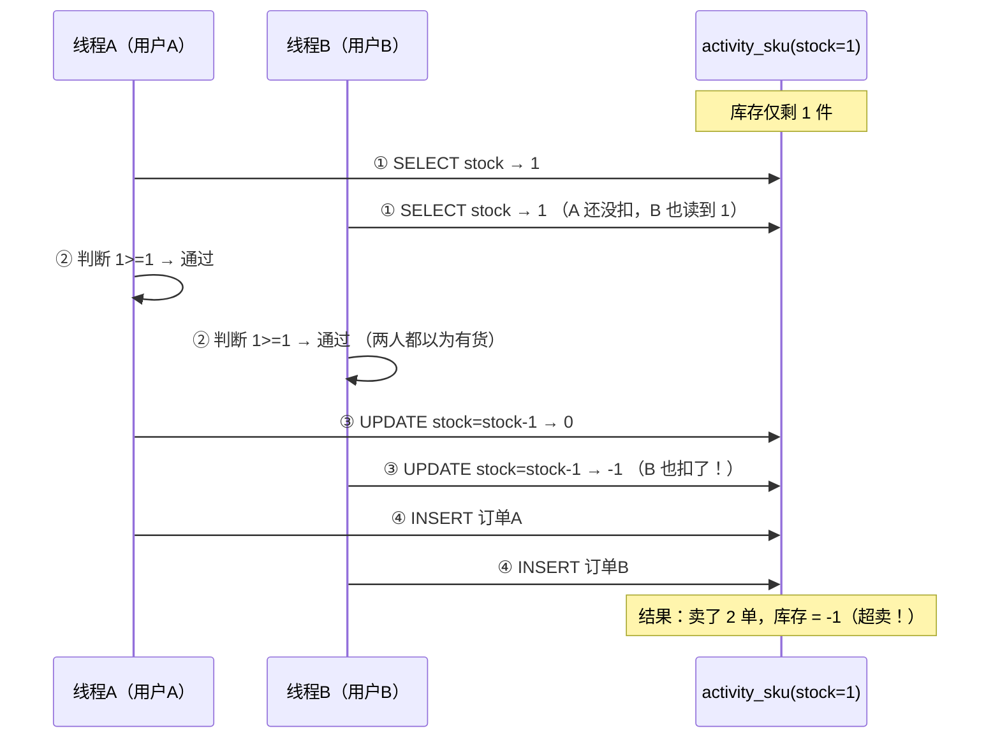

# Phase 1 — 最小秒杀主流程（手把手版）

> 这是**食谱式（recipe）教程**：每一步都给你「敲什么命令 → 建什么文件 → 贴完整代码（带注释）→ 做完会看到什么」。
> 你照着从第一步敲到最后一步，就能完整跑通一个「点抢购 → 库存-1 → 出订单」的接口。
> 本 Phase **故意不做并发保护**，目的就是把「超卖」这个 bug 当场演给你看，下一期再治好它。

---

## 先搞懂：我们在做什么、为什么难

「秒杀」本质是**同一件商品，瞬间被海量用户同时抢**。它和普通下单最大的区别就一个字：**并发**。

- 普通商城：一百个人慢慢买，数据库一条条处理，没问题。
- 秒杀现场：一万人**同一秒**点「抢」，背后是真的有一万次请求同时砸向「库存减 1」这句 SQL。

整个秒杀系统的**命根子**就是这一行库存扣减：**它操作的是一份「大家共享、且会变化」的数据（剩余库存）**。只要多人同时改这块数据又没保护好，就会出「超卖」——100 件库存卖出 120 单，这是秒杀的头号事故，也是本项目从头到尾要消灭的敌人。

> 💡 **教学哲学：先懂业务，再懂并发。**
> 如果一上来就上锁、上 Redis，你永远不知道「锁到底在防什么」。所以本 Phase 先让业务**正常跑通但故意留坑**，让你亲眼看到超卖；Phase 2/3 再一步步把坑填上。等你看到库存被打穿成 -200，你才会真正理解后面那些技术为什么存在。

### 术语大白话（看不懂先读这里，后面不再解释）

- **超卖**：明明只有 100 件商品，却卖出去 120 单。最典型的秒杀事故。
- **库存扣减**：用户抢到后，把「剩余库存」减 1。这是秒杀里**最关键的写操作**（共享可变状态）。
- **原子性（本 Phase 的反面教材）**：「查库存 + 减库存」应该是**一步完成、别人插不进来**的；本 Phase 故意把它拆成两步，于是别人能插进来 → 超卖。
- **竞态（race condition）**：两个请求「同时」读到同一份库存，都以为有货，于是都卖了 → 库存被打穿。
- **ORM（对象关系映射）**：把数据库表「变」成 Java 对象，让你用 `sku.getStock()` 而不是手拼 SQL 来读写数据。本项目用 MyBatis-Plus 做 ORM。
- **实体（Entity）**：一张表 → 一个 Java 类，表里一行 → 这个类的一个对象。
- **Mapper**：Java 方法 ↔ SQL 的桥梁。定义了方法，MyBatis-Plus 在运行时自动生成实现。
- **DTO（Data Transfer Object）**：专门用来在接口之间传数据的结构（请求体/返回体），和数据库实体分开，避免把表结构直接暴露给前端。

---

## 第 0 步：确认起点（你已完成 Phase 0）

Phase 0 已经帮你搭好了 Maven 多模块骨架 + 本地零依赖启动（H2 内存库，不用装 MySQL/Redis/Kafka）。本 Phase 只是往骨架里"填肉"。

> 📖 **为什么用 Maven 多模块？**
> 一个项目拆成 `common / persistence / seckill-core / api` 几个模块，是为了**职责分离**：数据库相关放 `persistence`，纯业务逻辑放 `seckill-core`，对外接口放 `api`。模块之间通过 `pom.xml` 的 `<dependency>` 互相引用，互不污染。你后面会看到 `seckill-core` 要 `import` 持久层的 Mapper，就必须在它的 `pom.xml` 里声明依赖——这就是模块化的代价与好处。

先确认你的目录是这个样子（只看相关部分）：

```
insightforge/
├── pom.xml                         # 父 POM（Phase 0 已配好 mybatis-plus 3.5.11 / mybatis-spring 3.0.4 / 编译器 -parameters）
├── insightforge-common/            # 统一返回类 ApiResult 在这里（Phase 0 已建）
├── insightforge-persistence/       # 持久层（本 Phase 填实体 + Mapper）
│   └── src/main/java/com/insightforge/persistence/
│       └── entity/BaseEntity.java  # 实体基类（Phase 0 已建）
├── insightforge-seckill-core/      # 秒杀核心业务（本 Phase 填 DTO + Service）
└── insightforge-api/               # Web 接入层（本 Phase 填 Controller + 建表脚本 + 测试）
    └── src/main/java/com/insightforge/api/InsightForgeApplication.java  # 启动类（Phase 0 已建）
```

**前置依赖（Phase 0 已搞定，这里只提醒，不用再改）**：
- JDK 21、Maven 3.9.x
- 父 POM 锁定 `mybatis-plus 3.5.11` + `mybatis-spring 3.0.4`（否则启动报 `factoryBeanObjectType` 错）
- 父 POM 编译器开了 `<parameters>true</parameters>`（否则 `@PathVariable` 拿不到参数名会 500）
- `application.yml` / `application-local.yml` 已开 `spring.sql.init.mode: always`（启动自动建表灌种子）
- `local` profile 已排除 Redis / Redisson / Kafka 自动配置（零依赖启动）

> ⚠️ 如果你是直接克隆的仓库、没做过 Phase 0，请先回 `phase0.md` 把骨架搭好，否则下面的代码编译不过。

---

## 第 1 步：建实体类（4 张表 → 4 个 Java 对象）

> 📖 **概念：实体就是"表的 Java 替身"。**
> 数据库里 `activity_sku` 表有一行数据（id=1, stock=100, ...），在 Java 里就对应一个 `ActivitySku` 对象，`sku.getStock()` 就能拿到 100。MyBatis-Plus 负责在「对象」和「表里那行数据」之间自动搬运。所以我们先建 4 个实体类，对应 4 张表。

### 1.1 创建包目录
```bash
# 在 insightforge-persistence 模块下，建 entity 包目录
mkdir -p insightforge-persistence/src/main/java/com/insightforge/persistence/entity
```

### 1.2 创建 BaseEntity.java（所有实体的父类，自带主键 id）
> 文件： `insightforge-persistence/src/main/java/com/insightforge/persistence/entity/BaseEntity.java`
```java
package com.insightforge.persistence.entity;

import com.baomidou.mybatisplus.annotation.IdType;
import com.baomidou.mybatisplus.annotation.TableId;
import lombok.Data;

import java.io.Serializable;

/**
 * 实体基类（Phase 0 已建）。
 * 所有业务表实体都继承它，白嫖一个自增主键 id。
 */
@Data                                   // Lombok：自动生成 getter/setter/toString 等
public abstract class BaseEntity implements Serializable {

    @TableId(type = IdType.AUTO)        // 告诉 MyBatis-Plus：id 由数据库自增
    private Long id;
}
```
> 🧠 **理解一下**：`@Data` 是 Lombok 注解，编译时自动帮你生成 `getId()/setId()` 等样板代码，你不用手写。`@TableId(type = AUTO)` 表示主键由数据库自增——你插入时不设 id，数据库自己填。所有实体都继承它，所以每张表都有 `id` 字段，不用重复写。

### 1.3 创建 Product.java（商品主数据）
> 文件： `.../persistence/entity/Product.java`
```java
package com.insightforge.persistence.entity;

import com.baomidou.mybatisplus.annotation.TableName;
import lombok.Data;
import lombok.EqualsAndHashCode;

import java.math.BigDecimal;

/**
 * 商品主数据表 product 的映射。
 * 秒杀活动挂的是某个 SKU——这里直接用 product.id 当成 skuId 来关联，简化模型。
 */
@Data
@EqualsAndHashCode(callSuper = true)    // 继承父类时，equals/hashCode 要把父类字段也算上
@TableName("product")                   // 指定对应数据库表名
public class Product extends BaseEntity {

    private String name;                // 商品名称，如「iPhone 16 秒杀款」
    private String sku;                 // SKU 编码，如「SKU-IP16」
    private BigDecimal costPrice;       // 成本价（元），后续 Agent 定价时用来判断「卖价是否低于成本」
}
```

### 1.4 创建 Activity.java（大促活动）
> 文件： `.../persistence/entity/Activity.java`
```java
package com.insightforge.persistence.entity;

import com.baomidou.mybatisplus.annotation.TableName;
import lombok.Data;
import lombok.EqualsAndHashCode;

import java.math.BigDecimal;
import java.time.LocalDateTime;

/**
 * 大促活动表 activity 的映射。
 * status 本 Phase 先用字符串（DRAFT/ARMED/LIVE...），Phase 6 再升级成状态机做合法迁转校验。
 */
@Data
@EqualsAndHashCode(callSuper = true)
@TableName("activity")
public class Activity extends BaseEntity {

    private String name;                // 活动名，如「双11 美妆数码场」
    private String status;              // 状态：DRAFT → ARMED → LIVE → SETTLING → CLOSED
    private BigDecimal targetGmv;       // 运营目标 GMV（元），Agent 离线规划的目标输入
    private BigDecimal targetRoi;       // 目标 ROI（投资回报率），Agent 定价的约束
    private LocalDateTime startAt;      // 活动开始时间
    private LocalDateTime endAt;        // 活动结束时间
}
```
> 🧠 **理解一下**：`Activity` 描述「一场大促」本身——它的目标 GMV、ROI 后面会喂给 AI Agent 做离线规划（定什么价、备多少货）。本 Phase 先建表存着，业务主流程暂时用不到它，但它是后续 Agent 的「原料」。

### 1.5 创建 ActivitySku.java（★秒杀核心表，务必看懂）
> 文件： `.../persistence/entity/ActivitySku.java`
```java
package com.insightforge.persistence.entity;

import com.baomidou.mybatisplus.annotation.TableName;
import lombok.Data;
import lombok.EqualsAndHashCode;

import java.math.BigDecimal;

/**
 * 活动 × SKU 的库存真相表 activity_sku —— 整个秒杀系统的「命根子」。
 *
 * 三个库存字段的分工（后面 Phase 反复用到）：
 * - totalStock：初始库存，建活动时写入后不再变，用于对账（最终剩余 = 初始 - 已售）。
 * - stock：     剩余库存，热路径（用户抢购）每次扣减就改它。★这是并发要保护的对象。
 * - sold：     已售数量，扣减时同步 +1，用于对账和后续「销量流」。
 * - version：  乐观锁版本号（表里已建好字段）。Phase 1 先不用；Phase 2 的防超卖主修复
 *              走的是更直接的「UPDATE ... WHERE stock >= qty」原子条件更新，不依赖 version。
 */
@Data
@EqualsAndHashCode(callSuper = true)
@TableName("activity_sku")
public class ActivitySku extends BaseEntity {

    private Long activityId;            // 所属活动 id（关联 activity.id）
    private Long skuId;                 // 关联的 SKU（这里 = product.id）
    private BigDecimal seckillPrice;    // 秒杀价（元）
    private Integer totalStock;         // 初始库存（对账用，不再变动）
    private Integer stock;              // 剩余库存（热路径扣减字段）
    private Integer sold;               // 已售数量
    private Integer version;            // 乐观锁版本号（Phase 2 启用）
}
```
> 🧠 **理解一下（这是全项目最重要的一张表）**：`stock` 是「还剩几件」，每次有人抢到就减 1；`sold` 是「已卖出几件」，减库存时同步加 1。`totalStock` 永远不变，专门用来对账——理论上 **最终剩余 stock = totalStock - sold**。后面所有并发保护的功夫，都是在保护「减 stock 和加 sold 这两件事」不被多人同时搞乱。

### 1.6 创建 Orders.java（订单）
> 文件： `.../persistence/entity/Orders.java`
```java
package com.insightforge.persistence.entity;

import com.baomidou.mybatisplus.annotation.TableName;
import lombok.Data;
import lombok.EqualsAndHashCode;

import java.time.LocalDateTime;

/**
 * 订单表 orders 的映射。
 * orderId：Phase 1 先用 UUID 占位；Phase 4 改成幂等 hash，配合 Redis 防重复下单。
 * status：Phase 1 写 "CREATED"；Phase 6 升级成订单状态机。
 */
@Data
@EqualsAndHashCode(callSuper = true)
@TableName("orders")
public class Orders extends BaseEntity {

    private String orderId;             // 订单号（Phase 4 改为幂等 hash）
    private Long userId;                // 用户 id
    private Long activityId;            // 活动 id
    private Long skuId;                 // SKU id（= product.id）
    private Integer qty;                // 购买数量
    private String status;              // 订单状态（Phase 6 状态机）
    private LocalDateTime createdAt;    // 下单时间
}
```

> 🧠 **这一步做完**：多了 5 个 Java 类，它们只是「表的描述」。现在还不能编译运行（还缺数据库操作层和 Spring 配置）。**实体本身不含任何 SQL**，SQL 是下一步 Mapper 的事。

---

## 第 2 步：建 Mapper（数据库操作接口）

> 📖 **概念：Mapper 是「方法名 ↔ SQL」的契约。**
> 你定义一个接口方法 `selectById(1L)`，MyBatis-Plus 在**运行时**自动生成一个实现类去执行 `SELECT * FROM ... WHERE id=1`。你继承 `BaseMapper<T>` 就直接白嫖了 `selectById / insert / update / delete` 等通用方法，不用自己写。只有「通用方法不够用」时才像 `ActivitySkuMapper` 那样自己写一条 SQL。

### 2.1 创建包目录
```bash
mkdir -p insightforge-persistence/src/main/java/com/insightforge/persistence/mapper
```

### 2.2 三个「零代码」Mapper
> 文件： `.../persistence/mapper/ProductMapper.java` / `ActivityMapper.java` / `OrdersMapper.java`
```java
// ProductMapper.java
package com.insightforge.persistence.mapper;
import com.baomidou.mybatisplus.core.mapper.BaseMapper;
import com.insightforge.persistence.entity.Product;
/** 商品 Mapper：继承 BaseMapper 即可，无需写任何方法。 */
public interface ProductMapper extends BaseMapper<Product> { }

// ActivityMapper.java
package com.insightforge.persistence.mapper;
import com.baomidou.mybatisplus.core.mapper.BaseMapper;
import com.insightforge.persistence.entity.Activity;
/** 活动 Mapper。 */
public interface ActivityMapper extends BaseMapper<Activity> { }

// OrdersMapper.java
package com.insightforge.persistence.mapper;
import com.baomidou.mybatisplus.core.mapper.BaseMapper;
import com.insightforge.persistence.entity.Orders;
/** 订单 Mapper。Phase 4 会配合 Kafka 异步建单 + Redis 幂等。 */
public interface OrdersMapper extends BaseMapper<Orders> { }
```
> 🧠 **理解一下**：这三个接口**身体是空的**，但 `extends BaseMapper<X>` 让它们拥有了全套 CRUD 能力。你之后在 Service 里写 `ordersMapper.insert(order)`，背后就是 MyBatis-Plus 自动拼出的 `INSERT INTO orders(...) VALUES(...)`。

### 2.3 ActivitySkuMapper（★超卖的根源就藏在这条 SQL 里）
> 文件： `.../persistence/mapper/ActivitySkuMapper.java`
```java
package com.insightforge.persistence.mapper;

import com.baomidou.mybatisplus.core.mapper.BaseMapper;
import com.insightforge.persistence.entity.ActivitySku;
import org.apache.ibatis.annotations.Param;
import org.apache.ibatis.annotations.Update;

/**
 * 活动库存 Mapper。
 */
public interface ActivitySkuMapper extends BaseMapper<ActivitySku> {

    /**
     * ⚠️ 故意不安全：这条扣减 SQL 没有 `WHERE stock >= #{qty}` 条件！
     *
     * 业务代码里是先 SELECT 查库存、再调本方法扣减，两步不是原子的：
     * 并发时多个线程可能「同时看到库存还有货」→ 都通过判断 → 一起扣减，
     * 于是库存被扣成负数（超卖），订单数却超过了初始库存。
     *
     * 修复路线（后续 Phase）：
     * - Phase 2：加上 `AND stock >= #{qty}`，变成 DB 级兜底（条件更新原子）。
     * - Phase 3：把扣减从 DB 移到 Redis + Lua（单线程原子执行），彻底解决性能与超卖。
     */
    @Update("UPDATE activity_sku SET stock = stock - #{qty}, sold = sold + #{qty} WHERE id = #{id}")
    int decrementStock(@Param("id") Long id, @Param("qty") int qty);
    // 返回值 = 受影响行数。Phase 1 里我们没用它；Phase 2 会靠它判断「到底扣到没有」。
}
```
> 🧠 **理解一下（记牢这句，后面全靠它）**：这条 SQL 只说「把 id 那行的 stock 减 qty」，但**没说「只有 stock 够减的时候才减」**。所以哪怕库存已经是 0，只要有人调它，它就照样 `stock = 0 - 1 = -1`。有没有货的判读，被我们放在了 Java 代码里（下一步 Service 的 `if (stock < qty)`），而**不是**在这条 SQL 里。这正是超卖的命门——判读和扣减分了家。

---

## 第 3 步：建 DTO（接口的进出参数）

> 📖 **概念：为什么有了实体还要 DTO？**
> 你完全可以直接用 `ActivitySku` 当接口参数，但那样做有两问题：① 前端能看到表里所有字段（包括 `costPrice` 这种不该暴露的）；② 表和接口**绑死**，表一改接口就崩。所以业界习惯：对外用 DTO（只装接口需要的数据），对内用 Entity（映射表）。两者各司其职。

### 3.1 创建包目录
```bash
mkdir -p insightforge-seckill-core/src/main/java/com/insightforge/seckill/core/dto
```

### 3.2 SeckillRequest.java（抢购请求体）
> 文件： `.../seckill/core/dto/SeckillRequest.java`
```java
package com.insightforge.seckill.core.dto;

import lombok.Data;
import java.io.Serializable;

/**
 * 抢购请求。也是 seckill-core 对外的契约 DTO，
 * api 模块的 Controller 直接复用它作为 @RequestBody，省得跨模块再建一份。
 */
@Data
public class SeckillRequest implements Serializable {
    private Long activityId;            // 活动 id
    private Long skuId;                 // SKU id（= product.id）
    private Long userId;                // 用户 id（Phase 4 起用于幂等 hash）
    private Integer qty;                // 购买数量（Phase 1 一般传 1）
}
```
> 🧠 **理解一下**：前端 POST 一个 JSON `{"activityId":1,"skuId":1,"userId":1,"qty":1}`，Spring 自动把它填进这个对象。后端不用自己解析 JSON。

### 3.3 StockInfo.java（库存查询返回体）
> 文件： `.../seckill/core/dto/StockInfo.java`
```java
package com.insightforge.seckill.core.dto;

import lombok.Data;
import java.io.Serializable;

/**
 * 库存查询返回。把初始/剩余/已售一起返回，方便你手动验证「有没有超卖」。
 */
@Data
public class StockInfo implements Serializable {
    private Long skuId;
    private Integer totalStock;         // 初始库存
    private Integer stock;              // 剩余库存
    private Integer sold;               // 已售数量
}
```

---

## 第 4 步：建核心服务 SeckillService（业务四步走）

> 📖 **概念：Service 是「业务大脑」。**
> Controller 只负责「接收 HTTP 请求、返回 HTTP 响应」这种薄活；真正的业务规则（先查库存、再判断、再扣减、再建单）写在 Service 里。这样以后换接口形式（比如改成 gRPC）也不用改业务逻辑。

### 4.0 先给 seckill-core 引入 persistence 依赖（否则编译找不到 Mapper）
> 编辑： `insightforge-seckill-core/pom.xml`，在 `<dependencies>` 里加：
```xml
<!-- seckill-core 要用到 persistence 层的实体和 Mapper，必须依赖它 -->
<dependency>
    <groupId>com.insightforge</groupId>
    <artifactId>insightforge-persistence</artifactId>
    <version>0.1.0-SNAPSHOT</version>
</dependency>
```
> 🧠 **理解一下**：模块化项目里，A 想用 B 的类，必须在 A 的 `pom.xml` 声明依赖。这里 `seckill-core` 要用 `ActivitySkuMapper`，所以必须依赖 `insightforge-persistence`。Maven 会在编译时把 persistence 的 class 放进 classpath。

### 4.1 创建包目录
```bash
mkdir -p insightforge-seckill-core/src/main/java/com/insightforge/seckill/core/service
```

### 4.2 SeckillService.java（完整代码 + 逐行注释）
> 文件： `.../seckill/core/service/SeckillService.java`
```java
package com.insightforge.seckill.core.service;

import com.insightforge.common.result.ApiResult;     // Phase 0 建好的统一返回类
import com.insightforge.persistence.entity.ActivitySku;
import com.insightforge.persistence.entity.Orders;
import com.insightforge.persistence.mapper.ActivitySkuMapper;
import com.insightforge.persistence.mapper.OrdersMapper;
import com.insightforge.seckill.core.dto.SeckillRequest;
import com.insightforge.seckill.core.dto.StockInfo;
import org.springframework.stereotype.Service;

import java.time.LocalDateTime;
import java.util.UUID;

/**
 * 最小秒杀主流程（Phase 1，★故意不安全★）。
 *
 * 四步走：查库存 → 应用层判断「有货」→ 扣库存 → 建订单。
 * 全程同步、没有任何并发保护（无锁 / 无乐观锁 / 扣减 SQL 无 stock>=qty 条件）。
 *
 * 目的：先让「用户点抢购 → 下单成功」跑通建立直观理解；
 *       同时把「并发会超卖」故意暴露，留给 Phase 2/3 去治。
 */
@Service
public class SeckillService {

    // 构造注入：Spring 会自动把两个 Mapper 的实现塞进来
    private final ActivitySkuMapper activitySkuMapper;
    private final OrdersMapper ordersMapper;

    public SeckillService(ActivitySkuMapper activitySkuMapper, OrdersMapper ordersMapper) {
        this.activitySkuMapper = activitySkuMapper;
        this.ordersMapper = ordersMapper;
    }

    /** 抢购主入口 */
    public ApiResult<String> seckill(SeckillRequest req) {
        // ① 查库存：一次独立的 SELECT 查询，拿到当前库存
        ActivitySku sku = activitySkuMapper.selectById(req.getSkuId());
        if (sku == null) {
            return ApiResult.fail(404, "商品不存在");
        }

        // ② 应用层判断「还有货」——⚠️ 这只是 Java 里的 if 判断，不是数据库的原子约束！
        if (sku.getStock() < req.getQty()) {
            return ApiResult.fail(409, "已售罄");
        }

        // ③ 扣库存——⚠️ decrementStock 的 SQL 没有 WHERE stock >= qty 条件，
        //    多个线程都通过上面第 ② 步后，会一起把库存扣成负数（超卖）。
        activitySkuMapper.decrementStock(sku.getId(), req.getQty());

        // ④ 建订单：写入 orders 表
        Orders order = new Orders();
        order.setOrderId(UUID.randomUUID().toString().replace("-", "")); // Phase 4 改幂等 hash
        order.setUserId(req.getUserId());
        order.setActivityId(req.getActivityId());
        order.setSkuId(req.getSkuId());
        order.setQty(req.getQty());
        order.setStatus("CREATED");                 // Phase 6 升级订单状态机
        order.setCreatedAt(LocalDateTime.now());
        ordersMapper.insert(order);

        return ApiResult.ok(order.getOrderId());     // 返回生成的订单号
    }

    /** 查库存，便于验证与演示超卖 */
    public ApiResult<StockInfo> stockInfo(Long skuId) {
        ActivitySku sku = activitySkuMapper.selectById(skuId);
        if (sku == null) {
            return ApiResult.fail(404, "商品不存在");
        }
        StockInfo info = new StockInfo();
        info.setSkuId(skuId);
        info.setTotalStock(sku.getTotalStock());
        info.setStock(sku.getStock());
        info.setSold(sku.getSold());
        return ApiResult.ok(info);
    }
}
```

> 🧠 **理解一下（这一步是全 Phase 的核心，慢看）**：
> 一次抢购被拆成 4 个动作。**关键在 ② 和 ③ 之间有一条看不见的缝**：
> - ② 是 Java 代码 `if (stock < qty)`——它读的是「这一刻查出来的旧值」。
> - ③ 才是真正改数据库。
>
> **单线程时**没问题：A 查到 100，判断通过，扣成 99，下一个 B 查到 99……井井有条。
> **并发时**就炸了：A 和 B 几乎同时查到 stock=1，都通过 ② 的判断（因为此刻都是 1≥1），然后**都去执行 ③**，于是库存 1 → 0 → -1，却生成了 2 张订单。判读（②）和扣减（③）不是同一瞬间发生的、中间没上锁，别人就能插进来——这就是竞态，这就是超卖。
>
> 记住这个画面，Phase 2 的修复本质上就是「把 ② 和 ③ 缝合成数据库里的一步原子操作」。

---

## 第 5 步：建控制器 + 开启 MapperScan（把服务暴露成 HTTP 接口）

> 📖 **概念：Controller 是「门面」。**
> 它把 `SeckillService` 的方法包成 HTTP 接口：`POST /api/seckill` 对应抢购，`GET /api/seckill/stock/1` 对应查库存。浏览器/Postman/curl 只能碰到 Controller，碰不到 Service——这就是分层。

### 5.1 创建包目录
```bash
mkdir -p insightforge-api/src/main/java/com/insightforge/api/controller
```

### 5.2 SeckillController.java
> 文件： `.../api/controller/SeckillController.java`
```java
package com.insightforge.api.controller;

import com.insightforge.common.result.ApiResult;
import com.insightforge.seckill.core.dto.SeckillRequest;
import com.insightforge.seckill.core.dto.StockInfo;
import com.insightforge.seckill.core.service.SeckillService;
import org.springframework.web.bind.annotation.*;

/**
 * 秒杀接入层（Phase 1）。
 * POST /api/seckill              用户抢购
 * GET  /api/seckill/stock/{skuId} 查看某 SKU 剩余/已售/初始库存
 */
@RestController
@RequestMapping("/api/seckill")
public class SeckillController {

    private final SeckillService seckillService;

    public SeckillController(SeckillService seckillService) {
        this.seckillService = seckillService;
    }

    // 抢购：前端 POST 一个 JSON 请求体，直接转成 SeckillRequest
    @PostMapping
    public ApiResult<String> seckill(@RequestBody SeckillRequest req) {
        return seckillService.seckill(req);
    }

    // 查库存：路径里的 {skuId} 用 @PathVariable 接。
    // 注意写了 ("skuId") 名字——因为编译没开 -parameters 时反射拿不到参数名会 500
    // （本项目父 POM 已开 <parameters>true</parameters> 根治，这里写上更稳妥）。
    @GetMapping("/stock/{skuId}")
    public ApiResult<StockInfo> stock(@PathVariable("skuId") Long skuId) {
        return seckillService.stockInfo(skuId);
    }
}
```
> 🧠 **理解一下**：`@PostMapping` 没写路径，所以完整地址就是类上的 `/api/seckill`。`@RequestBody` 把请求体 JSON 反序列化成 `SeckillRequest`；`@PathVariable("skuId")` 把 URL 里的 `1` 取出来当参数。Controller 自己不写业务，转手丢给 Service——只做「接请求、还响应」。

### 5.3 给 api 模块加 seckill-core 依赖（否则 Controller 找不到 SeckillService）
> 编辑： `insightforge-api/pom.xml`，`<dependencies>` 里加：
```xml
<dependency>
    <groupId>com.insightforge</groupId>
    <artifactId>insightforge-seckill-core</artifactId>
    <version>0.1.0-SNAPSHOT</version>
</dependency>
```

### 5.4 启动类加 @MapperScan（让 MyBatis-Plus 扫描 Mapper 接口）
> 编辑： `insightforge-api/src/main/java/com/insightforge/api/InsightForgeApplication.java`
```java
package com.insightforge.api;

import org.mybatis.spring.annotation.MapperScan;
import org.springframework.boot.SpringApplication;
import org.springframework.boot.autoconfigure.SpringBootApplication;

@SpringBootApplication(scanBasePackages = "com.insightforge")
@MapperScan("com.insightforge.persistence.mapper")   // ← 加这一行：扫描持久层 Mapper
public class InsightForgeApplication {
    public static void main(String[] args) {
        SpringApplication.run(InsightForgeApplication.class, args);
    }
}
```
> 🧠 **理解一下**：`@MapperScan` 告诉 MyBatis-Plus「去这个包下找所有 Mapper 接口，给它们生成实现类」。不加这行，运行时会报「找不到 ActivitySkuMapper 的 Bean」。`@SpringBootApplication(scanBasePackages=...)` 则负责把各模块的 `@Service/@RestController` 都扫描进 Spring 容器。

**这一步做完**：HTTP 接口就绪，程序已经能从「接收请求」一路走到「操作数据库」了。

---

## 第 6 步：建表脚本 + 种子数据（让程序一启动就有表、有数据）

> 📖 **概念：为什么需要 schema.sql 和 data.sql？**
> `schema.sql` 是「建表语句」——第一次启动把 4 张空表建出来。`data.sql` 是「种子数据」——往空表里塞一条演示用的商品+活动+库存。本项目开了 `spring.sql.init.mode: always`，所以**每次启动都会重跑这两个文件**：先建表、再清旧数据、再灌新数据。好处是你可以随便折腾，重启就回到「干净的一百库存」，方便反复演示超卖。

### 6.1 schema.sql
> 文件： `insightforge-api/src/main/resources/schema.sql`
```sql
-- ============================================================
-- 建表脚本（Phase 1）
-- 同时兼容 H2(MODE=MySQL, 本地零依赖) 与 MySQL 8。
-- 只用标准 SQL，不用 MySQL 专有子句（如 ENGINE=InnoDB），保证 H2 也能跑。
-- ============================================================

CREATE TABLE IF NOT EXISTS product (
    id          BIGINT AUTO_INCREMENT PRIMARY KEY,
    name        VARCHAR(128),
    sku         VARCHAR(128),
    cost_price  DECIMAL(12, 2)
);

CREATE TABLE IF NOT EXISTS activity (
    id          BIGINT AUTO_INCREMENT PRIMARY KEY,
    name        VARCHAR(128),
    status      VARCHAR(32),
    target_gmv  DECIMAL(14, 2),
    target_roi  DECIMAL(8, 4),
    start_at    DATETIME,
    end_at      DATETIME
);

CREATE TABLE IF NOT EXISTS activity_sku (
    id            BIGINT AUTO_INCREMENT PRIMARY KEY,
    activity_id   BIGINT,
    sku_id        BIGINT,
    seckill_price DECIMAL(12, 2),
    total_stock   INT,      -- 初始库存
    stock         INT,      -- 剩余库存（热路径扣减）
    sold          INT,      -- 已售
    version       INT       -- 乐观锁版本号（Phase 2 启用）
);

CREATE TABLE IF NOT EXISTS orders (
    id           BIGINT AUTO_INCREMENT PRIMARY KEY,
    order_id     VARCHAR(64),
    user_id      BIGINT,
    activity_id  BIGINT,
    sku_id       BIGINT,
    qty          INT,
    status       VARCHAR(32),
    created_at   DATETIME
);
```
> 🧠 **理解一下**：`IF NOT EXISTS` 保证重复启动不会因「表已存在」报错。`DECIMAL(12,2)` 表示共 12 位、小数 2 位（够存到千万级金额、精确到分）。`activity_sku` 里的 `stock/sold/version` 三个字段，后面每个 Phase 都会用到。

### 6.2 data.sql
> 文件： `insightforge-api/src/main/resources/data.sql`
```sql
-- ============================================================
-- 种子数据（Phase 1 演示用）
-- 每次启动（spring.sql.init.mode=always）都会先清空 4 张表再插入，
-- 方便反复重启看「库存 100 → 抢购 → 超卖」的效果。
-- ============================================================

DELETE FROM orders;
DELETE FROM activity_sku;
DELETE FROM activity;
DELETE FROM product;

INSERT INTO product (id, name, sku, cost_price) VALUES (1, 'iPhone 16 秒杀款', 'SKU-IP16', 5999.00);

INSERT INTO activity (id, name, status, target_gmv, target_roi, start_at, end_at)
VALUES (1, '双11 美妆数码场', 'DRAFT', 5000000.00, 1.80, '2026-11-11 00:00:00', '2026-11-11 23:59:59');

-- skuId=1 对应 product.id=1；初始/剩余库存都 100；sold=0；version=0
INSERT INTO activity_sku (id, activity_id, sku_id, seckill_price, total_stock, stock, sold, version)
VALUES (1, 1, 1, 6299.00, 100, 100, 0, 0);
```
> 🧠 **理解一下**：开头的 4 句 `DELETE` 是「清场」——保证每次启动都从「100 库存、0 订单」这个干净起点开始。最后一行就是我们的主角：1 个 SKU，初始和剩余都是 100 件，已售 0。后面所有演示都围绕它。

### 6.3 确认 SQL 初始化已开启
> 检查 `insightforge-api/src/main/resources/application.yml` 和 `application-local.yml`，确保都有：
```yaml
spring:
  sql:
    init:
      mode: always   # 启动就执行 schema.sql 建表 + data.sql 灌种子
```

**这一步做完**：程序一启动就有 4 张表和 100 库存的种子数据，随时可以抢。

---

## 第 7 步：跑通单线程（先证明「业务本身是对的」）

> 📖 **为什么先测单线程？**
> 我们要先确认「业务逻辑本身没问题」，再去看并发问题。如果单线程都错，那和并发无关，是代码写错了。单线程下「查→判→扣→建单」是串行的，不存在插队，所以一定正确——这步是基线。

### 7.1 构建
```bash
# 你自己的机器（已装好 Maven）：
mvn clean package

# 沙箱 / Windows+GitBash 下 mvn 启动报错时，用这条「直调 Java 启动 Maven」绕过：
# MVN_HOME="D:/devtools/maven/apache-maven-3.9.9"
# java -classpath "$MVN_HOME/boot/plexus-classworlds-2.8.0.jar" \
#   -Dclassworlds.conf="$MVN_HOME/bin/m2.conf" -Dmaven.home="$MVN_HOME" \
#   -Dmaven.multiModuleProjectDirectory="D:/Java/insightforge" \
#   -Dlibrary.jansi.path="$MVN_HOME/lib/jansi-native" \
#   org.codehaus.plexus.classworlds.launcher.Launcher clean package
```
看到 `BUILD SUCCESS` 就对了。

### 7.2 零依赖本地启动
```bash
java -jar insightforge-api/target/insightforge-api-0.1.0-SNAPSHOT.jar \
     --spring.profiles.active=local --server.port=8080
```

### 7.3 用 curl 验证（单线程，应该正确）
```bash
# 抢购前：库存 100
curl http://localhost:8080/api/seckill/stock/1
# → {"code":0,"data":{"skuId":1,"totalStock":100,"stock":100,"sold":0}}

# 单线程抢 1 件
curl -X POST http://localhost:8080/api/seckill \
  -H 'Content-Type: application/json' \
  -d '{"activityId":1,"skuId":1,"userId":1,"qty":1}'
# → {"code":0,"data":"<一串orderId>"}

# 抢购后：库存 99，已售 1 ✅ 单线程完全正确
curl http://localhost:8080/api/seckill/stock/1
# → {"code":0,"data":{"skuId":1,"totalStock":100,"stock":99,"sold":1}}
```

> 🧠 **这一步做完**：证明了「业务逻辑本身没问题」，超卖纯粹是并发引起的。接下来就要故意制造并发，把 bug 引出来。

---

## 第 8 步：写超卖演示测试，证明「并发会超卖」

> 📖 **为什么写测试而不是手敲 curl？**
> 手敲几个 curl 是「串行」的，引不出超卖。要复现并发，得让成百上千个请求**同一瞬间**打过来。JUnit 里用线程池 + `CountDownLatch`（发令枪）就能做到：先让 300 个线程都「各就各位」等信号，信号一响同时开抢，最大限度放大竞态。

### 8.1 创建测试目录
```bash
mkdir -p insightforge-api/src/test/java/com/insightforge/api
```

### 8.2 SeckillOversellDemoTest.java（完整代码 + 注释）
> 文件： `insightforge-api/src/test/java/com/insightforge/api/SeckillOversellDemoTest.java`
```java
package com.insightforge.api;

import com.insightforge.persistence.entity.ActivitySku;
import com.insightforge.persistence.mapper.ActivitySkuMapper;
import com.insightforge.persistence.mapper.OrdersMapper;
import com.insightforge.seckill.core.dto.SeckillRequest;
import com.insightforge.seckill.core.service.SeckillService;
import org.junit.jupiter.api.Test;
import org.springframework.beans.factory.annotation.Autowired;
import org.springframework.boot.test.context.SpringBootTest;
import org.springframework.test.context.ActiveProfiles;

import java.util.concurrent.CountDownLatch;
import java.util.concurrent.ExecutorService;
import java.util.concurrent.Executors;
import java.util.concurrent.atomic.AtomicInteger;

import static org.junit.jupiter.api.Assertions.assertTrue;

/**
 * 超卖演示测试（Phase 1）。
 * 用 300 个线程同时抢「库存仅 100」的 SKU，证明不安全的实现必然超卖。
 *
 * ⚠️ 本测试在 Phase 1 是「预期通过」的——它要证明缺陷确实存在。
 * 等 Phase 2（DB 条件更新兜底）修好超卖后，它会开始失败，
 * 届时把它删掉或改成断言「不再超卖」即可。
 */
@SpringBootTest
@ActiveProfiles("local")   // 用本地 H2 库，零依赖
class SeckillOversellDemoTest {

    @Autowired private SeckillService seckillService;
    @Autowired private ActivitySkuMapper activitySkuMapper;
    @Autowired private OrdersMapper ordersMapper;

    @Test
    void demoOversell() throws Exception {
        int threadCount = 300;     // 模拟 300 个用户同时抢
        int initialStock = 100;    // 初始库存只有 100

        ExecutorService pool = Executors.newFixedThreadPool(threadCount);
        CountDownLatch startGate = new CountDownLatch(1);  // 发令枪：让所有线程同时开跑
        CountDownLatch doneGate   = new CountDownLatch(threadCount);

        for (int i = 0; i < threadCount; i++) {
            pool.submit(() -> {
                try {
                    startGate.await();   // 等发令枪，保证大家「同一刻」开抢（放大竞态）
                    SeckillRequest req = new SeckillRequest();
                    req.setActivityId(1L);
                    req.setSkuId(1L);
                    req.setUserId(Thread.currentThread().getId());  // 用线程 id 假装不同用户
                    req.setQty(1);
                    seckillService.seckill(req);   // 调业务方法抢购
                } catch (InterruptedException e) {
                    Thread.currentThread().interrupt();
                } finally {
                    doneGate.countDown();   // 不管成功失败，跑完一个就减一
                }
            });
        }

        startGate.countDown();   // 发令：300 个线程同时开抢
        doneGate.await();        // 等全部跑完

        // 统计结果
        ActivitySku sku = activitySkuMapper.selectById(1L);
        int orderCount = ordersMapper.selectCount(null).intValue();

        System.out.println(">>> 初始库存          = " + initialStock);
        System.out.println(">>> 剩余库存 stock    = " + sku.getStock());
        System.out.println(">>> 订单总数          = " + orderCount);
        System.out.println(">>> 是否超卖          = " + (sku.getStock() < 0 || orderCount > initialStock));

        // Phase 1 断言：确实发生了超卖（库存变负 或 订单数超过初始库存）
        assertTrue(sku.getStock() < 0 || orderCount > initialStock, "本应超卖，但没发生，检查一下实现");
    }
}
```
> 🧠 **理解一下测试机制**：
> - `ExecutorService` 是线程池，替我们起 300 个并发任务。
> - `startGate`（发令枪）初始计数 1，所有线程先 `await()` 阻塞；主线程 `countDown()` 后，300 个线程**同时**被放行去抢——这比「挨个启动」更能复现超卖。
> - 抢完后用 `selectById` 读最终库存、`selectCount` 数订单总数，打印出来。
> - 断言 `assertTrue(超卖发生)`：因为本 Phase 故意不安全，**超卖才是预期结果**，所以测试「通过」恰恰说明 bug 复现成功。

### 8.3 跑测试看结果
```bash
mvn test -Dtest=SeckillOversellDemoTest
```
控制台会打印（中文可能因终端编码显示成乱码，但数字不会骗人）：
```
>>> 初始库存          = 100
>>> 剩余库存 stock    = -200      ← 被打穿成负数！
>>> 订单总数          = 300       ← 100 库存卖出去 300 单！
>>> 是否超卖          = true
```
测试「通过」——因为它断言的就是「超卖发生了」。**超卖被实锤。**

---

## 第 9 步：超卖到底是怎么发生的？（原理图解）

`seckill()` 里的 ②（应用层判断）和 ③（扣库存）之间**没有任何锁或原子保证**，于是：



> 🧠 **再换个生活化比喻**：这就像上厕所抢最后一个坑位。A 走到门口看了一眼「灯是绿的（有空位）」，正要推门，B 也走到门口看了一眼「也是绿灯」——两人都没锁门，于是一起推门进去，坑位被两个人同时占了（超卖），但洗手间只有一个。
>
> 更极端：本 Phase 的 `decrementStock` **完全没有 `WHERE stock >= qty`**，所以哪怕库存已是 0，只要请求通过 ②（因为 ② 用的是「旧值」），就继续扣成负数。并发越高，超卖越狠。

---

## 附录 A：踩坑排查（按症状查）

| 现象 | 原因 | 解决 |
|---|---|---|
| `mvn` 报 `ClassNotFoundException: org.codehaus.plexus.classworlds.launcher.Launcher` | Windows+GitBash 下 Maven 把 `MAVEN_HOME` 解析成 `/d/...`，但 `java.exe` 要 `D:/...` | 在 **cmd.exe** 里跑 `mvn`；或沙箱里用第 7.1 节的「直调 Java 启动 Maven」命令 |
| 启动报 `Invalid value type for attribute 'factoryBeanObjectType': java.lang.String` | MyBatis-Plus 3.5.9 + Spring 6.1 不兼容旧 mybatis-spring | 父 POM 升 `mybatis-plus 3.5.11` + 锁 `mybatis-spring 3.0.4`（Phase 0 已做） |
| `GET /api/seckill/stock/1` 返回 500：`Name for argument of type [java.lang.Long] not specified` | `@PathVariable Long` 没写名字且没开 `-parameters` | 注解写成 `@PathVariable("skuId")`；父 POM 开 `<parameters>true</parameters>` 根治 |

---

## 附录 B：本 Phase 验收清单

- [x] 4 张表建好（product / activity / activity_sku / orders）
- [x] `POST /api/seckill` 链路跑通（查库存 → 扣库存 → 建订单），同步、无并发保护
- [x] 单线程手动下单正确：库存 100→99、订单 +1（第 7 步已验证）
- [x] 并发超卖已复现：300 线程抢 100 库存 → stock=-200 / 订单=300（第 8 步已验证）
- [x] `mvn clean package` BUILD SUCCESS

---

## 下一步（Phase 2 预告）

Phase 2 给扣减 SQL 加上 `WHERE stock >= #{qty}`，把「还有没有货」塞进数据库那一瞬间的原子判断里——数据库这一层先兜底，即使后面 Redis 挂了也不超卖。Phase 3 再把扣减搬到 Redis+Lua 解决高并发性能。
