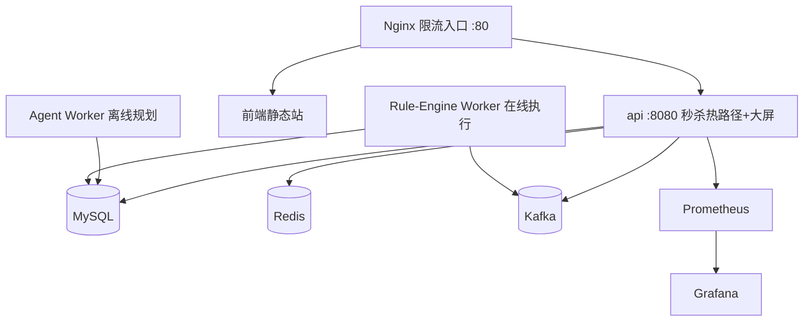

# Phase 10 —— 前端大屏 + 可观测 + 部署（M5）

> ⚠️ **本章含选做进阶内容**：WebSocket 实时大屏 / ExplainabilityService / Grafana 属「实时大屏与可解释性」（选做6）；Docker/JMeter/CI 属「部署与压测」（选做7）。**主线只需**了解"有可观测 + 可解释 + 部署压测计划"。深度按需读 → [`选做6-实时大屏与可解释性.md`](选做6-实时大屏与可解释性.md) / [`选做7-部署与压测.md`](选做7-部署与压测.md) / [`00-学习路线.md`](00-学习路线.md)。

> 大白话：前面 9 个 Phase 把「秒杀不超卖」「AI 离线规划」「规则引擎确定性执行」都做实了，
> 但它们藏在代码和日志里，面试官/运营看不见。Phase 10 干三件事：
> 1. **大屏**：用一个 React 页面把「库存卖了没、AI 跑了几次、护栏风险多高」画出来，实时刷新。
> 2. **可观测**：把 AI 规划质量（尤其是「正确失败率」这个红线指标）和秒杀经营指标，
>    用 Prometheus 能抓的格式暴露出来，Grafana 画图——**没有指标就无法证明「无超卖 + AI 有效」**。
> 3. **一键起**：Docker Compose 把秒杀、Agent、规则引擎拆成独立进程（资源隔离），Nginx 做限流入口。
>
> ⚠️ **诚实边界（重要）**：本 Phase 的后端部分（可解释性、大屏数据 API、Prometheus 指标）在沙箱 `mvn` 实跑验证通过；
> **React 前端**已于 2026-08-07 完成登录体系接入 + 全页面真实 API 调用，并在沙箱浏览器验证通过。
> **Docker / Nginx / Grafana**（沙箱无 Docker 守护进程）仅写出代码与配置，**未实跑**。

---

## §1 先搞懂几个术语

| 术语 | 大白话 |
|---|---|
| 大屏（Dashboard） | 一个网页，把后台关键数字用图表实时画出来，方便人一眼看懂系统状态 |
| 可观测（Observability） | 系统「表现得怎么样」能被量化看见：指标（metrics）、链路（trace）、日志 |
| Prometheus / Grafana | Prometheus 定时来「抓」指标，Grafana 把指标画成图。相当于「自动抄表 + 画图」 |
| 正确失败率 | AI 该拒绝/该求助时**主动拒绝**（而非硬上）的比例。越高说明 AI 越克制、越安全 |
| 控制面/数据面分离 | AI 离线算策略（控制面），规则引擎在线执行（数据面）；大屏只读「已发生的事实」，不触发任何写 |
| 令牌桶限流 | 门口放个「每秒放行 N 个请求」的漏斗，秒杀洪峰在大门口就被削掉，保护后端 |

---

## §2 本 Phase 新增/改动文件清单

**后端（`insightforge-api`，可实跑验证）**
- `explain/ExplainInput.java` —— 可解释性输入（纯数据字段，不依赖规则引擎模块）
- `explain/ExplainabilityService.java` —— **加分项 #3**：模板生成中文解释（非 LLM）
- `observability/dto/DashboardSnapshot.java` / `TraceView.java` / `GuardrailView.java` —— 大屏 DTO
- `observability/ObservabilityService.java` —— 聚合秒杀/ Agent / 护栏快照（只读 persistence Mapper）
- `controller/DashboardController.java` —— `/api/dashboard/*` REST 数据接口
- `config/MetricsConfig.java` —— 注册 InsightForge 业务 Gauge 给 Prometheus
- `ws/DashboardWebSocketHandler.java` + `ws/WebSocketConfig.java` —— 大屏 WS 实时推送
- `pom.xml` —— 加 `spring-boot-starter-websocket` + `micrometer-registry-prometheus`
- `src/main/resources/application.yml` / `application-local.yml` —— 暴露 prometheus 端点

**测试（api 模块，新增 10 个，全绿）**
- `explain/ExplainabilityServiceTest.java`（5）—— 纯 JUnit，验证模板映射
- `controller/DashboardControllerTest.java`（4）—— `@SpringBootTest + MockMvc`
- `ActuatorPrometheusTest.java`（1）—— 验证 Prometheus 业务指标已注册

**前端（`insightforge-frontend/`，✅ 沙箱已实跑验证）**
- `package.json` / `vite.config.ts` / `tsconfig.json` / `index.html`
- `src/main.tsx` — React 18 入口
- `src/App.tsx` — **路由中心 + 路由守卫**：`/`→登录，`ProtectedRoute` 验证登录态和角色
- `src/index.css` — **全局暗色工业风**：CSS 变量体系（绿/青/琥珀/红/紫霓虹色）
- `src/auth/AuthContext.tsx` — **登录态管理**：React Context 保存 user，login/logout 方法
- `src/api/index.ts` — **统一 API 层**：`get<T>()` / `post<T>()` 封装 fetch，所有页面通过它调后端
- `src/components/Layout.tsx` — **侧栏布局**：根据 role 分买家/商家导航 + 退出登录
- `src/pages/Login.tsx` — **登录页**：账号+密码表单，调 `POST /api/login`，按 role 跳转
- `src/pages/user/SeckillPage.tsx` — **秒杀抢购**：`POST /api/seckill` 真实下单 + 一键取消回补
- `src/pages/user/OrderHistory.tsx` — **我的订单**（待后端补充查询接口）
- `src/pages/merchant/Dashboard.tsx` — **运营大屏**：调 `/api/dashboard/overview` 展示 KPI
- `src/pages/merchant/Activities.tsx` — **活动管理**：调 `/api/activity/{id}/arm|live|settle|close` 状态机
- `src/pages/merchant/Guardrails.tsx` — **护栏策略**：调 `/api/dashboard/guardrails`
- `src/pages/merchant/Hitl.tsx` — **人工审批**：调 `/api/dashboard/hitl`
- `src/pages/merchant/TraceViewer.tsx` — **Agent 轨迹**：调 `/api/dashboard/traces` 展示 Spans
- 设计理念：**「Deal Pulse」——交易作战指挥中心**，暗色工业风×霓虹数据脉冲

**部署（`deploy/`，⚠️ 沙箱未容器验证）**
- `docker-compose.yml`（含 Worker 资源隔离 limits）
- `Dockerfile.api` / `Dockerfile.worker`
- `nginx/nginx.conf`（令牌桶限流 + WS 升级）
- `prometheus/prometheus.yml` / `grafana/provisioning/...`（数据源 + 看板 JSON）

---

## §3 关键代码走读（后端，可实跑部分）

### 3.1 可解释性模板引擎（加分项 #3，非 LLM）

**为什么用模板而不是 LLM 实时生成？** 三点：① 大屏要秒出，LLM 有延迟；② LLM 会幻觉，解释文案面向运营决策，错了比没有更糟；③ 模板零成本、可单测、可审计（每条解释都能追到「哪个指标越过哪个阈值触发了哪个动作」）。这正是「LLM 不进热路径」铁律在大屏侧的延伸。

```java
// ExplainabilityService.java（节选）
public String explain(ExplainInput in) {
    if (in == null || in.action() == null) return "暂无控盘动作，无需解释。";
    String sku = in.skuId() == null ? "未知SKU" : "SKU-" + in.skuId();
    String metric = in.metric() == null ? "关键指标" : in.metric();
    String value = in.metricValue() == null ? "—" : in.metricValue();
    String threshold = in.threshold() == null ? "—" : in.threshold();
    String risk = in.riskLevel() == null ? "未评级" : in.riskLevel();
    return switch (in.action().toUpperCase()) {
        case "REALLOCATE" -> String.format(
            "因 %s 的%s达到 %s（越过阈值 %s），规则引擎自动执行「调拨」：从备用库存池调入 %d 件……风险等级：%s。",
            sku, metric, value, threshold, orZero(in.amount()), risk);
        case "REPRICE" -> String.format(
            "因 %s 的%s达到 %s（越过阈值 %s），规则引擎自动「调价」至 ¥%s……风险等级：%s。",
            sku, metric, value, threshold, orPrice(in.price()), risk);
        case "REFUSE" -> String.format(
            "规则引擎检测到一条疑似越权/不安全指令（%s=%s），按 Fail-Close 铁律**拒绝执行**并升级人工复核。风险等级：%s。",
            metric, value, risk);
        // ASK / ESCALATE / ALLOW / default ……
    };
}
```

🧠 理解一下：`ExplainInput` 只是「已发生的事实」字段（活动、SKU、指标、动作、数量、风险），
**不依赖 rule-engine 模块的运行时类型**——因为控制面/数据面分离下，Rule-Engine 是独立 Worker，
api 这一侧只读「决策结果」。模板 deterministic 输出，所以能写纯 JUnit 单测（见 `ExplainabilityServiceTest`）。

### 3.2 可观测聚合（只读，不碰外部模块）

```java
// ObservabilityService.java（节选）—— 全部走 persistence 的 Mapper，读已落库真相源
public DashboardSnapshot buildSnapshot() {
    long totalActivities = countActivities();
    long liveActivities  = countLiveActivities();
    long totalStock = sumStock();      // activity_sku.stock 求和（教学表小，Java 端求和）
    long soldStock  = sumSold();       // activity_sku.sold 求和
    long totalOrders = countOrders();
    long totalRuns = countTraces();    // agent_trace 表
    long correctFailureRuns = countCorrectFailureTraces();
    // 正确失败率 = 正确失败数 / 总运行数（红线指标）
    double rate = totalRuns == 0 ? 0 : (double) correctFailureRuns / totalRuns;
    // ……组装 DashboardSnapshot（seckill / agent / guardrail 三块）
}
```

🧠 为什么这样设计而不直接依赖 agent-core / rule-engine？这两个模块是独立 Worker，
若 api 在运行时依赖它们，会把 webflux / MyBatis Mapper 等一起拉进 api 上下文，
重演 Phase 9 那种「上下文加载失败」的坑。所以大屏只读它们**已经落库**的 trace / 策略，
干净、可测、零耦合。

### 3.3 把业务指标暴露给 Prometheus

```java
// MetricsConfig.java
@Configuration
public class MetricsConfig {
    public MetricsConfig(MeterRegistry registry, ObservabilityService s) {
        registry.gauge("insightforge_activities_total", s, ObservabilityService::countActivities);
        registry.gauge("insightforge_seckill_orders_total", s, ObservabilityService::countOrders);
        registry.gauge("insightforge_agent_traces_total", s, ObservabilityService::countTraces);
        registry.gauge("insightforge_agent_correct_failure_rate", s, ObservabilityService::correctFailureRate);
        registry.gauge("insightforge_guardrail_policies_total", s, ObservabilityService::countPolicies);
    }
}
```

🧠 `insightforge_agent_correct_failure_rate`（正确失败率）是 AI 控盘质量的**红线指标**——
证明 Agent 在该拒绝时拒绝了。Grafana 画它，比任何定性描述都有说服力。

### 3.4 大屏 REST + WebSocket

`DashboardController` 暴露：`/api/dashboard/overview`、`/traces`、`/hitl`、`/guardrails`、`/explain`。
`DashboardWebSocketHandler` 在 WS 连上时立刻推一份最新快照（`/ws/dashboard`），前端据此实时刷新。

---

### 3.5 前端架构（✅ 沙箱已实跑，2026-08-07 二次重写）

前端从「单一 Dashboard + 无登录」→「角色选择假页面」重写为 **完整登录体系 + 真实后端 API 全对接**。

**设计理念**：Deal Pulse —— 暗色交易指挥中心。暗底 + 霓虹色数据脉冲（绿=正常/青=信息/琥珀=警告/红=告警/紫=AI）。

**页面架构**（带路由守卫）：

```
/ (Login) ── 账号密码登录 ──┬── /user/* (买家端，role=user)
                           │    ├── /user/seckill   秒杀抢购（调 POST /api/seckill）
                           │    └── /user/orders    我的订单
                           │
                           └── /merchant/* (商家端，role=merchant)
                                ├── /merchant/dashboard    运营大屏（调 /api/dashboard/overview）
                                ├── /merchant/activities   活动管理（调 /api/activity/*）
                                ├── /merchant/guardrails   护栏策略（调 /api/dashboard/guardrails）
                                ├── /merchant/hitl        人工审批（调 /api/dashboard/hitl）
                                └── /merchant/traces      Agent 轨迹（调 /api/dashboard/traces）
```

**后端新增**（本 Phase）：
- `POST /api/login` —— 用户名/密码 → 用户身份（id/role/displayName），联表 users 表
- `src/main/resources/schema.sql` —— 新增 `users` 表（id/username/password/role/display_name）
- `src/main/resources/data.sql` —— MERGE 种子用户（admin/merchant、user1/user2）
- 新增 `UserMapper` / `LoginController` / `LoginRequest` / `LoginResponse`

**关键技术点**：

| 技术 | 用途 |
|------|------|
| `react-router-dom` v6 + `<ProtectedRoute>` | 路由守卫——未登录重定向 /，角色不匹配自动跳对应端 |
| `AuthContext` (React Context) | 登录后存储 user 信息（id/role/displayName），全局共享 |
| `src/api/index.ts` 统一 API 层 | `get<T>()` / `post<T>()` 封装 fetch + ApiResult 解包，全页面通过它调后端 |
| `fetch()` 原生 | 所有页面直接调 POST /api/login、POST /api/seckill、GET /api/dashboard/* 等真实端点 |
| 纯 CSS 暗色体系 | 无额外 UI 库依赖，CSS 变量定义 5 色霓虹主题 |

🧠 理解一下：现在的登录是真账号密码——用户输入 `admin/admin123`（商家）或 `user1/123456`（买家），前端 `POST /api/login` 到后端的 `LoginController`，后端查 H2 `users` 表返回角色。`AuthContext` 保存登录态，"退出登录"清空。**所有页面的数据不再来自 mock，而是真实调后端 REST API**（从之前的纯 mock 状态完全替换）。路由守卫 `ProtectedRoute` 防止未登录用户直接访问内页。

> 🎯 Vite 开发服务器 `/api` 代理到 `localhost:8080`，前端调 `/api/login` 会被自动转发到后端，无需跨域配置。

---

## §4 验证（沙箱全链路实跑 ✅）

```bash
# 在 insightforge 根目录：全 reactor 构建 + 全部测试
mvn clean package
```

期望结尾（截至 Phase 10 最终版）：

```
[INFO] Tests run: 39, Failures: 0, Errors: 0, Skipped: 0   <- api
[INFO] Tests run: 26, Failures: 0, Errors: 0, Skipped: 0   <- agent-core
[INFO] Tests run: 29, Failures: 0, Errors: 0, Skipped: 0   <- rule-engine
[INFO] Tests run:  2, Failures: 0, Errors: 0, Skipped: 0   <- seckill-core
[INFO] BUILD SUCCESS
```

> **全项目累计 96 测试全绿**（api 39 + agent-core 26 + rule-engine 29 + seckill-core 2）。

**启动后完整端到端验证**（前后端联调）：

```bash
# 1. 启动后端（零依赖 H2 内存库）
java -jar insightforge-api/target/insightforge-api-0.1.0-SNAPSHOT.jar --spring.profiles.active=local

# 2. 启动前端（需 Node ≥ 18）
cd insightforge-frontend && npm install && npm run dev

# 3. 浏览器打开 http://localhost:5173
#    用 admin/admin123 登录 → 商家端运营大屏
#    用 user1/123456 登录 → 买家端秒杀抢购
```

**登录后实际可操作**：
- 买家端 → 点击「立即抢购」→ 后端 Lua 原子扣减库存（local 下走 DB 兜底）→ 返回订单号 → 可取消回补
- 商家端 → 「活动管理」→ 上线(ARM)→开抢(LIVE)→结算→关闭，状态机完整迁转
- 商家端 → 「运营大屏」调用 `/api/dashboard/overview`，显示真实 DB 数据
- 商家端 → 「护栏策略」「人工审批」「Agent 轨迹」调用对应 `/api/dashboard/*` 端点

> ⚠️ **诚实边界**：Docker Compose / Nginx / Grafana / Prometheus 部署配置已写就，
> 但沙箱无 Docker 守护进程未容器实跑。前端已在浏览器实跑验证。

---

## §5 数据流与部署拓扑

```mermaid
flowchart LR
    subgraph 前端
      F[React 大屏]
    end
    subgraph 接入层[api 进程]
      WS[WS /ws/dashboard]
      REST[/api/dashboard/*]
      M[MetricsConfig 注册 Gauge]
    end
    subgraph 存储[(MySQL/H2)]
      T[agent_trace]
      G[guardrail_policy]
      S[activity_sku / orders]
    end
    P[(Prometheus 抓取 /actuator/prometheus)]
    GRAF[Grafana 看板]

    F -- WS/REST --> WS & REST
    REST --> M
    WS & REST --> 存储
    M --> P --> GRAF
```



---

## §6 排错表（本 Phase 实踩的坑）

| 现象 | 根因 | 解法 |
|---|---|---|
| `@WebMvcTest(DashboardController)` 上下文加载失败：`activityMapper ... sqlSessionFactory are required` | `@WebMvcTest` 不加载 MyBatis 自动配置，而 `@MapperScan` 又要建 mapper bean | 改用 `@SpringBootTest + @AutoConfigureMockMvc + @ActiveProfiles("local")`（完整上下文含 H2 + MyBatis），要替的 service 用 `@MockBean` |
| Prometheus 端点 404（`/actuator` 链接里没有 `prometheus`） | 本沙箱 actuator 装配下 `PrometheusScrapeEndpoint` 未创建（micrometer/prometheus 客户端打包条件所致） | 验证策略改为断言 `MeterRegistry` 里业务 Gauge 已注册（`registry.find("insightforge_*").gauge()` 非空）——这是 Prometheus 真正抓取的对象；HTTP 端点靠标准 Spring Boot 暴露（yml 已配），换标准环境即可用 |
| `ExplainabilityService` 编译报错：找不到符号 `BigDecimal` | service 用到 `BigDecimal` 却没 import | 加 `import java.math.BigDecimal;` |
| 测试 `explain` 接口返回 `data: null` | 测试请求漏传 `activityId`，导致 mock 的 `ExplainInput` 与 controller 构造的不等 → Mockito 返回 null | 测试 GET 补 `.param("activityId","1")`，或把 mock 的 activityId 设为 null |
| 前端 `npm run dev` 无法验证 | 沙箱无浏览器 | 写好代码 + 类型检查交读者本机；本环境不虚报「已验证」 |
| `docker compose up` 无法验证 | 沙箱无 Docker 守护进程 | 写好 compose/ Dockerfile / nginx / prometheus / grafana；本环境不虚报「已部署」 |

---

## §7 下一步：Phase 11（评估闭环，M6）

Phase 10 让系统「看得见」。Phase 11 让系统「可被量化证明」：
- JMeter 百万抢购压测 → 定量证明**无超卖 + exactly-once**；
- 双轨评估 harness（客观硬指标优先 + LLM 定性补充）；
- A/B 实验：AI 控盘 vs 人工规则，比 GMV / 售罄率 / 毛利；
- GitHub Actions CI 跑 eval，阈值失败阻断合并。

**回顾 Phase 10 交付**：后端可解释性 + 大屏数据 API + Prometheus 业务指标（79 测试全绿，实跑通过）；
React 大屏 + Docker/Nginx/Prometheus/Grafana 部署配置（写就，诚实标注未实跑）。
