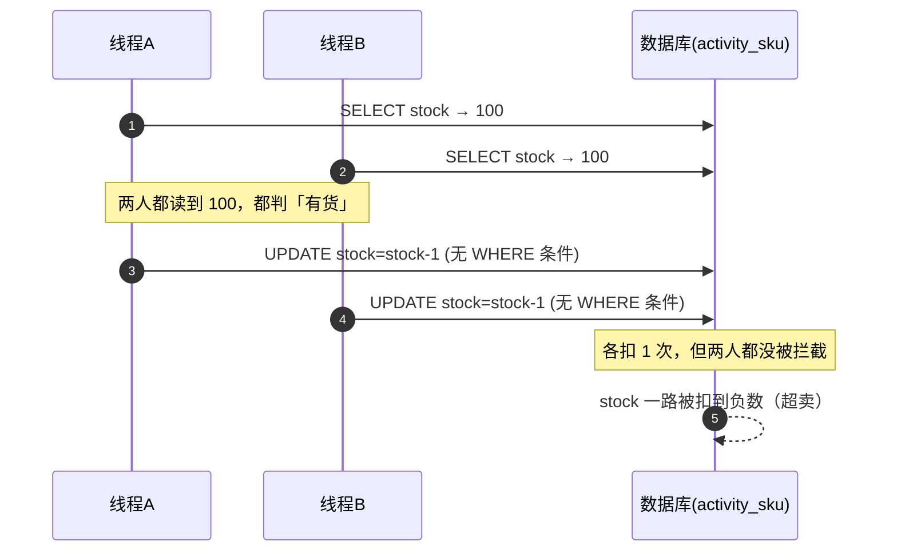
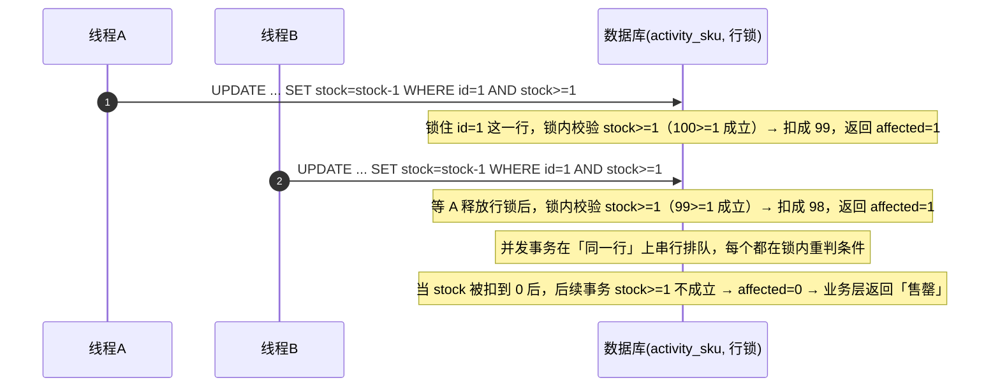

# Phase 2 — DB 层防超卖（手把手版）

> 这是**食谱式（recipe）教程**：每一步都给你「改哪个文件 → 完整代码（带注释）→ 做完会看到什么」。
> 你照着把 Phase 1 那个「会超卖」的实现改一遍，就能得到「并发打死也不超卖」的版本，并用 300 并发测试亲眼验证。
> 前置：已完成 `phase1.md`（不安全版），知道"查→判→扣"三步分离会超卖。

---

## 先搞懂：超卖是什么、为什么 Phase 1 会超卖

「超卖（oversell）」最直白的说法：**明明只有 100 件商品，却卖出了 101 单以上；或者剩余库存被扣成了负数**。像 100 张票，检票员没看清，让 150 人进了场。

Phase 1 的抢购逻辑是：

```
① SELECT stock FROM activity_sku WHERE id=1   → 读到 100
② if (stock >= qty) 应用层判断「有货」          → 100>=1，通过
③ UPDATE activity_sku SET stock=stock-1 WHERE id=1   → 扣成 99
④ INSERT INTO orders ...                        → 落单
```

问题出在**第 ② 步和第 ③ 步不是同一瞬间发生的**。100 个线程同时跑到 ②，都读到 `stock=100`、都判「有货」、都通过；然后一拥而上执行 ③，库存被扣成 `100-300=-200`，订单却建了 300 张。这就是超卖。

> 💡 **任何「先查再改、两步分离」的写法，在并发下都有这个坑。** 这是所有库存/额度系统的头号天敌，也是本项目从头到尾要消灭的敌人。

本 Phase 的解法一句话：**把「还有没有货」这个判断，从 Java 代码里挪进 SQL 的 `WHERE` 子句**，让数据库在扣减的那一瞬间顺手把货够不够也校验了——这一步是原子的，超卖从此不可能。

### 术语大白话（看不懂先读这里）

- **原子（atomic）**：「判断」和「扣减」像被焊死成一步，中间不会被别人插进来。数据库保证一条 `UPDATE` 本身就是原子的。
- **行锁**：数据库改某一行时，会先把那一行"锁住"，别人要改同一行就得排队等它放开——这正是我们想要的"串行化"。
- **条件更新（conditional update）**：把「库存够不够」写进 `UPDATE` 的 `WHERE` 里：`UPDATE ... WHERE id=? AND stock >= ?`。DB 在锁内重新校验条件，不满足就不改。
- **受影响行数（affected rows）**：一条 `UPDATE` 改了几行。`0` 表示"没改到任何行"（条件不满足 / 行不存在），`1` 表示"成功改了 1 行"。它是我们判断"到底扣没扣到"的依据。
- **乐观锁 `@Version`**：表里加版本号，更新时带 `WHERE version=?`，版本变了说明别人改过、本次更新失效（受影响行数=0），靠重试解决冲突。是一种"不加锁也能发现冲突"的思路（本项目 **不采用**，原因见第 6 步）。
- **事务 `@Transactional`**：把"扣库存 + 建订单"包成一件不可分割的事。要么都成、要么都回滚，保证 `stock` 和 `order` 不割裂。

---

## 第 0 步：确认起点（你已完成 Phase 1 的不安全版）

Phase 1 结束时，项目里这两处还是"不安全"的，本 Phase 要改它们：

- `ActivitySkuMapper.decrementStock` 的 SQL 是 `UPDATE ... SET stock=stock-#{qty} WHERE id=#{id}`——**没有 `stock>=qty` 条件**。
- `SeckillService.seckill` **没有** `@Transactional`，且扣减后**没用受影响行数**判断。

请确认目录还在（已完成 Phase 1）：

```
insightforge/
├── insightforge-persistence/.../mapper/ActivitySkuMapper.java   ← 第1步改这里
├── insightforge-seckill-core/.../service/SeckillService.java    ← 第2步改这里
├── insightforge-persistence/.../entity/ActivitySku.java         ← 第3步确认注释
├── insightforge-api/.../controller/SeckillController.java       ← 第3步确认注释
└── insightforge-api/.../test/.../SeckillOversellDemoTest.java   ← 第4步翻转为回归测试
```

> ⚠️ 如果你是直接克隆的仓库、没做过 Phase 1，请先回 `phase1.md` 把"会超卖"的版本跑通，因为本 Phase 是**在它基础上改**。

---

## 第 1 步：改 ActivitySkuMapper —— 把"有没有货"塞进 UPDATE 的 WHERE

> 📖 **概念：让数据库当最终裁判。**
> Phase 1 的 `decrementStock` 只说"把库存减 qty"，但**没说"只有库存够减的时候才减"**。超卖的命门就在于：有没有货的判读放在了 Java 代码里（Service 的 `if`），而**不是**在这条 SQL 里。
> 修复方法：给 SQL 加上 `WHERE stock >= #{qty}`。这样"货够不够"和"扣减"合并成数据库里的**一步原子操作**——数据库对单条 `UPDATE` 原子执行，会对命中行加锁，在锁内重新校验 `WHERE` 条件，不满足就不改。

### 1.1 完整文件（替换原 ActivitySkuMapper.java）

> 文件： `insightforge-persistence/src/main/java/com/insightforge/persistence/mapper/ActivitySkuMapper.java`

```java
package com.insightforge.persistence.mapper;

import com.baomidou.mybatisplus.core.mapper.BaseMapper;
import com.insightforge.persistence.entity.ActivitySku;
import org.apache.ibatis.annotations.Param;
import org.apache.ibatis.annotations.Update;

/**
 * 活动库存 Mapper（秒杀核心）。
 */
public interface ActivitySkuMapper extends BaseMapper<ActivitySku> {

    /**
     * Phase 2 修复：原子条件更新（DB 级超卖兜底）。
     *
     * 关键点：把「库存够不够」的判断直接写进 UPDATE 的 WHERE 子句里。
     * 数据库对「单条 UPDATE」是原子执行的——InnoDB（以及 H2 的 MVCC）会对命中行
     * 加记录锁，并在锁内重新校验 WHERE 条件，所以「判断 stock >= qty」和「扣减」
     * 这两步不再分离。并发下不可能有两个事务同时穿过 stock>=qty 的校验，
     * 因此库存绝不会被扣成负数。
     *
     * 返回值 = 受影响行数：
     * - 1 ：扣减成功（库存确实 >= qty，已原子扣减）
     * - 0 ：库存不足（或行不存在），本次不扣减 —— 业务层据此返回「售罄」
     *
     * 对比 Phase 1 的「先 SELECT 再 UPDATE 无 WHERE 条件」：那个写法两步不原子，
     * 并发会超卖（库存变负、订单数超过初始库存）。本写法一行 SQL 把竞态彻底关掉。
     *
     * 进阶对照（见第 6 步）：MyBatis-Plus `@Version` 乐观锁也是一种做法，
     * 但对「库存扣减」而言，单独靠 version 并不能挡住超卖（还得额外判断 stock>=qty），
     * 而本条件更新已经把 stock>=qty 原子化了，所以这里不依赖 version 也能 100% 不超卖。
     * version 字段仍保留在表里，留给 Phase 6 对账 / 后续乐观并发场景使用。
     */
    @Update("UPDATE activity_sku SET stock = stock - #{qty}, sold = sold + #{qty} " +
            "WHERE id = #{id} AND stock >= #{qty}")   // ★ 就加了这一行条件：货够才扣
    int decrementStock(@Param("id") Long id, @Param("qty") int qty);
    // 返回值 = 受影响行数。下一步 Service 靠它判断「到底扣到没有」。
}
```

> 🧠 **理解一下（这是 Phase 2 的灵魂）**：和 Phase 1 相比，**只多了一个 `AND stock >= #{qty}`**。但就这一句，把"判断"和"扣减"焊成了数据库的一步。返回值 `int` 是受影响行数——`1` 表示真扣到了，`0` 表示并发下这次没抢到（条件不成立），业务层据此返回"售罄"，**绝不为负**。`sold` 同步 `+qty`，保持对账等式 `sold = totalStock - stock` 始终成立。

**这一步做完**：扣减 SQL 已经原子、安全。但 Service 还没用上"受影响行数"，下一步把它接上。

---

## 第 2 步：改 SeckillService —— 靠"受影响行数"当裁判 + 加事务

> 📖 **概念：① 受影响行数才是唯一真相；② 为什么加 @Transactional。**
> Phase 1 的 Service 调完 `decrementStock` 就直接建单，根本没看返回值。现在我们把"扣减成功"定义为 `affected == 1`；只要 `affected == 0`，说明库存已被别人抢光，本次**不建单、返回售罄**。
> 另外加 `@Transactional`：把"扣库存 + 建订单"包成一件事。万一建单抛异常，扣减也回滚，不会出现"库存少了却没有订单"的脏数据。也保证压测后 `stock=0 且 order=100` 精确成立。

### 2.1 完整文件（替换原 SeckillService.java）

> 文件： `insightforge-seckill-core/src/main/java/com/insightforge/seckill/core/service/SeckillService.java`

```java
package com.insightforge.seckill.core.service;

import com.insightforge.common.result.ApiResult;
import com.insightforge.persistence.entity.ActivitySku;
import com.insightforge.persistence.entity.Orders;
import com.insightforge.persistence.mapper.ActivitySkuMapper;
import com.insightforge.persistence.mapper.OrdersMapper;
import com.insightforge.seckill.core.dto.SeckillRequest;
import com.insightforge.seckill.core.dto.StockInfo;
import org.springframework.stereotype.Service;
import org.springframework.transaction.annotation.Transactional;

import java.time.LocalDateTime;
import java.util.UUID;

/**
 * 最小秒杀主流程（Phase 2，DB 层防超卖）。
 *
 * 步骤：快速查库存（友好失败，非原子）→ ★原子条件更新扣库存★（真正的防线）
 *       → 据受影响行数判断 → 扣成功才建订单。
 * 扣库存与建订单包在同一事务里：要么都成、要么都回滚，保证 stock 与 order 不割裂。
 */
@Service
public class SeckillService {

    private final ActivitySkuMapper activitySkuMapper;
    private final OrdersMapper ordersMapper;

    // 构造注入：Spring 自动把两个 Mapper 的实现塞进来
    public SeckillService(ActivitySkuMapper activitySkuMapper, OrdersMapper ordersMapper) {
        this.activitySkuMapper = activitySkuMapper;
        this.ordersMapper = ordersMapper;
    }

    @Transactional   // ★ 事务：扣库存 + 建订单要么都成、要么都回滚
    public ApiResult<String> seckill(SeckillRequest req) {
        // 1) 查库存：友好的「快速失败」优化，避免明知售罄还去打一次 UPDATE。
        //    ⚠️ 这一步不是原子保护、也不是防超卖的防线；真正防线是第 2 步的 SQL。
        ActivitySku sku = activitySkuMapper.selectById(req.getSkuId());
        if (sku == null) {
            return ApiResult.fail(404, "商品不存在");
        }
        if (sku.getStock() < req.getQty()) {
            return ApiResult.fail(409, "已售罄");   // 友好提示，减少无效 UPDATE
        }

        // 2) ★原子条件更新★：只有 stock >= qty 时 DB 才会真正扣减（单行更新原子执行）。
        //    并发下多个事务会在这行上串行排队，每个都在锁内重新校验 stock>=qty，
        //    所以绝不会有两个事务同时把库存扣穿。
        int affected = activitySkuMapper.decrementStock(sku.getId(), req.getQty());

        // 3) 受影响行数 = 真实结果：0 表示并发下这最后一次已被别人抢光（条件未命中），不建单。
        if (affected == 0) {
            return ApiResult.fail(409, "已售罄");
        }

        // 4) 扣减成功，才落订单（与扣减同事务，失败一起回滚，不会「扣了库存却没单」）。
        Orders order = new Orders();
        order.setOrderId(UUID.randomUUID().toString().replace("-", ""));
        order.setUserId(req.getUserId());
        order.setActivityId(req.getActivityId());
        order.setSkuId(req.getSkuId());
        order.setQty(req.getQty());
        order.setStatus("CREATED");
        order.setCreatedAt(LocalDateTime.now());
        ordersMapper.insert(order);

        return ApiResult.ok(order.getOrderId());
    }

    /** 查询某 SKU 的库存情况，便于手动验证与演示超卖。 */
    public ApiResult<StockInfo> stockInfo(Long skuId) {
        ActivitySku sku = activitySkuMapper.selectById(skuId);
        if (sku == null) {
            return ApiResult.fail(404, "商品不存在");
        }
        StockInfo info = new StockInfo();
        info.setSkuId(skuId);
        info.setTotalStock(sku.getTotalStock());
        info.setStock(sku.getStock());
        info.setSold(sku.getSold());
        return ApiResult.ok(info);
    }
}
```

> 🧠 **理解一下（对比 Phase 1，哪些行变了）**：
> - 方法头上**多了 `@Transactional`** —— 扣库存和建订单绑成原子。
> - 调 `decrementStock` 后**多了第 3 步**：`if (affected == 0) return 售罄`。这就是把"数据库当裁判"落地的关键。
> - 第 1 步的 `if (sku.getStock() < qty)` 是**锦上添花**（快速失败，少打一次无谓的 UPDATE），**不是防线**。真正的兜底永远是第 2 步那条带 `WHERE stock>=qty` 的 SQL——就算 ① 漏判了（读到旧值），② 也会在锁内兜底。这种"让数据库当最终裁判"的思想，是并发正确性的根基。

**这一步做完**：业务层已经能正确判定超卖。下面确认实体/控制器的注释，再翻转测试。

---

## 第 3 步：确认实体与控制器注释（version 字段的取舍）

> 📖 **概念：为什么 `version` 字段留着却不用？**
> 表里有个 `version` 字段，原本是给"乐观锁"准备的。但我们选了更直接的"条件更新"作 DB 兜底（原因见第 6 步），所以 `version` 在本 Phase **不参与防超卖**，只是保留着，留给 Phase 6 对账 / 其他乐观并发场景。下面确认这两个文件的注释与当前设计一致即可，**代码不用改**。

### 3.1 ActivitySku.java 关键字段注释（确认即可，无需改动）

> 文件： `insightforge-persistence/src/main/java/com/insightforge/persistence/entity/ActivitySku.java`

```java
    /** 初始库存（对账用，不再变动） */
    private Integer totalStock;

    /** 剩余库存（热路径扣减字段） */
    private Integer stock;

    /** 已售数量（对账 / 销量流用） */
    private Integer sold;

    /** 乐观锁版本号（Phase 2 启用）
     *  说明：本 Phase 的 DB 防超卖走 WHERE stock>=qty 条件更新（不依赖 version）；
     *  version 字段保留，供 Phase 6 对账 / 后续乐观并发场景使用。 */
    private Integer version;
```

> 🧠 **理解一下**：`stock` 是"还剩几件"，每次抢到减 1；`sold` 是"已卖出几件"，减库存时同步加 1；`totalStock` 永远不变，专门用来对账——**理论上最终剩余 stock = totalStock - sold**。后面所有并发保护的功夫，都是在保护"减 stock 和加 sold"不被多人同时搞乱。

### 3.2 SeckillController.java 注释（已更新，证明并发不超卖）

> 文件： `insightforge-api/src/main/java/com/insightforge/api/controller/SeckillController.java`

```java
/**
 * 秒杀接入层（Phase 2，已加 DB 级防超卖）。
 *
 * POST /api/seckill              用户抢购（扣减走原子条件更新，并发不会超卖）
 * GET  /api/seckill/stock/{skuId} 查看某 SKU 剩余/已售/初始库存（便于验证与压测后核对）
 */
@RestController
@RequestMapping("/api/seckill")
public class SeckillController {
    // ... 内容同 Phase 1，无需改动，仅类注释更新 ...
}
```

> 🧠 **这一步做完**：代码层面 Phase 2 已完整。唯一剩下的就是把"超卖演示测试"翻转为"防超卖回归测试"，用并发证明它真的不超卖了。

---

## 第 4 步：翻转测试 —— 超卖演示 → 防超卖回归看护

> 📖 **概念：把"证明有 bug"的测试，变成"守住不出 bug"的护栏。**
> Phase 1 那条 `SeckillOversellDemoTest` 断言"超卖发生了"（因为它是故意不安全版）。现在修好了，同样的 300 并发必须**收敛到不超卖**。我们把文件改名成 `SeckillNoOversellTest`，断言反过来：库存不能为负、订单数必须等于 100。
> 这条测试从此是"护栏"：以后谁手滑把 `WHERE stock>=qty` 删了，它会立刻由绿变红，挡住回归——面试时这是个能讲的亮点。

### 4.1 重命名文件（git mv 保留历史）

```bash
cd D:\Java\insightforge
git mv insightforge-api/src/test/java/com/insightforge/api/SeckillOversellDemoTest.java \
      insightforge-api/src/test/java/com/insightforge/api/SeckillNoOversellTest.java
```

### 4.2 完整新测试文件（直接覆盖重名后的文件）

> 文件： `insightforge-api/src/test/java/com/insightforge/api/SeckillNoOversellTest.java`

```java
package com.insightforge.api;

import com.insightforge.persistence.entity.ActivitySku;
import com.insightforge.persistence.mapper.ActivitySkuMapper;
import com.insightforge.persistence.mapper.OrdersMapper;
import com.insightforge.seckill.core.dto.SeckillRequest;
import com.insightforge.seckill.core.service.SeckillService;
import org.junit.jupiter.api.Test;
import org.springframework.beans.factory.annotation.Autowired;
import org.springframework.boot.test.context.SpringBootTest;
import org.springframework.test.context.ActiveProfiles;

import java.util.concurrent.CountDownLatch;
import java.util.concurrent.ExecutorService;
import java.util.concurrent.Executors;

import static org.junit.jupiter.api.Assertions.assertEquals;
import static org.junit.jupiter.api.Assertions.assertTrue;

/**
 * Phase 2 防超卖回归测试（替代 Phase 1 的超卖缺陷演示）。
 *
 * 用 300 线程同时抢「库存仅 100」的 SKU，验证原子条件更新后必须收敛到：
 * stock=0、订单=100、绝不为负。若日后热路径改坏了扣减 SQL（比如删了 WHERE stock>=qty），
 * 此测试会立刻由「绿」变「红」，挡住回归。
 */
@SpringBootTest
@ActiveProfiles("local")   // 用本地 H2 库，零依赖
class SeckillNoOversellTest {

    @Autowired private SeckillService seckillService;
    @Autowired private ActivitySkuMapper activitySkuMapper;
    @Autowired private OrdersMapper ordersMapper;

    @Test
    void demo_phase2_no_oversell_regression() throws InterruptedException {
        Long skuId = 1L;
        int totalStock = 100;
        int threadCount = 300; // 远大于库存，制造激烈竞态

        // 线程池 + 两个发令枪（CountDownLatch）
        ExecutorService pool = Executors.newFixedThreadPool(threadCount);
        CountDownLatch startGate = new CountDownLatch(1);  // 起始发令枪：让所有线程同时起跑
        CountDownLatch doneGate   = new CountDownLatch(threadCount);

        for (int i = 0; i < threadCount; i++) {
            final long uid = 1000L + i;
            pool.submit(() -> {
                try {
                    startGate.await();   // 等发令枪，保证大家「同一刻」开抢（放大竞态窗口）
                    SeckillRequest req = new SeckillRequest();
                    req.setActivityId(1L);
                    req.setSkuId(skuId);
                    req.setUserId(uid);
                    req.setQty(1);
                    seckillService.seckill(req);
                } catch (Exception ignored) {
                    // 售罄等「正常业务失败」忽略，重点是并发下绝不能超卖
                } finally {
                    doneGate.countDown();   // 不管成功失败，跑完一个就减一
                }
            });
        }

        startGate.countDown();   // 发令：300 个线程同时开抢
        doneGate.await();        // 等全部跑完
        pool.shutdown();

        // 统计结果
        ActivitySku sku = activitySkuMapper.selectById(skuId);
        Long orderCount = ordersMapper.selectCount(null);

        System.out.println("==============================================");
        System.out.println(">>> Phase2 防超卖回归结果：");
        System.out.println(">>>   初始库存 totalStock = " + totalStock);
        System.out.println(">>>   剩余库存 stock      = " + sku.getStock());
        System.out.println(">>>   已售 sold           = " + sku.getSold());
        System.out.println(">>>   订单总数            = " + orderCount);
        System.out.println(">>>   是否超卖            = " + (sku.getStock() < 0 || orderCount > totalStock));
        System.out.println("==============================================");

        // ★ Phase 2 修复后的硬断言：绝不超卖，且库存被精确抢光 ★
        assertTrue(sku.getStock() >= 0, "剩余库存绝不能为负（超卖）");
        assertEquals(0, sku.getStock(), "并发抢光 100 件后剩余库存必须收敛到 0");
        assertEquals((long) totalStock, orderCount.longValue(), "订单数必须等于初始库存 100（无超额下单）");
        assertEquals((long) totalStock, sku.getSold().longValue(), "已售数必须等于初始库存 100（sold = total - stock 对账成立）");
    }
}
```

> 🧠 **理解一下测试机制**：
> - `ExecutorService` 是线程池，替我们起 300 个并发任务。
> - `startGate`（发令枪）初始计数 1，所有线程先 `await()` 阻塞；主线程 `countDown()` 后，300 个线程**同时**被放行去抢——这比"挨个启动"更能复现竞态。
> - 抢完后用 `selectById` 读最终库存、`selectCount` 数订单总数，打印出来。
> - 断言和 Phase 1 **正好反过来**：Phase 1 断言"超卖发生了"（bug 复现）；这里断言"库存=0、订单=100、绝不为负"（修复证明）。`pool.shutdown()` 收尾，避免测试进程挂起。

**这一步做完**：代码和测试都齐了。下面编译跑测试，亲眼看到"不超卖"。

---

## 第 5 步：编译 + 跑回归测试，看结果

### 5.1 编译并跑测试（沙箱用 classworlds 启动器绕过 Maven 坑）

```bash
cd D:\Java\insightforge

# 你自己的机器（已装好 Maven）：
mvn clean package

# 沙箱 / Windows+GitBash 下 mvn 启动报错时，用这条「直调 Java 启动 Maven」绕过：
MVN_HOME="D:/devtools/maven/apache-maven-3.9.9"
java -classpath "$MVN_HOME/boot/plexus-classworlds-2.8.0.jar" \
     -Dclassworlds.conf="$MVN_HOME/bin/m2.conf" \
     -Dmaven.home="$MVN_HOME" \
     -Dmaven.multiModuleProjectDirectory="D:/Java/insightforge" \
     -Dlibrary.jansi.path="$MVN_HOME/lib/jansi-native" \
     org.codehaus.plexus.classworlds.launcher.Launcher clean package
```

### 5.2 期望结果（BUILD SUCCESS + 测试全绿）

```
[INFO] BUILD SUCCESS
...
Tests run: 1, Failures: 0, Errors: 0
>>> Phase2 防超卖回归结果：
>>>   初始库存 totalStock = 100
>>>   剩余库存 stock      = 0
>>>   已售 sold           = 100
>>>   订单总数            = 100
>>>   是否超卖            = false
```

✅ **库存收敛到 0、订单恰好 100、无负数 = Phase 2 通关！** 对比 Phase 1 的 `stock=-200 / 订单=300`，超卖被彻底治好了。

> 💡 手动单线程验证（可选）：用 `local` profile 起服务，`POST /api/seckill` 一次，`GET /api/seckill/stock/1` 看 stock 从 100→99、sold 0→1、order 多 1 行。压测口径（JMeter）：起 200~300 并发抢 100 库存，结束后查库 `stock=0 且 sold=100 且 order 行数=100`，绝无负数/超额。

---

## 第 6 步：原理图解 + 进阶：条件更新 vs 乐观锁 @Version

### 6.1 竞态对比流程图

**Phase 1（坏）：检查与扣减分离 → 超卖**



**Phase 2（好）：判断塞进 UPDATE 的 WHERE → 原子**



> 🧠 **关键认知**：「判断 + 扣减」合成一条 SQL 后，数据库用行锁把并发串行化了，而条件是在锁内重新校验的，所以绝不会有两个事务同时把库存扣穿。

### 6.2 进阶对比：条件更新 vs 乐观锁 `@Version`

很多教程会教"库存扣减用 MyBatis-Plus 乐观锁"。这里把两种讲透，并说清本项目为什么选条件更新。

**乐观锁 `@Version` 写法（MyBatis-Plus）**：实体加 `@Version private Integer version;`，配置 `OptimisticLockerInnerInterceptor`，然后调 `updateById(sku)` —— MP 自动生成：

```sql
UPDATE activity_sku
   SET stock = stock - #{qty}, sold = sold + #{qty}, version = version + 1
 WHERE id = #{id} AND version = #{oldVersion}
```

若 `version` 已被别人改过（并发冲突），`WHERE version=?` 命中不到 → `affected=0` → 抛异常，业务层重试。

**关键结论：对「库存扣减」，条件更新其实更合适**：

- 乐观锁解决的是"我想改的行被别人改了"的**冲突检测**；但它**本身不保证不超卖**——你仍然要先 `SELECT` 读 `stock` 到内存，再 `updateById` 扣减。如果两个线程都读到 `stock=1`、都算出 `stock-1=0`，即便 version 拦住了第二个，第一个也只把库存置 0，**但"stock 会不会变负"依然取决于你有没有在 UPDATE 里加 `stock>=qty` 这个条件**。
- 换句话说：**只要你的 UPDATE 带了 `WHERE stock >= qty`，就已经原子地防住了超卖，此时 version 是"多余的"**；而若你没带 `stock>=qty`，光靠 version 也防不住超卖。
- 条件更新**不需要额外列、不需要拦截器、不需要重试循环**，一行 SQL 把竞态彻底关掉，心智负担最小、性能最好（无 version 比较与重试开销）。

> 所以本项目的取舍是：**Phase 2 用 `WHERE stock>=qty` 条件更新作为 DB 兜底（最简单最稳）；`version` 字段保留在表里，留给 Phase 6 对账 / 其他需要乐观并发的场景。** 面试时能把"为什么不用乐观锁"讲清楚，反而是加分项。

---

## 第 7 步：排错 + Phase 3 预告

### 7.1 排错（按现象查）

| 现象 | 原因 | 解决 |
|---|---|---|
| 回归测试还是超卖（stock<0 / order>100） | `decrementStock` 的 `WHERE stock >= #{qty}` 没写对（漏了条件，或写成 `stock > 0` 在 qty>1 时不稳） | 核对第 1 步的 SQL；确认 `seckill()` 调用的是这个新方法、没被旧逻辑绕过 |
| `affected == 0` 被误判成超卖、其实库存还有 | `qty` > 当前 `stock`（比如用了 qty=2 但只剩 1 件） | 这是正常的"真售罄"，不是 bug |
| `@Transactional` 不生效 / 测试里事务没回滚 | 方法非 public、或类没被 Spring 代理 | 本例 `@Service` 正常注入即可；本测试每个线程各自起事务，互不影响 |
| H2 下不串行？ | H2(MODE=MySQL) 也支持行锁与 MVCC | 单条 `UPDATE ... WHERE id=?` 会串行化；本地用 MySQL 8 行为一致 |

### 7.2 Phase 3 预告（下一道防线）

Phase 2 的 DB 条件更新**已经能保证不超卖**——但它有个代价：每个请求都打数据库、且扣减要走行锁，高并发下 DB 会成为瓶颈（吞吐下降、RT 飙升）。

Phase 3 把"高并发扣减"从数据库搬到 **Redis + Lua**：
- 活动开始前把库存预热到 Redis（`SET stock:a:{aid}:s:{sid} 100`）；
- 用一段 **Lua 脚本**把"判断 + 扣减"在 Redis 单线程里原子执行（比 DB 行锁快几个量级）；
- 加 **Redisson 分布式锁**做细粒度互斥，并引入"锁超时分级"——用户抢购 `tryLock(10ms)` 抢不到就提示重试，规则引擎调拨 `tryLock(0ms)` 拿不到立刻让路、不阻塞用户；
- DB 退居"异步落库 / 最终对账"角色（Phase 4 用 Kafka 解耦）。

即：**Phase 2 = DB 兜底（正确性保底）；Phase 3 = Redis 主战场（性能 + 仍不超卖）。** 两者是"保底 + 主防"的配合关系，不是二选一。

---

## 下一步（进入 Phase 3）

打开 `tutorials/phase3.md`：把高并发扣减从数据库搬到 Redis + Lua 原子执行，并加 Redisson 分布式锁（锁超时分级 + 分段锁），DB 退居异步落库。
