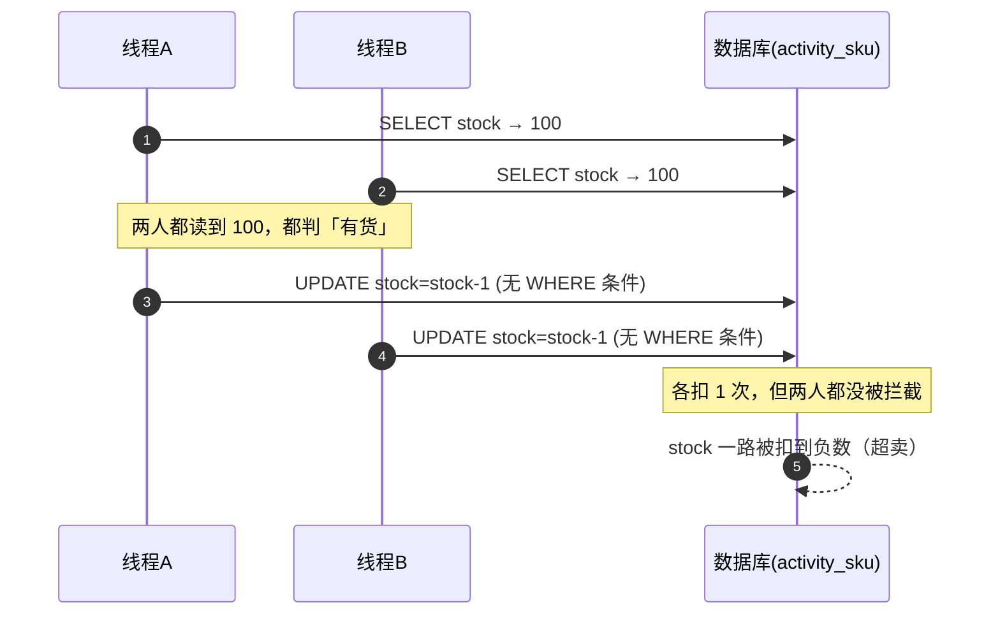
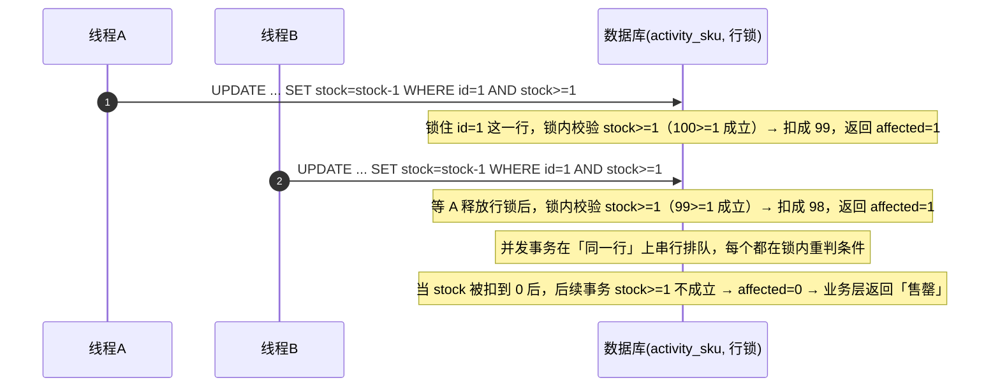

# Phase 2 逐行详解 — DB 层防超卖（原子条件更新）

> 配套：`../tasks.md`（任务勾选）、`../tutorial.md`（总览）、`../spec.md`（设计）。
> 本阶段目标：给秒杀加**第一道超卖防线**——即使并发打满，数据库也绝不让库存变负。
> 前置：已读完 `phase1.md`，知道「查→判→扣」三步非原子会超卖。

---

## 0. 大白话先讲清楚（术语速查）

- **超卖（oversell）**：库存只有 100 件，却卖出了 101 单以上；或者剩余库存被扣成负数。
  就像 100 张票，检票员没看清楚，让 150 人进了场。
- **原子（atomic）**：「判断」和「扣减」像被焊死成一步，中间不会被别人插进来。
  数据库保证一条 `UPDATE` 语句本身就是原子的——你没法在它执行到一半时插队。
- **TOCTOU 竞态（Time-Of-Check to Time-Of-Use）**：Phase 1 的坑——「检查时刻」和「使用时刻」
  之间被别的线程插了空，导致检查和实际动作对不上。
- **条件更新（conditional update）**：把「库存够不够」写进 `UPDATE` 的 `WHERE` 里，
  `UPDATE ... WHERE id=? AND stock >= ?`。DB 在锁内重新校验条件，不满足就不改。
- **乐观锁 `@Version`**：表里加版本号，更新时带 `WHERE version=?`，版本变了就说明别人改过、
  本次更新失效（受影响行数=0），靠重试解决冲突。是一种「不加锁也能发现冲突」的思路。
- **受影响行数（affected rows）**：一条 `UPDATE` 改了几行。0 表示「没改到任何行」
  （条件不满足 / 行不存在），1 表示「成功改了 1 行」。它是我们判断「到底扣没扣到」的依据。

一句话总结本 Phase：**把「还有没有货」这个判断，从 Java 代码里挪进 SQL 的 `WHERE` 子句，
让数据库在扣减的那一瞬间顺手把货够不够也校验了——这一步是原子的，超卖从此不可能。**

---

## 1. 为什么需要 Phase 2（回顾 Phase 1 的坑）

Phase 1 的抢购逻辑是：

```
1. SELECT stock FROM activity_sku WHERE id=1   → 读到 100
2. if (stock >= qty) 应用层判断「有货」          → 100>=1，通过
3. UPDATE activity_sku SET stock=stock-1 WHERE id=1   → 扣成 99
4. INSERT INTO orders ...                        → 落单
```

问题出在**第 2 步和第 3 步不是同一瞬间发生的**。
100 个线程同时跑到第 2 步，都读到 `stock=100`、都判断「有货」、都通过；
然后一拥而上执行第 3 步，库存被扣成 `100-100=0`？不——它们**没有互相感知**，
300 个线程全过了第 2 步，第 3 步被执行 300 次，库存被扣成 `100-300=-200`，
订单却建了 300 张。这就是超卖。

> 任何「先查再改、两步分离」的写法，在并发下都有这个坑。这是所有库存/额度系统的头号天敌。

**Phase 2 的解法**：让「货够不够」和「扣减」成为**同一条 SQL 的一步**。
数据库对单条 `UPDATE` 是原子执行的——它会对命中的那一行加锁，在锁内重新校验 `WHERE`
条件，满足条件才改。于是两个并发事务不可能同时穿过 `stock >= qty` 的校验。

---

## 2. 流程图

### 2.1 Phase 1（坏）：检查与扣减分离 → 超卖



### 2.2 Phase 2（好）：判断塞进 UPDATE 的 WHERE → 原子



> 关键认知：**「判断 + 扣减」合成一条 SQL 后，数据库用行锁把并发串行化了，
> 而条件是在锁内重新校验的**，所以绝不会有两个事务同时把库存扣穿。

---

## 3. 伪代码对比

### 3.1 Phase 1 的坏伪代码（留作对照，不要再这么写）

```
function seckill(req):
    sku = SELECT * FROM activity_sku WHERE id = req.skuId   // ① 读
    if sku.stock < req.qty:                                  // ② 应用层判断（和非原子！）
        return "售罄"
    UPDATE activity_sku SET stock = stock - req.qty          // ③ 无 WHERE 条件，直接扣
           WHERE id = req.skuId
    INSERT INTO orders ...                                   // ④ 落单
    return "ok"
```
缺陷：② 和 ③ 之间可被其他线程插入，多人同时过 ②，③ 被重复执行 → 超卖。

### 3.2 Phase 2 的好伪代码（本阶段采用）

```
function seckill(req):
    sku = SELECT * FROM activity_sku WHERE id = req.skuId   // ① 快速失败优化（非原子保护）
    if sku == null: return "商品不存在"
    if sku.stock < req.qty: return "售罄"                    // 友好提示，减少无效 UPDATE

    affected = UPDATE activity_sku                           // ② ★原子条件更新★：真正的防线
                 SET stock = stock - req.qty,
                     sold  = sold  + req.qty
               WHERE id = req.skuId
                 AND stock >= req.qty                        // 货够才扣，DB 行锁内重判
    if affected == 0: return "售罄"                          // ③ 没改到行 = 并发下被抢光了

    INSERT INTO orders ...                                  // ④ 扣成功才落单（与②同事务）
    return "ok"
```

> ①②③④ 中，**只有 ② 决定「到底扣没扣到」**。① 只是锦上添花的快速失败，
> 就算①漏判了（读到旧值），② 也会在锁内兜底。这就是「让数据库当最终裁判」的思想。

---

## 4. 逐文件核心代码改动

### 4.1 `insightforge-persistence/.../mapper/ActivitySkuMapper.java`

把「无条件的扣减」改成「带 `stock >= qty` 条件的扣减」：

```java
@Update("UPDATE activity_sku SET stock = stock - #{qty}, sold = sold + #{qty} " +
        "WHERE id = #{id} AND stock >= #{qty}")
int decrementStock(@Param("id") Long id, @Param("qty") int qty);
```

- 返回 `int` = 受影响行数。**这是 Phase 2 的灵魂**：用它判断扣减是否真的发生。
- `WHERE id = #{id} AND stock >= #{qty}` 让「货够不够」和「扣减」合并为原子一步。
- `sold` 同步 `+qty`，保持对账等式 `sold = totalStock - stock` 始终成立。

### 4.2 `insightforge-seckill-core/.../service/SeckillService.java`

```java
@Transactional
public ApiResult<String> seckill(SeckillRequest req) {
    ActivitySku sku = activitySkuMapper.selectById(req.getSkuId());
    if (sku == null) return ApiResult.fail(404, "商品不存在");
    if (sku.getStock() < req.getQty()) return ApiResult.fail(409, "已售罄"); // 快速失败（非原子）

    // ★原子条件更新★：只有 stock>=qty 才真扣；受影响行数是唯一真相
    int affected = activitySkuMapper.decrementStock(sku.getId(), req.getQty());
    if (affected == 0) return ApiResult.fail(409, "已售罄");

    Orders order = new Orders();
    order.setOrderId(UUID.randomUUID().toString().replace("-", ""));
    order.setUserId(req.getUserId());
    order.setActivityId(req.getActivityId());
    order.setSkuId(req.getSkuId());
    order.setQty(req.getQty());
    order.setStatus("CREATED");
    order.setCreatedAt(LocalDateTime.now());
    ordersMapper.insert(order);                              // 与扣减同事务，失败一起回滚
    return ApiResult.ok(order.getOrderId());
}
```

- `@Transactional`：把「扣库存 + 建订单」包成一件事。万一建单抛异常，扣减也回滚，
  不会出现「库存少了却没有订单」的脏数据。也保证压测后 `stock=0 且 order=100` 精确成立。
- 第 2 行的 `if (sku.getStock() < qty)` 是**非原子优化**，不是防线；真正兜底是第 3 行 SQL。

### 4.3 测试 `insightforge-api/.../test/.../SeckillNoOversellTest.java`

由 Phase 1 的「超卖演示」翻转为「防超卖回归看护」。同样 300 并发抢 100 库存，
但断言收敛到 `stock=0、order=100、stock>=0`：

```java
Assertions.assertTrue(sku.getStock() >= 0, "剩余库存绝不能为负（超卖）");
Assertions.assertEquals(0, sku.getStock(), "并发抢光后剩余库存必须收敛到 0");
Assertions.assertEquals(100L, orderCount.longValue(), "订单数必须等于初始库存 100");
Assertions.assertEquals(100L, sku.getSold().longValue(), "已售数必须等于初始库存 100");
```

> 这条测试是「护栏」：以后谁要是手滑把 `WHERE stock>=qty` 删了，它会立刻由绿变红，
> 挡住回归。这也是面试时能讲的一个亮点——「我有自动化测试守住并发正确性」。

---

## 5. 进阶对比：条件更新 vs 乐观锁 `@Version`

很多教程会教「库存扣减用 MyBatis-Plus 乐观锁」。这里把两种讲透，并说清本项目为什么选条件更新。

### 5.1 乐观锁 `@Version` 写法（MyBatis-Plus）

实体加 `@Version private Integer version;`，配置 `OptimisticLockerInnerInterceptor`，
然后调用 `activitySkuMapper.updateById(sku)` —— MP 会自动生成：

```sql
UPDATE activity_sku
   SET stock = stock - #{qty}, sold = sold + #{qty}, version = version + 1
 WHERE id = #{id} AND version = #{oldVersion}
```

若 `version` 已被别人改过（并发冲突），`WHERE version=?` 命中不到 → `affected=0` → 抛
`OptimisticLockException`，业务层重试。

### 5.2 关键结论：对「库存扣减」，**条件更新其实更合适**

- 乐观锁解决的是「我想改的行被别人改了」的**冲突检测**；但它**本身不保证不超卖**——
  你仍然要先 `SELECT` 读 `stock` 到内存，再 `updateById` 扣减。如果两个线程都读到
  `stock=1`、都算出 `stock-1=0`，即便 version 拦住了第二个，第一个也只把库存置 0，
  **但「stock 会不会变负」依然取决于你有没有在 UPDATE 里加 `stock>=qty` 这个条件**。
- 换句话说：**只要你的 UPDATE 带了 `WHERE stock >= qty`，就已经原子地防住了超卖，
  此时 version 是「多余的」**；而若你没带 `stock>=qty`，光靠 version 也防不住超卖。
- 条件更新**不需要额外列、不需要拦截器、不需要重试循环**，一行 SQL 把竞态彻底关掉，
  心智负担最小，性能也最好（没有 version 比较与重试开销）。

> 所以本项目的取舍是：**Phase 2 用 `WHERE stock>=qty` 条件更新作为 DB 兜底（最简单最稳）；
> `version` 字段保留在表里，留给 Phase 6 对账 / 其他需要乐观并发的场景。** 这样既不超卖，
> 又不引入不必要的复杂度。面试时能把「为什么不用乐观锁」讲清楚，反而是加分项。

---

## 6. 验收清单（怎么跑、期望看到什么）

1. **编译打包 + 跑回归测试**（沙箱用 classworlds 启动器绕过 Maven 坑，见 phase0.md §0.8）：
   ```bash
   MVN_HOME="D:/devtools/maven/apache-maven-3.9.9"
   java -classpath "$MVN_HOME/boot/plexus-classworlds-2.8.0.jar" \
        -Dclassworlds.conf="$MVN_HOME/bin/m2.conf" \
        -Dmaven.home="$MVN_HOME" \
        -Dmaven.multiModuleProjectDirectory="D:/Java/insightforge" \
        -Dlibrary.jansi.path="$MVN_HOME/lib/jansi-native" \
        org.codehaus.plexus.classworlds.launcher.Launcher clean package
   ```
2. **期望**：`BUILD SUCCESS`；`SeckillNoOversellTest` 全绿，控制台打印：
   ```
   >>>   初始库存 totalStock = 100
   >>>   剩余库存 stock      = 0
   >>>   已售 sold           = 100
   >>>   订单总数            = 100
   >>>   是否超卖            = false
   ```
3. **手动单线程验证**（可选）：用 `local` profile 起服务，`POST /api/seckill` 一次，
   `GET /api/seckill/stock/1` 看 stock 从 100→99、sold 0→1、order 多 1 行。
4. **DB 层断言**：`stock >= 0` 恒成立；`sold == totalStock - stock` 恒成立（对账成立）。

> 压测口径（JMeter）：起 200~300 并发线程抢 100 库存，结束后查库，
> `stock=0` 且 `sold=100` 且 `order 行数=100`，绝无负数/超额。这就是 DB 级兜底的证明。

---

## 7. 排错（这一 Phase 可能踩的坑）

- **回归测试还是超卖（stock<0 / order>100）**：十有八九是 `decrementStock` 的
  `WHERE stock >= #{qty}` 没写对（漏了条件，或写成 `stock > 0` 在 qty>1 时不稳）。
  核对 §4.1 的 SQL。另外确认 `seckill()` 调用的是这个新方法、没有被旧逻辑绕过。
- **`affected == 0` 被误判成超卖、其实库存还有**：检查 `qty` 是否 > 当前 `stock`
  （比如演示用了 qty=2 但只剩 1 件），这是正常的「真售罄」，不是 bug。
- **`@Transactional` 不生效 / 测试里事务没回滚**：确认方法用 `public`、且类被 Spring
  代理（本例是 `@Service` 正常注入即可）。本测试每个线程各自起事务，互不影响。
- **H2 下不串行？** H2(MODE=MySQL) 也支持行锁与 MVCC，单条 `UPDATE ... WHERE id=?`
  会串行化；若本地用 MySQL 8，InnoDB 行锁行为一致，结论相同。

---

## 8. Phase 3 预告（下一道防线）

Phase 2 的 DB 条件更新**已经能保证不超卖**——但它有个代价：每个请求都打数据库、
且扣减要走行锁，高并发下 DB 会成为瓶颈（吞吞吐吐、RT 飙升）。

Phase 3 把「高并发扣减」从数据库搬到 **Redis + Lua**：
- 活动开始前把库存预热到 Redis（`SET stock:a:{aid}:s:{sid} 100`）；
- 用一段 **Lua 脚本**把「判断 + 扣减」在 Redis 单线程里原子执行（比 DB 行锁快几个量级）；
- 加 **Redisson 分布式锁**做细粒度互斥，并引入「锁超时分级」——用户抢购 `tryLock(10ms)`
  抢不到就提示重试，规则引擎调拨 `tryLock(0ms)` 拿不到立刻让路、不阻塞用户；
- DB 退居「异步落库 / 最终对账」角色（Phase 4 用 Kafka 解耦）。

即：**Phase 2 = DB 兜底（正确性保底）；Phase 3 = Redis 主战场（性能 + 仍不超卖）。**
两者是「保底 + 主防」的配合关系，不是二选一。

---

> 下一步：确认本 Phase 跑通（回归测试绿、stock 收敛到 0），即可进入 Phase 3。
