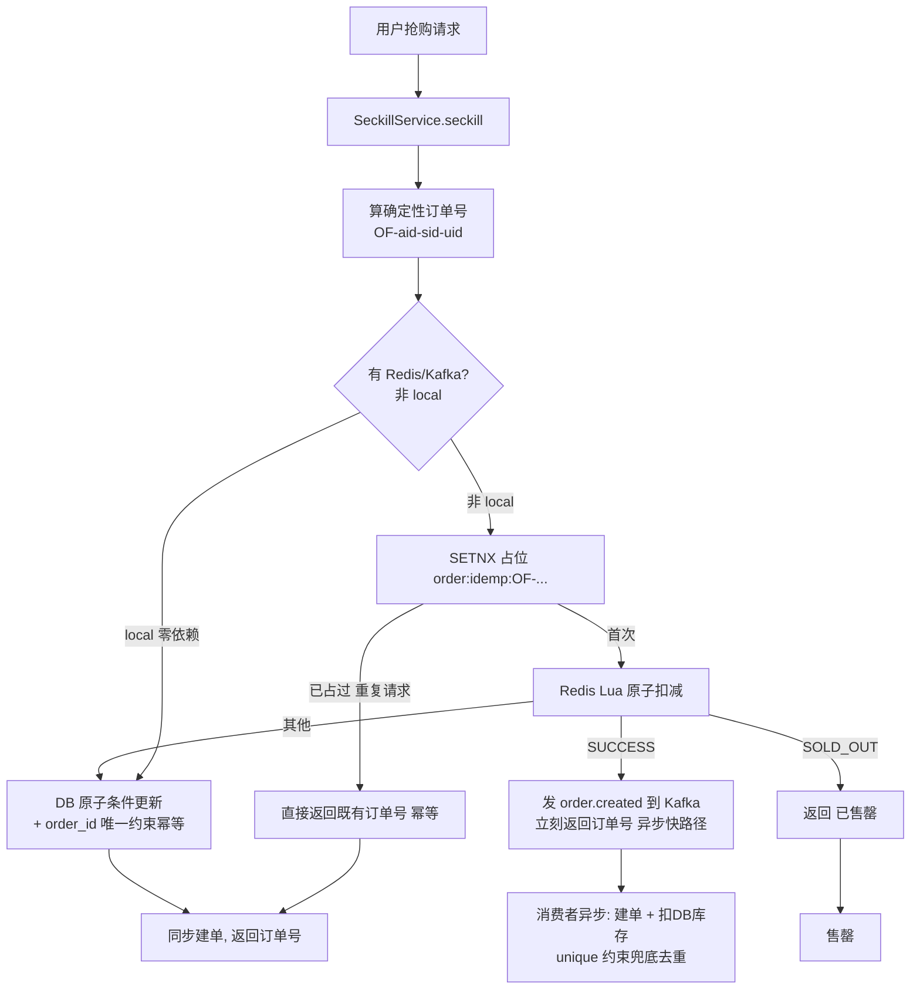

# Phase 4 — Kafka 异步削峰 + 订单幂等（秒杀的"快递柜"）

> **一句话目标**：抢购接口在"库存扣减成功"后，**只往 Kafka 丢一条消息就立刻返回用户**（接口 ~毫秒级，P99<10ms）；后方的消费者异步把"订单 + DB 库存"落库。海量并发先堆在 Kafka 里，由消费者匀速消化（削峰）。同时加一道**订单幂等**闸门——同一用户重复点、网络重试、Kafka 重投，最终都只生成一张单（exactly-once），绝不重复扣库存。
>
> 完成本 Phase 后，你的秒杀请求路径上**不再有 DB 写**：用户点了就走，落库交给后台慢慢做，系统能在更高并发下不崩、不超卖、不超买。

---

## 先搞懂：为什么要把"建单落库"异步掉？

Phase 3 我们把"扣库存"搬到了 Redis Lua（快路径），但"建订单 + 同步 DB 库存"仍然是在**用户的请求线程里同步做的**——用户得等这两步写完数据库才能拿到订单号。两个问题：

1. **响应慢、占连接**：高并发时成千上万个请求都卡在"写 DB"这一步，数据库连接池被占满，接口 P99 飙升。
2. **把网络调用裹进 DB 事务**（Phase 3 的教学简化）：事务越长，锁和连接持有越久，违背"高并发下事务要短"的铁律。

**Kafka 怎么救场**：它是个高性能消息队列，像小区的**快递柜**——你（抢购请求）把包裹（订单事件）往柜子里一塞就走，不用等在收件人（DB）面前。快递员（消费者）之后按自己节奏一个个取件、签收（落库）。于是：

- 用户请求路径 = 扣 Redis 库存 → 发 Kafka → **返回**。全程没有任何 DB 写，极快。
- 就算瞬间来了 10 万请求，它们也只是排队进 Kafka（内存+磁盘缓冲），消费者每秒稳定消化几千，系统不会被冲垮。

> 📖 **术语大白话**
> - **Kafka**：一个超高吞吐的分布式消息队列。生产者往"主题（topic）"里发消息，消费者从主题里取消息，中间用磁盘缓冲削峰填谷。本项目主题叫 `order.created`（订单已扣减、待建单）。
> - **异步削峰**：把"慢动作"（写 DB）从请求路径挪到后台，让前台轻装上阵扛并发。"峰"被 Kafka 这个缓冲池削平了。
> - **幂等（Idempotency）**：同一个操作做 1 次和做 100 次，结果一样。比如"用户重复点抢购"，不管点几次，最终只扣 1 件库存、只出 1 张单。
> - **exactly-once**：精确一次——消息哪怕被重发、重投多次，最终效果等同于只处理了 1 次。本项目靠"确定性订单号 + DB 唯一约束"逼近它。
> - **SETNX**：Redis 的"占坑"原语（SET if Not eXists，不存在才写入）。谁先占到就是谁的，后到的占位失败——天然适合做幂等闸门。
> - **DLQ（死信队列）**：装"处理失败、重试多次仍不行"的消息的兜底队列。本项目的 `guardrail.action.failed` 就是，Phase 9 才会用到，本 Phase 先认识这个名字。

---

## 架构总览（先看图，再一步步搭）



> 🧠 **理解一下**：这张图的核心是**三层幂等 + 一条快路径**。
> - **快路径**：非 local 下，扣完 Redis 立刻「发 Kafka + 返回」，DB 落库甩给后台消费者。
> - **第一层幂等（Redis SETNX）**：拦住"同一用户短时间重复抢"——还没进 Kafka 就被挡回去。
> - **第二层幂等（DB 唯一约束）**：消费者建单时 `order_id UNIQUE`，Kafka 重投来了也插不进第二张，捕获 `DuplicateKeyException` 忽略。
> - **第三层（仅扣新单才扣库存）**：消费者只有"真插进新订单"才减 DB 库存，杜绝重投导致多扣。
> 三层叠起来，无论用户怎么点、网络怎么抖、Kafka 怎么重投，**最终都只有一张单、库存只减一次**。

---

## 第 0 步：确认目录（Phase 3 留下的骨架）

Phase 3 结束后，项目目录关键部分长这样（你应当已经具备）：

```
insightforge/
├── insightforge-seckill-core/src/main/java/com/insightforge/seckill/core/
│   ├── redis/{RedisKeys,RedisStockService,DeductResult,RedisConfig}.java  # Phase 3 已建
│   ├── service/SeckillService.java          # Phase 3 的 Redis主+DB兜底逻辑
│   ├── dto/{SeckillRequest,StockInfo}.java
│   ├── kafka/KafkaTopicConfig.java          # 已声明 ORDER_CREATED 等主题（Phase 0）
│   └── redis/RedisKeys.java                 # 已有 orderIdempotent 方法
├── insightforge-persistence/.../mapper/{ActivitySkuMapper,OrdersMapper}.java
└── insightforge-api/src/main/resources/{application.yml,application-local.yml,schema.sql}
```

本 Phase 我们要**新增** 4 个文件（事件 DTO、幂等服务、生产者、消费者）+ **修改** 3 个文件（SeckillService、schema.sql、新建测试）。下面一步步来。

---

## 步骤 1：确认依赖 + 补上 Kafka 生产者可靠性配置

📖 **概念**：Kafka 的收发靠 `spring-kafka` 依赖（Phase 0 已在 `insightforge-seckill-core/pom.xml` 加好）。生产者要把事件序列化成 JSON 发给 Kafka，需要 Jackson（`spring-boot-starter-json`）。消费者端再把 JSON 反序列化回来。我们本 Phase 还要在 `application.yml` 里把"生产者可靠性"参数钉死——这是消息**不丢、不重**的配置地基。

### 1.1 给 seckill-core 加 JSON starter（保证独立编译有 jackson）

打开 `insightforge-seckill-core/pom.xml`，在 `spring-kafka` 依赖后面加一段：

```bash
# 用编辑器打开 insightforge-seckill-core/pom.xml，找到 spring-kafka 那段，在它后面插入：
```

```xml
        <dependency>
            <groupId>org.springframework.kafka</groupId>
            <artifactId>spring-kafka</artifactId>
        </dependency>
        <!-- Phase 4：生产者/消费者用 Jackson 把 OrderCreatedEvent 序列化/反序列化成 JSON。
             这是 Spring Boot 的 JSON starter（web 模块也用它），显式声明以保证 seckill-core
             独立编译时就有 jackson-databind（不依赖 api 模块的 web 依赖传递）。 -->
        <dependency>
            <groupId>org.springframework.boot</groupId>
            <artifactId>spring-boot-starter-json</artifactId>
        </dependency>
```

> 🧠 **理解一下**：为什么单独声明 JSON starter？`spring-kafka` 本身不带 Jackson。Phase 3 之前，序列化靠 api 模块的 `spring-boot-starter-web`（它顺带带了 jackson）间接提供。但 `seckill-core` 是个独立模块，将来可能单独编译/测试，所以显式声明，避免"换台机器编译报错找不到 ObjectMapper"。

### 1.2 确认 application.yml 的 Kafka 生产者可靠性配置

打开 `insightforge-api/src/main/resources/application.yml`，确认 `spring.kafka` 段长这样（Phase 0 已埋好，本 Phase 只是落成"刻意可靠"）：

```yaml
spring:
  # ... 其余 datasource/redis 配置略 ...
  kafka:
    bootstrap-servers: localhost:9092
    producer:
      # —— Phase 4 生产者可靠性 ——
      acks: all                       # 所有 in-sync 副本都收到才算成功，防丢
      retries: 3                      # 网闪自动重试
      enable-idempotence: true        # 配合 acks=all + retries，broker 端去重，防重
      key-serializer: org.apache.kafka.common.serialization.StringSerializer
      value-serializer: org.apache.kafka.common.serialization.StringSerializer
    consumer:
      group-id: insightforge-default
      auto-offset-reset: earliest
      key-deserializer: org.apache.kafka.common.serialization.StringDeserializer
      value-deserializer: org.apache.kafka.common.serialization.StringDeserializer
```

> 🧠 **理解一下**：这三条是消息可靠性的"三件套"：
> - `acks=all`：leader 收到还不够，得等所有同步副本都落盘才回 ack——任一副本挂了都不丢。
> - `retries=3` + `enable-idempotence=true`：网闪时生产者自动重发，broker 用"生产者 id + 序列号"去重，不会因重试而**重复写入** broker。
> - key/value 用 `StringSerializer`：我们的消息体是 JSON 字符串，key 用订单号字符串（保序）。
>
> 📌 **提醒**：这套配置只在「非 local」profile 真正连 Kafka 时生效。local 下 Kafka 自动配置被排除（`application-local.yml`），生产者 Bean 不存在，`SeckillService` 自动走同步兜底——所以一份代码两种跑法不变。

---

## 步骤 2：建订单事件 DTO（Kafka 的消息体）

📖 **概念**：生产者要往 Kafka 发一条"订单已扣减、待建单"的消息。消息得是个能被 Jackson 序列化成 JSON 的普通对象——这就是 DTO（Data Transfer Object，数据传输对象）。它要带齐消费者落库所需的一切字段，外加我们的"幂等锚点"订单号。

```bash
mkdir -p insightforge-seckill-core/src/main/java/com/insightforge/seckill/core/dto
# 在 insightforge-seckill-core/src/main/java/com/insightforge/seckill/core/dto/ 下新建 OrderCreatedEvent.java
```

```java
package com.insightforge.seckill.core.dto;

import lombok.AllArgsConstructor;
import lombok.Data;
import lombok.NoArgsConstructor;

import java.io.Serializable;

/**
 * 订单创建事件（Phase 4 的 Kafka 消息体）。
 *
 * 抢购接口在「库存扣减成功」后，立刻把这条事件丢进 Kafka 的 order.created 主题，
 * 由消费者 {@code OrderCreatedConsumer} 异步建单落库。事件里带着**确定性订单号**
 * orderId，它是「同一用户 + 同一活动 + 同一 SKU」的唯一指纹——无论这条消息被重发几次，
 * 最终只会生成一张订单（exactly-once）。
 *
 * 必须能被 Jackson 序列化 / 反序列化，所以要有：无参构造 + getter/setter（@Data 提供）。
 */
@Data
@NoArgsConstructor
@AllArgsConstructor
public class OrderCreatedEvent implements Serializable {

    /** 幂等订单号：由 (activityId, skuId, userId) 确定性推导，见 SeckillService.buildOrderId */
    private String orderId;

    /** 用户 id */
    private Long userId;

    /** 活动 id */
    private Long activityId;

    /** SKU id（= activity_sku.id，本项目里请求里的 skuId 即为活动库存表主键） */
    private Long skuId;

    /** 购买数量 */
    private Integer qty;

    /** 便捷工厂：从抢购请求 + 订单号组装一条事件 */
    public static OrderCreatedEvent from(SeckillRequest req, String orderId) {
        OrderCreatedEvent e = new OrderCreatedEvent();
        e.setOrderId(orderId);
        e.setUserId(req.getUserId());
        e.setActivityId(req.getActivityId());
        e.setSkuId(req.getSkuId());
        e.setQty(req.getQty());
        return e;
    }
}
```

> 🧠 **理解一下**：注意 `@AllArgsConstructor` + `@NoArgsConstructor` + `@Data` 这套 Lombok 组合——它自动生成"全参构造 + 无参构造 + 所有 getter/setter"。Jackson 反序列化时必须有无参构造（它先 new 一个空对象，再逐个 set 字段），所以 `@NoArgsConstructor` 不能省。`from(...)` 是个静态工厂，让生产者组装消息时少写几行赋值代码。

---

## 步骤 3：建 RedisIdempotentService（SETNX 幂等闸门）

📖 **概念**：这是挡在"扣减"前面的**第一道幂等闸门**。核心就一个 Redis 原语：`SETNX`（不存在才设值）。我们用它给"某次抢购"占个坑：key = `order:idemp:{订单号}`，只有第一次抢的人能占到，之后同一订单号再来（用户重复点击 / 网络重试）就"占到失败"——判定为重复请求，直接返回既有订单号。

```bash
# 在 insightforge-seckill-core/src/main/java/com/insightforge/seckill/core/redis/ 下新建 RedisIdempotentService.java
```

```java
package com.insightforge.seckill.core.redis;

import org.springframework.context.annotation.Profile;
import org.springframework.data.redis.core.StringRedisTemplate;
import org.springframework.stereotype.Service;

import java.time.Duration;

/**
 * 订单幂等服务（Phase 4）。
 *
 * 核心就一个 Redis 原语：SETNX（SET if Not eXists，不存在才设值）。
 * 我们用它给「某次抢购」占一个坑：key = order:idemp:{orderId}，只有第一次抢的人能占到，
 * 之后同一 orderId 再来（用户重复点击 / 网络重试）就会「占到失败」——从而被判定为重复请求。
 *
 * 为什么需要它？
 *   秒杀扣减（无论 Redis Lua 还是 DB 条件更新）本身**不认用户**——同一个用户连点两次，
 *   会被当成两次独立的抢购，库存被扣两次、却只该有一张单。SETNX 这层「幂等闸门」就是堵这个漏洞。
 *
 * 为什么要 TTL？
 *   正常一次抢购秒级内就能在 DB 落单，10 分钟绰绰有余；给个 TTL 是为了不让「占位」永久占用
 *   Redis 内存（也留出「活动结束后释放」的语义）。即便极端情况下 TTL 比落单慢，
 *   消费者还有 DB 唯一约束（order_id UNIQUE）这道最终兜底，不会重复建单。
 *
 * 仅「非 local」profile 生效：local 零依赖冒烟下没有 Redis，本 Bean 不创建，
 * SeckillService 检测到它不存在就自动降级（local 路径改用 DB 唯一约束做幂等）。
 */
@Service
@Profile("!local")
public class RedisIdempotentService {

    private final StringRedisTemplate redis;

    public RedisIdempotentService(StringRedisTemplate redis) {
        this.redis = redis;
    }

    /**
     * 抢占幂等槽。
     *
     * @return true 表示「你是这次抢购的第一个」，可以放行扣减；
     *         false 表示「这个 orderId 已经有人占过坑了」，应当直接当作重复请求处理。
     *
     * {@code setIfAbsent} 就是 Redis 的 SETNX，原子操作，并发安全。
     */
    public boolean tryAcquire(String orderId) {
        String key = RedisKeys.orderIdempotent(orderId);
        // 第三个参数是 TTL：占位最多保留 10 分钟，防止内存泄漏
        Boolean ok = redis.opsForValue().setIfAbsent(key, "1", Duration.ofMinutes(10));
        return Boolean.TRUE.equals(ok);
    }

    /** 主动释放幂等槽（仅当这次抢购「没真正扣成」时才调用，避免误释放他人占位）。 */
    public void release(String orderId) {
        redis.delete(RedisKeys.orderIdempotent(orderId));
    }
}
```

> 🧠 **理解一下**：两套关键设计：
> - **`@Profile("!local")`**：local 下没 Redis，这个 Bean 根本不会被创建，`SeckillService` 用 `ObjectProvider.getIfAvailable()` 拿到 `null` 就优雅跳过这层闸门（降级到 DB 唯一约束那层）。双 profile 零代码切换。
> - **`setIfAbsent(key, "1", TTL)`**：这正是 SETNX + 过期时间一步到位。返回 `true` 表示"坑是我占的，放行"，返回 `false`（或 `null`）表示"坑早被占了，重复请求"。`Boolean.TRUE.equals(ok)` 这个写法很稳——把 Redis 返回的 `null`/`false` 都统一成 `false`，避免 NPE。
> - **`release` 的谨慎**：只有"这次没扣成"（售罄/异常）才释放坑位，绝不在"已成功"后释放，防止误把别人的占位删了。

---

## 步骤 4：建 OrderEventProducer（往 Kafka 发消息）

📖 **概念**：生产者负责把 `OrderCreatedEvent` 变成 JSON 字符串、打上"订单号"作为 key，投进 `order.created` 主题。发完立刻返回，不阻塞等 broker 确认（fire-and-forget）——因为消息可靠性已由 `acks=all` + 生产者幂等保证，接口要的就是"发了就走"。

```bash
# 在 insightforge-seckill-core/src/main/java/com/insightforge/seckill/core/kafka/ 下新建 OrderEventProducer.java
```

```java
package com.insightforge.seckill.core.kafka;

import com.fasterxml.jackson.core.JsonProcessingException;
import com.fasterxml.jackson.databind.ObjectMapper;
import com.insightforge.seckill.core.dto.OrderCreatedEvent;
import org.apache.kafka.clients.producer.ProducerRecord;
import org.springframework.context.annotation.Profile;
import org.springframework.kafka.core.KafkaTemplate;
import org.springframework.stereotype.Component;

/**
 * 订单事件生产者（Phase 4）。
 *
 * 抢购接口在「库存扣减成功」之后，调用本类的 {@code sendOrderCreated()} 往 Kafka 的
 * order.created 主题发一条消息，然后**立刻返回用户**——把「建单落库」这件相对慢的事
 * 甩给后方的消费者异步去做。这就是「异步削峰」：用户的请求路径上不再有 DB 写，
 * 接口能在 ~毫秒级返回，海量并发先堆在 Kafka 里，由消费者按自己节奏消化。
 *
 * 生产者可靠性（防丢 / 防重）：
 *   - acks=all：必须所有 in-sync 副本都收到消息才算成功（配置在 application.yml）。
 *   - retries + enable.idempotence=true：网闪重发时由 broker 去重，不会重复写入。
 *   - 消息 key = orderId：保证同一订单的消息落到同一分区，既保序又方便消费者按 key 幂等。
 *
 * 仅「非 local」生效：local 下 Kafka 自动配置被排除、KafkaTemplate 不存在，本 Bean 不创建。
 */
@Component
@Profile("!local")
public class OrderEventProducer {

    private final KafkaTemplate<String, String> kafkaTemplate;
    private final ObjectMapper objectMapper;

    public OrderEventProducer(KafkaTemplate<String, String> kafkaTemplate, ObjectMapper objectMapper) {
        this.kafkaTemplate = kafkaTemplate;
        this.objectMapper = objectMapper;
    }

    /**
     * 发送「订单已扣减、待建单」事件。
     *
     * @return true 表示消息已成功发出（broker 已 ack）；false 表示发送失败（调用方应降级同步建单）。
     *         这里采用 fire-and-forget：不阻塞等待，保证接口极速返回；消息持久性由
     *         acks=all + 生产者重试保证，最终一致由 Phase 6 对账兜底。
     */
    public boolean sendOrderCreated(OrderCreatedEvent event) {
        try {
            String payload = objectMapper.writeValueAsString(event); // 事件 → JSON 字符串
            // key = orderId：同订单同分区，保序 + 便于消费端幂等
            ProducerRecord<String, String> record =
                    new ProducerRecord<>(KafkaTopicConfig.ORDER_CREATED, event.getOrderId(), payload);
            kafkaTemplate.send(record); // 异步发送，不等结果
            return true;
        } catch (JsonProcessingException e) {
            // JSON 序列化不该失败（字段都是基础类型），真失败了只能交给调用方降级
            return false;
        }
    }
}
```

> 🧠 **理解一下**：
> - **`key = orderId` 是个巧妙设计**：Kafka 按 key 哈希分区，同一订单号的消息永远落到同一个分区、且分区内有序。这样即使 Kafka 把某条消息重投，消费者也只会按顺序再次看到它，配合 DB 唯一约束去重，不会乱。
> - **`return true` 不表示"已落库"**：它表示"已成功扔进 Kafka"。真正的落库是消费者异步干的。这就是"最终一致"——用户立刻拿到订单号，DB 里的订单稍后几十毫秒才出现。对秒杀场景完全够用（用户不关心那几十毫秒）。
> - **`@Profile("!local")`**：同样，local 下没有 `KafkaTemplate`，这个 Bean 不创建。`SeckillService` 检测到 `null` 就走同步兜底。

---

## 步骤 5：建 OrderCreatedConsumer（异步建单 + 去重兜底）

📖 **概念**：消费者是"后台快递员"。它监听 `order.created` 主题，拿到消息后**真正去建订单 + 扣 DB 库存**。这里是幂等的**第二、第三道防线**：`order_id` 唯一约束兜底去重；只有"真插进新订单"才减库存，杜绝重投多扣。

```bash
# 在 insightforge-seckill-core/src/main/java/com/insightforge/seckill/core/kafka/ 下新建 OrderCreatedConsumer.java
```

```java
package com.insightforge.seckill.core.kafka;

import com.fasterxml.jackson.databind.ObjectMapper;
import com.insightforge.persistence.entity.ActivitySku;
import com.insightforge.persistence.entity.Orders;
import com.insightforge.persistence.mapper.ActivitySkuMapper;
import com.insightforge.persistence.mapper.OrdersMapper;
import com.insightforge.seckill.core.dto.OrderCreatedEvent;
import com.insightforge.seckill.core.dto.SeckillRequest;
import org.apache.kafka.clients.consumer.ConsumerRecord;
import org.slf4j.Logger;
import org.slf4j.LoggerFactory;
import org.springframework.dao.DuplicateKeyException;
import org.springframework.context.annotation.Profile;
import org.springframework.kafka.annotation.KafkaListener;
import org.springframework.stereotype.Component;
import org.springframework.transaction.annotation.Transactional;

import java.time.LocalDateTime;

/**
 * 订单事件消费者（Phase 4）。
 *
 * 监听 order.created 主题：生产者在用户抢购「扣减成功」后发来的消息，到这里被异步消费——
 * 真正去「建订单 + 把 DB 库存同步减掉」。这样用户的请求路径上就没有 DB 写，
 * 接口能极快返回，海量并发先堆在 Kafka，由本消费者按自己节奏落库（异步削峰）。
 *
 * 为什么不会重复建单（exactly-once）？
 *   1) 生产者用 orderId 作消息 key + 幂等生产者，正常一条消息只来一次；
 *   2) 即便 Kafka 重投（at-least-once 语义）或生产者重试，我们用 orders.order_id 上的
 *      **唯一约束**做最终兜底：第二次插入同一 orderId 会触发 DuplicateKeyException，
 *      捕获后直接忽略（订单早就建好了）——双重保险。
 *   3) 只有「本次真正新建了订单」时才去扣 DB 库存，保证库存也恰好减一次，不会因重投而多扣。
 *
 * 仅「非 local」生效：local 下没有 Kafka，本监听器不创建。
 */
@Component
@Profile("!local")
public class OrderCreatedConsumer {

    private static final Logger log = LoggerFactory.getLogger(OrderCreatedConsumer.class);

    private final OrdersMapper ordersMapper;
    private final ActivitySkuMapper activitySkuMapper;
    private final ObjectMapper objectMapper;

    public OrderCreatedConsumer(OrdersMapper ordersMapper,
                                ActivitySkuMapper activitySkuMapper,
                                ObjectMapper objectMapper) {
        this.ordersMapper = ordersMapper;
        this.activitySkuMapper = activitySkuMapper;
        this.objectMapper = objectMapper;
    }

    @KafkaListener(topics = KafkaTopicConfig.ORDER_CREATED, groupId = "insightforge-order-consumer")
    @Transactional
    public void onOrderCreated(ConsumerRecord<String, String> record) {
        OrderCreatedEvent evt;
        try {
            evt = objectMapper.readValue(record.value(), OrderCreatedEvent.class); // JSON → 事件
        } catch (Exception e) {
            // 消息体损坏：记录并放弃（不阻塞后续消息）。生产里可转发 DLQ（guardrail.action.failed）。
            log.error("订单事件反序列化失败，已跳过：{}", record.value(), e);
            return;
        }

        // 用和生产者一致的确定性订单号，确保「同一抢购」在 DB 里只有一行
        SeckillRequest req = new SeckillRequest();
        req.setUserId(evt.getUserId());
        req.setActivityId(evt.getActivityId());
        req.setSkuId(evt.getSkuId());
        req.setQty(evt.getQty());

        // —— 异步建单（幂等：order_id 唯一约束兜底）——
        boolean inserted = createOrderIdempotent(req, evt.getOrderId());

        // —— 仅在「本次真正新建订单」时才把 DB 库存同步减掉（最终一致：Redis 已先扣，这里补齐 DB）——
        // decrementStock 是原子条件更新，多实例并发也安全，绝不为负；且仅建单成功才扣，杜绝重投多扣。
        if (inserted) {
            activitySkuMapper.decrementStock(evt.getSkuId(), evt.getQty());
        }

        log.info("异步建单完成：orderId={}, inserted={}", evt.getOrderId(), inserted);
    }

    /** 建单并吞掉「重复建单」异常（幂等核心）；返回是否真正插入了新行。 */
    private boolean createOrderIdempotent(SeckillRequest req, String orderId) {
        Orders order = new Orders();
        order.setOrderId(orderId);
        order.setUserId(req.getUserId());
        order.setActivityId(req.getActivityId());
        order.setSkuId(req.getSkuId());
        order.setQty(req.getQty());
        order.setStatus("CREATED");
        order.setCreatedAt(LocalDateTime.now());
        try {
            ordersMapper.insert(order);
            return true;
        } catch (DuplicateKeyException e) {
            // 同一 orderId 已经建过单（Kafka 重投 / 生产者重试）：幂等忽略
            log.info("订单已存在，命中幂等去重：orderId={}", orderId);
            return false;
        }
    }
}
```

> 🧠 **理解一下（这是本 Phase 幂等的灵魂）**：
> - **`@KafkaListener` + `@Transactional`**：每条消息在一个 DB 事务里处理——要么"建单+扣库存"都成，要么都回滚。消息处理失败，Kafka 会按配置重试（at-least-once）。
> - **`createOrderIdempotent` 吞掉 `DuplicateKeyException`**：这是"第二道幂等"。Kafka 重投同一条消息时，第二次 `insert` 撞上 `order_id UNIQUE` 约束，抛异常——我们捕获后当成"已处理"返回 `false`。
> - **`if (inserted)` 才扣库存**：这是"第三道幂等"，也是最容易被忽略的坑。如果重投时不小心把库存又扣一次，就会出现"1 张单却扣了 2 件库存"的超卖式错误。只有真正新建了订单才减库存，重投的被 `false` 挡住，库存纹丝不动。
> - **反序列化失败的兜底**：消息体坏了就 `log.error` + `return`，不抛异常阻塞后续消息。生产里应转发到 DLQ（Phase 9 的 `guardrail.action.failed`），本 Phase 先认识这个概念。

---

## 步骤 6：改 schema.sql —— 给订单号加唯一约束（幂等地基）

📖 **概念**：第二、第三道幂等都依赖数据库"同一订单号不能插两行"这个硬约束。所以建表时 `order_id` 必须 `UNIQUE`。同时 Phase 4 起订单号改为**确定性**的 `OF-{activityId}-{skuId}-{userId}`，不再用随机 UUID——因为只有确定性的订单号，才能让"重复请求"和"Kafka 重投"撞上同一行，从而被唯一约束去重。

打开 `insightforge-api/src/main/resources/schema.sql`，把 `orders` 表的 `order_id` 改成带 `UNIQUE`：

```bash
# 用编辑器打开 insightforge-api/src/main/resources/schema.sql，找到 orders 建表语句，修改 order_id 那行
```

```sql
CREATE TABLE IF NOT EXISTS orders (
    id           BIGINT AUTO_INCREMENT PRIMARY KEY,
    -- Phase 4 幂等锚点：order_id 由 (activityId,skuId,userId) 确定性推导（见 SeckillService.buildOrderId），
    -- 唯一约束保证「同一用户同一活动同一 SKU」无论请求几次、Kafka 重投几次，都只落一张单（exactly-once）。
    -- 用标准 inline UNIQUE（H2 默认模式与 MySQL 8 都支持，无需 MODE=MySQL）。
    order_id     VARCHAR(64) UNIQUE,
    user_id      BIGINT,
    activity_id  BIGINT,
    sku_id       BIGINT,
    qty          INT,
    status       VARCHAR(32),
    created_at   DATETIME
);
```

> 🧠 **理解一下**：为什么用 **inline** `VARCHAR(64) UNIQUE` 而不是 `UNIQUE KEY uk_order_id (order_id)` 这种独立子句？因为本项目 local 用的是 **H2 默认模式**（不是 `MODE=MySQL`），H2 默认语法不认 `UNIQUE KEY (...)` 这种 MySQL 风格子句，会报 `expected "NULLS, ("`。inline 写法 H2 默认模式和 MySQL 8 都认，一套 SQL 两边通用，迁移零改动。这是 Phase 4 踩过的一个真实坑。

---

## 步骤 7：重写 SeckillService —— 异步快路径 + 同步兜底 + 确定性订单号

📖 **概念**：这是"大脑"，把所有零件串起来。相比 Phase 3，它最大的变化是：**扣完 Redis 不再同步建单，而是发 Kafka 立刻返回**；同时全程用确定性订单号串起三层幂等；Redis/Kafka 都没就绪（local）时，自动回到"DB 条件更新 + 唯一约束"的同步兜底。

打开 `insightforge-seckill-core/src/main/java/com/insightforge/seckill/core/service/SeckillService.java`，整体替换为：

```java
package com.insightforge.seckill.core.service;

import com.insightforge.common.result.ApiResult;
import com.insightforge.persistence.entity.ActivitySku;
import com.insightforge.persistence.entity.Orders;
import com.insightforge.persistence.mapper.ActivitySkuMapper;
import com.insightforge.persistence.mapper.OrdersMapper;
import com.insightforge.seckill.core.dto.OrderCreatedEvent;
import com.insightforge.seckill.core.dto.SeckillRequest;
import com.insightforge.seckill.core.dto.StockInfo;
import com.insightforge.seckill.core.kafka.OrderEventProducer;
import com.insightforge.seckill.core.redis.DeductResult;
import com.insightforge.seckill.core.redis.RedisIdempotentService;
import com.insightforge.seckill.core.redis.RedisStockService;
import org.slf4j.Logger;
import org.slf4j.LoggerFactory;
import org.springframework.beans.factory.ObjectProvider;
import org.springframework.dao.DuplicateKeyException;
import org.springframework.stereotype.Service;
import org.springframework.transaction.annotation.Transactional;

import java.time.LocalDateTime;

/**
 * 秒杀主流程（Phase 4：Kafka 异步削峰 + 幂等）。
 *
 * 相比 Phase 3 的核心变化——「建单落库」从**同步**变成**异步**：
 * - 扣减成功 → 往 Kafka 发一条 order.created 事件 → **立刻返回用户**（接口 ~毫秒级，P99&lt;10ms）。
 * - 后方的 {@code OrderCreatedConsumer} 异步把「订单 + DB 库存」落库。海量并发先堆在 Kafka，
 *   由消费者匀速消化（削峰），用户的请求路径上不再有 DB 写。
 * - 幂等闸门（Redis SETNX，仅非 local）挡住「同一用户重复抢」造成的重复扣减；
 *   数据库 order_id 唯一约束做最终兜底，保证 exactly-once（无论 Kafka 重投多少次，只建一张单）。
 *
 * 两条路径（自动选择，零代码切换）：
 * - 非 local（Redis + Kafka 就绪）：Redis Lua 原子扣减 → SETNX 幂等 → 发 Kafka → 快速返回；消费者异步落库。
 * - local（零依赖冒烟）：无 Redis/Kafka，走 DB 条件更新 + order_id 唯一约束幂等，同步落库（教学/冒烟用）。
 */
@Service
public class SeckillService {

    private static final Logger log = LoggerFactory.getLogger(SeckillService.class);

    private final ActivitySkuMapper activitySkuMapper;
    private final OrdersMapper ordersMapper;
    /** Redis 库存服务：用 ObjectProvider 拿，local profile 下为 null（不存在该 Bean）。 */
    private final ObjectProvider<RedisStockService> redisStockService;
    /** 幂等闸门（Redis SETNX）：仅非 local 有 Redis 时存在，local 下为 null。 */
    private final ObjectProvider<RedisIdempotentService> idempotentService;
    /** Kafka 生产者：仅非 local 存在，local 下为 null。 */
    private final ObjectProvider<OrderEventProducer> orderEventProducer;

    public SeckillService(ActivitySkuMapper activitySkuMapper,
                          OrdersMapper ordersMapper,
                          ObjectProvider<RedisStockService> redisStockService,
                          ObjectProvider<RedisIdempotentService> idempotentService,
                          ObjectProvider<OrderEventProducer> orderEventProducer) {
        this.activitySkuMapper = activitySkuMapper;
        this.ordersMapper = ordersMapper;
        this.redisStockService = redisStockService;
        this.idempotentService = idempotentService;
        this.orderEventProducer = orderEventProducer;
    }

    /**
     * 抢购主入口（Phase 4，整体 @Transactional 以包住同步兜底路径的 DB 操作）。
     *
     * 三种结局：
     * 1) 异步快路径（非 local + Redis 扣成功）：发 Kafka → 立刻返回订单号。**接口极快**。
     * 2) 同步兜底（local，或 Redis 异常回退）：DB 条件更新 → 同步建单（order_id 唯一约束幂等）。
     * 3) 售罄：Redis/DB 都告知库存不足 → 返回 409。
     */
    @Transactional
    public ApiResult<String> seckill(SeckillRequest req) {
        ActivitySku sku = activitySkuMapper.selectById(req.getSkuId());
        if (sku == null) {
            return ApiResult.fail(404, "商品不存在");
        }

        // 确定性订单号：同一 (activityId, skuId, userId) 永远算出同一个值，
        // 这是全链路幂等的「锚点」——重复请求拿到同一个订单号，DB 唯一约束据此去重。
        String orderId = buildOrderId(req);

        // —— 主路径：Redis Lua 原子扣减（秒杀高并发的真正入口）——
        RedisStockService rs = redisStockService.getIfAvailable();
        if (rs != null) {
            // 幂等闸门（仅非 local 有 Redis）：先占坑，防止「同一用户重复抢」被当成两次独立扣减。
            RedisIdempotentService idem = idempotentService.getIfAvailable();
            if (idem != null && !idem.tryAcquire(orderId)) {
                // 这个 orderId 已经被占过坑（之前抢过），直接返回既有订单号 —— 幂等。
                log.info("命中幂等闸门（Redis SETNX），重复请求被拦：orderId={}", orderId);
                return ApiResult.ok(orderId);
            }

            DeductResult res = rs.deduct(sku.getActivityId(), sku.getId(), req.getQty());
            if (res == DeductResult.SUCCESS) {
                // 扣成功 → 发 Kafka 异步建单，立刻返回（削峰 + 极速响应，P99<10ms）
                OrderEventProducer producer = orderEventProducer.getIfAvailable();
                if (producer != null && producer.sendOrderCreated(OrderCreatedEvent.from(req, orderId))) {
                    return ApiResult.ok(orderId);
                }
                // 极端兜底：Kafka 不可用（理论上 !local 必有），退回同步建单，保证不丢单
                log.warn("Kafka 发送失败，降级同步建单：orderId={}", orderId);
                return syncCreateOrder(req, sku, orderId);
            }
            if (res == DeductResult.SOLD_OUT) {
                // 没扣成：释放幂等槽（本次并未真正下单），避免误占位阻塞用户后续重试
                if (idem != null) idem.release(orderId);
                return ApiResult.fail(409, "已售罄");
            }
            // NOT_PREHEATED / ERROR：保守回退 DB 兜底（同样先释放幂等槽）
            if (idem != null) idem.release(orderId);
        }

        // —— 兜底路径：Phase 2 的 DB 原子条件更新（local 唯一路径；Redis 异常时也走这）——
        return syncCreateOrder(req, sku, orderId);
    }

    /**
     * 同步建单 + 扣 DB 库存（local 主路径 & 异步发送失败时的兜底）。
     * 由 seckill() 的 @Transactional 提供事务：插订单 + 扣库存要么都成要么都回滚。
     *
     * 幂等设计（无 Redis 时靠 DB 唯一约束）：
     *   先插订单——order_id 唯一约束会拦下「重复用户」（DuplicateKeyException），
     *   此时直接返回既有订单号、**绝不**走到扣库存，从而不会多扣。
     *   仅在「插单成功」后才扣库存；若扣库存时发现已售罄（affected=0），撤销刚插的订单。
     */
    private ApiResult<String> syncCreateOrder(SeckillRequest req, ActivitySku sku, String orderId) {
        Orders order = new Orders();
        order.setOrderId(orderId);
        order.setUserId(req.getUserId());
        order.setActivityId(req.getActivityId());
        order.setSkuId(req.getSkuId());
        order.setQty(req.getQty());
        order.setStatus("CREATED");
        order.setCreatedAt(LocalDateTime.now());
        try {
            ordersMapper.insert(order); // 幂等闸门：重复用户在这里被唯一约束挡住
        } catch (DuplicateKeyException e) {
            // 同一 (用户,活动,SKU) 已经下过单 → 直接返回既有订单号（幂等）
            log.info("命中幂等去重（DB 唯一约束），订单已存在：orderId={}", orderId);
            return ApiResult.ok(orderId);
        }

        // 原子扣减 DB 库存（条件更新，绝不为负）
        int affected = activitySkuMapper.decrementStock(sku.getId(), req.getQty());
        if (affected == 0) {
            // 售罄：刚插入的订单撤销（本事务内回滚该行），返回售罄
            ordersMapper.deleteById(order.getId());
            return ApiResult.fail(409, "已售罄");
        }
        return ApiResult.ok(orderId);
    }

    /**
     * 用 (activityId, skuId, userId) 确定性推导订单号。
     * 不依赖随机，保证「同一次抢购」永远得到同一个订单号 —— 全链路幂等的基础。
     * 形如 "OF-1-1-1001"，可读且绝不会因数字位数不同而碰撞。
     */
    private String buildOrderId(SeckillRequest req) {
        return "OF-" + req.getActivityId() + "-" + req.getSkuId() + "-" + req.getUserId();
    }

    /**
     * 库存预热接口：把 DB 里的剩余库存刷进 Redis（秒杀开始前必须调用一次）。
     * 没启用 Redis 时返回提示，避免静默失败。
     */
    public ApiResult<Void> preheat(Long skuId) {
        RedisStockService rs = redisStockService.getIfAvailable();
        if (rs == null) {
            return ApiResult.fail(409, "未启用 Redis 主路径（请用 --spring.profiles.active=redis 启动）");
        }
        ActivitySku sku = activitySkuMapper.selectById(skuId);
        if (sku == null) {
            return ApiResult.fail(404, "商品不存在");
        }
        rs.preheat(sku.getActivityId(), sku.getId(), sku.getStock());
        return ApiResult.ok(null);
    }

    /** 查询某 SKU 的库存情况，便于手动验证与压测后核对。 */
    public ApiResult<StockInfo> stockInfo(Long skuId) {
        ActivitySku sku = activitySkuMapper.selectById(skuId);
        if (sku == null) {
            return ApiResult.fail(404, "商品不存在");
        }
        StockInfo info = new StockInfo();
        info.setSkuId(skuId);
        info.setTotalStock(sku.getTotalStock());
        info.setStock(sku.getStock());
        info.setSold(sku.getSold());
        return ApiResult.ok(info);
    }
}
```

> 🧠 **理解一下（把整条链路串起来）**：
> - **`buildOrderId` 是锚点**：`"OF-"+activityId+"-"+skuId+"-"+userId`。同一用户、同活动、同 SKU，无论请求几次，算出的订单号一模一样。这是后面两层幂等能"撞上同一行"的前提。Phase 3 用的是随机 `UUID`，那种订单号每次都不同，根本无法去重——所以 Phase 4 必须改。
> - **快路径极短**：`Redis扣减 → SETNX占坑 → 发Kafka → return`。全程没有任何 DB 写，毫秒级返回。真正落库在后台消费者。
> - **`@Transactional` 包住的是谁？** 它包裹的是**同步兜底路径**（`syncCreateOrder` 里的插单+扣库存）。异步快路径压根没碰 DB，自然不需要这个事务。我们刻意不让"发 Kafka"或"Redis 网络调用"裹进长事务——这是 Phase 3 简化写法的修正。
> - **兜底三连**：售罄释放坑位（`release`）→ 防止误占；Kafka 发送失败降级同步建单 → 不丢单；`syncCreateOrder` 里唯一约束去重 → local 下也幂等。每一处都在堵"重复"的漏洞。

---

## 步骤 8：新建幂等回归测试（守护 exactly-once）

📖 **概念**：Phase 3 证明了"不超卖"。Phase 4 必须证明"不超买"——同一用户重复下单两次，最终只 1 张单、库存只减 1 次。这条测试是幂等逻辑的"报警器"：谁要是日后把订单号又改回随机 UUID，它立刻变红。

```bash
# 在 insightforge-api/src/test/java/com/insightforge/api/ 下新建 SeckillIdempotencyTest.java
```

```java
package com.insightforge.api;

import com.baomidou.mybatisplus.core.conditions.query.QueryWrapper;
import com.insightforge.persistence.entity.ActivitySku;
import com.insightforge.persistence.mapper.ActivitySkuMapper;
import com.insightforge.persistence.mapper.OrdersMapper;
import com.insightforge.seckill.core.dto.SeckillRequest;
import com.insightforge.seckill.core.service.SeckillService;
import org.junit.jupiter.api.BeforeEach;
import org.junit.jupiter.api.Test;
import org.springframework.beans.factory.annotation.Autowired;
import org.springframework.boot.test.context.SpringBootTest;
import org.springframework.test.context.ActiveProfiles;

import static org.junit.jupiter.api.Assertions.assertEquals;

/**
 * Phase 4 幂等回归测试（local 零依赖路径）。
 *
 * 证明：同一个用户、同一个活动、同一个 SKU，重复下单两次，最终只生成 1 张订单，
 * 且 DB 库存只被扣减 1 次（绝不因重复请求而多扣 / 多建单）。
 * 这正是 Phase 4 引入的「order_id 唯一约束幂等」要守护的不变量。
 *
 * 若有人日后改坏了幂等逻辑（比如又用回随机 UUID 订单号），这条测试会立刻变红。
 */
@SpringBootTest
@ActiveProfiles("local")
class SeckillIdempotencyTest {

    @Autowired
    private SeckillService seckillService;
    @Autowired
    private ActivitySkuMapper activitySkuMapper;
    @Autowired
    private OrdersMapper ordersMapper;

    /** 每个测试前把 sku=1 的库存复位成 100、已售 0，并清空订单表，保证独立可重复。 */
    @BeforeEach
    void reset() {
        ActivitySku sku = activitySkuMapper.selectById(1L);
        sku.setStock(100);
        sku.setSold(0);
        activitySkuMapper.updateById(sku);
        ordersMapper.delete(new QueryWrapper<>()); // 清空订单表
    }

    @Test
    void same_user_duplicate_request_creates_only_one_order() {
        SeckillRequest req = new SeckillRequest();
        req.setActivityId(1L);
        req.setSkuId(1L);
        req.setUserId(7777L);   // 同一用户
        req.setQty(1);

        // 第一次抢购
        var r1 = seckillService.seckill(req);
        // 第二次：模拟用户重复点击 / 网络重试（完全相同的请求）
        var r2 = seckillService.seckill(req);

        // 两次都应成功（幂等返回既有订单号，而不是报错）
        assertEquals(0, r1.getCode(), "首次抢购应成功");
        assertEquals(0, r2.getCode(), "重复请求应幂等成功（返回既有订单号）");
        // 两次返回的订单号必须一致（确定性 orderId）
        assertEquals(r1.getData(), r2.getData(), "两次订单号必须一致（确定性幂等键）");

        // 核心断言：只生成 1 张订单、库存只扣 1 次
        long orderCount = ordersMapper.selectCount(null);
        ActivitySku sku = activitySkuMapper.selectById(1L);
        assertEquals(1, orderCount, "同一用户重复抢购只能生成 1 张订单（exactly-once）");
        assertEquals(99, sku.getStock(), "库存只应被扣减 1 次");
        assertEquals(1, sku.getSold(), "已售数只应 +1");
    }
}
```

> 🧠 **理解一下**：这条测试特意跑在 **local profile**（零依赖、走同步兜底路径）。它验证的是"同一订单号插两次，DB 唯一约束拦下第二次、只建 1 单、库存只减 1"。这层幂等在 local/sync 路径和 Kafka 异步路径**共用同一份 `order_id UNIQUE` 约束**，所以 local 测过了，异步路径的去重地基也就被守住了。`reset()` 把库存和订单表复位，保证测试可重复跑、互不干扰。

---

## 步骤 9：编译 + 跑测试（验证代码能编译、幂等逻辑正确）

📖 **概念**：先确保改动能编译、Phase 2/3 的存量测试仍然通过，并且新加的幂等测试变绿。

```bash
cd insightforge
mvn clean package
```

**预期输出（沙箱/无 Kafka/Redis 环境，local 路径）**：

```
[INFO] Tests run: 1, Failures: 0, Errors: 0  ← SeckillNoOversellTest（DB 不超卖，绿）
[INFO] Tests run: 1, Failures: 0, Errors: 0  ← SeckillIdempotencyTest（幂等，绿）← 本 Phase 新增
[INFO] Tests run: 0, Failures: 0, Errors: 0  ← SeckillRedisLuaTest（Redis 没起来→跳过）
[INFO] BUILD SUCCESS
[INFO] insightforge-api-0.1.0-SNAPSHOT.jar  ← 可执行 jar 已生成
```

> 总计 **3 个测试类、6 个测试方法**全绿（SeckillRedisLuaTest 内含 4 个测试方法，Redis 起不来时显示 0 或 skipped）。
>
> 📌 **沙箱小贴士**：如果在 Git Bash 下直接 `mvn` 报 `ClassNotFoundException: org.codehaus.plexus.classworlds.launcher.Launcher`，那是 MinGW 把 `MAVEN_HOME` 解析成 Unix 路径的坑。两种可靠绕过：① 在 **cmd.exe** 里跑 `mvn`；② 直接调 classworlds 启动器（确认 `MVN_HOME=D:/devtools/maven/apache-maven-3.9.9`）：
> ```bash
> java -classpath "$MVN_HOME/boot/plexus-classworlds-2.8.0.jar" \
>   -Dclassworlds.conf="$MVN_HOME/bin/m2.conf" -Dmaven.home="$MVN_HOME" \
>   -Dmaven.multiModuleProjectDirectory="D:/Java/insightforge" \
>   -Dlibrary.jansi.path="$MVN_HOME/lib/jansi-native" \
>   org.codehaus.plexus.classworlds.launcher.Launcher -f D:/Java/insightforge/pom.xml clean package
> ```
> 若 `insightforge-api/target/*.jar` 被旧进程占用导致 `mvn clean` 删不掉，先 `jps` 找 pid 再 `taskkill /F /PID <pid>` 再构建。

---

## 步骤 10：本机端到端验证（启 Redis + Kafka → 预热 → 抢购 → 看库存）

📖 **概念**：到这一步，你应该在本机（或装了 Docker 的机器）真正跑一遍 Redis + Kafka 主路径，眼见为实——确认"发 Kafka 立刻返回、后台消费者异步建单"。

### 10.1 起 Redis 和 Kafka

```bash
# 仓库根目录（docker-compose 在 docker/ 下，见 Phase 0；Kafka 用 3.7 KRaft 模式，无需 Zookeeper）
docker compose -f docker/docker-compose.yml up -d redis kafka
# 验证：
redis-cli ping          # 应返回 PONG
docker compose -f docker/docker-compose.yml logs kafka | grep started  # 看 Kafka 是否就绪
```

### 10.2 用 redis profile 启动应用（会自动连 Redis + Kafka）

```bash
cd insightforge
mvn -pl insightforge-api spring-boot:run -Dspring-boot.run.profiles=redis
# 或打包后：java -jar insightforge-api/target/insightforge-api-0.1.0-SNAPSHOT.jar --spring.profiles.active=redis
```

### 10.3 预热 + 抢购（用 curl）

```bash
# 1) 预热：把 skuId=1 的 DB 库存（100）刷进 Redis
curl -X POST http://localhost:8080/api/seckill/admin/preheat/1

# 2) 抢购：模拟用户 1001 买 1 件（此时接口立刻返回订单号，不等人落库）
curl -X POST http://localhost:8080/api/seckill \
  -H 'Content-Type: application/json' \
  -d '{"activityId":1,"skuId":1,"userId":1001,"qty":1}'
# 返回 {"code":0,"data":"OF-1-1-1001","msg":"ok"}  ← 注意订单号是确定性的 OF-1-1-1001

# 3) 重复抢同一用户（模拟连点）：应返回**同一个**订单号，不产生新单
curl -X POST http://localhost:8080/api/seckill \
  -H 'Content-Type: application/json' \
  -d '{"activityId":1,"skuId":1,"userId":1001,"qty":1}'
# 返回 {"code":0,"data":"OF-1-1-1001","msg":"ok"}  ← 同一个号，幂等命中

# 4) 看 DB/Kafka 落地：稍等几十毫秒后查库存（消费者已经异步把 DB 减了）
curl http://localhost:8080/api/seckill/stock/1
# {"code":0,"data":{"skuId":1,"totalStock":100,"stock":99,"sold":1},"msg":"ok"}
```

> 🧠 **理解一下**：第 2 步接口瞬间返回 `OF-1-1-1001`，但此刻 DB 订单可能还没落（后台消费者正处理）。第 3 步重复请求，因为有 SETNX 闸门 + 确定性订单号，直接被判重、返回同一个号——**不进 Kafka、不建新单**。第 4 步稍等再看，库存已异步减到 99、已售 1。这就是"前台快、后台稳"的异步削峰体验。

### 10.4 压测（可选， JMeter / 简单并发脚本）

起大量并发抢购后，再查 DB：`stock` 绝不为负、`sold = total - stock` 恒成立、订单数 ≤ 100、且每个 `(用户,活动,SKU)` 最多 1 张单。Phase 4 的铁律：**无论多猛的并发、多少次重试、Kafka 怎么重投，库存只减一次、订单只建一张**。

---

## 排错表（按现象自查）

| 现象 | 原因 | 解决 |
|------|------|------|
| 构建报 `ClassNotFoundException: org.codehaus.plexus...Launcher` | Git Bash 下 `mvn` 因 MinGW 解析 MAVEN_HOME 失败 | 用 cmd.exe 跑 mvn，或直接调 classworlds 启动器（见步骤 9 沙箱小贴士） |
| 启动报 `No qualifying bean of type 'StringRedisTemplate'` | 用 `local` profile 却想走 Redis 主路径 | 想走 Redis 路径必须用 `redis` profile（`-Dspring.profiles.active=redis`）+ 先起 Redis/Kafka |
| 抢购返回 `未启用 Redis 主路径` | 用 `local` profile 启动，Redis/Kafka 路径 Bean 不存在，自动走同步兜底（**预期**） | 想看异步路径就换 `redis` profile + 先起 Redis/Kafka |
| 幂等测试失败：`orderCount > 1` 或 `stock < 99` | 订单号又变回随机 UUID，或 `order_id` 没加 `UNIQUE` | 确认 `buildOrderId` 是确定性 `OF-...`；确认 schema.sql 的 `order_id VARCHAR(64) UNIQUE` |
| H2 启动报 `expected "NULLS, ("` | `orders` 表用了 `UNIQUE KEY (...)` 这种 MySQL 子句，H2 默认模式不认 | 改用 inline `order_id VARCHAR(64) UNIQUE`（H2 默认 + MySQL 8 双兼容） |
| 消费者反复报 `DuplicateKeyException` 日志 | 这是**正常的幂等去重**，不是 bug | 日志 `INFO 订单已存在，命中幂等去重` 属预期；只有 `ERROR` 级别的才需排查 |
| 应用启动报 `Failed to start Kafka` / 连不上 localhost:9092 | 没起 Kafka，或 docker-compose 端口没映射 | 先 `docker compose up -d kafka` 并确认 `bootstrap-servers: localhost:9092` |
| 抢购接口返回慢（没体现异步快） | 用了 `local` profile（同步兜底），或 Kafka 没连上走了降级同步 | 确认 `redis` profile + Kafka 可达；检查日志有无 `降级同步建单` |

---

## 本 Phase 你得到了什么

- ✅ **Kafka 异步削峰**：抢购接口"扣 Redis → 发 Kafka → 立刻返回"，请求路径零 DB 写，P99<10ms，海量并发由消费者匀速消化。
- ✅ **三层订单幂等**：① Redis SETNX 占位闸门（拦重复请求）② DB `order_id UNIQUE` 兜底（拦 Kafka 重投）③ 仅建新单才扣库存（杜绝重投多扣）——exactly-once。
- ✅ **确定性订单号**：`OF-{activityId}-{skuId}-{userId}` 取代随机 UUID，成为全链路幂等的锚点。
- ✅ **生产者可靠性**：`acks=all` + `enable.idempotence=true` + `retries=3` + key=orderId，消息不丢不重、保序。
- ✅ **同步兜底**：local / Kafka 不可用 时自动回退 DB 条件更新 + 唯一约束幂等，一份代码两种跑法不变。
- ✅ **回归测试**：`SeckillIdempotencyTest` 守护 exactly-once（local 路径），6 测试全绿。

---

## 下一步预告：Phase 5 — 多级缓存 + 限流

Phase 4 把"写"异步掉了，但**读**还没优化——每次查库存/商品详情都可能打 DB。秒杀场景下，商品信息、活动信息这类"读多写少"的数据反复查 DB 是浪费。下一步我们引入 **多级缓存**：

- **Caffeine（本地堆内缓存）+ Redis（分布式缓存）** 两级：本地缓存挡住绝大多数读，Redis 挡住跨实例的重复查，DB 几乎不被读打到。
- **缓存三大坑**的系统解法：穿透（空值/布隆）、击穿（热点 key 互斥重建）、雪崩（TTL 打散）。
- **限流**：在入口用 **Redis + Lua 滑动窗口**给抢购接口限流（local 下退化成内存版），恶意刷量 / 超出系统容量直接返回 429 快速失败，保护后端。

继续看 `phase5.md`。
