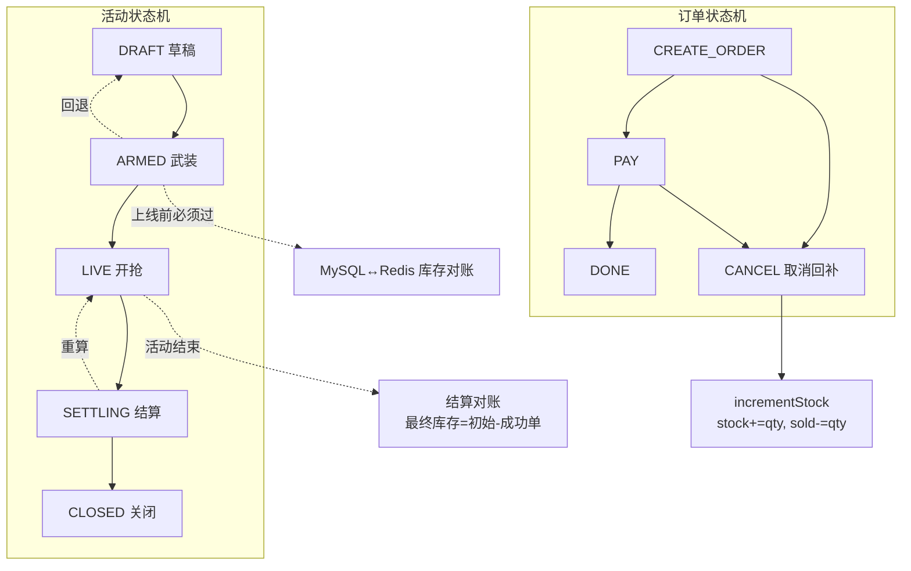

# Phase 6 — 状态机 + 对账（秒杀的"生命周期守门员"与"账房先生"）

> **一句话目标**：给「活动」和「订单」各自装上**状态机**（规定它们只能按规定顺序流转，乱跳直接报错），并给系统配一个**对账服务**（上线前查 MySQL↔Redis 库存对不对，结算时查"最终库存 = 初始库存 - 成功单数"成不成立）。让"状态正确"和"账对得上"变成可证明的事，而不是靠人肉盯着。
>
> 完成本 Phase 后，你的活动从 DRAFT（草稿）到 CLOSED（关闭）每一步都有守卫；任何一个想"跳步/乱回退"的操作都会被状态机拦下；上线前库存对账不过就绝不允许开抢；活动结束能用数学公式证明"没超卖、没少卖"。

---

## 先搞懂：为什么既要状态机又要对账？

Phase 5 结束时，系统能扛高并发读、能挡恶意流量，但还有一个隐患：**没人管"活动走到哪一步了"和"账到底对不对"**。

1. **状态乱跳**：如果有人直接把活动从 DRAFT 改成 CLOSED，或者把已支付订单改成"未支付"，业务就乱套了。我们需要一个"守门员"，规定"现在能去哪、不能去哪"。
2. **账对不上**：秒杀系统里库存存在 MySQL 和 Redis 两份（双写）。万一某次同步出岔子，Redis 说剩 50、MySQL 说剩 49，谁真谁假？活动结束时，你怎么向运营证明"我没超卖"？——靠**对账**：用公式 `最终库存 = 初始库存 - 成功下单数` 反推，算出来对不上就说明有 bug。

**两个武器**：
- **状态机（State Machine）**：把"对象能处的状态"和"状态之间允许的迁转"写死在代码里。任何迁转先查矩阵，非法直接抛异常。
- **对账（Reconciliation）**：定期 / 关键节点（上线前、结算时）盘点 MySQL 与 Redis、盘点库存与订单数，证明数据自洽。

> 📖 **术语大白话**
> - **状态机**：像红绿灯——红灯只能→绿灯，不能→黄灯乱跳。我们用枚举 + 一张"迁转矩阵"实现，代码里写着"DRAFT 下一步只能去 ARMED"。
> - **对账**：像月底盘点——"账上应有 100 件，卖了多少、剩多少，一对发现对不上，就说明中间漏记了"。
> - **活动生命周期**：`DRAFT`（草稿/规划中）→ `ARMED`（武装：库存已预热、对账已过）→ `LIVE`（开抢）→ `SETTLING`（结算对账）→ `CLOSED`（关闭归档）。
> - **订单生命周期**：`PRE_CHECK`(前置校验) → `LOCK_STOCK`(锁库存) → `CREATE_ORDER`(落库) → `PAY`(支付) → `DONE`(完成) / `CANCEL`(取消回补)。
> - **成功单**：对账公式里"算成功"的订单。本项目把 `CANCEL`（已取消并回补库存）排除在外——取消的单不算卖出。
> - **降级（degrade）**：环境不支持某能力时自动换成"次优但可用"的方案。比如本地没 Redis，MySQL↔Redis 对账就降级成"只校验 MySQL 内部库存自洽"。

---

## 架构总览（先看图，再一步步搭）



> 🧠 **理解一下**：这张图把"状态"和"对账"绑在了一起。
> - **活动状态机是"流程守门员"**：每走一步先过矩阵，`DRAFT` 不能直接跳 `CLOSED`，`CLOSED` 是终态不能再动。
> - **对账是"数据守门员"**：进 `ARMED`（上线）前必须 MySQL↔Redis 库存一致；进 `SETTLING`（结算）时必须 `最终库存=初始-成功单` 成立。状态机管"走法对不对"，对账管"数据对不对"，两手都硬。
> - **诚实边界**：spec 路线图里提到的 Redisson 分布式锁，在本项目实际由 Phase 3 的 **Redis+Lua 原子扣减** + Phase 2 的 **DB 条件更新兜底**承载防超卖（Lua 在 Redis 单线程里执行本身就是原子，无需额外锁）。状态机 / 对账是**管理面**操作，用 DB 事务 + `updateById` 即可，不在用户抢购热路径上，本项目未单独引入 Redisson 锁 Bean——如实说明，不虚报。
> - **支付链路**：`PAY→DONE` 属于业务范围红线（M7+ 才做真实支付回调）。本 Phase 只暴露迁转 API 用于演示状态机合法 / 非法迁转，不接真实支付。

---

## 第 0 步：确认目录（Phase 5 留下的骨架）

Phase 5 结束后，项目关键结构（你应当已经具备）：

```
insightforge/
├── insightforge-seckill-core/src/main/java/com/insightforge/seckill/core/
│   ├── redis/{RedisKeys,RedisStockService,RedisConfig,RedisIdempotentService,DeductResult}.java
│   ├── cache/{MultiLevelCache,SkuCacheService}.java      # Phase 5 多级缓存
│   ├── service/SeckillService.java                        # Phase 4 异步快路径 + 同步兜底（建单写 status）
│   ├── state/                                             # ★ Phase 6 新增：状态机
│   └── reconcile/                                         # ★ Phase 6 新增：对账
├── insightforge-api/src/main/java/com/insightforge/api/controller/{SeckillController,ActivityController,OrderController}.java
└── insightforge-persistence/src/main/java/com/insightforge/persistence/{entity,mapper}/
```

本 Phase 我们**新增** 10 个文件（3 状态机 + 2 对账 + 2 服务 + 2 控制器 + 2 测试）+ **修改** 3 个文件（`SeckillService.java` 建单初态、`ActivitySkuMapper.java` 加 `incrementStock`、规划文档）。下面一步步来。

---

## 步骤 1：状态机枚举（活动 + 订单 + 异常）

📖 **概念**：状态机最干净的实现是「枚举 + 一张迁转矩阵」。每个状态知道自己"能去哪些状态"，迁转时用矩阵查一下，非法就抛异常。我们把矩阵放在 `static` 块里装配（规避枚举常量前向引用问题）。

### 1.1 非法迁转异常（守门员的"拒绝票"）

`insightforge-seckill-core/src/main/java/com/insightforge/seckill/core/state/IllegalStateTransitionException.java`：

```java
package com.insightforge.seckill.core.state;

/**
 * 非法状态迁转异常（Phase 6）。
 * 当业务试图把对象从「当前状态」迁到「不被允许的目标状态」时抛出（如 DRAFT 直接 CLOSED）。
 * 单独建类，是为了让上层精准 catch 它返回 409，而不是和数据库异常混在一起。
 */
public class IllegalStateTransitionException extends RuntimeException {
    public IllegalStateTransitionException(String message) {
        super(message);
    }
}
```

### 1.2 活动状态机

`insightforge-seckill-core/src/main/java/com/insightforge/seckill/core/state/ActivityStatus.java`：

```java
package com.insightforge.seckill.core.state;

import java.util.EnumMap;
import java.util.EnumSet;
import java.util.Map;
import java.util.Set;

/**
 * 活动生命周期状态机（Phase 6）：DRAFT → ARMED → LIVE → SETTLING → CLOSED。
 * 数据库 activity.status 存的就是这些大写字符串（与 Phase 1 建表兼容，零类型改动）；
 * 本枚举只在代码层做「合法迁转校验」，是状态一致性的守门员。
 */
public enum ActivityStatus {

    DRAFT, ARMED, LIVE, SETTLING, CLOSED;

    // 迁转矩阵：key=当前状态，value=允许的下一状态集合（静态装配，规避前向引用）
    private static final Map<ActivityStatus, Set<ActivityStatus>> TRANSITIONS = new EnumMap<>(ActivityStatus.class);
    static {
        TRANSITIONS.put(DRAFT, EnumSet.of(ARMED));                 // 草稿只能去武装
        TRANSITIONS.put(ARMED, EnumSet.of(LIVE, DRAFT));           // 武装后可开抢，也可回退重改方案
        TRANSITIONS.put(LIVE, EnumSet.of(SETTLING));               // 开抢中只能去结算
        TRANSITIONS.put(SETTLING, EnumSet.of(CLOSED, LIVE));       // 结算后可关闭，也可退回重算
        TRANSITIONS.put(CLOSED, EnumSet.noneOf(ActivityStatus.class)); // 终态，无去处
    }

    /** 当前状态能否迁到 target（只查矩阵，不抛异常，方便「预判」）。 */
    public boolean canTransitionTo(ActivityStatus target) {
        return TRANSITIONS.get(this).contains(target);
    }

    /** 执行迁转：合法则返回目标；非法抛 IllegalStateTransitionException。 */
    public ActivityStatus transitionTo(ActivityStatus target) {
        if (!canTransitionTo(target)) {
            throw new IllegalStateTransitionException(
                    String.format("活动状态非法迁转：%s → %s（合法下一状态：%s）", this, target, TRANSITIONS.get(this)));
        }
        return target;
    }

    /** 是否终态（无去处）。 */
    public boolean isTerminal() { return TRANSITIONS.get(this).isEmpty(); }

    /** 把 DB 字符串解析成枚举；未知值直接抛异常（防止脏数据绕过状态机）。 */
    public static ActivityStatus from(String status) {
        if (status == null) throw new IllegalStateTransitionException("活动状态为空，无法解析");
        try {
            return ActivityStatus.valueOf(status.trim().toUpperCase());
        } catch (IllegalArgumentException e) {
            throw new IllegalStateTransitionException("未知的活动状态：" + status);
        }
    }
}
```

### 1.3 订单状态机

`insightforge-seckill-core/src/main/java/com/insightforge/seckill/core/state/OrderStatus.java`（结构与 `ActivityStatus` 一致，迁转矩阵不同）：

```java
package com.insightforge.seckill.core.state;

import java.util.EnumMap;
import java.util.EnumSet;
import java.util.Map;
import java.util.Set;

/**
 * 订单生命周期状态机（Phase 6）。
 * PRE_CHECK → LOCK_STOCK → CREATE_ORDER → PAY → DONE，任意非终态可 → CANCEL。
 * 本项目下单落库即 CREATE_ORDER（PRE_CHECK/LOCK_STOCK 是内存瞬态，不落库）；
 * PAY→DONE 仅演示迁转（真实支付延后 M7+）。对账时「成功单」= status != CANCEL 的订单。
 */
public enum OrderStatus {

    PRE_CHECK, LOCK_STOCK, CREATE_ORDER, PAY, DONE, CANCEL;

    private static final Map<OrderStatus, Set<OrderStatus>> TRANSITIONS = new EnumMap<>(OrderStatus.class);
    static {
        TRANSITIONS.put(PRE_CHECK, EnumSet.of(LOCK_STOCK));
        TRANSITIONS.put(LOCK_STOCK, EnumSet.of(CREATE_ORDER, CANCEL));
        TRANSITIONS.put(CREATE_ORDER, EnumSet.of(PAY, CANCEL));
        TRANSITIONS.put(PAY, EnumSet.of(DONE, CANCEL));
        TRANSITIONS.put(DONE, EnumSet.noneOf(OrderStatus.class));   // 终态
        TRANSITIONS.put(CANCEL, EnumSet.noneOf(OrderStatus.class)); // 终态
    }

    public boolean canTransitionTo(OrderStatus target) { return TRANSITIONS.get(this).contains(target); }

    public OrderStatus transitionTo(OrderStatus target) {
        if (!canTransitionTo(target)) {
            throw new IllegalStateTransitionException(
                    String.format("订单状态非法迁转：%s → %s（合法下一状态：%s）", this, target, TRANSITIONS.get(this)));
        }
        return target;
    }

    public boolean isTerminal() { return TRANSITIONS.get(this).isEmpty(); }

    public static OrderStatus from(String status) {
        if (status == null) throw new IllegalStateTransitionException("订单状态为空，无法解析");
        try {
            return OrderStatus.valueOf(status.trim().toUpperCase());
        } catch (IllegalArgumentException e) {
            throw new IllegalStateTransitionException("未知的订单状态：" + status);
        }
    }
}
```

> 🧠 **理解一下**：为什么用 `EnumMap` + `static` 块而不是在枚举常量里直接 `EnumSet.of(ARMED)`？因为 Java 要求枚举常量必须最先声明，`DRAFT(EnumSet.of(ARMED))` 里的 `ARMED` 还没声明出来，会编译报错。`static` 块在类加载末尾执行，那时所有常量都已存在，完美避开这个坑。这是状态机实现里一个很常见的实战细节。

---

## 步骤 2：对账报告 + 对账服务

📖 **概念**：对账就是把"盘点结果"结构化——每个被检查的维度一条明细（`ReconcileItem`），整体 `passed` = 所有明细都 ok。`ReconcileService` 是"账房先生"，提供两类对账。

### 2.1 对账明细项与报告

`insightforge-seckill-core/src/main/java/com/insightforge/seckill/core/reconcile/ReconcileItem.java`：

```java
package com.insightforge.seckill.core.reconcile;

import lombok.AllArgsConstructor;
import lombok.Data;

/** 对账明细项：dimension=维度名，ok=是否通过，detail=人读明细。 */
@Data
@AllArgsConstructor
public class ReconcileItem {
    private String dimension;  // 如 "mysql-redis:1"（SKU1 的 MySQL↔Redis 比对）
    private boolean ok;        // 这一项是否通过
    private String detail;     // 明细，如 "db_stock=100, redis_stock=100"
}
```

`insightforge-seckill-core/src/main/java/com/insightforge/seckill/core/reconcile/ReconcileReport.java`：

```java
package com.insightforge.seckill.core.reconcile;

import lombok.Data;
import java.util.ArrayList;
import java.util.List;

/**
 * 对账报告（Phase 6）：一次对账检查多个维度，整体 passed = 所有明细都 ok。
 * 任一项不 ok，passed 立刻变 false，活动就不能上线 / 必须人工介入。
 */
@Data
public class ReconcileReport {
    private boolean passed = true;          // 整体是否通过（初始 true；任一明细 false 即置 false）
    private String activityStatus;          // 触发对账时活动的状态
    private List<ReconcileItem> items = new ArrayList<>();

    /** 追加一条明细；若该项不通过，整体 passed 立刻标记为 false。 */
    public void add(ReconcileItem item) {
        items.add(item);
        if (!item.isOk()) passed = false;
    }
}
```

### 2.2 对账服务（核心逻辑）

`insightforge-seckill-core/src/main/java/com/insightforge/seckill/core/reconcile/ReconcileService.java`（关键片段）：

```java
@Service
public class ReconcileService {
    private final ActivitySkuMapper skuMapper;
    private final OrdersMapper ordersMapper;
    private final ObjectProvider<RedisStockService> redisStockService; // local 下为 null

    public ReconcileService(ActivitySkuMapper skuMapper, OrdersMapper ordersMapper,
                            ObjectProvider<RedisStockService> redisStockService) {
        this.skuMapper = skuMapper; this.ordersMapper = ordersMapper; this.redisStockService = redisStockService;
    }

    /** 维度一：上线前 MySQL↔Redis 库存一致性。Redis 不可用则降级为 DB 内部校验。 */
    public ReconcileReport reconcileStockConsistency(long activityId) {
        ReconcileReport report = new ReconcileReport();
        List<ActivitySku> skus = skuMapper.selectList(new QueryWrapper<ActivitySku>().eq("activity_id", activityId));
        RedisStockService rs = redisStockService.getIfAvailable();
        if (rs == null) {
            report.add(new ReconcileItem("mysql-redis", true, "Redis 不可用（local）：跳过比对，降级校验 DB 内部库存"));
            for (ActivitySku sku : skus) {
                boolean dbOk = sku.getStock() >= 0 && sku.getStock() <= sku.getTotalStock()
                        && (sku.getTotalStock() - sku.getStock()) == sku.getSold();
                report.add(new ReconcileItem("db-internal:" + sku.getId(), dbOk,
                        String.format("total=%d, stock=%d, sold=%d", sku.getTotalStock(), sku.getStock(), sku.getSold())));
            }
            return report;
        }
        for (ActivitySku sku : skus) { // 非 local：真比 MySQL 与 Redis 的剩余库存
            int redisStock = rs.getStock(activityId, sku.getId());
            boolean ok = redisStock == sku.getStock(); // Redis 未预热返回 -1，会被判为不一致 → 阻断上线
            report.add(new ReconcileItem("mysql-redis:" + sku.getId(), ok,
                    String.format("db_stock=%d, redis_stock=%d", sku.getStock(), redisStock)));
        }
        return report;
    }

    /** 维度二：结算对账 最终库存 = 初始库存 - 成功下单数（成功单 = 非 CANCEL 订单）。 */
    public ReconcileReport reconcileFinalStock(long activityId) {
        ReconcileReport report = new ReconcileReport();
        List<ActivitySku> skus = skuMapper.selectList(new QueryWrapper<ActivitySku>().eq("activity_id", activityId));
        for (ActivitySku sku : skus) {
            long successOrders = ordersMapper.selectCount(new QueryWrapper<Orders>()
                    .eq("activity_id", activityId).eq("sku_id", sku.getSkuId())
                    .ne("status", OrderStatus.CANCEL.name())); // CANCEL 不算成功
            int expectedStock = sku.getTotalStock() - (int) successOrders;
            boolean ok = expectedStock == sku.getStock();
            report.add(new ReconcileItem("final-stock:" + sku.getId(), ok,
                    String.format("total=%d, successOrders=%d, expectedStock=%d, actualStock=%d",
                            sku.getTotalStock(), successOrders, expectedStock, sku.getStock())));
        }
        return report;
    }
}
```

> 🧠 **理解一下**：为什么 Redis 未预热（`getStock` 返回 -1）要判为"不一致、阻断上线"？因为上线前必须保证 Redis 里的库存是准的——宁可错杀（不让上线）也不放过一个脏数据。宁可报错让人来修，也比带着错误库存开抢强。

---

## 步骤 3：活动状态机服务（把"状态"和"对账"绑死）

📖 **概念**：`ActivityService` 是活动状态机的"执行者"。每个操作先过 `transitionTo` 校验，再干正事；`arm`（上线）前置对账闸门，`settle`（结算）跑结算对账。

`insightforge-seckill-core/src/main/java/com/insightforge/seckill/core/service/ActivityService.java`（关键片段）：

```java
@Service
public class ActivityService {
    private final ActivityMapper activityMapper;
    private final ReconcileService reconcileService;

    public ActivityService(ActivityMapper activityMapper, ReconcileService reconcileService) {
        this.activityMapper = activityMapper; this.reconcileService = reconcileService;
    }

    private Activity require(long activityId) {
        Activity a = activityMapper.selectById(activityId);
        if (a == null) throw new IllegalArgumentException("活动不存在：id=" + activityId);
        return a;
    }

    /** DRAFT → ARMED：上线前强制对账，不过绝不写 ARMED（宁可阻断不上线）。 */
    @Transactional
    public ApiResult<ReconcileReport> arm(long activityId) {
        Activity a = require(activityId);
        ActivityStatus next = ActivityStatus.from(a.getStatus()).transitionTo(ActivityStatus.ARMED); // 非法迁转抛异常
        ReconcileReport report = reconcileService.reconcileStockConsistency(activityId);
        if (!report.isPassed()) return ApiResult.fail(409, "库存对账未通过，禁止上线（ARMED）");
        a.setStatus(next.name());
        activityMapper.updateById(a);
        return ApiResult.ok(report);
    }

    @Transactional public ApiResult<Void> goLive(long activityId) { /* ARMED→LIVE，同上套路 */ }
    @Transactional public ApiResult<Void> close(long activityId)  { /* SETTLING→CLOSED */ }

    /** LIVE → SETTLING：跑结算对账，把差异暴露出来（即便有差异也进入 SETTLING 待复盘）。 */
    @Transactional
    public ApiResult<ReconcileReport> settle(long activityId) {
        Activity a = require(activityId);
        ActivityStatus.from(a.getStatus()).transitionTo(ActivityStatus.SETTLING);
        ReconcileReport report = reconcileService.reconcileFinalStock(activityId);
        a.setStatus(ActivityStatus.SETTLING.name());
        activityMapper.updateById(a);
        return ApiResult.ok(report);
    }

    /** 一键查看两类对账（不改状态）。 */
    public ApiResult<ReconcileReport> reconcile(long activityId) { /* 合并两个报告返回 */ }
}
```

> 🧠 **理解一下**：`arm` 里"对账不过就返回 409、不改状态"——这是状态机和对账**联动**的精髓：上线这件事，必须"状态合法 **且** 账对得上"两个条件同时成立。少一个都不行。这正是把"流程正确"和"数据正确"绑死的设计。

---

## 步骤 4：订单状态机服务 + 库存回补

📖 **概念**：`OrderStateService` 演示订单生命周期迁转，并实现唯一有真实副作用的操作——**取消订单并回补库存**。回补用 `incrementStock`（与 Phase 2 的 `decrementStock` 对称，条件 `sold >= qty` 防扣成负）。

先给 Mapper 加回补方法 `insightforge-persistence/.../mapper/ActivitySkuMapper.java`：

```java
    /** Phase 6：库存回补（订单取消时用）。stock+=qty, sold-=qty，WHERE 加 sold>=qty 防负。 */
    @Update("UPDATE activity_sku SET stock = stock + #{qty}, sold = sold - #{qty} " +
            "WHERE id = #{id} AND sold >= #{qty}")
    int incrementStock(@Param("id") Long id, @Param("qty") int qty);
```

`insightforge-seckill-core/src/main/java/com/insightforge/seckill/core/service/OrderStateService.java`（关键片段）：

```java
@Service
public class OrderStateService {
    private final OrdersMapper ordersMapper;
    private final ActivitySkuMapper skuMapper;
    private final SkuCacheService skuCacheService;

    /** 取消订单：CREATE_ORDER/PAY → CANCEL，并回补库存。幂等（已取消直接返回）；DONE 不允许取消。 */
    @Transactional
    public ApiResult<Void> cancel(String orderId) {
        Orders order = ordersMapper.selectOne(new QueryWrapper<Orders>().eq("order_id", orderId));
        if (order == null) return ApiResult.fail(404, "订单不存在");
        OrderStatus cur = OrderStatus.from(order.getStatus());
        if (cur == OrderStatus.CANCEL) return ApiResult.ok(null); // 幂等
        cur.transitionTo(OrderStatus.CANCEL); // DONE 会抛非法迁转异常

        ActivitySku sku = skuMapper.selectOne(new QueryWrapper<ActivitySku>()
                .eq("activity_id", order.getActivityId()).eq("sku_id", order.getSkuId()));
        int aff = skuMapper.incrementStock(sku.getId(), order.getQty()); // 回补库存
        if (aff == 0) return ApiResult.fail(409, "库存回补失败（sold 不足，可能已回补）");
        order.setStatus(OrderStatus.CANCEL.name());
        ordersMapper.updateById(order);
        skuCacheService.evict(order.getSkuId());
        return ApiResult.ok(null);
    }

    /** 标记支付（仅演示迁转，无真实支付）：CREATE_ORDER → PAY → DONE。 */
    @Transactional
    public ApiResult<Void> markPaid(String orderId) {
        Orders order = ordersMapper.selectOne(new QueryWrapper<Orders>().eq("order_id", orderId));
        if (order == null) return ApiResult.fail(404, "订单不存在");
        OrderStatus.from(order.getStatus()).transitionTo(OrderStatus.PAY).transitionTo(OrderStatus.DONE);
        order.setStatus(OrderStatus.DONE.name());
        ordersMapper.updateById(order);
        return ApiResult.ok(null);
    }
}
```

> 🧠 **理解一下**：`cancel` 取消一张订单，必须把它当初扣掉的库存**加回来**（stock+1, sold-1），否则这张单不卖了但库存却少了，下次对账就会"账对不上"。这就是为什么取消要回补——它和对账公式是闭环的。

---

## 步骤 5：订单初始状态接入（最小改动，守热路径纪律）

📖 **概念**：Phase 4 建单时把 `status` 写成字符串 `"CREATED"`（占位）。现在让它在状态机里有正式身份——落库即 `CREATE_ORDER`（代表"下单成功、库存已锁"）。这是一处**最小改动**，不碰扣减/幂等/异步热路径。

`insightforge-seckill-core/src/main/java/com/insightforge/seckill/core/service/SeckillService.java` 里 `syncCreateOrder` 方法中：

```java
        order.setQty(req.getQty());
        // 订单落库即进入状态机的第一个持久状态 CREATE_ORDER（代表「下单成功、库存已锁」）。
        // PRE_CHECK / LOCK_STOCK 是在内存里完成的前置瞬态，不落库。
        order.setStatus(OrderStatus.CREATE_ORDER.name()); // 原为 "CREATED"
        order.setCreatedAt(LocalDateTime.now());
```

并在文件顶部 import 加上：`import com.insightforge.seckill.core.state.OrderStatus;`

---

## 步骤 6：控制器端点（把状态机 / 对账暴露成 HTTP）

📖 **概念**：在 api 模块新增两个 Controller，把活动与订单的状态机迁转、对账查看暴露成 REST 接口。

`insightforge-api/src/main/java/com/insightforge/api/controller/ActivityController.java`：

```java
@RestController
@RequestMapping("/api/activity")
public class ActivityController {
    private final ActivityService activityService;
    public ActivityController(ActivityService activityService) { this.activityService = activityService; }

    @PostMapping("/{id}/arm")      public ApiResult<ReconcileReport> arm(@PathVariable long id) { return activityService.arm(id); }
    @PostMapping("/{id}/live")     public ApiResult<Void> live(@PathVariable long id) { return activityService.goLive(id); }
    @PostMapping("/{id}/settle")   public ApiResult<ReconcileReport> settle(@PathVariable long id) { return activityService.settle(id); }
    @PostMapping("/{id}/close")    public ApiResult<Void> close(@PathVariable long id) { return activityService.close(id); }
    @GetMapping("/{id}/reconcile") public ApiResult<ReconcileReport> reconcile(@PathVariable long id) { return activityService.reconcile(id); }
}
```

`insightforge-api/src/main/java/com/insightforge/api/controller/OrderController.java`：

```java
@RestController
@RequestMapping("/api/order")
public class OrderController {
    private final OrderStateService orderStateService;
    public OrderController(OrderStateService orderStateService) { this.orderStateService = orderStateService; }

    @PostMapping("/{orderId}/cancel") public ApiResult<Void> cancel(@PathVariable String orderId) { return orderStateService.cancel(orderId); }
    @PostMapping("/{orderId}/pay")    public ApiResult<Void> pay(@PathVariable String orderId) { return orderStateService.markPaid(orderId); }
}
```

---

## 步骤 7：测试（状态机 + 对账）

📖 **概念**：状态机测试是纯逻辑（不依赖 Spring），直接验证"合法迁转放行、非法抛异常"。对账测试用 `JdbcTemplate` 以**显式大 id（99001）**插入隔离的活动/SKU——因为实体基类是 `@TableId(AUTO)`，MyBatis-Plus 会忽略实体里的 id 让数据库自增，而 data.sql 种子显式写了 id=1 导致自增序列没推进，测试若用 Mapper 自增分配又从 1 开始会撞主键。显式大 id 彻底绕开这个问题，**绝不和 NoOversellTest 抢同一个 SKU（id=1）**，保证互不干扰。

- `ActivityStateMachineTest`：活动/订单状态机共 **8** 个用例（合法迁转、非法抛异常、终态、脏数据解析）。
- `ReconcileTest`（local profile，H2 内存库）：**4** 个用例——30 单后结算对账通过 / 制造不一致被检出 / 取消单不计入成功单 / local 下降级对账通过。

---

## 验证：跑起来看效果

### 7.1 单元测试 + 集成测试全绿

项目根目录执行（沙箱用 classworlds 启动器，路径用 Windows 风格 `D:/...`）：

```bash
cd D:/Java/insightforge
MVN_HOME="D:/devtools/maven/apache-maven-3.9.9"
/d/devtools/jdk21/jdk-21.0.12+8/bin/java \
  -classpath "$MVN_HOME/boot/plexus-classworlds-2.8.0.jar" \
  -Dclassworlds.conf="$MVN_HOME/bin/m2.conf" \
  -Dmaven.home="$MVN_HOME" \
  -Dmaven.multiModuleProjectDirectory="D:/Java/insightforge" \
  -Dlibrary.jansi.path="$MVN_HOME/lib/jansi-native" \
  org.codehaus.plexus.classworlds.launcher.Launcher clean package -B
```

**期望输出（关键行）**：

```
[INFO] Results:
[INFO] Tests run: 25, Failures: 0, Errors: 0, Skipped: 0
[INFO] BUILD SUCCESS
```

> 25 = 原有 12（NoOversell/Idempotency/RedisLua×4/Cache×3/RateLimit×3）+ Phase 6 状态机 9（`ActivityStateMachineTest`）+ 对账 4（`ReconcileTest`）。全部通过代表：状态机矩阵正确、对账公式成立、且与已有"防超卖回归测试"和平共处。

### 7.2 手动演示状态机迁转（需先以 redis profile 启动，或直接看单元测试结论）

如果本地起了 MySQL+Redis（`--spring.profiles.active=redis`），可以用 curl 走一遍活动生命周期：

```bash
# 1) 草稿 → 武装（内部跑 MySQL↔Redis 对账，过了才 ARMED）
curl -X POST http://localhost:8080/api/activity/1/arm
# 返回 ApiResult{code=200, data={passed:true, items:[...]}}，活动变为 ARMED

# 2) 武装 → 开抢
curl -X POST http://localhost:8080/api/activity/1/live

# 3) 模拟抢了一批后，结算（跑 最终库存=初始-成功单 对账）
curl -X POST http://localhost:8080/api/activity/1/settle
# 返回 data 里能看到每个 SKU 的 expectedStock vs actualStock

# 4) 关闭归档
curl -X POST http://localhost:8080/api/activity/1/close

# 5) 随时查看两类对账（不改状态）
curl http://localhost:8080/api/activity/1/reconcile
```

验证"乱跳被拦"：直接对 `DRAFT` 状态的活动调 `/close`（跳过中间步骤），会返回 409 + 非法迁转提示——状态机守门员生效。

---

## 排错表（按现象查）

| 现象 | 可能原因 | 排查 / 修复 |
|---|---|---|
| 调 `arm` 返回 409「库存对账未通过」 | Redis 里库存与 MySQL 不一致（或 Redis 未预热返回 -1） | 先调 `/preheat/{skuId}` 预热；确认 Redis 与 DB 库存一致再 arm |
| 调 `close` 返回 500 / 非法迁转异常 | 活动不是 `SETTLING` 状态就直接关 | 必须按 DRAFT→ARMED→LIVE→SETTLING→CLOSED 顺序走，不能跳步 |
| 订单 `cancel` 返回 409「库存回补失败」 | 该订单已取消过（sold 已减，再次减变负被条件拦） | 正常幂等保护；重复取消本就返回 ok，若仍 409 检查是否并发取消 |
| `markPaid` 对已 CANCEL 订单返回异常 | 状态机不允许 CANCEL→DONE | 取消的单不能"复活"成已支付，符合业务常识 |
| 构建报 `cannot find symbol OrderStatus` | SeckillService 没加 import | 在 SeckillService 顶部加 `import com.insightforge.seckill.core.state.OrderStatus;` |
| ReconcileTest 把 NoOversellTest 搞红 | 共用同一 SKU / 自增序列撞种子 id=1 | 本项目用 `JdbcTemplate` 显式大 id（99001）插入隔离活动/SKU，绕开 `@TableId(AUTO)` 自增撞种子 id=1，不碰 seeds |

---

## 下一步预告（Phase 7）

Phase 6 把"状态正确 + 账对得上"钉死了。Phase 7 进入真正的 **Agent Core（自研 Agent 运行时）**——我们要搭一个最小可用的 Agent 循环：能**规划（Plan）→ 调工具（Tool）→ 召回记忆（Memory）→ 反思重试（Reflect）**，并把每一次 Agent 运行都记成 **Trace**（为 Phase 10 的可观测大屏和 Phase 11 的评估闭环埋点）。同时 Phase 7 会把本 Phase 的状态机三态（`SUCCESS`/`CORRECT_FAILURE`/`FAILED`）和预算闸门落进 Agent 控制面——Agent 不再是"黑盒对话"，而是"可观测、可评估、可回滚"的工程组件。

> 提示：Phase 7 起进入 M3（Agent Core），技术栈会从"纯后端高并发"扩展到"LLM 智能体运行时"，记得先确认 DeepSeek / Spring AI 的依赖接入方式。
