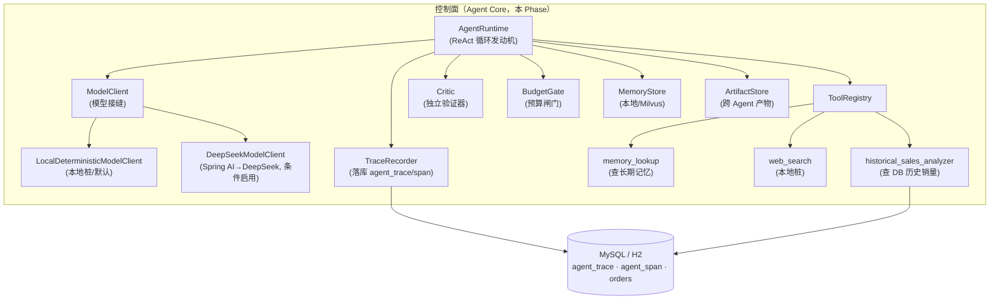

# Phase 7 — Agent Core 自研运行时（M3）

> 配套代码：`insightforge-agent-core/`（新建模块）。本 Phase 给"AI 辅助"打底座——一个**能调工具、会记忆、能反思**的自研 Agent 运行时，并且从第一行就内建监测（Trace 落库 + 预算闸门 + 三态状态机）。
> 全部代码已在仓库带逐行中文注释；本教程按"先搞懂 → 看架构 → 走读关键代码 → 自己跑一遍 → 排错"的顺序带你过一遍。

---

## 0. 先搞懂：这一 Phase 在解决什么（大白话）

前面 Phase 1–6 的秒杀是**确定性系统**：库存怎么扣、状态怎么流转，都是写死的代码。
从 Phase 7 起，我们要让系统"会思考"——**自动产出选品/定价/库存方案**，而不是运营手工配。

但"AI 聪明"有个大问题：**它靠不靠谱？出错了怎么办？** 所以本 Phase 的核心不是"接个大模型"，而是：

1. **工具系统**：Agent 不能瞎编，它能做的事被严格声明成"工具"（查历史销量、查记忆、联网比价），调之前先过 JSON Schema 校验。
2. **记忆机制**：短期（当前对话窗口）+ 长期（历史活动方案，生产用 Milvus 向量库）+ 跨 Agent 共享（Artifact 产物）。
3. **反思重试（Critic）**：Agent 产出的方案先给一个"独立审核员"Critic 校验（售价≥成本？库存不透支？），不通过就打回去重做，最多 3 次。
4. **监测内建（重点）**：每一次运行都生成一条 `trace` + 一串 `span` 落库 MySQL——事后可查、可重放、可算"正确失败率"。预算闸门保证它**不会无节制烧钱**。

> 🔑 一句话定位：本 Phase 的 Agent 跑在**控制面（离线规划）**，LLM 只在"思考"这一步出现；它产出的是**方案 JSON**，绝不直接改秒杀库存。改库存那是热路径 + 护栏规则引擎的事（Phase 9）。这就是本项目"控制面/数据面分离、LLM 不进热路径"的灵魂。

---

## 1. 架构图：Agent 一次运行的闭环



**怎么读这张图**：`AgentRuntime` 是发动机，它每轮「调模型(MC) → 要调工具就走 ToolRegistry → 出方案就交给 Critic 审 → 审不过就重试」。全程被 `BudgetGate` 盯着花钱，最后 `TraceRecorder` 把整件事写进 `agent_trace`/`agent_span`。模型这一层（`ModelClient`）是**唯一**和具体 LLM 耦合的地方——换 DeepSeek 只换一个实现类。

---

## 2. 动手前：模块与依赖（最小功能起步）

### 2.1 新建模块 `insightforge-agent-core`

在仓库根 `pom.xml` 的 `<modules>` 追加一行（已加好）：

```xml
<module>insightforge-agent-core</module>
```

新建 `insightforge-agent-core/pom.xml`，关键依赖（完整见仓库）：

```xml
<dependencies>
    <dependency><groupId>com.insightforge</groupId><artifactId>insightforge-persistence</artifactId></dependency>
    <dependency><groupId>org.springframework.boot</groupId><artifactId>spring-boot-starter</artifactId></dependency>
    <dependency><groupId>com.baomidou</groupId><artifactId>mybatis-plus-boot-starter</artifactId></dependency>
    <!-- 工具参数 JSON Schema 校验（L1 指标：参数 Schema 合规率 100%） -->
    <dependency><groupId>com.networknt</groupId><artifactId>json-schema-validator</artifactId><version>1.5.6</version></dependency>
    <!-- Spring AI 接 DeepSeek（仅生产启用，本地用本地桩） -->
    <dependency><groupId>org.springframework.ai</groupId><artifactId>spring-ai-openai</artifactId></dependency>
    <dependency><groupId>com.h2database</groupId><artifactId>h2</artifactId><scope>test</scope></dependency>
    <dependency><groupId>org.springframework.boot</groupId><artifactId>spring-boot-starter-test</artifactId><scope>test</scope></dependency>
</dependencies>
```

📖 **概念**：Spring AI 版本我们锁定 `1.0.0-M6`（根 POM `spring-ai.version`），因为它和本项目的 Spring Boot 3.3.5 / Spring 6.1 兼容；GA(1.0.0) 需要 Spring 6.2，会编译失败。**只在这一处用 Spring AI 接模型，其余运行时全是自研**——这就是 spec 要求的"Agent 核心自研，仅用 Spring AI 接模型"。

### 2.2 持久层：两张监测表

`agent_trace`（一次运行）与 `agent_span`（每个步骤）已加进 `insightforge-api/src/main/resources/schema.sql`（完整应用用），结构见 `agent-observability-evaluation.md §2`。测试用独立副本在 `insightforge-agent-core/src/test/resources/schema-agent.sql`。

---

## 3. 关键代码走读（带注释的核心）

> 下面的类是"骨架级"重点，完整 30+ 个文件都在 `insightforge-agent-core/src/main/java/com/insightforge/agent/core/` 下，每个都带逐行注释。

### 3.1 模型接缝 `ModelClient`（换模型只换这一处）

```java
// ModelClient.java —— Agent 与具体 LLM 之间唯一的接缝
public interface ModelClient {
    ModelResponse generate(ModelRequest req);
}
```

两个实现：
- `LocalDeterministicModelClient`（**默认**，`@Primary`）：离线桩，不联网。它按固定启发式干活——第一轮先请求调 `historical_sales_analyzer` 取数，看到工具结果后再产出方案 JSON。目的是让整条管线在**无网络、无 API Key** 的本地/测试环境也能跑通并演示完整闭环。
- `DeepSeekModelClient`（`@ConditionalOnProperty(enabled=true)` 才装配）：生产用，通过 Spring AI 的 `OpenAiApi` 调 DeepSeek（`https://api.deepseek.com`，OpenAI 兼容协议）。切换只靠配置，运行时一行不动。

🧠 **理解一下**：为什么不直接在本地也调真 DeepSeek？因为沙箱无外网 + 没有 Key，且教学要"可复现"。把不确定性推理换成确定性脚本，但**工具执行、Critic 校验、重试、Trace 落库全是真的**——这才是教学价值。

### 3.2 工具系统：声明 + 校验 + 执行

工具接口（`Tool.java`）：每个工具用 **JSON Schema** 声明参数，运行时先校验再执行。

```java
public interface Tool {
    String name();
    String description();
    String parametersJson();                 // 参数 JSON Schema
    ToolResult execute(Map<String,Object> args, ToolContext ctx);
}
```

参数校验（`ParameterValidator.java`，用 networknt）：

```java
public static List<String> validate(String jsonSchema, Map<String,Object> args) {
    List<String> errors = new ArrayList<>();
    JsonNode schemaNode = OBJECT_MAPPER.readTree(jsonSchema);
    JsonNode dataNode   = OBJECT_MAPPER.valueToTree(args);
    // 纯 Java 确定性校验：不合规参数直接打回，绝不拿脏参数碰业务
    for (ValidationMessage m : FACTORY.getSchema(schemaNode).validate(dataNode)) {
        errors.add(m.getMessage());
    }
    return errors;
}
```

三个内置工具：`historical_sales_analyzer`（**真实查 DB** 算销量/GMV/售罄率）、`memory_lookup`（查历史方案）、`web_search`（本地桩，诚实标注未联网）。

### 3.3 运行时发动机 `AgentRuntime`（ReAct 循环）

这是最核心的 ~120 行，循环骨架（完整见仓库，含逐行注释）：

```java
public Trace run(AgentTask task) {
    // 1) 初始化：traceId、短期记忆、预算闸门清零
    ShortTermMemory stm = new ShortTermMemory();
    budgetGate.reset();
    stm.add(ChatMessage.system(buildSystemPrompt()));
    stm.add(ChatMessage.user("目标: " + task.goal()));

    for (int step = 1; step <= budgetGate.getMaxSteps(); step++) {
        // 2) 护栏①：预算闸门（每步前检查 token/延迟）
        budgetGate.assertWithinBudget();                 // 超限抛异常 → 优雅 ESCALATE

        // 3) 思考：调模型
        ModelResponse resp = modelClient.generate(new ModelRequest(stm.messages(), ...));
        budgetGate.addTokens(resp.tokenIn(), resp.tokenOut());
        tb.addSpan(Span.model(...));                     // 记录建模 span

        // 4) 工具循环：模型要调工具就执行，观察回灌记忆
        if (resp.toolCall() != null) {
            tb.addSpan(executeTool(...));                // 内部先校验 Schema 再执行
            continue;
        }

        // 5) 最终答案 → Critic 独立校验
        CriticVerdict v = critic.verifyPlan(resp.content());
        if (v.pass()) {                                  // 成功：方案存 Artifact
            artifactStore.put(Artifact.of("plan-"+traceId, "plan", resp.content()));
            return terminate(..., SUCCESS, null, false);
        }
        // 6) 反思重试：不通过就打回，最多 maxRetry=3 次
        if (tb.retryCount() < budgetGate.getMaxRetry()) {
            stm.add(ChatMessage.user("Critic 未通过，请修订：" + v.reasons()));
            tb.incRetry(); continue;
        }
        // 7) 重试耗尽 → 正确失败（拒绝交付不合规方案，比假装成功可靠）
        return terminate(..., CORRECT_FAILURE, REFUSE, true);
    }
}
```

🧠 **理解一下**：注意第 7 步——方案不合规、改了 3 次还不对，Agent **主动拒绝交付**并标记为 `CORRECT_FAILURE`。这正是监测设计文档强调的"**正确失败率**"：失败的"对"，比编造成功更有价值。

### 3.4 Critic（独立验证器，第一道确定性校验）

```java
// Critic.java —— 能程序判定的绝不先问模型
public CriticVerdict verifyPlan(String planJson) {
    // 售价 repriceTo 必须 ≥ 成本 costFloor
    if (repriceTo < costFloor) reasons.add("售价 < 成本（违反护栏）");
    // 再分配数量 amount 必须 ≥ 0（库存不可透支）
    if (amount < 0) reasons.add("再分配数量为负（违反护栏）");
    return reasons.isEmpty() ? CriticVerdict.pass()
                             : CriticVerdict.fail(reasons, 0.97, "HIGH");
}
```

### 3.5 三态状态机 + Trace 落库（监测内建）

一次运行结束于三态之一（写进 `agent_trace.status`）：

| 终态 | 含义 | 计入正确失败率 |
|---|---|---|
| `SUCCESS` | 产出有效方案 + Critic 通过 | 否 |
| `CORRECT_FAILURE` | 主动正确终止（ASK/REFUSE/ESCALATE） | **是（好的失败）** |
| `FAILED` | 崩溃/超时/预算耗尽未优雅降级 | 否（坏的失败，必须修） |

`TraceRecorder.persistTrace(...)` 把 `Trace` + 所有 `Span` 写进 MySQL——这就是"状态外化"，事后可查、可重放、可沉淀回归评估集（Phase 11）。

📖 **概念**：`Trace` = 一次运行；`Span` = 运行里的每一步（建模/工具/Critic）。两者通过 `trace_id` 关联，构成一棵可回放的"做了什么"的证据链。

---

## 4. 自己跑一遍（验证）

```bash
# 仓库根目录，用沙箱 classworlds 启动器（Windows 路径）
MVN_HOME="D:/devtools/maven/apache-maven-3.9.9"
java -classpath "$MVN_HOME/boot/plexus-classworlds-2.8.0.jar" \
  -Dclassworlds.conf="$MVN_HOME/bin/m2.conf" -Dmaven.home="$MVN_HOME" \
  -Dmaven.multiModuleProjectDirectory="D:/Java/insightforge" \
  -Dlibrary.jansi.path="$MVN_HOME/lib/jansi-native" \
  org.codehaus.plexus.classworlds.launcher.Launcher clean package -B
```

**期望输出（关键行）**：

```
[INFO] Tests run: 34, Failures: 0, Errors: 0, Skipped: 0   ← 25(旧) + 9(Phase7) 全绿
```

Phase 7 新增的 9 个测试（集中在 `insightforge-agent-core` 模块）：

| 测试类 | 覆盖 | 数量 |
|---|---|---|
| `ToolRegistryTest` | 工具注册 / JSON Schema 合规与违规 / 工具真实查 DB 写 Artifact | 4 |
| `AgentRuntimeTest` | SUCCESS 路径（建模→工具→Critic→落库） | 1 |
| `AgentRuntimeRejectTest` | Critic 拒绝 → CORRECT_FAILURE / REFUSE（验证落库） | 1 |
| `AgentRuntimeBudgetTest` | 预算 token 超限 → CORRECT_FAILURE / ESCALATE（验证落库） | 1 |
| `BudgetGateTest` | token 超限 / 延迟超限触发优雅停止 | 2 |

> 注：原来把"拒绝 / 预算"两条路径都塞在 `AgentRuntimeTest` 里、`@TestPropertySource` 写在方法上会编译报错（该注解只能用在类级），所以拆成了 3 个独立测试类，每个类用类级 `@TestPropertySource` 覆盖对应开关。

**手动验证落库**（可选）：在 `AgentRuntimeTest` 跑完后，H2 里能看到 `agent_trace` 一行 + `agent_span` 多行；SUCCESS 路径至少有「建模 + 工具 + Critic」三个 span。

---

## 5. 排错表（按现象查）

| 现象 | 可能原因 | 处置 |
|---|---|---|
| 构建报 `Cannot resolve org.springframework.ai:spring-ai-openai:1.0.0` | Spring AI 版本与 Boot 3.3.5 不匹配 | 确认根 POM `spring-ai.version=1.0.0-M6`（已设）；M6 才兼容 Spring 6.1 |
| 测试起不来，报 `unique constraint` / 重复主键 | 多测试上下文共享同一 H2 内存库，种子重复插入 | 测试数据源 URL 已加 `${random.int}` 后缀隔离（见 application-test.yml） |
| `historical_sales_analyzer` 返回空 | 活动的历史订单没种子 | 检查 `data-agent.sql` 是否插入了 `activity_id=1` 的订单 |
| Critic 一直拒绝、跑成 CORRECT_FAILURE | 本地模型桩被设了 `force-invalid-plan=true` | 那是专门演示"拒绝路径"的开关，正常应为 false |
| 想接真 DeepSeek | 默认用本地桩，不联网 | 设 `insightforge.agent.deepseek.enabled=true` + 环境变量 `DEEPSEEK_API_KEY` |
| 全部用到 `AgentCoreTestConfig` 的测试报 `Failed to load ApplicationContext`，根因 `NoClassDefFoundError: jakarta/websocket/Endpoint` 或 `No bean named 'webHandler' available` | `spring-ai-retry` 传递引入 `spring-webflux`，让 Boot 误判为响应式 Web 应用去装配 WebSocket/HttpHandler 等 Bean，缺类即失败 | `application-test.yml` 已设 `spring.main.web-application-type=none`，从根上关闭 Web 上下文装配（`spring-webflux` jar 仍留 classpath，不影响生产 `DeepSeekModelClient`）；不要在测试配置里逐个排除 WebFlux 自动配置类，那会漏掉 `ErrorWebFlux`/`HttpHandler` 一串而连环失败 |

---

## 6. 诚实边界（本 Phase 如实标注）

1. **本地模型是确定性桩，不是真 LLM**：它真实驱动了工具/Critic/重试/Trace，但"推理"是脚本化。生产换 `DeepSeekModelClient`（Spring AI）即可，接口不变。
2. **Milvus 未接入**：长期记忆用 `LocalMemoryStore`（关键词召回，非向量检索）。`MilvusMemoryStore` 是明确标注的桩，启用即抛 `UnsupportedOperationException`，绝不假装已接入向量库。
3. **web_search 是本地桩**：沙箱无外网，返回占位竞品价，真实环境接 web_search MCP/API（且自身也走 Phase 5 限流 + 缓存）。
4. **热路径零改动纪律仍未破**：Agent 产出方案 JSON，不碰库存/订单写操作；写命脉永远留给 Phase 9 的护栏规则引擎 + 确定性锁。

---

## 7. 下一步预告（Phase 8）

Phase 7 有了"单 Agent 发动机"。Phase 8 把它升级成**多智能体离线规划**：`Planner` 拆任务 DAG → 选品/定价/预热/风控 Agent 并行产出 → `Guardrail Policy Agent` 把预案编译成**护栏 DSL JSON** → DSL 自编译校验（失败回 Critic ≤3 次）→ 版本化存 `guardrail_policy`（MySQL）+ 缓存 Redis。**监测**会在 Phase 8 升级：Critic 变独立验证器（程序→规则→模型/人工三道）、Agent 主动 ASK/REFUSE/ESCALATE 计入正确失败率、建立最小 golden 评估集。
