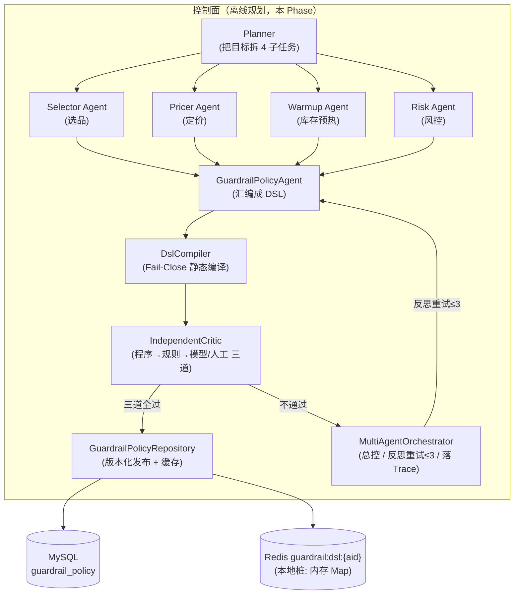
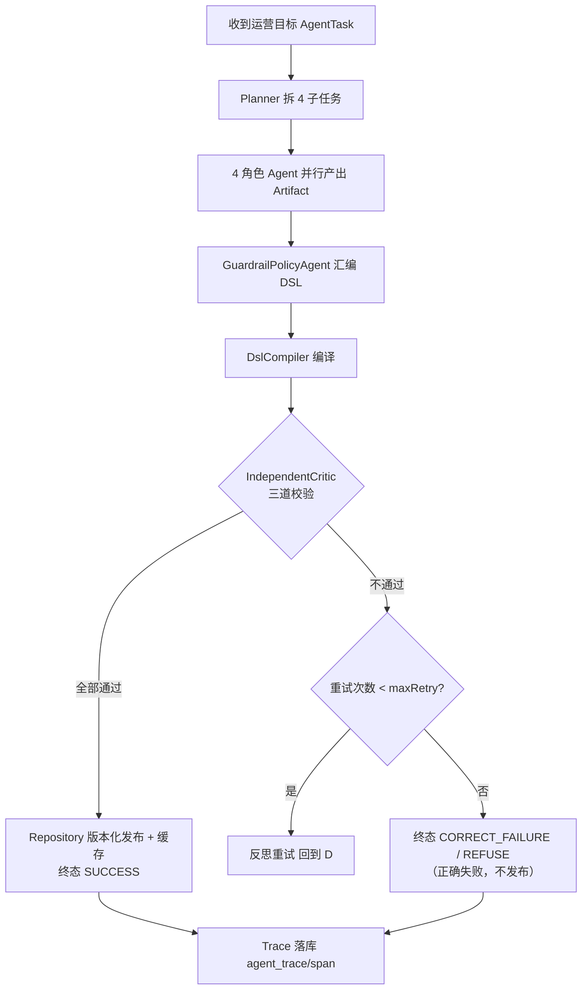

# Phase 8 — 多智能体离线规划（M4）

> ⚠️ **本章含选做进阶内容**：MultiAgentOrchestrator / RoleAgent / IndependentCritic / GoldenEvalHarness 属「多智能体编制」（选做1）。**主线只需**"一个 Planner 产出可上线 DSL"。多角色编排按需读 → [`选做1-多智能体编制.md`](选做1-多智能体编制.md) / [`00-学习路线.md`](00-学习路线.md)。

> 配套代码：`insightforge-agent-core/.../planning/`（新建包）+ `insightforge-persistence`（护栏表）。本 Phase 把 Phase 7 的「单 Agent 发动机」升级成「一支团队」：输入运营目标 → 多 Agent 分工产出 → 汇编成一份**护栏策略 DSL** → 编译校验 → 版本化发布并上架缓存。
> 全部代码已在仓库带逐行中文注释；本教程按「先搞懂 → 看架构 → 走读关键代码 → 自己跑一遍 → 排错」的顺序带你过一遍。

---

## 0. 先搞懂：这一 Phase 在解决什么（大白话）

前面 Phase 1–6 的秒杀是**确定性系统**：库存怎么扣、状态怎么流转，全是写死的代码。Phase 7 给了 Agent 一个「能调工具、会反思」的发动机。但现实里**一个运营目标**（比如「双11 美妆场 GMV 500 万、毛利不低于 30%」）需要**好几件事一起做**：选哪些 SKU 主推、定多少价、库存怎么预热调度、风控怎么告警。

让一个 Agent 一把梭会怎样？提示词爆炸、难维护、漏掉某一摊。**多智能体**就是「一个目标拆解给四个专员各管一摊，最后由一个汇编员拼成统一方案」。

另一个关键点：**AI 的想法必须变成一种"机器能校验、能版本化、能回滚"的东西，而不是直接让 AI 去改库存**。这件东西就是 **DSL（领域特定语言，大白话：一份结构化的「控盘规则清单」JSON）**。

> 🔑 一句话定位（项目灵魂复述）：本 Phase 的 Agent 跑在**控制面（离线规划）**，产出的是一份 DSL；它**绝不改库存/订单**——那属于 Phase 9 护栏规则引擎在线走同一套锁。**LLM 永不进秒杀热路径**。

---

## 1. 架构图：Phase 8 多智能体协作



**怎么读这张图**：`Planner` 把目标拆成「选品/定价/预热/风控」四个子任务 → 四个角色 Agent 各自产出一份产物（Artifact）→ `GuardrailPolicyAgent` 把它们**翻译**成统一的 DSL → `DslCompiler` 编译（编译不过就拦下）→ `IndependentCritic` 三道校验 → 全过才由 `Repository` 版本化发布并上架缓存；不通过就回到编排器反思重试，最多 3 次，耗尽则**正确失败（拒绝上线）**。

---

## 2. 动手前：planning 包结构一览

Phase 8 在 `agent-core` 里新建 `planning` 包，文件分工如下（每个都带逐行注释，这里只挑骨架）：

| 文件 | 角色（大白话） |
|---|---|
| `Metric` / `Operator` / `Action` | DSL 的「词汇表」：能比什么指标、用什么算符、能做什么动作（白名单） |
| `GuardrailRule` / `GuardrailPolicy` | DSL 的「纸张」：一条规则、一整份策略（record，天然不可变） |
| `DslCompileResult` | 编译结果（valid + 错误列表） |
| `DslCompiler` | **静态编译器**：编译不过 → Fail-Close 拦下 |
| `Role` / `SubTask` / `PlanningContext` | 角色枚举、子任务、规划上下文（成本底线等） |
| `RoleAgent` / `LocalRoleAgent` | 角色 Agent 接口 + 本地确定性桩（默认实现） |
| `GuardrailPolicyAgent` | 汇编器：把四个产物拼成 DSL |
| `PolicyCache` / `LocalPolicyCache` | 策略缓存接口 + 本地内存实现（生产换 Redis） |
| `GuardrailPolicyEntity` / `Mapper` / `Repository` | 持久化（MySQL 表 + MyBatis-Plus）与发布逻辑 |
| `IndependentCritic` | 独立验证器：三道校验 |
| `PlanningResult` / `MultiAgentOrchestrator` | 结果封装 + 总控编排器（灵魂） |

持久层：`insightforge-persistence` 新增 `guardrail_policy` 表（`GuardrailPolicyEntity` + `GuardrailPolicyMapper`）。

📖 **概念**：为什么用 `record`？Java 21 的 `record` 是不可变数据载体，天然适合「一份 DSL 产出后不应被偷偷改」——编译期就杜绝了手滑改字段。

---

## 3. 关键代码走读（带注释的核心）

### 3.1 DSL 长什么样：`GuardrailRule` / `GuardrailPolicy`

```java
// GuardrailRule.java —— 一条护栏规则（DSL 的最小单元）
public record GuardrailRule(
        String id,            // 规则唯一 id（编译期查重）
        Metric metric,        // 比什么指标：STOCK_RATIO / SALES_VELOCITY / PRICE_GAP ...
        Operator operator,    // 怎么比：GT / LT / GE / LE ...
        BigDecimal threshold, // 阈值（如 0.15 表示 15%）
        Action action,        // 做什么：REPRICE(调价) / REALLOCATE(调拨) / ALERT(告警)
        Map<String,Object> params) {}  // 动作参数（如 repriceTo=6299, costFloor=5999）

// GuardrailPolicy.java —— 一整份策略（一个活动一份）
public record GuardrailPolicy(Long activityId, String version, List<GuardrailRule> rules) {}
```

🧠 **理解一下**：DSL 就是「当指标 X 满足算符 Y 超过阈值 Z，就执行动作 A（带参数）」的规则清单。它**结构化、可编译、可版本化**——这是把 AI 的"想法"和"执行"解耦的关键。AI 只负责产出这份 JSON，真正执行是 Phase 9 的确定性规则引擎。

### 3.2 静态编译器 `DslCompiler`：编译不过就 Fail-Close

```java
// DslCompiler.java —— 两道确定性校验（能程序判定的绝不先问模型）
public DslCompileResult compile(GuardrailPolicy p) {
    List<String> errs = new ArrayList<>();
    // ① 结构校验：activityId/version/rules 合法；每条规则 id 唯一、metric/operator/action 在白名单、阈值非负
    if (p.rules() == null || p.rules().isEmpty()) errs.add("rules 为空");
    Set<String> ids = new HashSet<>();
    for (GuardrailRule r : p.rules()) {
        if (!ids.add(r.id())) errs.add("规则 id 重复: " + r.id());           // 查重
        if (r.metric() == Metric.INVALID) errs.add("指标非法");               // 白名单
        if (r.threshold() != null && r.threshold().compareTo(ZERO) < 0)
            errs.add("阈值非法（为负）");
        // ② 业务护栏（第二道）：调价不得低于成本价 / 库存不可透支
        if (r.action() == Action.REPRICE) {
            BigDecimal repriceTo = num(r.params(), "repriceTo");
            BigDecimal costFloor = num(r.params(), "costFloor");
            if (repriceTo.compareTo(costFloor) < 0)
                errs.add("售价 < 成本（违反『调价不得低于成本价』护栏）");
        }
        if (r.action() == Action.REALLOCATE) {
            BigDecimal amount = num(r.params(), "amount");
            if (amount.compareTo(ZERO) < 0)
                errs.add("再分配数量为负（违反『库存不可透支』护栏）");
        }
    }
    return errs.isEmpty() ? DslCompileResult.ok() : DslCompileResult.fail(errs);
}
```

📖 **概念**：**Fail-Close（失败即关闭）**——AI 抽风生成了 `售价5999<成本6999` 这种自杀式定价，编译器在「上线前」就拦下来，绝不发布到热路径。这是本项目对抗「LLM 幻觉」的核心纪律之一。

### 3.3 四个角色 Agent：`LocalRoleAgent`（本地桩）

```java
// LocalRoleAgent.java —— 默认本地确定性桩（不联网、不调真 LLM）
@Component @Primary
public class LocalRoleAgent implements RoleAgent {
    public Artifact run(SubTask task, PlanningContext ctx) {
        return switch (task.role()) {
            case SELECTOR -> Artifact.of("sel-"+task.activityId(), "selection",
                    Map.of("includeSkus", List.of(101,102), "stockRatioThreshold", 0.2));
            case PRICER -> {
                BigDecimal cost = ctx.costFloor();
                BigDecimal reprice = ctx.forceInvalid              // 演示用：故意低于成本
                        ? cost.subtract(BigDecimal.valueOf(500))
                        : cost.multiply(BigDecimal.valueOf(1.05)); // 正常：成本上浮 5%
                yield Artifact.of("price-"+task.activityId(), "pricing",
                        Map.of("repriceTo", reprice, "costFloor", cost));
            }
            case WARMUP -> Artifact.of("warm-"+task.activityId(), "warmup",
                    Map.of("reallocateAmount", 50, "targetSegment", "seg_hot"));
            case RISK -> Artifact.of("risk-"+task.activityId(), "risk",
                    Map.of("alertOnVelocityDrop", true));
            default -> null;   // 未知角色不产出（编排器记一次 invalidStep）
        };
    }
}
```

🧠 **理解一下**：为什么用确定性桩而不直接调 DeepSeek？沙箱无外网、无 Key，且教学要可复现。桩把「多 Agent 协作 / DSL 汇编 / 编译 / 发布 / 评估」整条管线**真实地**跑通——换真模型只是把 `LocalRoleAgent` 换成调 DeepSeek 的实现（`@Primary` 注解一改即可），接口不变。

### 3.4 汇编器 `GuardrailPolicyAgent`：把产物拼成 DSL

```java
// GuardrailPolicyAgent.java —— 只「翻译」，不「拍板」
public GuardrailPolicy assemble(PlanningContext ctx, Map<Role, Artifact> artifacts) {
    List<GuardrailRule> rules = new ArrayList<>();
    // 定价产物 → REPRICE 规则
    Map<String,Object> pm = LocalRoleAgent.asMap(artifacts.get(Role.PRICER));
    rules.add(new GuardrailRule("r_price", Metric.PRICE_GAP, Operator.GT, new BigDecimal("0.15"),
            Action.REPRICE, Map.of("repriceTo", bd(pm,"repriceTo"), "costFloor", bd(pm,"costFloor"))));
    // 预热产物 → REALLOCATE 规则（调拨只建新段由 Phase 9 热路径保证）
    Map<String,Object> wm = LocalRoleAgent.asMap(artifacts.get(Role.WARMUP));
    rules.add(new GuardrailRule("r_alloc", Metric.STOCK_RATIO, Operator.LT, new BigDecimal("0.2"),
            Action.REALLOCATE, Map.of("amount", bd(wm,"reallocateAmount"), "targetSegment","seg_hot")));
    // 风控产物 → ALERT 规则（只告警，不写共享状态）
    rules.add(new GuardrailRule("r_risk", Metric.SALES_VELOCITY, Operator.LT, new BigDecimal("5"),
            Action.ALERT, Map.of()));
    return new GuardrailPolicy(ctx.activityId(), "v?", rules);
}
```

### 3.5 独立验证器 `IndependentCritic`：三道校验 + 正确失败

```java
// IndependentCritic.java —— 不让原 Agent 自评，由独立 Critic 把关
public CriticVerdict verify(GuardrailPolicy policy, DslCompileResult compile) {
    // 第一道（程序）+ 第二道（规则）：确定性，直接采信 DslCompiler 结果
    if (!compile.valid()) return CriticVerdict.fail(compile.errors(), 0.98, "HIGH");
    // 第三道（模型/人工）：本地桩默认放行；requireHumanReview=true 模拟「需人工复核」
    if (requireHumanReview)
        return CriticVerdict.fail(List.of("需人工复核（高风险动作 / 低置信度）"), 0.6, "MEDIUM");
    return CriticVerdict.pass();
}
```

📖 **概念**：**正确失败率（Correct Failure Rate）**——AI 系统最怕「明明做不到却假装成功」。本项目把「编译不过 / 需人工复核」明确标记为 `CORRECT_FAILURE`，记入正确失败率，**绝不编造成功**。这是生产级 Agent 评估的红线（详见 `agent-observability-evaluation.md`）。

### 3.6 总控编排器 `MultiAgentOrchestrator`（灵魂）

```java
// MultiAgentOrchestrator.java —— plan() 的核心循环（省略日志/指标埋点）
public PlanningResult plan(AgentTask task) {
    // Planner 拆 4 子任务（这里四角色无依赖，并行产出）
    List<SubTask> plan = List.of(
        new SubTask(Role.SELECTOR,"选品",task.activityId()),
        new SubTask(Role.PRICER,"定价",task.activityId()),
        new SubTask(Role.WARMUP,"库存预热",task.activityId()),
        new SubTask(Role.RISK,"风控",task.activityId()));
    Map<Role,Artifact> artifacts = new LinkedHashMap<>();
    for (SubTask st : plan) artifacts.put(st.role(), roleAgent.run(st, ctx)); // 角色 Agent 产出

    GuardrailPolicy policy = policyAgent.assemble(ctx, artifacts);            // 汇编 DSL
    for (int attempt = 1; attempt <= maxRetry + 1; attempt++) {
        DslCompileResult compile = dslCompiler.compile(policy);
        CriticVerdict verdict = critic.verify(policy, compile);
        if (verdict.passed()) {                                              // 三道全过 → 发布
            GuardrailPolicy published = repository.publish(policy);
            return finish(... SUCCESS, published);
        }
        metrics.criticInterceptions().incrementAndGet();                     // L2 指标：拦截率
        if (tb.retryCount() < maxRetry) { tb.incRetry(); continue; }         // 反思重试
        return finish(... CORRECT_FAILURE, FailureKind.REFUSE, null);         // 耗尽 → 正确失败
    }
}
```

### 3.7 版本化发布 + 热更新缓存 `GuardrailPolicyRepository`

```java
// GuardrailPolicyRepository.java —— publish()：分配新版本 → 持久化 → 上架缓存
public GuardrailPolicy publish(GuardrailPolicy p) {
    GuardrailPolicyEntity latest = mapper.selectLatestByActivity(p.activityId());
    int next = (latest == null) ? 1 : parseVersion(latest.getVersion()) + 1; // 版本自增 v1/v2...
    GuardrailPolicy withVersion = new GuardrailPolicy(p.activityId(), "v"+next, p.rules());
    // ... insert 进 guardrail_policy 表 ...
    cache.put(p.activityId(), withVersion);   // 上架缓存（Phase 9 规则引擎 Worker 直接读它）
    return withVersion;
}

public GuardrailPolicy getLatest(Long activityId) {        // 先查缓存（秒级），未命中再查库回填
    GuardrailPolicy cached = cache.get(activityId);
    if (cached != null) return cached;
    // ... mapper 查库 → 反序列化 → 回填缓存 ...
}
```

📖 **概念**：**热更新**——新策略发布后立刻进缓存 `guardrail:dsl:{aid}`，Phase 9 的规则引擎 Worker 不用重启就能读到最新 DSL，实现「离线改策略、在线秒生效」。

### 3.8 最小 golden 评估集 `GoldenEvalHarness`

```java
// GoldenEvalHarness.java —— 把 golden 集跑一遍，逐条核对验收准则（Phase 11 评估闭环雏形）
public List<GoldenResult> runAll() throws Exception {
    for (GoldenCase c : loadCases()) {                 // 读 classpath:golden/phase8-cases.json
        AgentTask task = new AgentTask(c.activityId(), c.goal(), null);
        PlanningResult r = orchestrator.plan(task);
        boolean accept = accept(c, r);                  // 核对：SUCCESS 且含 REPRICE+REALLOCATE
        out.add(new GoldenResult(c, r.status(), r.published(), accept));
    }
    return out;
}
```

📖 **概念**：**golden 集（黄金评估集）**——一组「已知正确答案」的样本。每次改动后重跑，验证「以前能过的现在还能过」（防回归）。本项目 golden 集是 10 条正向 case（不同品类大促），Phase 11 会把失败样本也沉淀进来形成工程复利。

---

## 4. 验证：自己跑一遍

打开终端，进入仓库根（用 PowerShell 调 `mvn.cmd`，避免 Git Bash 的 MinGW 路径坑——见 phase7.md 排错表）：

```powershell
$env:JAVA_HOME='D:\devtools\jdk21\jdk-21.0.12+8'
$env:MAVEN_HOME='D:\devtools\maven\apache-maven-3.9.9'
cd D:\Java\insightforge
& "$env:MAVEN_HOME\bin\mvn.cmd" -B clean package
```

**期望输出（节选）**：

```
[INFO] Tests run: 22, Failures: 0, Errors: 0, Skipped: 0   <- agent-core（含 Phase 8 新增 13）
[INFO] Tests run: 25, Failures: 0, Errors: 0, Skipped: 0   <- api（Phase 1~6 回归看护）
...
[INFO] BUILD SUCCESS
[INFO] Total time:  ~25 s
```

**Phase 8 新增的 13 个测试**（5 个测试类）：

| 测试类 | 用例数 | 验什么 |
|---|---|---|
| `DslCompilerTest` | 8 | 编译两道校验：合法 / 空规则 / 未知 metric / 未知 action / 负阈值 / 售价<成本 / 负再分配 / 重复 id |
| `GuardrailPolicyRepositoryTest` | 2 | 版本自增 v1→v2 + 缓存命中 + 缺失返回 null |
| `MultiAgentOrchestratorTest` | 1 | happy 路径：SUCCESS + 发布 + 缓存命中 |
| `MultiAgentOrchestratorRejectTest` | 1 | 拒绝路径：forceInvalid → CORRECT_FAILURE（不发布） |
| `GoldenEvalHarnessTest` | 1 | golden 10 条正向 case 全 ACCEPTED |

> 全项目累计 **47 测试全绿**（api 25 + agent-core 22）。

---

## 5. 流程图：编排器一次运行的闭环



**怎么读**：无论成功还是正确失败，都会生成一条 `trace` 落库——可观测、可重放、可算正确失败率。这是「监测内建」的体现。

---

## 6. 排错表（本 Phase 真实踩过的坑）

| 现象 | 根因 | 解决 |
|---|---|---|
| 测试断言 `expected: <v1> but was: <v2>` | `MultiAgentOrchestratorTest` 用 `activityId=5`，而 `GoldenEvalHarness` 的 golden 集第 5 条也是 activityId=5；四个测试类配置相同，Spring 复用同一 `ApplicationContext` ⇒ 同一 H2 库被先占用 | 测试改用**独占 activityId**（555/888），版本号断言改为 `startsWith("v")` 且不硬编码绝对值 |
| 序列化 `InvalidDefinitionException: Java 8 date/time type java.time.LocalDateTime not supported` | `ObjectMapper` 默认不注册 JSR310 模块，序列化含 `createdAt` 的 Artifact 失败 | 改为只序列化 `a.content()`（Map，无日期）；不引入额外模块 |
| `Failed to load ApplicationContext` / `NoClassDefFoundError jakarta/websocket/Endpoint` | Phase 7 已遇：spring-ai 传递引入 spring-webflux，Boot 误判响应式 Web 应用 | `application-test.yml` 设 `spring.main.web-application-type: none`（沿用 Phase 7 根治方案） |

⚠️ **测试隔离提醒**：Spring Test 按「配置」缓存 ApplicationContext。相同 `@SpringBootTest(classes=...)` + `@ActiveProfiles` 的测试类**共享同一上下文/同一内存库**；带 `@TestPropertySource` 的配置会独立成新上下文。写测试时务必用互不冲突的 `activityId`，或断言「相对关系」而非绝对版本号。

---

## 7. 诚实边界（不虚报）

1. **角色 Agent 是确定性本地桩**（`LocalRoleAgent`），非真 LLM；但多 Agent 协作、DSL 汇编、编译、Critic 三道、版本化发布、缓存、golden 评估**全是真的**。生产换调 DeepSeek 的角色实现即可（`@Primary` 注解切换）。
2. **`PolicyCache` 是本地 `ConcurrentHashMap` 桩**（键 `guardrail:dsl:{aid}`），生产替换为 `RedisTemplate` 实现即接 Redis 热更新——接口已隔离，改动零侵入。
3. **`IndependentCritic` 第三道（模型/人工）是本地桩**：`require-human-review` 默认 false 直接放行；生产接模型评审或 HITL 界面（高风险动作如跨活动预算再分配必须人工 approve）。
4. **长期记忆 Milvus 仍是桩**（Phase 7 已说明），本 Phase 未启用。
5. **DSL→Drools 翻译** 在 Phase 9 做；本 Phase 的 `DslCompiler` 只负责「校验 + Fail-Close 门禁」。

---

## 8. 下一步预告（Phase 9 — 护栏规则引擎）

Phase 8 产出了「可上线的 DSL JSON」。Phase 9 把它真正落到**热路径**：

- 独立 `rule-engine` 模块消费 `sales.tick` 销量流 → 条件匹配 DSL → 输出 `REPRICE` / `REALLOCATE` 控盘指令；
- 调价/调拨**走与用户同一套 Redisson 锁**（0ms 超时让路），**调拨只建新段 `seg_{N+1}`**；
- 两阶段预留 `pending_stock`（补偿只删 pending 标记，绝不碰已售硬库存）；
- DSL→Drools 翻译 + 影子模式 + 历史回测（断言 oversell=0）。

一句话：Phase 9 让「AI 离线制定的策略」以**确定性、零 LLM 热路径**的方式，实时驱动百万级秒杀的库存写操作。

---

> 配套：本 Phase 验收已实跑通过（`mvn clean package` BUILD SUCCESS，47 测试全绿）。下一 Phase 见 `tutorials/phase9.md`。
