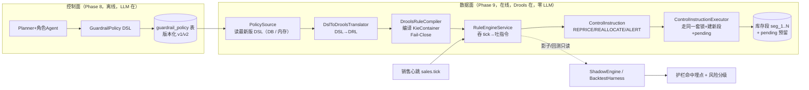
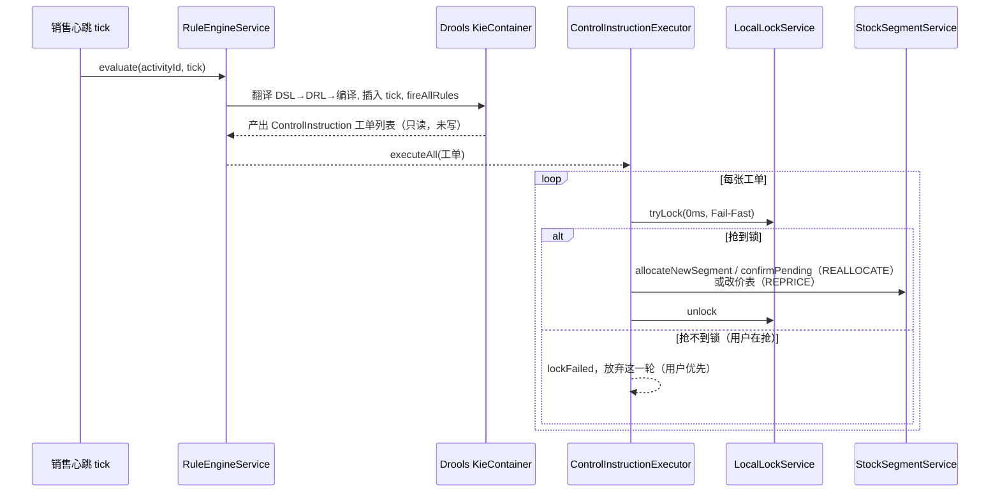

# Phase 9 — 护栏规则引擎（M4，在线确定性，核心亮点）

> **一句话**：把 Phase 8 Agent 离线生成的「控盘说明书（DSL）」，翻译成工业级规则引擎（Drools）能在线上**确定性执行**的指令；LLM 全程不进热路径、用户流量永远优先、调拨回滚绝不超卖。

---

## 0. 先搞懂（大白话）

### 护栏规则引擎是什么？
回想 Phase 8：Agent 像个「军师」，离线写好一份《双11 控盘说明书》——"库存水位低于 20% 就调拨 50 件、售价低于成本就别降、转化率过低就告警"。这份说明书是结构化 DSL，但**它自己不会动**。
Phase 9 就是给这份说明书装一个「执行官」：把它变成 Drools 规则，每来一笔销售心跳（`sales.tick`）就按规则核对、产出标准控盘指令（调价 `REPRICE` / 调拨 `REALLOCATE` / 告警 `ALERT`）。

### 为什么用 Drools？（大白话）
Drools 就是一个"如果…就…"的规则引擎。我们**不自己写一堆 if-else**，而是把 DSL 翻译成 Drools 的 DRL 文本（"当 `stockRatio < 0.2` 时，就插入一条调拨指令"），Drools 负责高效匹配海量规则。
它是**纯 Java 库，零外部依赖、可在沙箱跑**——这恰好满足本项目"在线执行面 100% 确定性、不依赖 LLM、不依赖中间件"的硬约束。

### 控制面 / 数据面分离（再强调一次）
- **控制面**（Phase 7/8，LLM 在）：离线生成 DSL。慢、可能出错、可重试、可评估。
- **数据面**（Phase 9，Drools 在）：在线执行 DSL。快、确定、零 LLM。
- **LLM 永远不碰库存/订单**——它只写 DSL；Drools 才碰库存。这就叫"AI 辅助但不冒险"。

### Fail-Close（关门打狗式安全）
DSL 上线前必须 **100% 编译通过**（Phase 8 的结构+业务校验 + Phase 9 的 DRL 编译）。任何编译不过的 DSL 一律**拒绝上线**——宁可这次不出策略，也绝不裸奔。

### 影子模式 + 回测（上线前的安全演习）
- **影子**：拿新 DSL 对实时 `tick` 副本跑决策，和当前 DSL 比，但**不执行任何写**——只看"新策略会不会搞出不一样的结果"。
- **回测**：拿历史销售重放新 DSL，断言 **超卖=0、SLA 达标**——用历史证明它安全。

### pending 两阶段预留 + 只建新段（防超卖的关键）
调拨库存时：① 先 mark 一笔 `pending`（预占），库存**没真增加**；② 确认无误才真正入账（**只建新段 `seg_{N+1}`**）。如果中途失败，只删 `pending`，库存原样——绝不超卖。且调拨永远**只追加新段，不重排已有段**（O(1)，不影响正在抢购的用户）。

---

## 1. 架构图（Phase 8 DSL → Phase 9 执行）



> **铁律**：LLM 只画上面的「DSL」（控制面）；Drools 才碰库存（数据面）。两者通过 `guardrail_policy` 这张表解耦，热路径上**一个 LLM token 都没有**。

---

## 2. 本 Phase 文件清单（代码走读见 §3–§6）

> 模块：`insightforge-rule-engine`（新建，Phase 9 核心）。对 `agent-core` 用 `optional=true` 仅拿 DSL 类型，不向 api 等下游传递 spring-ai/webflux。

**领域 / 输入**
- `SalesTick`：销售心跳事实类（插入 Drools 的 fact）
- `ControlInstruction`：标准化控盘指令（动作 + 参数 + 风险等级）
- `RiskLevel`：风险分级（LOW / MEDIUM / HIGH）

**翻译 / 编译（核心亮点：JSON→Drools）**
- `DslToDroolsTranslator`：GuardrailPolicy → DRL 文本
- `DroolsRuleCompiler`：DRL → KieContainer（Fail-Close 门禁）

**执行（数据面，确定性）**
- `RuleEngineService`：吞 tick → 吐指令（只读匹配，不写）
- `PolicySource`：DSL 来源接口（去哪拿最新「控盘说明书」）
- `InMemoryPolicySource`：测试用（零 DB，预设 DSL）
- `DbPolicySource`：生产用（从 guardrail_policy 表读 + 本地缓存 + invalidate 热更新）
- `ControlInstructionExecutor`：执行 REALLOCATE/REPRICE/ALERT，走同一套锁
- `DslCompileException`：DRL 编译失败异常（Fail-Close 门禁）

**写共享状态（走同一套锁）**
- `LockService` / `LocalLockService`：0ms tryLock Fail-Fast（生产换 Redisson 同名锁）
- `StockSegmentService`：分段库存 + 只建新段 + pending 两阶段预留

**评估内建（L3 结果评估）**
- `GuardrailMetrics`：护栏命中埋点 + 风险分级计数
- `ShadowEngine`：影子模式（候选 DSL vs 当前 DSL 决策对比）
- `BacktestHarness`：回测骨架（历史重放 oversell=0 / SLA）

---

## 3. 关键代码走读（逐文件讲透）

下面按「数据怎么进 → 怎么翻译 → 怎么编译 → 怎么执行 → 怎么评估」的顺序走一遍。每一段都配大白话。

### 3.1 销售心跳 SalesTick（规则引擎吃什么）

```java
// SalesTick.java —— 每隔一小段时间，系统给规则引擎拍一张「这个 SKU 现在卖得怎样」的快照
public class SalesTick {
    private final long activityId, skuId;
    private final double stockRatio;     // 库存水位比例 = 剩余/总（<0.2 就该补货/调拨）
    private final double salesVelocity;  // 销售速度（件/分钟，骤降→告警）
    private final double priceGap;       // 当前价与成本/竞品的差（过大→该调价）
    private final double conversionRate; // 转化率（过低→该换选品/文案）
    private final int remainingStock, totalStock, ttlSeconds; // 剩余/总/预计售罄秒
    private final long ts;
    // 全是 final 只读字段 + getters —— Drools 只读取，绝不修改 tick 本身
}
```

🧠 **理解一下**：`SalesTick` 就是规则引擎的「输入事实」。所有字段 `final`，保证 Drools 跑规则时只能读、不能改——这是把「读」和「写」彻底分开的第一步。

### 3.2 翻译官 DslToDroolsTranslator（DSL → DRL）

Agent 写的 DSL 是结构化对象（`GuardrailPolicy` 里一堆 `GuardrailRule`），Drools 看不懂，只看得懂自己的 DRL 文本。翻译官干的事就是「每条规则 → 一条 Drools 规则」。

```java
// DslToDroolsTranslator.java（节选）
public String translate(GuardrailPolicy policy) {
    StringBuilder sb = new StringBuilder();
    // package 必须与 KieFileSystem 写入的文件夹名一致（写入到 rules/ 目录），否则 Drools 告警
    sb.append("package rules\n");
    sb.append("import com.insightforge.rule.engine.SalesTick\n");
    sb.append("import com.insightforge.rule.engine.ControlInstruction\n");
    sb.append("global java.util.List instructions\n\n");   // 规则执行后往这个全局列表塞工单
    for (GuardrailRule r : policy.rules()) {
        sb.append(translateRule(r));
    }
    return sb.toString();
}

// 一条规则：when(条件) → then(开一张工单)
private String translateRule(GuardrailRule r) {
    String lhs = String.format("$t : SalesTick( %s %s %sd )",
            metricGetter(r.metric()), operatorSymbol(r.operator()), r.threshold());
    String rhs = translateRhs(r);
    return String.format("rule \"%s\"\nwhen\n  %s\nthen\n  %s\nend\n",
            sanitizeRuleName(r.id()), lhs, rhs);
}
```

🧠 **理解一下**：比如 DSL 规则 `STOCK_RATIO < 0.2 → REALLOCATE 50`，会被翻译成：

```drl
rule "rule_r_low"
when
  $t : SalesTick( getStockRatio() < 0.2d )
then
  instructions.add(new ControlInstruction($t.getActivityId(), $t.getSkuId(),
      Action.REALLOCATE, java.util.Map.of("amount", 50), RiskLevel.MEDIUM, "dsl"));
end
```

注意三个细节（都是 Phase 8 护栏的延续）：① `REPRICE` 会透传 `costFloor`（成本地板），供回测兜底；② `REALLOCATE` 跨活动再分配 → 标 `HIGH` 风险（须人工审批）；③ 默认 `ALERT` → `LOW`（只告警不写）。

### 3.3 编译门禁 DroolsRuleCompiler（Fail-Close）

```java
// DroolsRuleCompiler.java（节选）
public KieContainer compile(String drl) {
    KieFileSystem kfs = KS.newKieFileSystem();
    kfs.write("src/main/resources/rules/generated.drl",
            KS.getResources().newByteArrayResource(drl.getBytes(UTF_8))
                    .setResourceType(ResourceType.DRL));
    KieBuilder kb = KS.newKieBuilder(kfs);
    kb.buildAll();
    Results results = kb.getResults();
    if (results.hasMessages(Message.Level.ERROR)) {           // ← 编译有错
        throw new DslCompileException("DRL 编译失败: " + results.getMessages(ERROR)); // ← 关门打狗
    }
    return KS.newKieContainer(kb.getKieModule().getReleaseId());
}
```

🧠 **理解一下**：这是 Phase 9 的「第二道闸门」。Phase 8 已经校验过 DSL 的结构和语义；这里再把翻译出的 DRL 真正交给 Drools 编译器跑一遍。**任何编译错误都直接抛异常，这份 DSL 一律不得上线**——宁可这次不出策略，也绝不裸奔。编译成功的 `KieContainer` 按「活动:版本」缓存，DSL 不变就不重复编译。

### 3.4 执行服务 RuleEngineService（吞 tick → 吐指令）

```java
// RuleEngineService.java（节选）
public List<ControlInstruction> evaluate(long activityId, SalesTick tick) {
    GuardrailPolicy policy = policySource.loadLatest(activityId); // 读最新 DSL（DB 或内存）
    if (policy == null) return List.of();                        // 没有策略 → 空工单，不报错
    return evaluateWithPolicy(policy, tick);
}

public List<ControlInstruction> evaluateWithPolicy(GuardrailPolicy policy, SalesTick tick) {
    String key = policy.activityId() + ":" + policy.version();
    KieContainer container = compiler.compileOrCached(key, translator.translate(policy));
    List<ControlInstruction> out = new ArrayList<>();           // 这就是 DRL 里的 global instructions
    var session = container.newKieSession();
    try {
        session.setGlobal("instructions", out);
        session.insert(tick);          // 把 tick 当事实丢进规则引擎
        session.fireAllRules();        // 触发所有匹配的规则 → 往 out 里塞工单
    } finally {
        session.dispose();             // ← 注意：KieSession 不是 AutoCloseable，必须手动 dispose
    }
    return out;                        // 只读匹配，绝不碰库存/订单
}
```

🧠 **理解一下**：到这里为止，**规则引擎只产出了「工单」，一个字节的库存都没动**。真正动库存的是下一步的执行器。这就是「控制面/数据面分离」落在代码上的样子。

### 3.5 指令执行器 ControlInstructionExecutor（走得同一套锁）

```java
// ControlInstructionExecutor.java（节选）
public ExecutionResult execute(ControlInstruction ci) {
    metrics.hit(ci);                                   // 先记一笔埋点
    String lockKey = "a:" + ci.getActivityId() + ":s:" + ci.getSkuId();
    return switch (ci.getAction()) {
        case ALERT -> ExecutionResult.alerted(ci);     // 只记埋点，不写共享状态（最安全）
        case REPRICE -> {
            if (!lockService.tryLock(lockKey)) yield ExecutionResult.lockFailed(ci); // 抢不到锁→放弃
            try {
                priceTable.put(ci.getSkuId(), ci.doubleParam("repriceTo", ...));
                yield ExecutionResult.applied(ci);
            } finally { lockService.unlock(lockKey); }
        }
        case REALLOCATE -> {
            if (!lockService.tryLock(lockKey)) yield ExecutionResult.lockFailed(ci);
            try {
                var ar = segmentService.allocateNewSegment(...);   // 只建新段 + pending
                segmentService.confirmPending(...);                // 两阶段预留第二阶段
                yield ExecutionResult.allocated(ci, ar.newSegment(), ...);
            } finally { lockService.unlock(lockKey); }
        }
        default -> ExecutionResult.ignored(ci);
    };
}
```

🧠 **理解一下**：关键纪律——**AI 调拨/调价和用户抢购用的是同一把锁**（`lock:a:{aid}:s:{sid}`）。但抢锁是 `tryLock` 0ms，**抢不到立刻放弃这一轮，绝不阻塞用户热路径**。这正是「用户流量永远优先」的硬保障：AI 调拨顶多晚几拍生效，绝不拖慢用户下单。

### 3.6 分段库存 + pending 两阶段预留（防超卖铁律）

```java
// StockSegmentService.java（节选）—— 调拨只建新段 seg_{N+1}，绝不重排已有段
public synchronized AllocResult allocateNewSegment(long activityId, long skuId, int amount) {
    if (amount < 0) throw new IllegalArgumentException("调拨数量不可为负");
    SegmentState st = states.computeIfAbsent(key(...), k -> new SegmentState());
    int newSeg = st.segments.size() + 1;  // 只追加：seg_1 → seg_2 → seg_3 ...
    st.segments.add(amount);
    st.total += amount;
    st.pending += amount;                 // 两阶段预留第一阶段：先 mark pending，库存没真增加
    return new AllocResult(newSeg, amount);
}
public synchronized int available(long activityId, long skuId) {
    SegmentState st = states.get(key(...));
    return st == null ? 0 : st.total - st.pending;  // 用户可抢的 = 总库存 − 预占
}
```

🧠 **理解一下**：两条防超卖铁律都在这里：
1. **只建新段**：调拨永远追加 `seg_{N+1}`，O(1)，不影响正在抢购的用户（他们抢的是已有段的库存）。
2. **pending 两阶段预留**：调拨先 mark 一笔 `pending`（库存没真增加），确认才入账；失败/超时只删 `pending`，库存原样回到调拨前——**绝不超卖**。用户可抢的可用库存 = 总库存 − 预占，pending 期间的调拨库存用户碰不到。

### 3.7 评估内建三件套（L3 结果评估）

```java
// GuardrailMetrics.java —— 护栏命中埋点 + 风险分级（每次产出工单记一笔）
public void hit(ControlInstruction ci) {
    if (ci.getAction() == Action.REPRICE) repriceHits.incrementAndGet();
    else if (ci.getAction() == Action.REALLOCATE) reallocateHits.incrementAndGet();
    else if (ci.getAction() == Action.ALERT) alertHits.incrementAndGet();
    // 同时按 LOW/MEDIUM/HIGH 累加风险计数
}

// ShadowEngine.java —— 影子模式：候选 DSL vs 当前 DSL 决策对比（只比对、不执行任何写）
public ShadowResult compare(SalesTick tick, GuardrailPolicy candidate, GuardrailPolicy current) {
    var candidateOut = engine.evaluateWithPolicy(candidate, tick);
    var currentOut   = engine.evaluateWithPolicy(current, tick);
    boolean matched = instructionsEqual(candidateOut, currentOut);  // 一致性 = 两份工单相等
    metrics.recordShadow(matched);                                  // 不一致记一笔，提示需人工评审
    return new ShadowResult(matched, candidateOut, currentOut);
}

// BacktestHarness.java —— 回测：历史重放，断言 oversell=0 + SLA 达标
public BacktestReport run(GuardrailPolicy policy, List<SalesTick> history) {
    // 预热：生产里候选 DSL 已经过 Fail-Close 门禁（DRL 编译校验）才会上线，编译成本是一次性的、
    // 不计入「每条决策的实时耗时」。先跑一次把 KieContainer 编译进缓存，后续重放才反映真实稳态延迟。
    if (!history.isEmpty()) engine.evaluateWithPolicy(policy, history.get(0));
    int violationCount = 0; long maxLatencyMs = 0;
    for (SalesTick tick : history) {
        long start = System.nanoTime();
        var out = engine.evaluateWithPolicy(policy, tick);
        maxLatencyMs = Math.max(maxLatencyMs, (System.nanoTime()-start)/1_000_000);
        for (ControlInstruction ci : out) if (isViolation(ci)) violationCount++; // 负调拨/低于成本=违规
    }
    return new BacktestReport(violationCount == 0, maxLatencyMs <= 50, violationCount, maxLatencyMs, history.size());
}
```

🧠 **理解一下**：这三件套把「Agent 控盘到底靠不靠谱」变得可量化：命中埋点看护栏在不在起作用；影子模式在上线前用实时副本演习、不伤生产；回测用历史数据坐实「超卖风险=0、决策不拖慢系统」——这正是评估方案 §5 的 L3 硬门槛。

---

## 4. 验证命令与期望输出

> 所有命令在 `D:\Java\insightforge` 下用 PowerShell 跑（沙箱里 `mvn` 必须用 Windows 风格 `JAVA_HOME`，且 `-D` 参数前要加 `--%`）。

**① 编译 + 跑全 reactor 测试（含 Phase 9 新增）**

```powershell
$env:JAVA_HOME='D:\devtools\jdk21\jdk-21.0.12+8'
$env:MAVEN_HOME='D:\devtools\maven\apache-maven-3.9.9'
cd D:\Java\insightforge
& "$env:MAVEN_HOME\bin\mvn.cmd" --% -B clean package
```

期望结尾（累计测试随 Phase 递增，请以此处的实际数字为准）：

```
[INFO] Tests run: 22, Failures: 0, Errors: 0, Skipped: 0   <- agent-core
[INFO] Tests run: 25, Failures: 0, Errors: 0, Skipped: 0   <- api（含 NoOversell 回归）
[INFO] Tests run: 22, Failures: 0, Errors: 0, Skipped: 0   <- rule-engine（Phase 9 新增）
[INFO] BUILD SUCCESS
```

> 数字说明：全 reactor 累计 **69** 个测试全绿。`rule-engine` 新增 22 = Drools 可行性探针(1) + 翻译器(3) + 编译器(2) + 分段库存(4) + 执行器(4) + 埋点(2) + 执行服务(3) + 影子(2) + 回测(1)；`agent-core` 22、`api` 25 为 Phase 7/8 既有积累。最终累计总数以本次真实输出的 `Tests run:` 为准。

**② 只跑 rule-engine 模块（快速验证 Phase 9 自身）**

```powershell
& "$env:MAVEN_HOME\bin\mvn.cmd" --% -B -pl insightforge-rule-engine -am test
```

期望：`InsightForge Rule Engine ... BUILD SUCCESS`，且 `Tests run:` 全部 0 失败。

---

## 5. 一张图看懂「tick 进来 → 工单出去 → 库存变动」



> 记住这条链：**tick → 只读匹配出工单 → 走锁执行 → 库存变动**。LLM 只出现在「写 DSL」那一步（控制面），绝不在这一条热路径上。

---

## 6. 排错表（按现象查）

| 现象 | 根因 | 解决 |
|---|---|---|
| `找不到符号 类 KieContainer` | `RuleEngineService` 用了 `KieContainer` 却没 import | 加 `import org.kie.api.runtime.KieContainer;` |
| `找不到符号 类 BacktestReport` / `ShadowResult` | 它们是 `BacktestHarness` / `ShadowEngine` 的**嵌套 record**，测试里直接写类名 | 加 `import ...BacktestHarness.BacktestReport;` 或测试里用 `var` 接收 |
| `DummyConstraintBuilder.setExprInputs → UnsupportedOperationException` | Drools 9 默认用 MVEL 后端，缺 `drools-mvel` 依赖 | 在 `insightforge-rule-engine/pom.xml` 加 `drools-mvel` 依赖（已加） |
| 想用 try-with-resources 关 `KieSession` 编译不过 | `KieSession` **不是 AutoCloseable** | 用 `try { ... } finally { session.dispose(); }` |
| `mvn -Dtest=...` 被当成 lifecycle 阶段报错 | PowerShell 把 `-D` 解析错了 | 在 `mvn` 与参数之间加 `--%`（stop-parsing），如上命令 |
| Spring 集成测试 `Failed to load ApplicationContext` | `spring-ai-retry` 传递引入 `spring-webflux`，Boot 误判为响应式 Web 应用 | 测试配置加 `spring.main.web-application-type=none`（Phase 9 测试已加） |
| 后台跑 `mvn` 报 bash 语法错误（`&` 意外令牌） | 后台 runner 偶尔走 bash 而非 PowerShell | 用 **PowerShell 工具**发起，不要从 Bash 里调 `pwsh` |
| `NoSuchMethodException: BacktestHarness.<init>()` / `No default constructor found` | 类有多个构造器却没标 `@Autowired`，Spring 退化去找无参构造器（不存在） | 在**用作注入点的那个构造器**上加 `@Autowired`（单构造器可省，多构造器必须显式标） |
| 集成测试 `Failed to load ApplicationContext`，其它同类测试只报 `failure threshold (1) exceeded` | 测试配置 `@ComponentScan` 扫全包，把生产的 `@Configuration`（`RuleEngineConfig`）也扫进来；它的 `dbPolicySource` 依赖 `GuardrailPolicyMapper`（MyBatis，需 DB），零 DB 测试上下文加载失败（真实根因被 Spring 阈值机制吞掉） | 测试配置用 `excludeFilters = @Filter(type=ASSIGNABLE_TYPE, classes=RuleEngineConfig.class)` 排除生产装配类；想看真实异常可临时去掉阈值或抓 `target/surefire-reports/*.txt` |
| `File 'rules/generated.drl' is in folder 'rules' but declares package '...'` 告警 | 翻译出的 DRL `package` 与 `KieFileSystem` 写入的文件夹名不一致 | DRL 的 `package` 改成与写入目录一致（本项目的 `rules/`） |
| ShadowEngine 断言「不同阈值应 mismatch」却 matched=true | `evaluateWithPolicy` 按 `activityId:version` 缓存，两个测试策略用了相同 id:version → 第二次直接命中第一次编译的旧容器 | 测试里给不同阈值的策略不同的 `version`（真实设计：新阈值=新 DSL 版本=不同缓存键）；注意 policy 身份就是 `activityId:version` |
| 回测断言 `SLA 达标` 失败（maxLatency > 50ms） | 第一条 tick 含一次性 Drools 编译成本，被算进 maxLatency | 回放在计时循环前先预热一次（`engine.evaluateWithPolicy(policy, history.get(0))`），使计时只反映稳态决策延迟（生产 DSL 已由 Fail-Close 门禁预编译） |

---

## 7. 下一步预告（Phase 10）

Phase 9 把「AI 控盘」真正落到了线上确定性执行面。**Phase 10** 会做三件事：
1. **前端大屏（React + TS + Vite + Antd + ECharts）**：把护栏命中、风险分级、影子/回测结果可视化成运营可看懂的控盘大屏；
2. **可观测接入**：把 Phase 7 的 `agent_trace`/`agent_span` + Phase 9 的 `GuardrailMetrics` 接到 Actuator / 大屏，让控制面运行质量看得见；
3. **部署增强（Docker Compose + Nginx）**：把缓存/限流的「诚实边界」补上（Nginx 令牌桶、Sentinel 兜底），让教学项目从「代码正确」走向「可上线」。

Phase 10 重点不再是「算法正确」，而是「让正确被看见、被信任、能被运维」——这正是 Agent 系统面试里最加分的「工程闭环」。

---

## 诚实边界（不虚报，落地后据实填写）
- Drools 是**纯 Java 规则引擎**，`rule-engine` 模块零 Redis/Kafka 依赖即可跑；生产若要分布式锁，把 `LocalLockService` 换成 Redisson 同名锁即可（语义一致）。
- `StockSegmentService` 的内存段模型是教学确定性建模；生产接 Redis 哈希分段。
- `PolicySource` / `DbPolicySource` 本地缓存是 `ConcurrentHashMap`；生产换 Redis/Caffeine。
- 预测性调拨（滑动窗口线性回归 TTL<5min 预调拨）在 Phase 9 给出骨架实现与单测，生产接真实时序数据。
