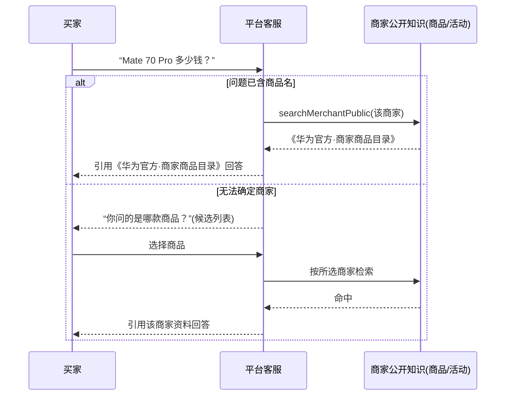
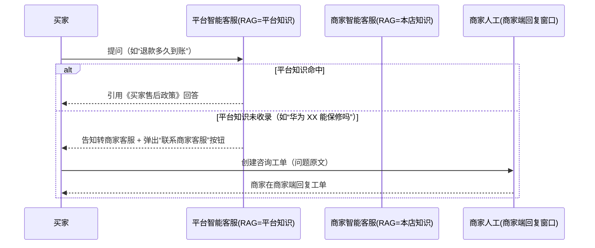

# 选做 9：客服与防幻觉架构（平台智能客服 → 商家智能客服 → 人工客服）

> 一句话定位：**客服的所有回答都必须能在知识库里找到出处；找不到就转人工，绝不编造。**
> 架构形态：平台智能客服（公共问题）→ 商家智能客服（本店问题，RAG 按商家隔离）→ 商家人工客服（商家端回复窗口）。

---

## 1. 为什么不能"每商家一个独立智能客服"

两种方案对比：

| 方案 | 成本 | 知识隔离 | 效果 |
|---|---|---|---|
| 每商家部署一个独立客服 Agent | 高：N 个服务/上下文/额度 | 物理隔离 | 隔离最好，但过度设计 |
| **共享客服引擎 + 按商家隔离的知识库**（本方案） | 低：一个服务，检索时带 merchantId | 逻辑隔离（metadata.merchantId 强制过滤） | 效果等同，运维简单 |

结论：**一个智能客服引擎，知识按"平台级 / 商家级 / 用户级"三层划分**，检索时按请求者身份取对应层。
我们已经在 Milvus 里给每块知识打了 `merchantId` 标签（0=平台，N=商家），Java 侧强制过滤，
天然支持"每个商家看到自己的知识"。

---

## 2. 三层知识库划分

| 层 | 内容 | 谁可见 | 检索身份 | 例子 |
|---|---|---|---|---|
| 平台级（merchantId=0） | 运营手册 / FAQ / 买家售后政策 | 所有用户+商家 | buyer 客服用 `merchantId=0` 检索 | 退货政策、发货时效、发票 |
| 商家级·公开（merchantId=N, PRODUCT/ACTIVITY） | 商品目录 / 活动规则 | 本店商家 + 买家客服**按需代理检索**（一次只查一个商家） | buyer 客服 `searchMerchantPublic(N)` | 商品卖点、秒杀价、库存说明 |
| 商家级·私有（merchantId=N, CUSTOM/DECISION） | 商家自定义知识 / 历史决策 | **仅本店商家** | 商家助手用 `merchantId=N` 检索 | 本店 SOP、内部复盘 |
| 用户级（不入向量库） | 订单 / 地址 / 售后工单 / 咨询工单 | 仅本人 | 结构化 SQL + 权限校验 | 我的订单、退款申请 |

**关键规则**：买家客服的 RAG 只取平台级；商家客服的 RAG 只取本店 + 平台级；
用户隐私永不进向量库。

---

## 3. 商家智能客服：平台客服按需代理检索

问题涉及具体商品时，平台客服**先确认是哪款商品（哪个商家）**，再代理检索该商家的
**公开知识**（商品/活动）回答；只有检索不到才转商家人工。

**隐私边界**：代理检索只能读商家"公开"知识（商品/活动）；商家自定义文档、决策等
私有知识对买家不可见，与商品详情页公开原则一致。

---

## 4. 知识冲突处理（平台 vs 商家）

规则：**商家具体信息优先回答，但平台红线永远优先**。

| 场景 | 处理 |
|---|---|
| 商家商品信息 vs 平台通用政策 | 回答用商家具体信息（价格/库存/卖点），政策作补充 |
| 商家说明违反平台红线（退款时效、价格下限、禁售） | **以平台政策为准**，并在回答中指出差异 |
| 多商家同名/相似商品 | 必须先锁定单一商家再检索，绝不混用 |

落地：prompt 注入顺序为"商家公开知识在前、平台知识在后"，并显式指令：
“若商家说明与平台政策冲突，以平台政策为准并指出差异”。

---

## 5. 上下文与商家切换

对话上下文**按商家绑定**，防止"上一个问题的商家 RAG 回答下一个商家的问题"：

1. **每轮重新锁定**：从问题文本识别商品名 → 归属商家；识别不到且是追问
   （“那库存呢”“价格呢”等短句/指代）→ 沿用上一轮商家；
2. **提到别家商品立即切换**：新问题出现另一商家商品名 → 本轮 RAG 只检索新商家，
   历史里上一商家的内容不参与检索（只保留为聊天历史文本）；
3. **检索与回答隔离**：当前轮 prompt 只注入"当前商家公开知识 + 平台知识"，
   模型被明确告知"只使用当前问题对应商家的资料"。

落地：`BuyerAssistantService` 维护 `lastMerchantByUser` 会话上下文，
`resolveMerchant()` 每轮做商品→商家锁定；商品候选选择后以
`【商家名】商品名，原问题` 重发，完成上下文切换。

---

## 3. 防幻觉五道防线

1. **检索即依据**：回答前先检索，命中片段拼进 prompt，要求"仅依据【知识库参考】与【订单数据】回答"。
2. **引用溯源**：回答必须标注《来源》标题（如《买家售后政策》），拿不出来源就不断言具体条款。
3. **无命中兜底**：检索为空且非订单类问题 → 固定话术"知识库未收录，转人工客服"，**不编造答案**。
4. **数字走结构化**：订单金额/库存/状态只来自 SQL 查询结果，LLM 只能复述不能计算发明。
5. **相似度阈值（可选）**：生产可配置 `min-score`，低于阈值的检索片段视为不可靠（默认关闭，
   避免误伤弱相关命中；文档在此说明启用方式）。

---

## 4. 消息流转：用户 → 平台客服 → 商家客服/人工

**商家智能客服何时出现**：咨询工单创建后，商家可以选择让商家侧 Agent 先草拟回复
（基于本店知识库检索）再人工确认发送——与商家助手的"动作批准"同一套 HITL 哲学。

---

## 5. 用户侧 / 商家侧客服的知识边界

| 端 | 提问者 | 可访问知识 | 不可访问 |
|---|---|---|---|
| 买家客服（/user/support） | 买家 | 平台级知识 + 本人订单/工单 | 任何商家私有知识、他人订单 |
| 商家客服（/merchant/agent） | 商家 | 平台级知识 + 本店知识 + 本店订单 | 其他商家知识、买家隐私 |
| 商家人工（/merchant/support） | 商家 | 本店咨询工单 | 其他商家工单 |

---

## 6. 退款策略的归属

退款/售后规则属于**平台统一策略**（《买家售后政策》，平台级知识），所有买家客服回答同一套标准；
商家可以在自己的知识库补充**店铺级附加说明**（如"本店 30 天保价"），但商家级知识买家客服不检索——
避免商家自定义话术与平台政策冲突。退款**执行**走售后工单（用户级，真实闭环）。

---

## 7. 落地对照（Phase 19f + 19g）

- ✅ 平台级 RAG（FAQ/售后政策/运营手册）供买家客服检索
- ✅ 商家级 RAG（商品/决策/活动/自定义）供商家助手检索，严格商家隔离
- ✅ 用户级订单/售后工单走 SQL 仅本人
- ✅ 退款工单（AI 预填草稿 → 用户确认提交 → 状态流转）
- ✅ 咨询工单（support_ticket）：平台客服答不了 → 转商家（弹出商家选择）→ 商家端回复窗口（/merchant/support）→ 买家查看/关闭
- ✅ 防幻觉强化：买家/商家 system prompt 强制"仅依据参考资料 + 引用来源 + 无命中转人工"；
  买家侧代码级兜底——知识库无命中时不再调用 LLM，直接返回转人工话术（杜绝编造）
- ✅ 商家智能客服：平台客服按需代理检索指定商家的公开知识（商品/活动），无法锁定商家时返回商品候选让用户选择
- ✅ 冲突处理：商家具体信息优先 + 平台红线优先，prompt 显式指令并在回答中指出差异
- ✅ 上下文商家切换：每轮商品→商家锁定，追问沿用、提到别家立即切换，RAG 只检索当前商家
